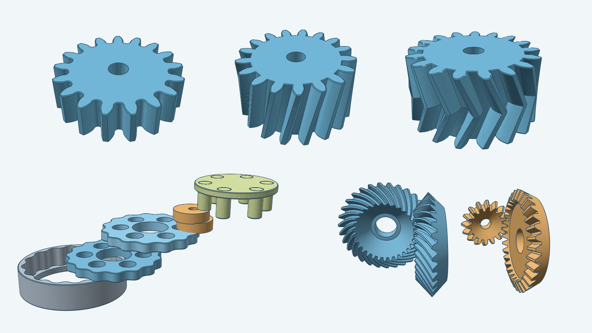

# decad gallery

A gallery of parametric 3D shapes, patterns, and assemblies built with
[decad](https://github.com/lestrrat-3d/decad). Each model is a solid body whose dimensions come from
inputs such as tooth count, thickness, and bore. Items may use geometry from other items, so a gear can
become part of a hand-crank siren or a wind turbine.

## Models

The [models](models/) include spur, helical, herringbone, bevel and screw gears, a cycloidal drive,
and a [treadle spinning wheel](models/spinningwheel/) with a flyer and bobbin.
Each model's page shows rendered images and lists the inputs you can change.

Every model directory holds two specification files. `instructions.md` states the inputs and defaults,
units, derived values, geometric construction, feature order, valid parameter range, and representative
cases. `steps.md` maps each construction requirement to a Sketch or Decad operation and names the geometry
check at each boundary.

## For developers

The [docs](docs/) explain how the models are built, how to add one, and how the images are rendered. The
[repository layout and checks](docs/repository.md) page lists what lives where.

[`fusion360-gear-generator`](https://github.com/lestrrat-3d/fusion360-gear-generator) translates the Go
construction into Python code for Fusion add-ins.

## License

This repository uses the [PolyForm Noncommercial License 1.0.0](LICENSE).
