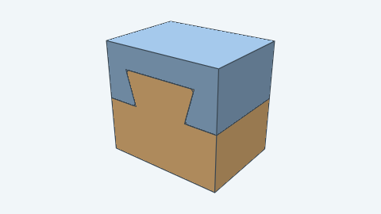

# Features

A feature is a reusable shape that cuts or adds material on parts that other items own, such as a joint between two
boards. It makes no part of its own, so it is not a gallery model. See [Features](../docs/features.md) for the rules
and [Models](../models/) for the finished products.

| Feature | Image | Description | Build status |
| --- | --- | --- | --- |
| [Dovetail joint](dovetail/) |  | A straight sliding dovetail: a tapered tail added to one host and a socket of the same outline cut into another, with the slope, width, length, depth and tail side as inputs. | Not built yet |
