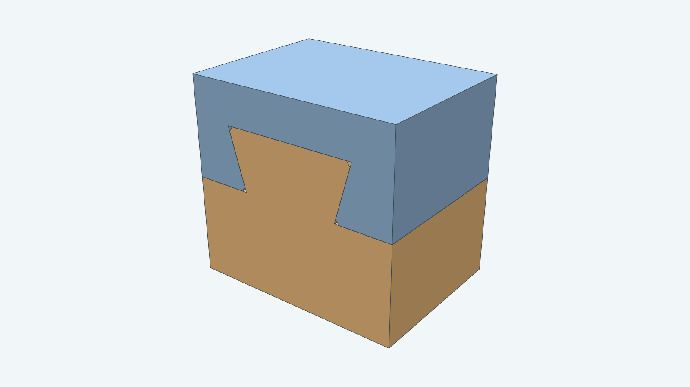
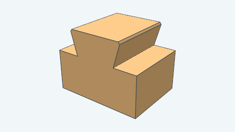
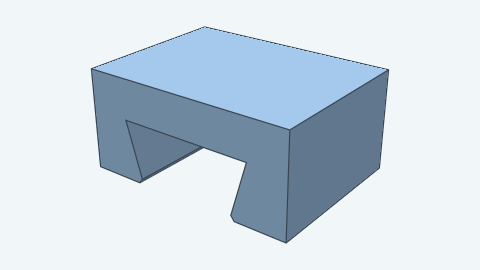
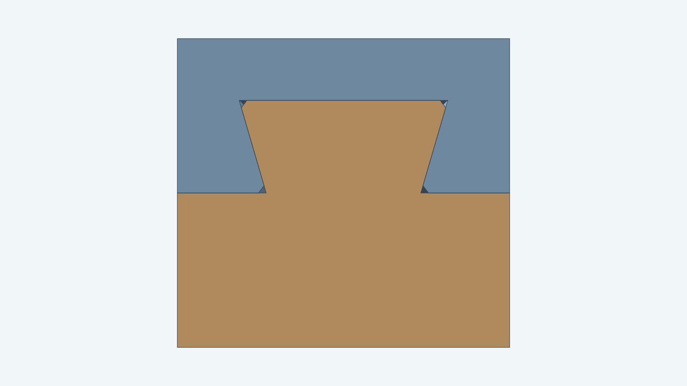
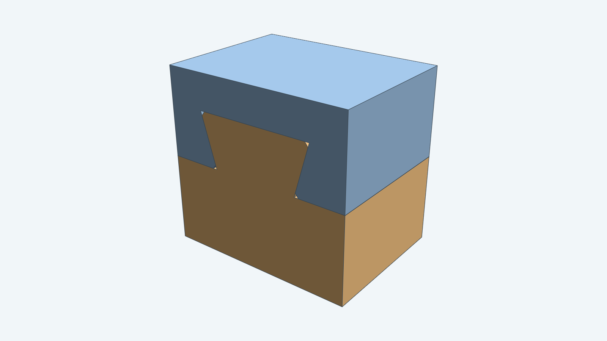
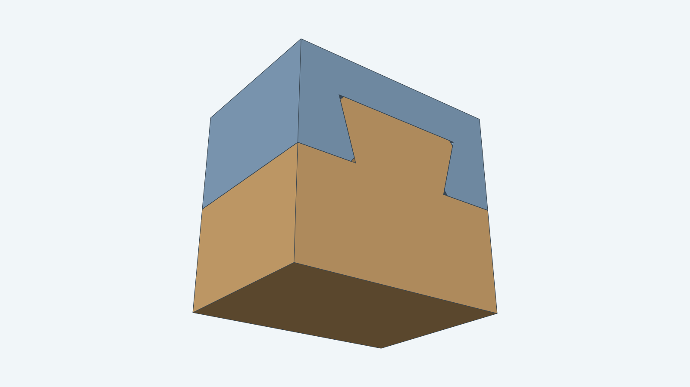
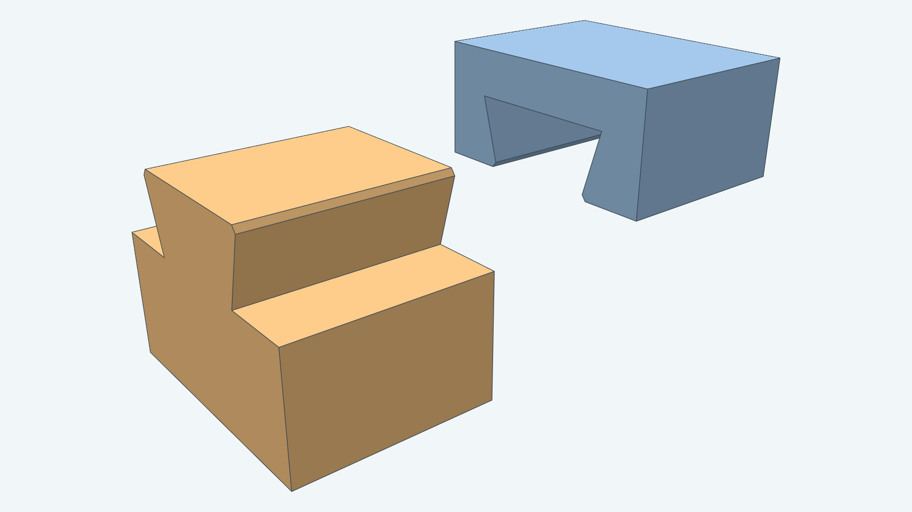

# Dovetail joint

**Build status:** Not built yet.

A feature is a reusable shape that cuts or adds material on parts that other items own. This one is a straight
sliding dovetail. It adds a tapered tail to one host body and cuts a socket of the same outline into another, so the
two slide together along one direction and cannot be pulled apart across it. Both halves are built from one set of
parameters, so they match exactly.

The tail's two wide-end corners and the socket's two lips are chamfered 0.50048828125 mm along the whole joint, a hair
over the usual 0.5 mm so that the chamfer lands on exact coordinates. The two concave corners of each half stay sharp,
so a chamfer meeting a sharp mate leaves only a small void and the flanks still touch. The tail and its host share one
end face at each end of the joint, with no line between them.

The halves are built at exact nominal size. The tail and the socket touch with no gap, so a printed pair needs a fit
clearance before it will slide. The clearance is defined separately and is not part of this feature yet.

**Clearance adjustment:** Nominal. There is no clearance parameter.

You can change the tail width at its narrow end (10 mm by default), the flank slope (7:24, which leans 16.26 degrees, from a list of 14 allowed slopes), the
joint length (16 mm), the depth (6 mm, a multiple of 3 mm times a power of two at 7:24) and which block carries the tail.

## Demo blocks

The demo joins two plain blocks, which are test fixtures and not printed parts. Their own edges have no chamfer. Each is 21.5 mm wide, 16 mm long and
10 mm tall at the defaults. The tail rises 6 mm from the first block into the second, which is the tail's socket.

| Block | Image | Holds |
| --- | --- | --- |
| Tail block |  | The tail on its face. Orange in the images. |
| Socket block |  | The socket cut through its length. Blue in the images. |

## Views

The end view looks along the slide direction at the dovetail profile, with the four chamfers at the tail's wide end
and the socket's lips.

The rear view shows the other end and side of the joint.

The underside view shows the tail block's flat bottom and the socket block's far end.

## Exploded view

The exploded view pulls the two blocks apart along the slide direction: the tail block 15 mm one way and the socket
block 15 mm the other.

For the Go API, the build command and the geometry checks, see the [developer notes](../../docs/features/dovetail.md).
