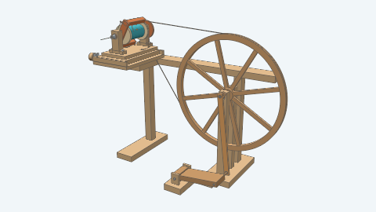
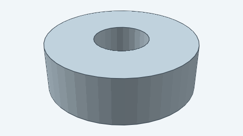
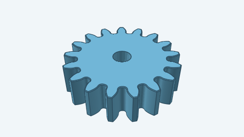
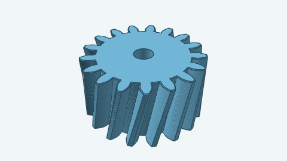
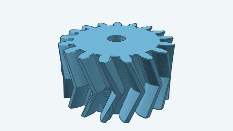
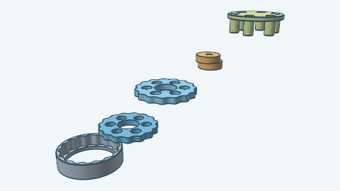
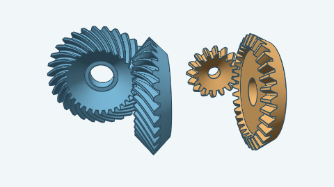
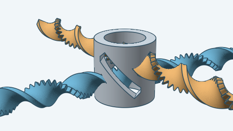
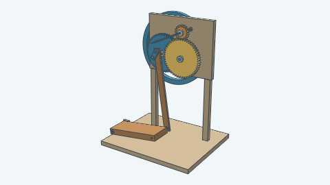

# Models

| Model | Image | Description |
| --- | --- | --- |
| [Treadle spinning wheel](spinningwheel/) |  | A single drive band turns a hollow flyer around an independently rotating bobbin with a Scotch brake. |
| [Ball bearing envelope](ballbearing/) |  | A purchased bearing's nominal bore, outside diameter and width for fitting an assembly. |
| [Spur gear](spurgear/) |  | A straight-toothed involute gear with optional bore and cap chamfers. |
| [Helical gear](helicalgear/) |  | An involute gear with teeth twisted along its axis. |
| [Herringbone gear](herringbonegear/) |  | An involute gear with mirrored tooth slopes that meet at its midpoint. |
| [Cycloidal drive](cycloidal/) |  | A cycloidal speed reducer with one or two lobed discs, a pinless housing, and an output plate. |
| [Bevel gear pair](bevelgear/) |  | Two meshing gears whose shafts meet at an angle. |
| [Screw gear](screwgear/) |  | Two twisted toothed ribbons that run through a windowed sleeve and move one another one tooth for one tooth. |
| [Pedal yarn spindle](pedalspindle/) |  | A foot treadle and two spur gear stages turn a horizontal quill at nine times the crank speed. |

To add a model, see [adding a model](../docs/adding-models.md).
