# Models

| Model | Image | Description | Clearance adjustment | Build status |
| --- | --- | --- | --- | --- |
| [Ball bearing envelope](ballbearing/) | 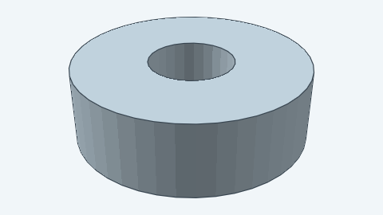 | 608-2RS, 608ZZ and 605ZZ nominal bore, outside diameter and width for fitting an assembly. | Nominal | Built |
| [Bevel gear pair](bevelgear/) | 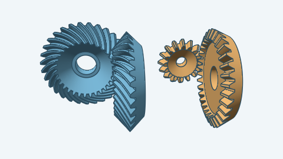 | Two meshing gears whose shafts meet at an angle. | Adjustable | Built |
| [Crank handle](crankhandle/) | 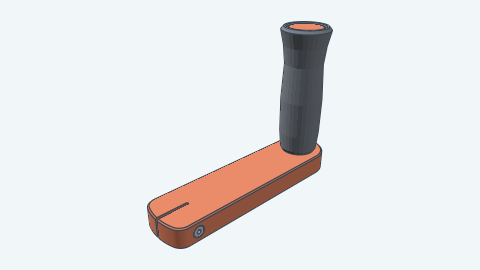 | The hand-crank siren's crank: an arm that pinches a D-flat shaft with a slit and a bolt across its hub, and a handle that turns on a bolted pin printed as two halves clamped by cross bolts, with presets for the 5 mm shaft of a 605ZZ and the 8 mm shaft of a 608-2RS bearing. | Mixed | Built |
| [Cycloidal drive](cycloidal/) | 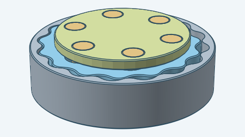 | A cycloidal speed reducer with one or two lobed discs, a pinless housing, eccentric cam and output plate. | Adjustable | Built |
| [Graham escapement](escapement/) | 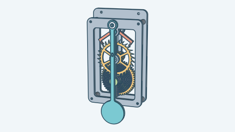 | A spring-driven clock movement: a 30-tooth escape wheel, a deadbeat anchor, a crutch and a pendulum, with an open spiral mainspring, in an open, symmetric two-plate frame on seven 605ZZ bearings, with the mechanism in view from the front and the back. | Mixed | Not built yet |
| [Hand-crank fan](handcrankfan/) | 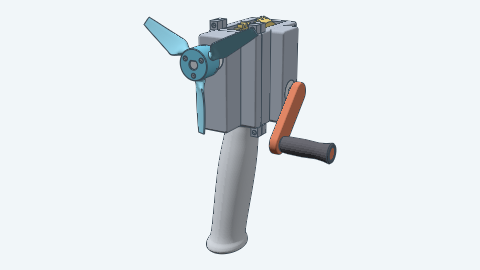 | A handheld fan whose right-hand crank drives a three-blade turbine fan rotor (swappable blades, a set screw on a D-flat shaft) through a spur pair and a bevel gear pair. | Mixed | Not built yet |
| [Hand-crank siren](handcranksiren/) | 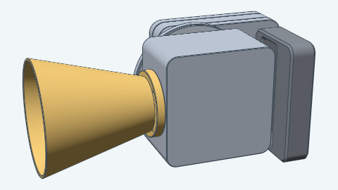 | A hand crank spins a slotted rotor ten times faster through two spur stages; 20 ports chop the air into a 400 Hz tone at two crank turns a second. | Mixed | Not built yet |
| [Helical gear](helicalgear/) | 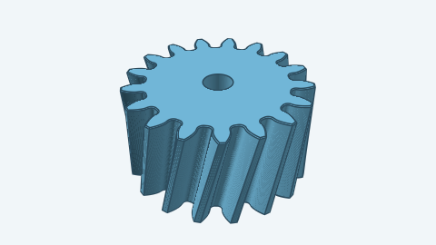 | An involute gear with teeth twisted along its axis. | Adjustable | Built |
| [Herringbone gear](herringbonegear/) | 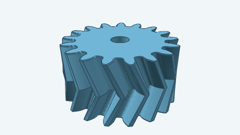 | An involute gear with mirrored tooth slopes that meet at its midpoint. | Adjustable | Built |
| [M2 bolt](m2bolt/) | 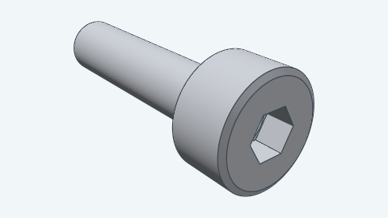 | An M2 socket head cap screw with a hex socket and a length you choose. | Nominal | Built |
| [M2 nut](m2nut/) | 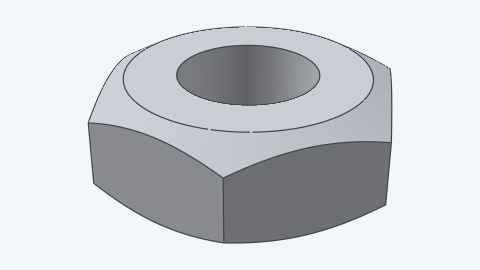 | An M2 hex nut that fits the M2 bolt. | Nominal | Built |
| [One-way clutch](onewayclutch/) | 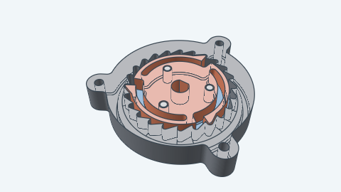 | A printed one-way clutch for a D-flat shaft: a hub with three flexing pawls, a 38.2 mm ring with 18 internal teeth and three bolt ears, a back plate and a cover, clamped by three M2 x 16 bolts into nuts in hex pockets, and a separate adapter ring with a 7 mm bore (10 mm on the 8 mm presets) that bolts to the ears with three M2 x 25 bolts and takes a part on three face holes, with the freewheel direction and the shaft preset (605ZZ, 608ZZ, 608ZZ-gearbox) as inputs. | Mixed | Built |
| [Pin ring](pinring/) | 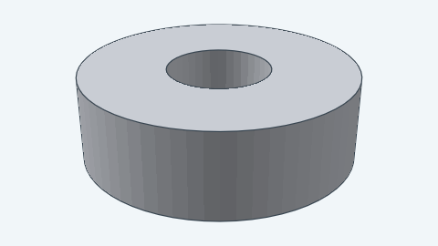 | An assembly aid (jig): a plain flat ring that sits on a pin to hold it in place while you assemble. | Adjustable | Built |
| [Planetary gearbox](planetarygearbox/) | 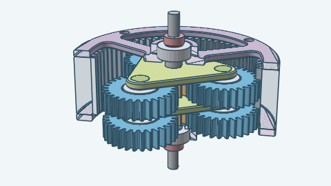 | A stackable planetary speed reducer: a sun gear, three planets and a carrier inside a fixed internal ring gear. | Mixed | Built |
| [Screw gear](screwgear/) | 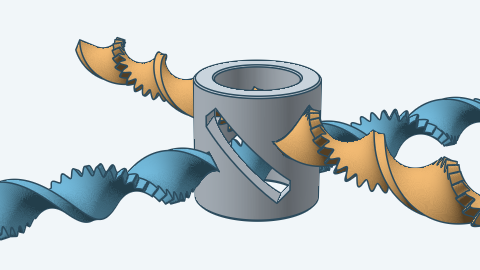 | Two twisted toothed ribbons that run through a windowed sleeve and move one another one tooth for one tooth. | Adjustable | Built |
| [Spiral spring](spiralspring/) | 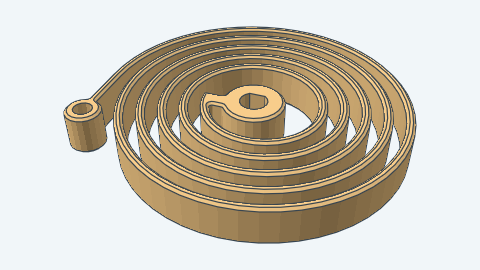 | A flat spiral (clock) spring for wind-up mechanisms, with a D-bore hub and an anchor eye, sized by its relaxed outer diameter. | Adjustable | Not built yet |
| [Spur gear](spurgear/) | 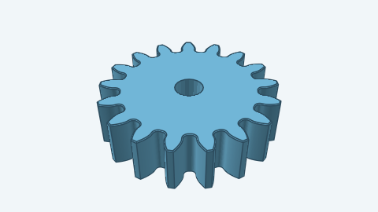 | A straight-toothed involute gear with optional bore and cap chamfers. | Adjustable | Built |
| [Swiss lever escapement](swisslever/) | 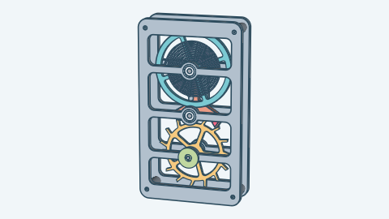 | A hand-turned watch-style escapement: a 15-tooth club-tooth escape wheel, a lever with a fork, a dart and two pallet stones, and a balance with an impulse pin, a safety roller and a printed hairspring, in an open two-plate frame on six 605ZZ bearings. | Mixed | Not built yet |
| [Treadle spinning wheel](spinningwheel/) | 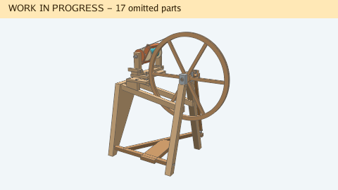 | A single drive band turns a hollow flyer around an independently rotating bobbin with a Scotch brake. | Mixed | Not built yet |
| [Turbine fan](turbinefan/) | 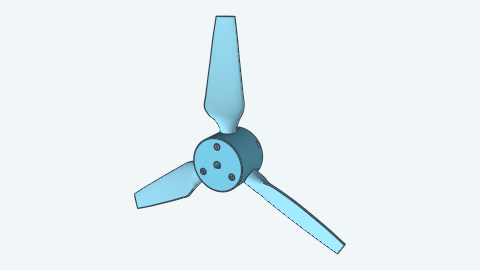 | A three-blade fan with turbine-shaped blades that each bolt into a round hub, so a blade can be swapped, in a right-hand and a left-hand version; an M2 set screw holds the hub on a D-flat shaft, with presets for the 5 mm shaft of a 605ZZ and the 8 mm shaft of a 608ZZ bearing; the same hub also bolts to the one-way clutch's adapter ring so the fan coasts. | Mixed | Not built yet |

Build status says whether someone has made the model as a physical object and tested it.
Clearance adjustment labels follow the [model fit rules](../docs/model-pipeline.md#part-clearances).
Nominal components keep their published dimensions; adjust the custom mating part to provide the required gap.

To add a model, see [adding a model](../docs/adding-models.md).
