# Models

| Model | Image | Description | Clearance adjustment |
| --- | --- | --- |
| [Treadle spinning wheel](spinningwheel/) | 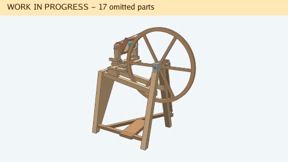 | A single drive band turns a hollow flyer around an independently rotating bobbin with a Scotch brake. | Mixed |
| [Ball bearing envelope](ballbearing/) | 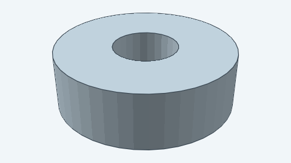 | 608-2RS and 605ZZ nominal bore, outside diameter and width for fitting an assembly. | Nominal |
| [Spur gear](spurgear/) | 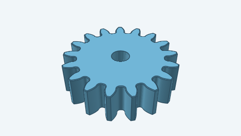 | A straight-toothed involute gear with optional bore and cap chamfers. | Adjustable |
| [Helical gear](helicalgear/) | 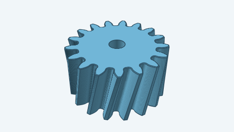 | An involute gear with teeth twisted along its axis. | Adjustable |
| [Herringbone gear](herringbonegear/) | 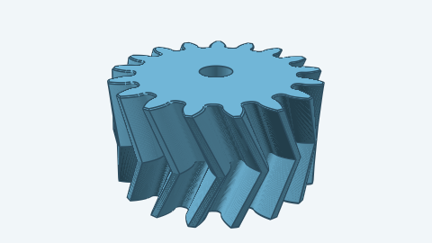 | An involute gear with mirrored tooth slopes that meet at its midpoint. | Adjustable |
| [Planetary gearbox](planetarygearbox/) | 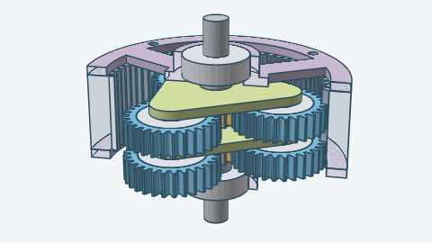 | A stackable planetary speed reducer: a sun gear, three planets and a carrier inside a fixed internal ring gear. | Mixed |
| [Cycloidal drive](cycloidal/) | 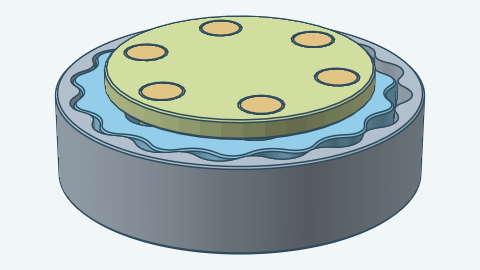 | A cycloidal speed reducer with one or two lobed discs, a pinless housing, eccentric cam and output plate. | Adjustable |
| [Bevel gear pair](bevelgear/) | 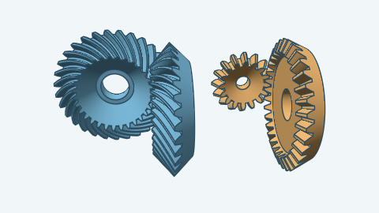 | Two meshing gears whose shafts meet at an angle. | Adjustable |
| [Screw gear](screwgear/) | 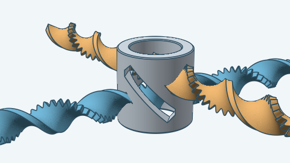 | Two twisted toothed ribbons that run through a windowed sleeve and move one another one tooth for one tooth. | Adjustable |
| [M2 bolt](m2bolt/) | 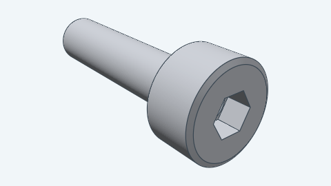 | An M2 socket head cap screw with a hex socket and a length you choose. | Nominal |
| [M2 nut](m2nut/) | 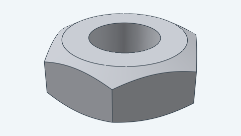 | An M2 hex nut that fits the M2 bolt. | Nominal |

Clearance adjustment labels follow the [model fit rules](../docs/model-pipeline.md#part-clearances).
Nominal components keep their published dimensions; adjust the custom mating part to provide the required gap.

To add a model, see [adding a model](../docs/adding-models.md).
