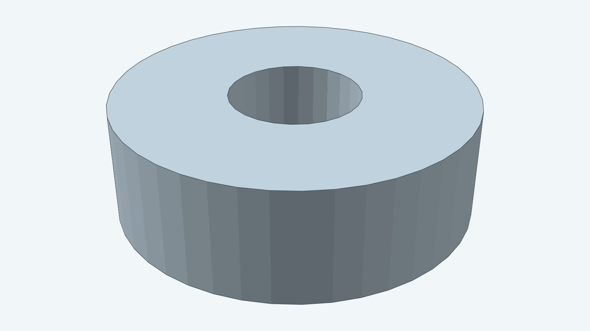
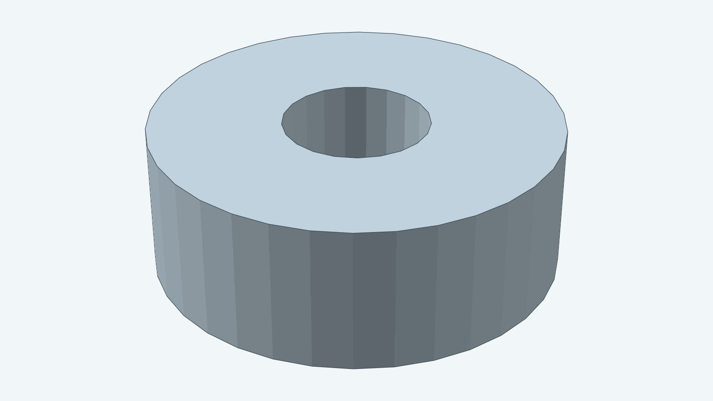

# Ball-bearing mounting envelope

This model gives a purchased 608-2RS bearing's nominal mounting envelope: an 8 mm bore,
22 mm outside diameter and 7 mm width. Assemblies can import the construction to position
the bearing, check shaft alignment and reserve housing space.
The dimensions come from [JTEKT's 608 2RS catalogue](https://www.jtekt.co.jp/products/bearing/en/p/detail/?pno=608+2RS).

**Clearance adjustment:** Nominal. Keep the purchased bearing dimensions and adjust custom mating geometry.

The rendered annulus is the occupied envelope. It does not depict separate races, balls, seals or cage.
Use the purchased bearing as the rolling component. The model does not establish running clearance,
shaft or housing fits, bearing life, load capacity or fastening details.
For a tight-fitting bearing seat in a 3D-printed part, chamfer the hole entrance so the bearing can
be pressed in.

You can change the bore diameter, the outside diameter and the width for other nominal sizes. Catalogue
bearings should keep their specified dimensions rather than scaling with the assembly.

## 605ZZ preset

The 605ZZ preset selects a 5 mm bore, 14 mm outside diameter and 5 mm width, as listed in
[EZO's 605ZZ catalogue](https://www.ezo-brg.co.jp/english/product/spec.php?eid=00529).
The default preset and hero image show the 608-2RS envelope.

## 608ZZ preset

The 608ZZ preset selects an 8 mm bore, 22 mm outside diameter and 7 mm width. A 608ZZ has a metal shield where
a 608-2RS has a rubber seal, and both have the same outline, so this is the same envelope as the default and
has no image of its own. Use it where a design calls for a 608ZZ by name, such as the
[planetary gearbox](../planetarygearbox/), which presses one into each planet gear.

For how to build this envelope from Go, see the [developer notes](../../docs/models/ballbearing.md).
