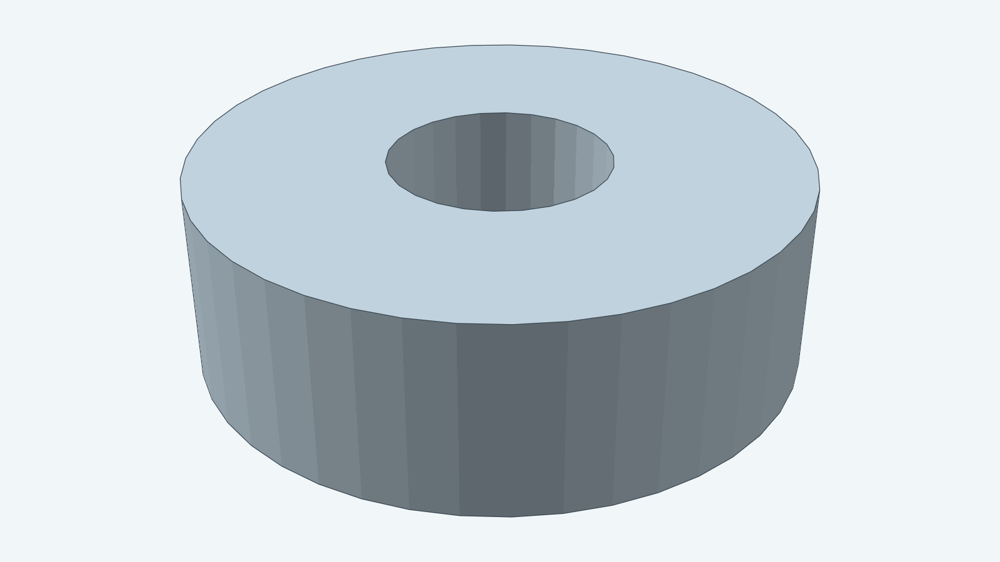
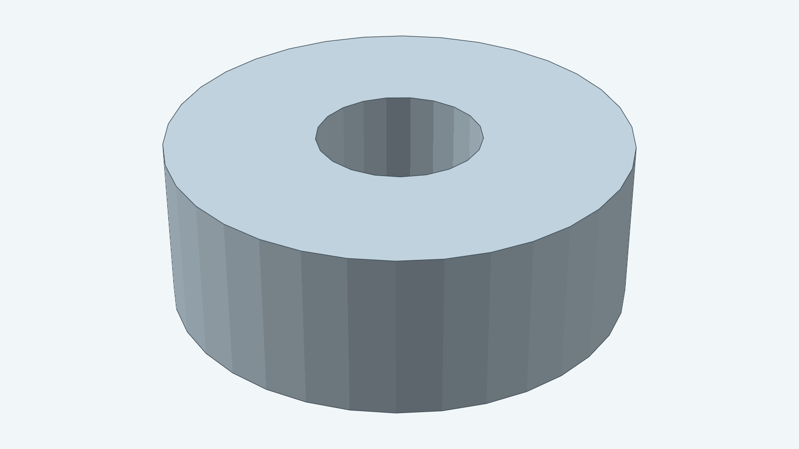

# Ball-bearing mounting envelope

This model gives a purchased 608-2RS bearing's nominal mounting envelope: an 8 mm bore,
22 mm outside diameter and 7 mm width. Assemblies can import the construction to position
the bearing, check shaft alignment and reserve housing space.
The dimensions come from [JTEKT's 608 2RS catalogue](https://www.jtekt.co.jp/products/bearing/en/p/detail/?pno=608+2RS).

The rendered annulus is the occupied envelope. It does not depict separate races, balls, seals or cage.
Use the purchased bearing as the rolling component. The model does not establish running clearance,
shaft or housing fits, bearing life, load capacity or fastening details.

`DefaultParams` selects 608-2RS dimensions. `BoreDiameter`, `OuterDiameter` and `Width` allow other
nominal sizes. `Placement` positions the lower-face center and bearing axis in an assembly.
Catalogue bearings should keep their specified dimensions rather than scaling with the assembly.

## 605ZZ preset

`Params605ZZ()` selects a 5 mm bore, 14 mm outside diameter and 5 mm width, as listed in
[EZO's 605ZZ catalogue](https://www.ezo-brg.co.jp/english/product/spec.php?eid=00529).
It calls the same construction through `Build`; no bearing geometry is copied.
The default preset and hero image continue to show the 608-2RS envelope.

The [developer guide](../../docs/models/ballbearing.md) documents construction and checks.
The [instructions](instructions.md) own the nominal geometry; the [steps](steps.md) map it to Decad.
