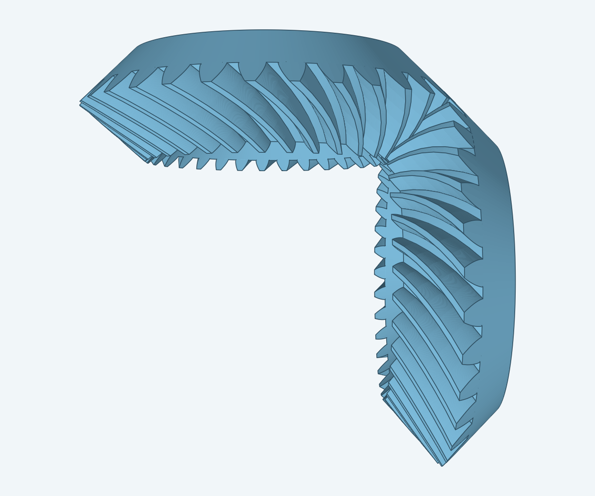
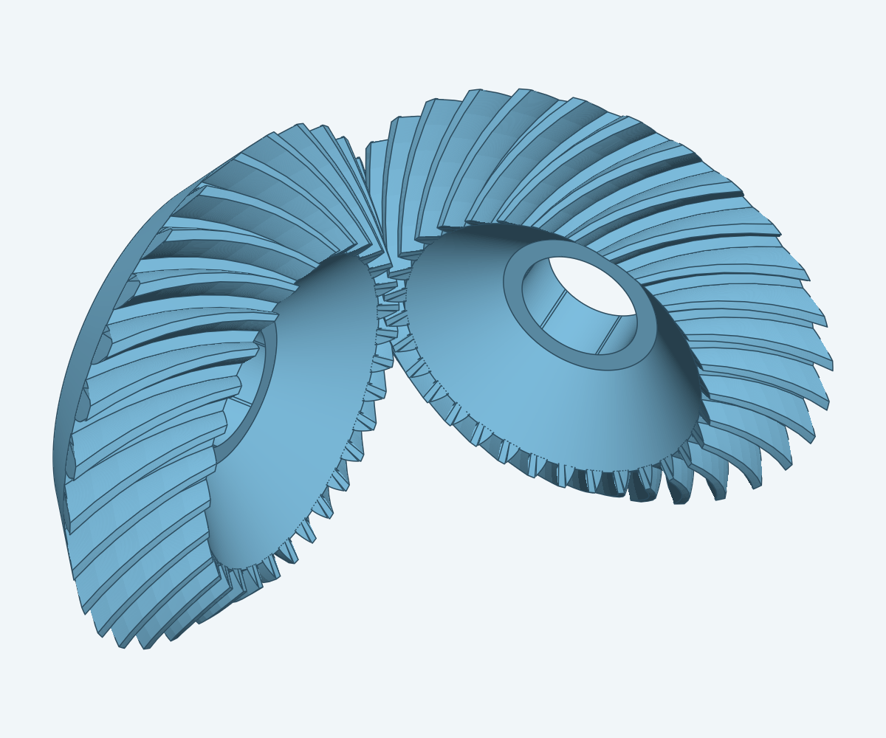
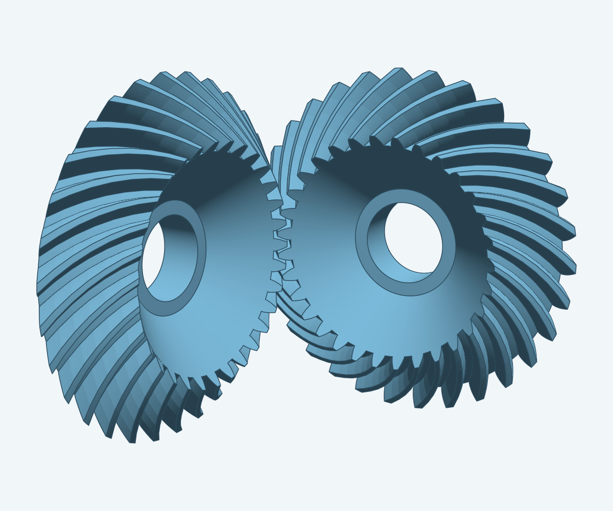
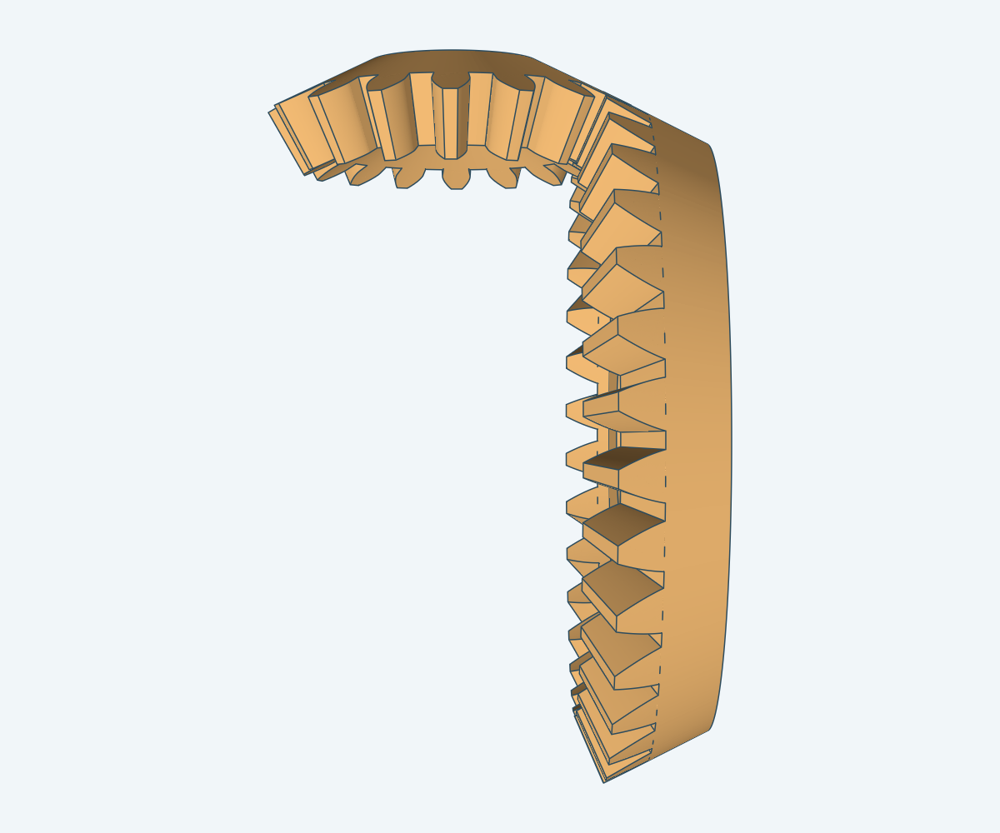
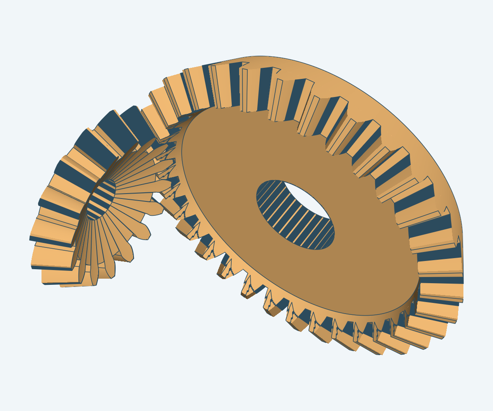
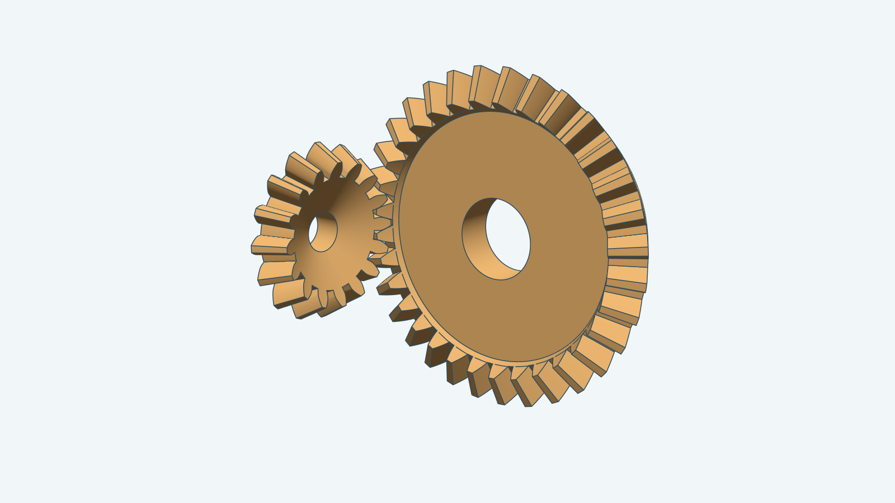

# Bevel gear pair

The hero image renders two pairs side by side: the source-default 31/31 spiral pair on
the left and a 32/16 straight-tooth pair at Module 4 on the right. The renderer enlarges
the Module 1 spiral pair fourfold so both pairs have the same pitch diameter. Each spiral
member has a revolved blank extended past its caps, one curved tooth trimmed past the toe and
heel, 31 patterned teeth joined to the blank, a single trim to the caps, and a 7.75 mm
through-bore cut after the join. The pinion and driving member share a pitch apex and
follow the source's meshing rotations. The construction rules come from
`fusion360-gear-generator/spec/bevelgear/instructions.md`.

The smooth back face and tooth band meet at a sharp root. The source joins
them into one solid without a root fillet.

## More views

The spiral pair:

| From above | High oblique angle | Low side angle |
| --- | --- | --- |
|  |  |  |

The 32/16 straight-tooth pair:

| From above | High oblique angle | Low side angle |
| --- | --- | --- |
|  |  |  |

`Build(ctx, doc, Params)` constructs one gear member. A straight member takes any tooth
count and option. A spiral member takes equal tooth counts at Module 1 and any cutter
radius, hand, face width, base height, tooth spacing, toe extension, toe radius, pressure
angle and spiral angle. `DefaultParams()` selects Module 1, a 90° shaft angle, 35° spiral
teeth, and an auto-calculated bore for each member. `BuildPair` builds and places all four
supported pairs.

Set `Params.Placement` (an `r3.Frame`) to anchor the pair. The frame origin is the common
pitch apex, its U and V axes span the plane that holds both shafts, and the driving shaft
runs along U. A nil `Placement` keeps the world origin and XY shaft plane.

The [instructions](instructions.md) define supported inputs and invalid cases.
The [steps](steps.md) name the Sketch and Decad operations. The
[renderer](../../tools/render/README.md) builds the source-default pair and the 32/16
straight pair for the hero image.
