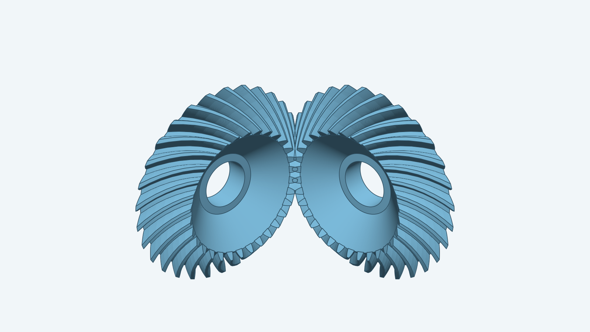

# Bevel gear pair

The image renders the source-default 31/31 spiral pair. Each member has a
revolved blank, one curved tooth trimmed at the toe and heel, 31 patterned
teeth joined to the blank in one Combine-Join, and a 7.75 mm through-bore
cut after the join. The pinion and driving member share a pitch apex and
follow the source's meshing rotations. The construction rules come from
`fusion360-gear-generator/spec/bevelgear/instructions.md`.



`Build(ctx, doc, Params)` constructs one source-default 31/31 spiral member
or one tested straight 8/8 member. `DefaultParams()` selects Module 1, a 90°
shaft angle, 35° spiral teeth, and an auto-calculated bore for each member.
`BuildPair` builds and places both supported pairs.
The [instructions](instructions.md) define supported inputs and invalid cases.
The [steps](steps.md) name the Sketch and Decad operations.

Run the real-body checks separately:

```sh
go test ./models/bevelgear -run '^TestRealEightToothFullPatternJoin$' -timeout 5m
go test ./models/bevelgear -run '^TestJoinedEightToothPairThroughBore$' -timeout 10m
go test ./models/bevelgear -run '^TestSourceDefaultSpiralFullCombine$' -timeout 10m
go test ./models/bevelgear -run '^TestSourceDefaultSpiralFullBoredMember$' -timeout 10m
go test ./models/bevelgear -run '^TestSourceDefaultSpiralPair$' -timeout 15m
```

The tests check a closed outer shell before the bore, two placed solids with
through-holes afterward, and `VerifyAll` for each member. The
[renderer](../../tools/render/README.md) builds the source-default pair for the hero image
and checks the PNG in its integration test.

`BuildVirtualToothProfile` also draws one back-cone tooth for the planned
apex loft. Its Sketch tests cover fractional virtual tooth counts for equal
and unequal pairs and an embedded 60-tooth flank whose root trim is exact.
`BuildBackConeToothProfile` places it on the tilted plane and tests the
half-millimeter tooth-spacing offset without changing the plane's distance
from the apex.
`BuildPointTooth` lofts that fitted profile from the exact common apex.
Its tests build 8/8, spaced and oblique 16/12, and embedded-root 60/60
teeth; all four have the origin apex and a verified Decad mesh.
`BuildBlank` revolves the reference's six-sided axial section. Its focused
test checks two planar ends, three conical surfaces, and a verified mesh.
`BuildBoredBlank` cuts the real revolved blank. Its test checks the small
eight-tooth case and a 31-tooth pair at Module 4. Both produce a verified
solid with a through-hole in the mesh.
`BuildBlankPair` revolves both members around one apex. Its unequal 16/12
test checks the two shaft directions, each heel station, and verified meshes.
`BuildToeCone` and `BuildHeelCone` revolve the exact conical cutting tools
from the blank's toe-root corner and heel-cone line. Their tests check the
apex stations, cone surfaces, far caps, and verified meshes. The ordered toe
cut and heel trim now pass `VerifyAll` for 8/8 and spaced 16/12 teeth, retain
cone and fitted flank faces, and select the larger heel piece.
The real 8/8 blank and one trimmed tooth join into a verified solid. The
first join test confirms that the tooth seats inside the revolved blank and
that the joined volume exceeds the blank's certified upper bound. All eight
trimmed teeth, copied around the shaft in 45° steps, join the blank into one
closed solid and pass `VerifyAll`. A 1 mm through-bore then cuts that joined
body, and its mesh has Euler characteristic zero.

For the source-default 31/31 spiral pair, the driving and pinion teeth each
pass the real slice, cutter trace, twist, crown, nine-face loft, toe cut,
and heel trim. Each trimmed tooth produces 31 placed copies, and every copy
passes `VerifyAll` at 0.1 mm against merged Decad heel support. The first
tooth-to-blank `Union` passes `VerifyAll` for both members. Each full
31-tooth pattern joins its blank into one solid. Each member passes its
7.75 mm bore cut and `VerifyAll`. The real `BuildPair(DefaultParams())`
passes both placed bodies through `VerifyAll`. The renderer produced the
1600 × 900 hero PNG from that pair. Real blank-only cuts
also pass for the source-default 90° case and a capped 35° shaft-angle case.
The Decad/Sketch handoff is in
`../decad/.tmp/bevelgear-gallery-handoff.md` from the repository root.
