# Bevel gear pair

Two meshing bevel gears whose shafts meet at an angle, shown as two pairs side by side. The pair on the
left has spiral teeth: 31 teeth on each gear at Module 1 with 35° spiral teeth on a 90° shaft angle. The
pair on the right has straight teeth: 32 and 16 teeth at Module 4. Every gear has a through-bore for its
shaft. The two gears of a pair share one pitch apex and are rotated so their teeth mesh.

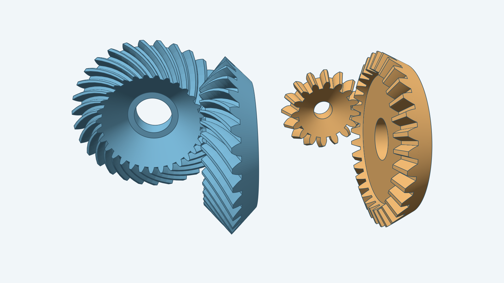

The tooth root has no fillet.

## More views

The spiral pair:

| From above | High oblique angle | Low side angle |
| --- | --- | --- |
| 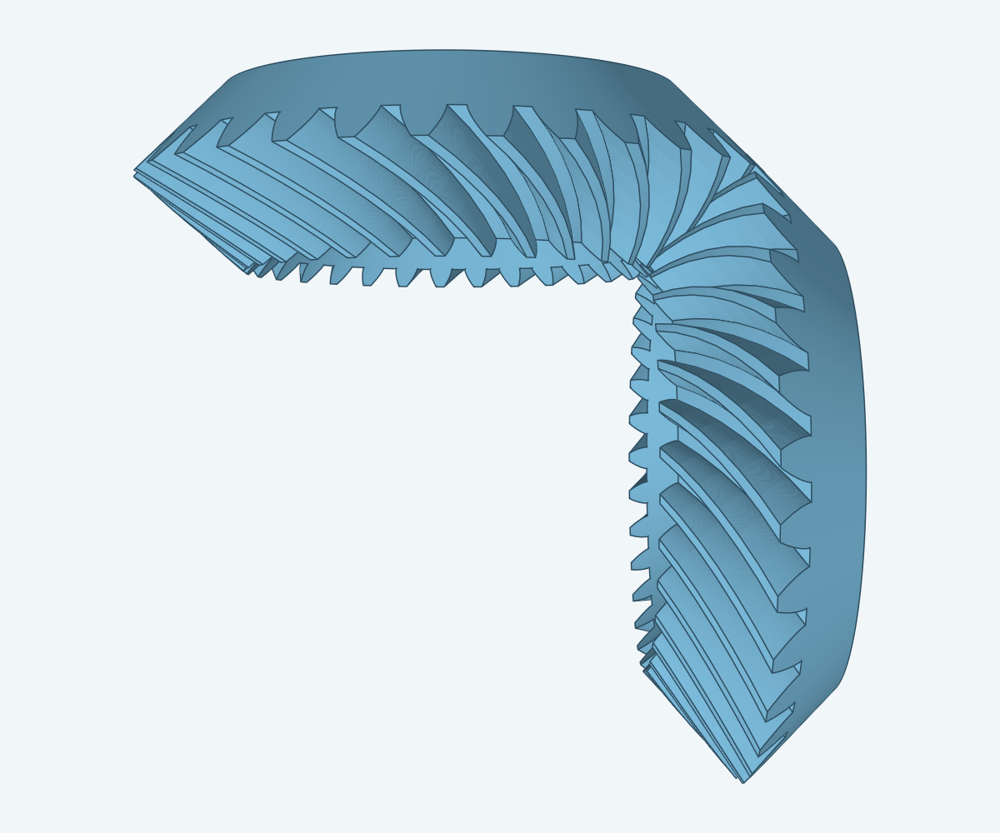 | 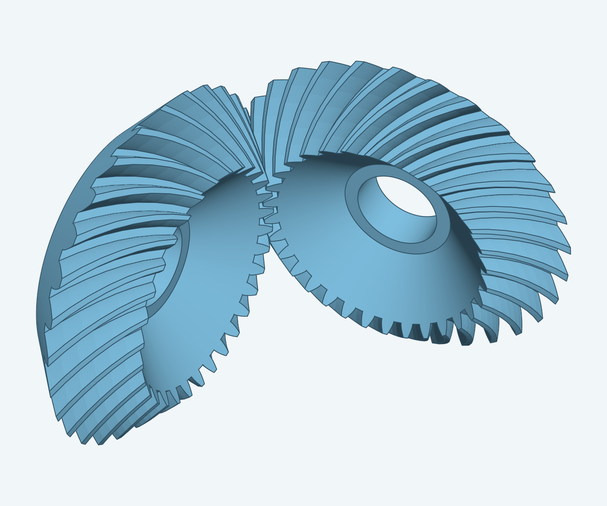 | 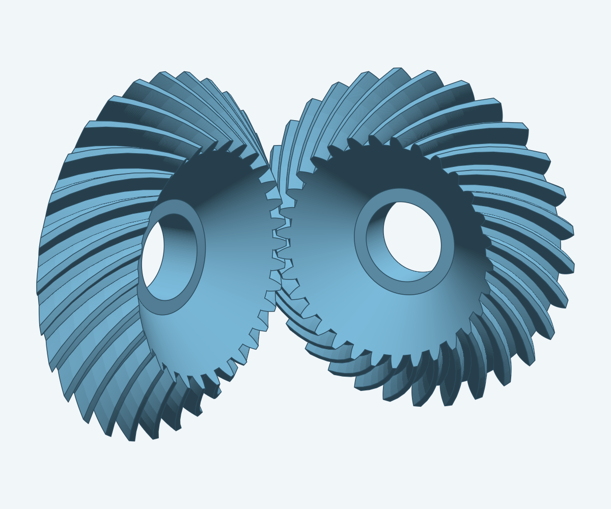 |

The 32/16 straight-tooth pair:

| From above | High oblique angle | Low side angle |
| --- | --- | --- |
| 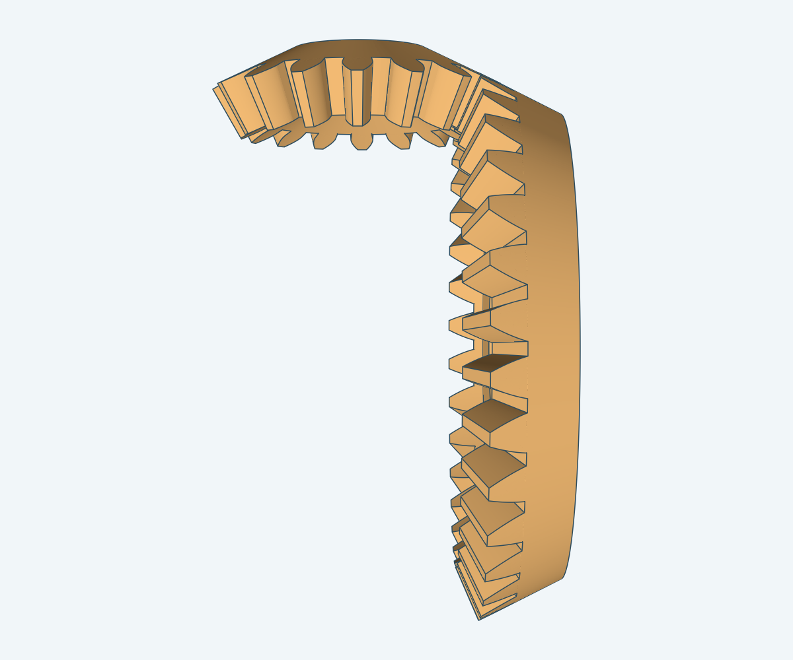 | 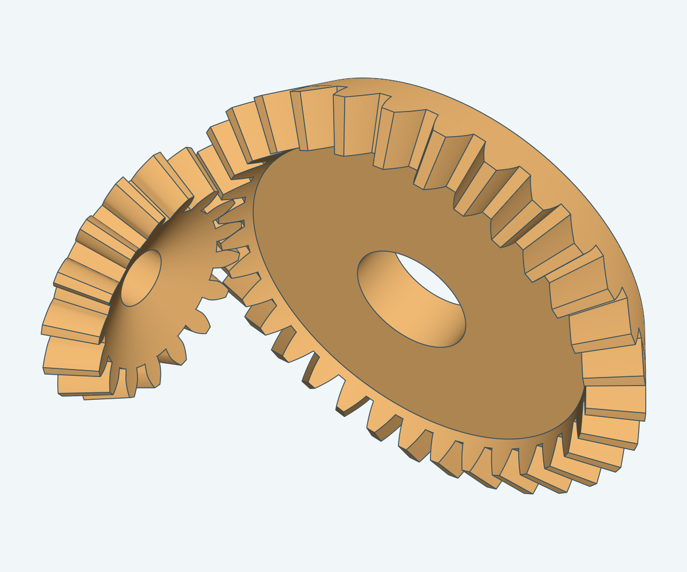 | 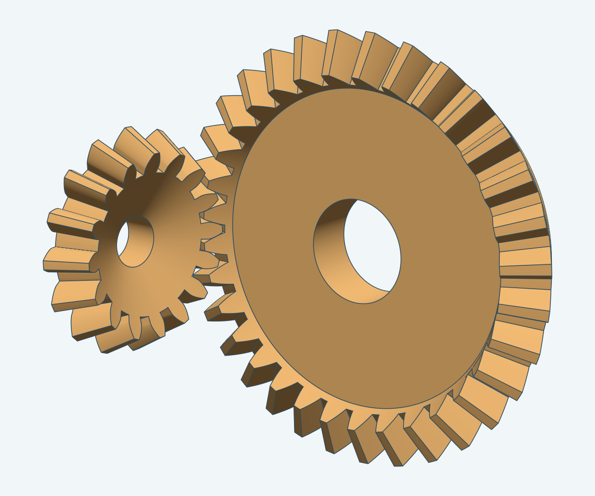 |

## Exploded

Each pair pulled apart along its two shafts. The driving gear moves out along its shaft and the pinion along its
own, both away from the shared pitch apex.

| Spiral pair, 31/31 | Straight pair, 32/16 |
| --- | --- |
| 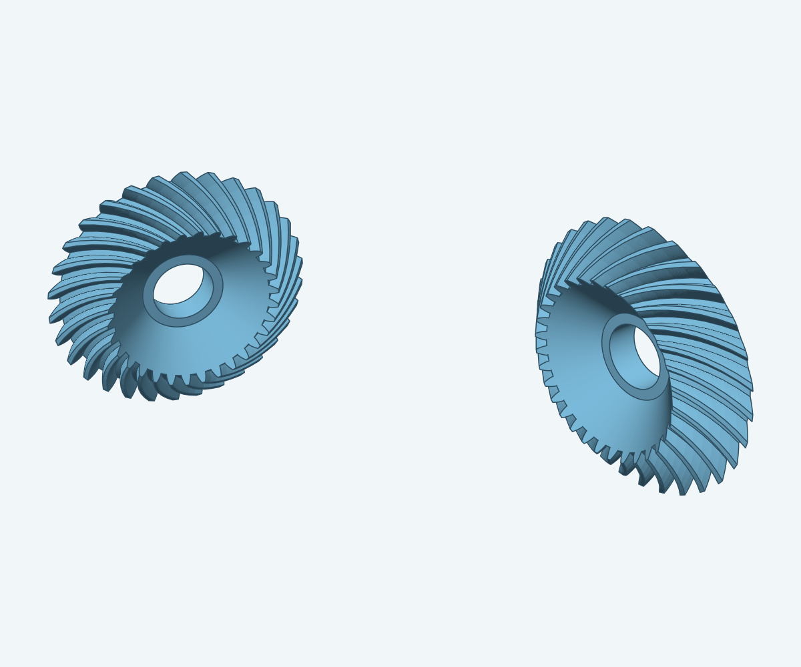 | 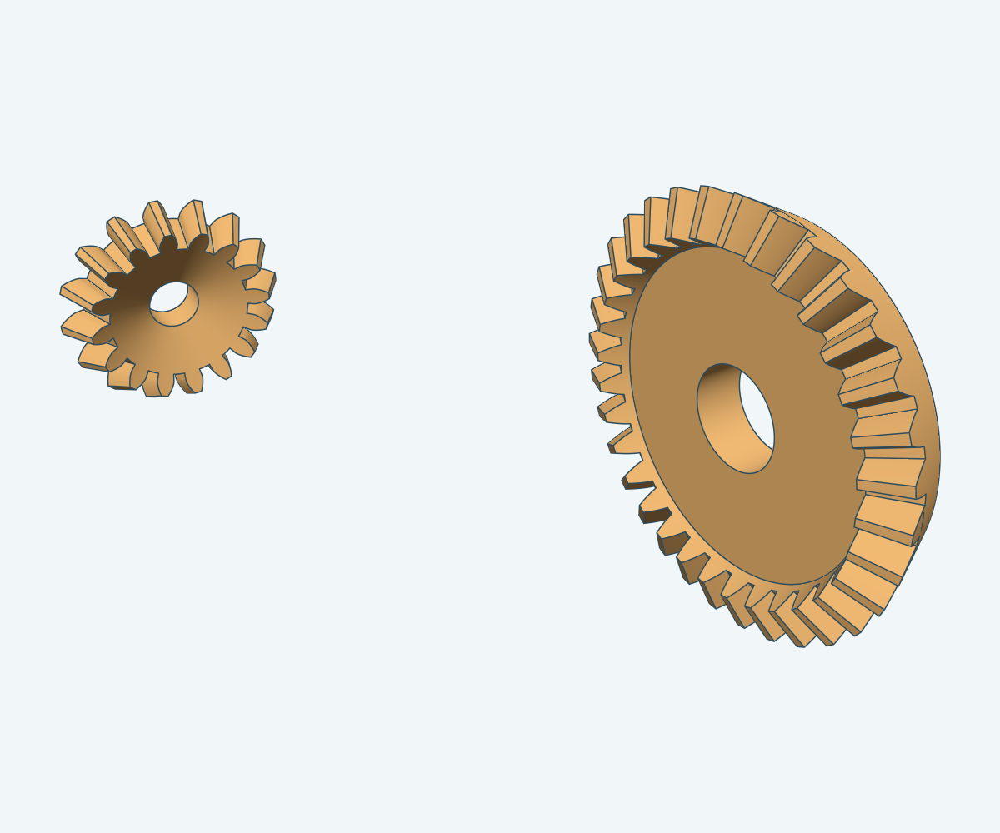 |

## Parts

A pair has two parts, the driving gear and the pinion. The two spiral gears are the same part, one mirrored
from the other, so they have one row. The straight pair has two different parts.

| Image | Name |
| --- | --- |
| 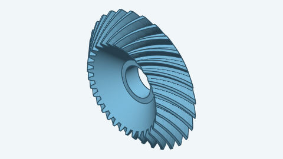 | Spiral gear (31 teeth; driving gear and pinion, mirror images) |
| 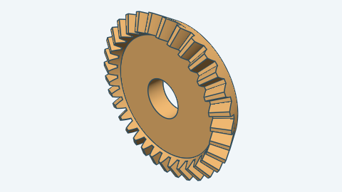 | Straight driving gear (32 teeth) |
| 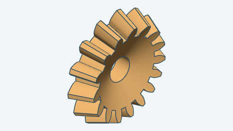 | Straight pinion (16 teeth) |

You can vary:

- Straight teeth: any tooth count and the supported options.
- Spiral teeth: equal tooth counts at Module 1, the cutter radius, hand, face width, base height, tooth
  spacing, toe extension, toe radius, pressure angle and spiral angle.
- The module and the shaft angle.
- The bore of each gear.
- The position and orientation of the pair in space.

For how to build these pairs from Go, see the [developer notes](../../docs/models/bevelgear.md).
