# Clamp arm

**Build status:** Not built yet.

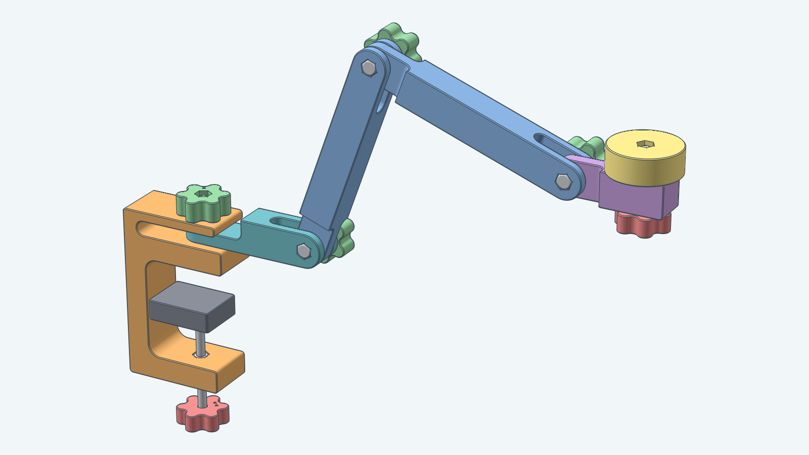

A printed desk-edge clamp with a four-joint friction arm. The C-shaped frame grips the edge of a desk, the arm reaches
out over the desk, and the free end carries a mount interface that holds a camera adapter. Every joint holds its pose
by friction, so you aim the arm by hand and lock each joint with its knob.

The arm has a swivel, two identical links and a head. The default pose has 120 mm links and a level head. The
model ends in a placeholder adapter: a plain disc that fits
the mount interface. A real holder, such as a webcam holder, is a later model that builds against the interface.

**Clearance adjustment:** Mixed. The fits between printed parts are named constants in `params.go`, such as `JointFit` (0.26 mm per side), and change
in source; the bolts and nuts keep their nominal size.

## Views

From the side, along the joint axes, the arm reads as a chain of 20 mm square parts.

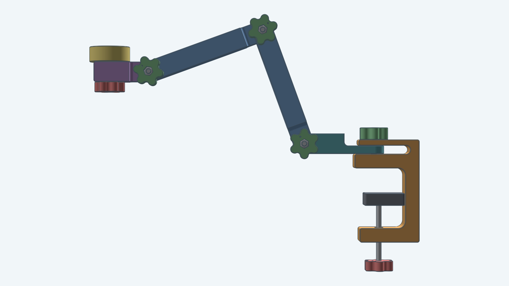

From behind and above, the knobs of J2 to J4 sit on the +Y side and their bolt heads on the other. The J1 knob sits on top.

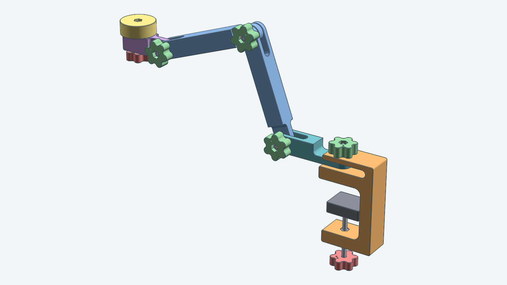

From above, the arm lies in one plane across the desk until the swivel turns it.

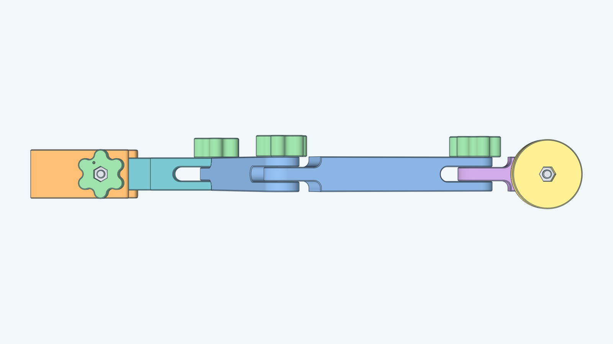

## Poses

This image shows three poses side by side: the default, a raised pose (shoulder 90, elbow -30, wrist -60) and a folded pose (shoulder
100, elbow -115, wrist 15). The swivel turns the whole arm 125 degrees either way. The shoulder runs from -60 to 115
degrees, the elbow from -115 to 115 and the wrist from -110 to 90.

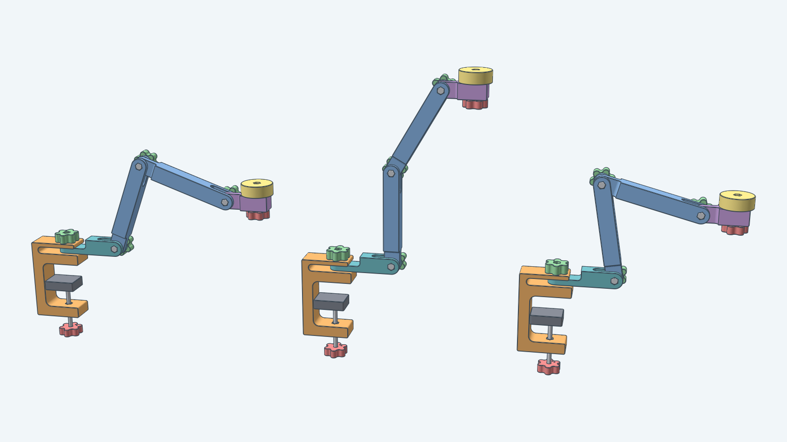

## The clamp

The frame is one C-shaped piece, 30 mm wide, with a top jaw, a bottom jaw and a spine. An M5 x 70 screw runs up
through the bottom jaw, turned by a screw knob below the jaw, and pushes a pad against the desk's underside. The pad
cannot turn, so it does not scrub the desk. The clamp grips desks 10 to 40 mm thick. The desk's edge goes into the
frame against the spine. The 7 mm round at the root of each jaw keeps a square desk edge up to 7 mm away from the spine.

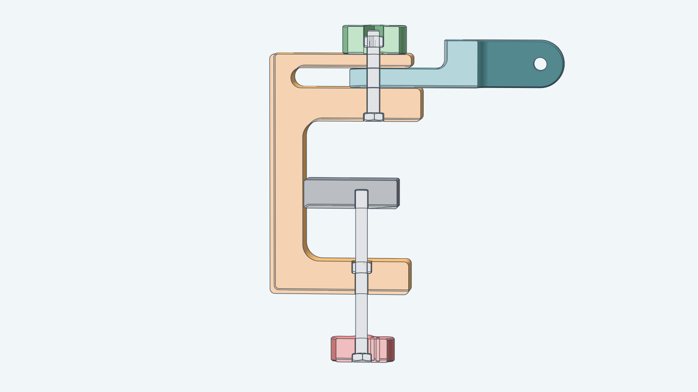

The top jaw is also the lower fin of the first joint (J1). The J1 bolt's head sits flush in a pocket in the underside
of the top jaw, so nothing stands proud on the face that goes against the desk.

## The joints

There are four joints. J1 pans the arm about a vertical axis: the swivel sits on the frame. J2 is the shoulder, J3 the
elbow and J4 the wrist tilt. Each joint is a fork on one part, a tongue on the next, an M5 bolt through both and a nut
held in a lobed knob. The tongue goes into the fork with 0.26 mm of clearance on each side. Tightening the knob presses
the two fins against the tongue and the friction holds the pose.

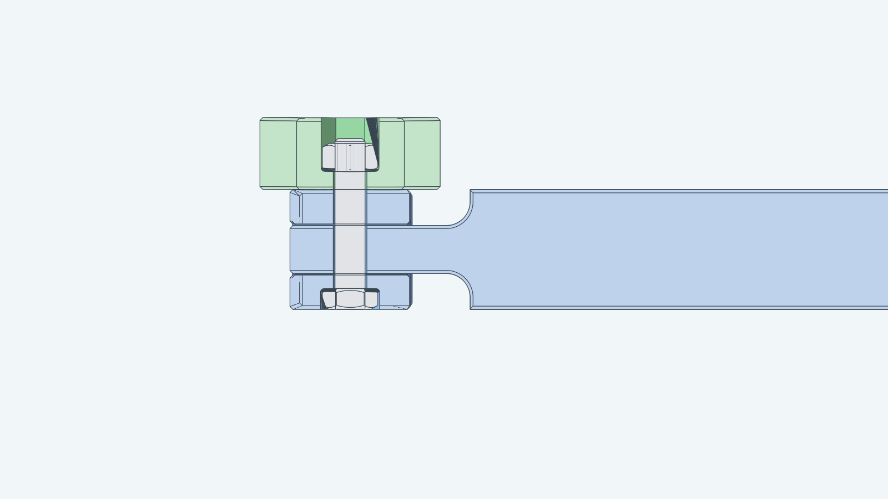

The bolt's head sits in a hex pocket in one fin, so the bolt does not turn. The knob turns the nut, so turning a joint
never turns a bolt in its nut. The nut sits in a hex pocket open to the knob's outer face. The bolt holds it there.

Each joint is estimated to hold about 2.3 N.m at a hand-tight 0.6 N.m of knob torque (1.0 to 4.3 N.m across the low and high knob torque and friction cases). The arm's
heaviest load, the shoulder with the arm horizontal, a 200 g camera and a 30 g adapter at the mount, is about
0.9 N.m at 120 mm links and 1.1 N.m at 150 mm. [instructions.md](instructions.md) ("Joint capacity") shows the
estimate. A bench test settles it: lock the clamp, straighten the arm horizontally, hang masses at the stud and record
the mass at which each joint slips.

## The Mount interface

The head's top face is the mount interface. It has a 45 degree cone boss, 12 mm across at its base, and an M5 stud
that rises 13.5 mm above the face, turned by a screw knob under the head. An adapter lays its flat face on the head, sets
the cone into a matching recess, passes the stud through a 5.6 mm hole and holds on a nut. Tightening the screw knob
pulls the adapter onto the boss, and the cone centres it on the stud.

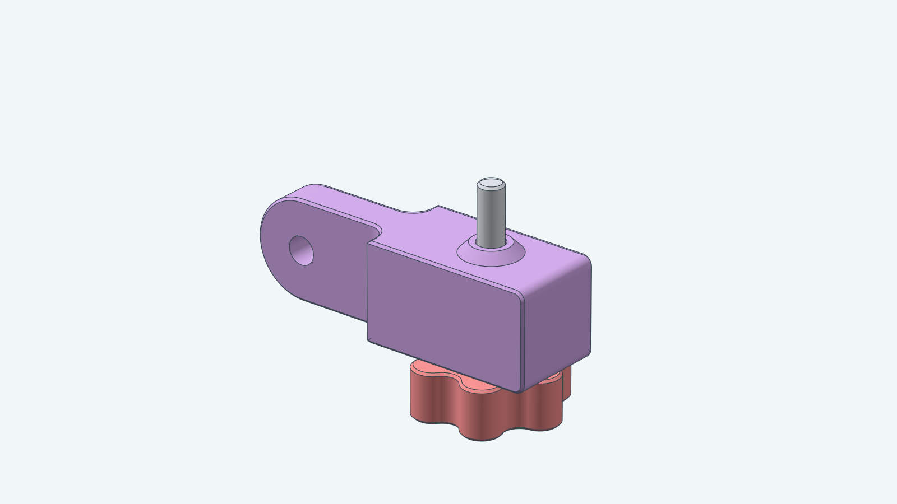

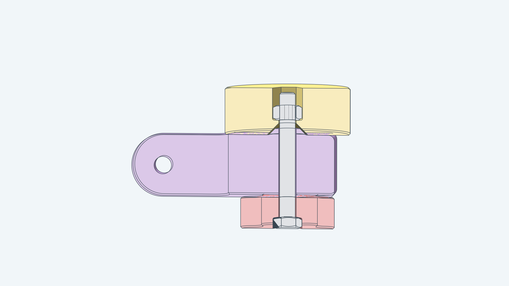

[instructions.md](instructions.md) ("Mount interface") lists what an adapter must provide, the exported constants and
`InterfaceRecessTool`, which builds the recess for a new adapter.

**Limits.**

- Keep the adapter and its camera at 230 g or less in total, with the centre of mass within 10 mm of the stud's axis.
  The joints' friction is sized for that load.
- With no adapter fitted, the stud bolt and its screw knob are loose in the head and can drop out. The model has no
  retainer for them.

## Exploded

The preset pulls the arm apart. The bolts of J2 to J4 leave the -Y face and their nuts and knobs leave the +Y face, along
the joint axis. The J1 bolt moves out to -Y, and the jaw nut moves out to +Y; the J1 nut and knob lift along +Z. The swivel lifts off the frame, link B, the head and the adapter move apart along the chain, and the
pad, the clamp screw and its knob go down. The parts, in assembly order:

1. The clamp frame, the J1 bolt, the swivel, the J1 nut and the J1 knob.
2. The jaw nut, the screw knob, the M5 x 70 clamp screw and the pad.
3. Link A, with the J2 bolt, nut and knob.
4. Link B, with the J3 bolt, nut and knob.
5. The head, with the J4 bolt, nut and knob.
6. The stud knob, the M5 x 40 stud bolt, the adapter nut and the adapter.

## Parts

Hole count is the number of 1.5 mm marks cut through the part, for telling look-alike knobs apart. A dash means the
part carries no mark.

| Image | Name | Qty | Holes |
| --- | --- | --- | --- |
| 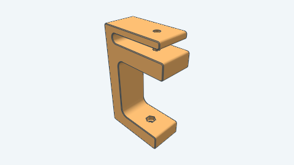 | Frame (printed) | 1 | - |
| 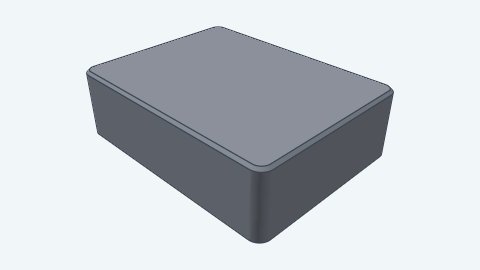 | Pad (printed) | 1 | - |
| 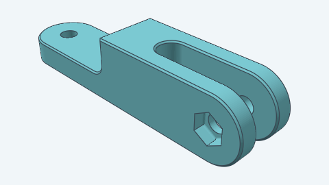 | Swivel (printed) | 1 | - |
| 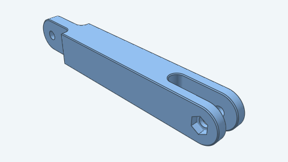 | Link, links A and B are identical (printed) | 2 | - |
| 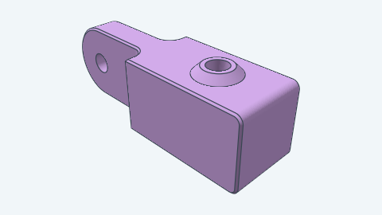 | Head (printed) | 1 | - |
| 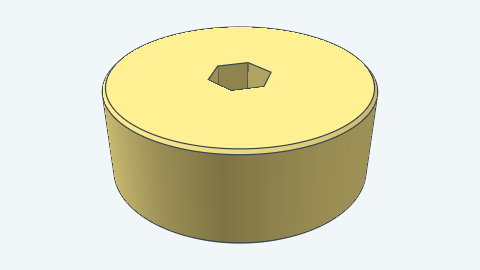 | Adapter (printed) | 1 | - |
| 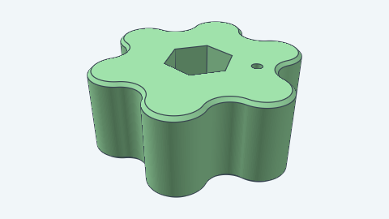 | Knob, for J1 to J4 (printed) | 4 | 1 |
| 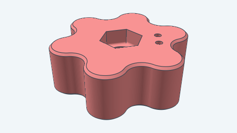 | Screw Knob, for the clamp screw and the stud (printed) | 2 | 2 |
| 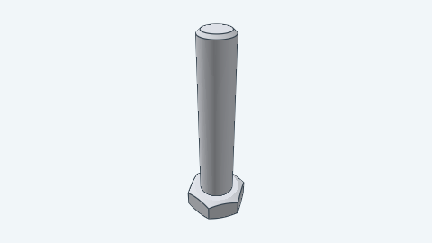 | M5 × 25 hex head bolt ([`models/fastener`](../fastener)), the J2, J3 and J4 bolts | 3 | - |
| 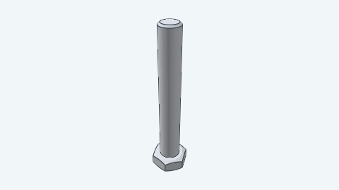 | M5 × 35 hex head bolt ([`models/fastener`](../fastener)), the J1 bolt | 1 | - |
| 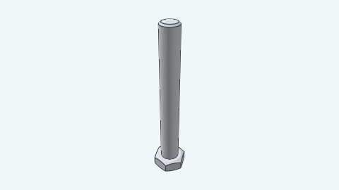 | M5 × 40 hex head bolt ([`models/fastener`](../fastener)), the stud | 1 | - |
| 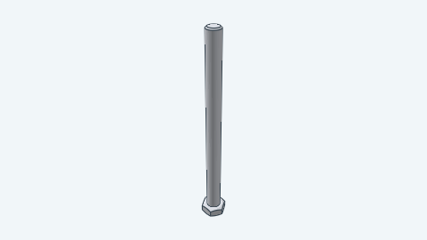 | M5 × 70 hex head bolt ([`models/fastener`](../fastener)), the clamp screw | 1 | - |
| 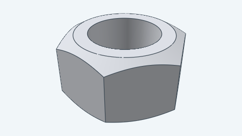 | M5 hex nut ([`models/fastener`](../fastener)), four in knobs, one in the bottom jaw, one in the adapter | 6 | - |

## Parameters

All dimensions are in millimeters and angles in degrees. `Params.Validate` rejects a value outside its range with an
error that names it.

| Parameter | Default | Range |
| --- | --- | --- |
| `LinkLength` | 120 | 80 to 150 |
| `Opening` | 25 | 10 to 40 |
| `Pan` | 0 | -125 to 125 |
| `Shoulder` | 70 | -60 to 115 |
| `Elbow` | -90 | -115 to 115 |
| `Wrist` | 20 | -110 to 90 |
| `Placement` | none | A valid frame |

`Opening` is the desk thickness the pad is posed at. The model has no desk.

## Printing and assembly

Print each part in the orientation [instructions.md](instructions.md) gives: the frame on its -Y face, the pad top
face down, the swivel bottom face down, the links on their -Z face, the head bottom face down, the knobs inner face
down and the adapter mating face down. The nuts go into their pockets at assembly.

To assemble:

1. Seat the J1 bolt's head into the top jaw's pocket from below, slide the swivel's tongue into the gap and fit the J1
   knob with its nut on top.
2. Drop the jaw nut into its pocket. Press a screw knob onto the M5 x 70 bolt's head, push the bolt up through the
   jaw and set the pad on its tip.
3. Slide link A's tongue into the swivel's fork, push the J2 bolt in from the -Y side and fit its knob on the +Y side.
4. Fit link B and the J3 bolt and knob the same way.
5. Fit the head and the J4 bolt and knob.
6. Press the other screw knob onto the M5 x 40 bolt's head and push the stud up through the head.
7. Set the nut in the adapter, set the adapter on the boss and turn the stud's screw knob.

For how to build this model from Go, see the [developer notes](../../docs/models/clamparm.md). The construction is in
[instructions.md](instructions.md) and [steps.md](steps.md).
