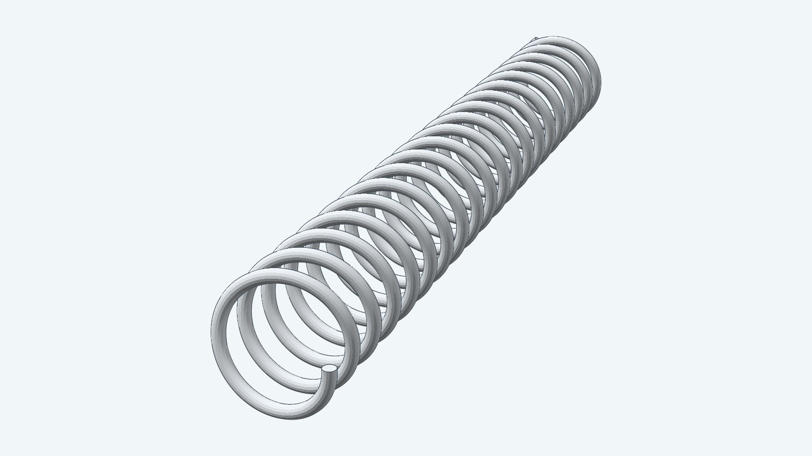
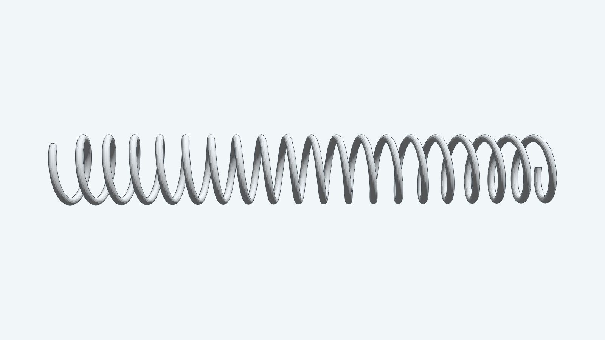
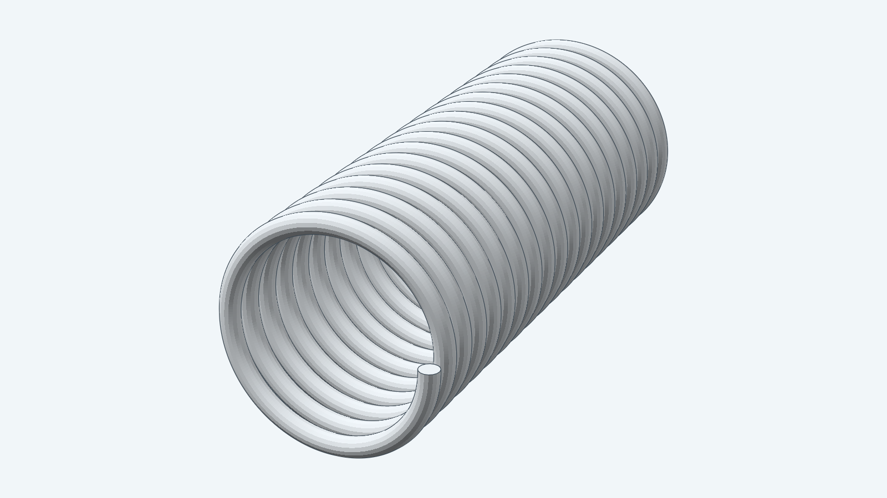

# Compression spring

**Build status:** Not built yet.

Choose a purchased round-wire spring and set the distance between its seats. The model keeps the catalog wire diameter,
outside diameter and turn count while the pitch changes with compression.

| Lee Spring part | Material | Outside diameter | Free length | Rate |
| --- | --- | ---: | ---: | ---: |
| LC 024C 14 M | Music wire | 6.10 mm | 50.80 mm | 0.49 N/mm |
| LC 026D 16 S | Stainless steel | 7.62 mm | 63.50 mm | 0.30 N/mm |
| LC 022D 03 S | Stainless steel | 7.62 mm | 15.88 mm | 0.736 N/mm |

**Clearance adjustment:** Nominal. Size the mating guides around the purchased spring.

The stainless button-return spring shortens from 55.50 mm at rest to 18.94 mm at full press. It still has 6.77 mm
of travel before reaching its catalog solid height. The modeled wire follows a constant-pitch helix throughout.
The purchased springs have squared, ground ends, so their seat contact and end-coil spacing differ.

See the [construction, API and checks](../../docs/models/compressionspring.md).
