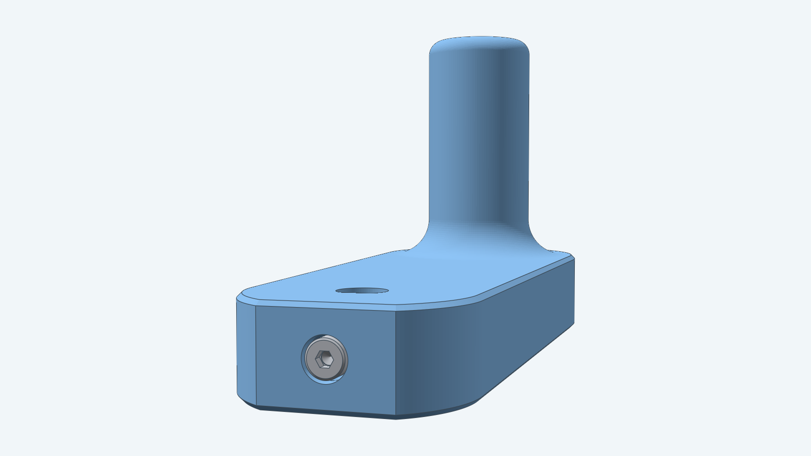
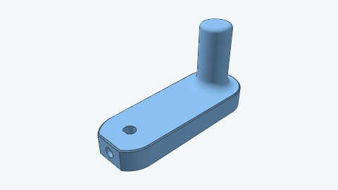

# Crank handle

A printed crank handle that turns a D-flat shaft by hand. It is one printed part: a flat plate with a D-shaped bore
in its hub, a tapered arm, and a round grip on the arm's end. An M2 set screw goes into the flat face at the back of
the hub and presses on the shaft's flat, so the crank stays on the shaft. The flat turns the crank with the shaft.

The crank fits any shaft that runs in a purchased bearing, because the shaft's diameter equals the bearing's bore.
The default fits the 5 mm shaft of a 605ZZ bearing, the bearing the planetary gearbox and the Graham escapement use.
A second preset fits the 8 mm shaft of a 608-2RS (or 608ZZ) bearing. The shaft itself is part of the mechanism the
crank drives and is not in this model.

**Clearance adjustment:** Mixed. The bore's clearance is a parameter; the bolt and nut keep their nominal size.

## Views

From the side, the grip stands on the arm's end with a rounded root.

From below, the back face shows the D bore. This face goes against the mechanism and onto the print bed.

The set screw's head lies flush with the flat tail face of the hub.

## How the crank is held on the shaft

The picture cuts the hub through the set screw's axis. The bolt runs from its head pocket in the tail face, through a
nut held in a closed cavity, to the bore's flat. Tightening it pushes its tip onto the shaft's flat.

| Part | Pocket | Size |
| --- | --- | --- |
| Bolt head (M2 × 6) | Round, in the tail face | 4.4 mm wide, 2 mm deep, flush with the face |
| Bolt shank | Hole from the pocket into the bore | 2.6 mm wide |
| Nut | Closed round cavity, 2 mm behind the head pocket | 5.02 mm wide, 2 mm long |

The concave rims of the head pocket's floor and of the nut cavity have a small 45 degree chamfer, so the printed
layers have no sharp inside corner there.

The bore is 0.05 mm larger than the shaft all round, on the round and on the flat, a press fit. You can raise the
clearance up to 0.5 mm for a crank that slides on and off.

The mechanism's shaft needs a collar between its frame and the crank, so the crank does not rub the frame.

## Exploded

The nut goes in first, during the print, and the set screw after the print.

## Parts

| Image | Name |
| --- | --- |
|  | Crank (printed) |
|  | M2 × 6 socket head cap screw ([`models/m2bolt`](../m2bolt)) |
|  | M2 hex nut ([`models/m2nut`](../m2nut)) |

## Sizes

The 605ZZ crank (left) and the 608-2RS crank (right). The 608-2RS crank has a larger hub for its 8 mm bore and a
chamfer on the bore's rim.

## Parameters

All dimensions are in millimeters. `Params.Validate` rejects a value outside its limit with an error that names it.

| Parameter | 605ZZ (default) | 608-2RS | Limit |
| --- | --- | --- | --- |
| `ShaftDiameter` | 5 | 8 | Above 0; the bearing's bore |
| `FlatDepth` | 0.5 | 0.5 | At most a quarter of `ShaftDiameter`; the flat must be at least 2.6 wide |
| `BoreClearance` | 0.05 | 0.05 | 0.05 to 0.5 |
| `HubDiameter` | 24 | 28 | Room for the set screw: at least 21.1 (605ZZ) or 24.0 (608-2RS) |
| `Thickness` | 10 | 10 | At least 7.02, room for the nut cavity |
| `Throw` | 50 | 50 | At least the hub radius plus the arm end's radius (25.5 at the defaults) |
| `GripDiameter` | 14 | 14 | Above 0 |
| `GripLength` | 30 | 30 | At least the root fillet plus the top round plus 1 |
| `Placement` | none | none | A valid frame |

`Throw` is the distance from the shaft's axis to the grip's axis. The grip's root fillet has a radius of half the
thinner of `Thickness` and `GripDiameter`.

Decad currently fails to build some throws, such as 30 and 65 to 90 mm; 40 to 60 and 100 or more build.

## Printing

Print the crank on its back face with no supports. Pause the print at 5.5 mm (half the thickness plus 0.5 mm), drop
the M2 nut into its cavity so it stands on a flat, and resume. Screw the M2 × 6 set screw in from the tail face after
the print.

For how to build this crank from Go, see the [developer notes](../../docs/models/crankhandle.md). The construction is
in [instructions.md](instructions.md) and [steps.md](steps.md).
