# Crank handle

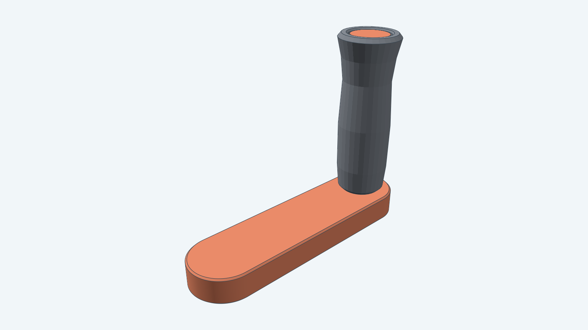

A printed hand crank for a D-flat shaft. It is the crank of the [hand-crank siren](../handcranksiren/), which builds
its crank from this model. The arm presses onto the shaft, a pin is clamped into the arm's far end by an M2 bolt and nut,
and the handle turns freely on the pin, so your hand does not twist on it as you crank. The pin's head holds the handle
on.

The crank fits a shaft that runs in a purchased bearing, because the shaft's diameter equals the bearing's bore. The
default fits the 5 mm shaft of a 605ZZ bearing. A second preset fits the 8 mm shaft of a 608-2RS (or 608ZZ) bearing; it
is the siren's crank. The shaft is part of the mechanism the crank drives and is not in this model.

**Clearance adjustment:** Mixed. The bore's clearance is a parameter; the bolt and nut keep their nominal size.

## Views

From the side, the handle stands on the arm's far end.

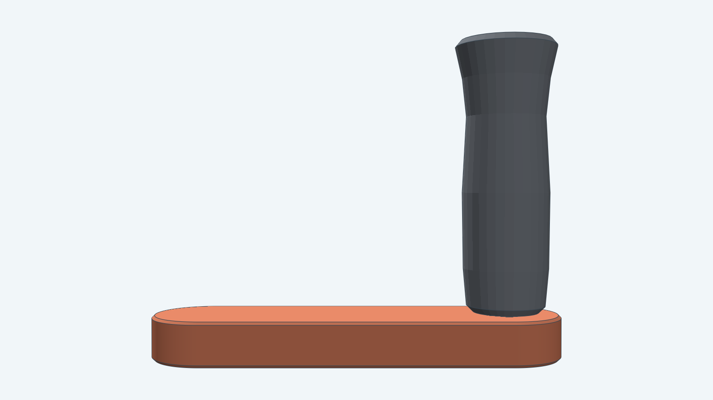

From below, the arm's back face shows the D bore and the pin bolt's head, flush in its pocket. This face goes against
the mechanism.

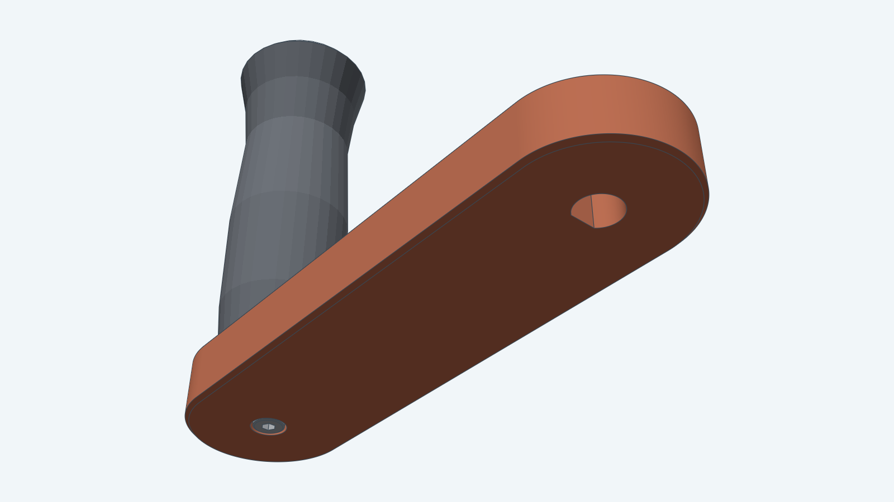

## How the parts go together

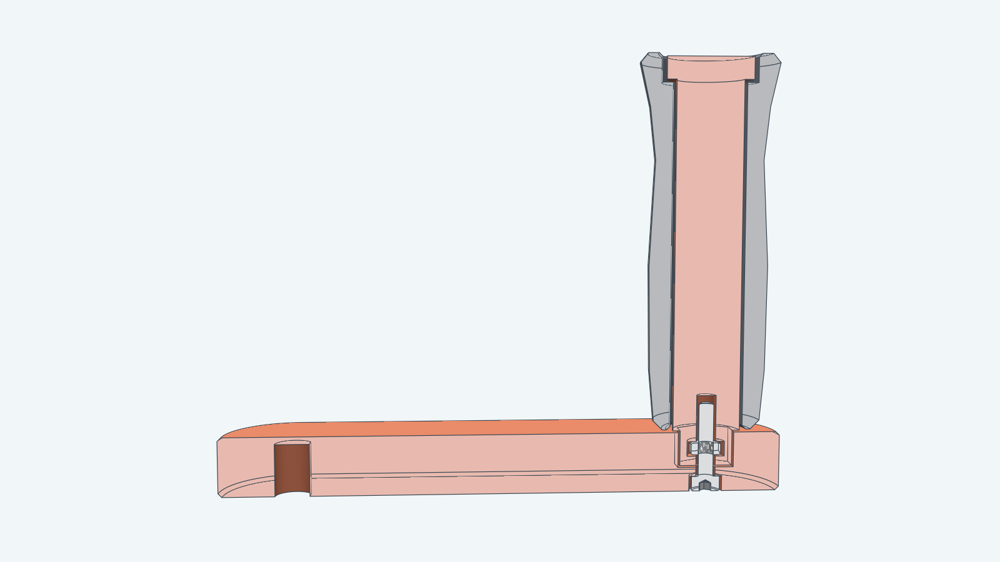

The picture cuts the crank through the shaft axis and the pin axis.

- The D bore is blind: 1 mm of arm closes it at the front, and the shaft's end stops there. The bore is 0.05 mm larger
  than the shaft all round, a press fit, so the arm turns with the shaft. You can raise that clearance up to 0.5 mm.
- The pin's hexagonal stub sits in a hexagonal pocket in the arm with 0.25 mm of clearance on each flat, so the pin
  cannot turn in the arm. An M2 x 10 bolt from the arm's back face runs into a nut held inside the stub and clamps it.
- The handle's bore is 0.4 mm larger than the pin's shank all round, and the handle stands 0.4 mm clear of the arm and of
  the pin's head, so it turns freely. The head is wider than the handle's bore, so the handle cannot come off.

## Exploded

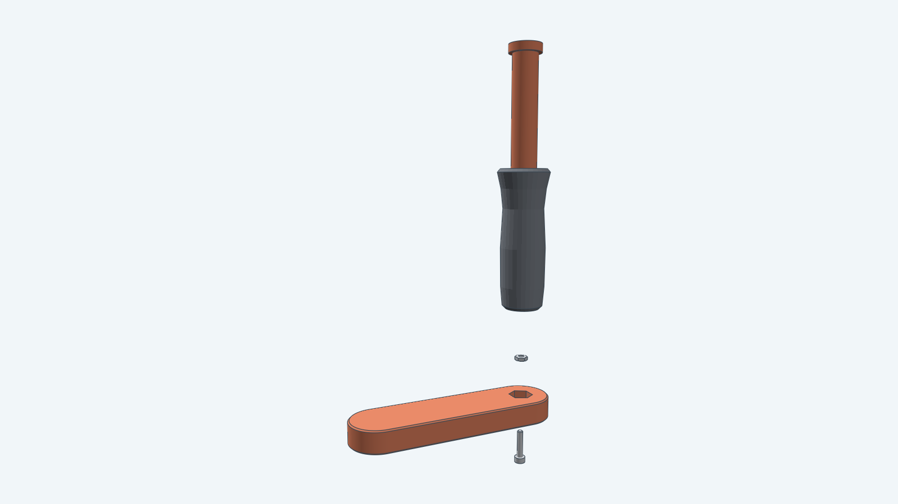

From the bottom: the bolt, the arm, the nut, the handle and the pin.

## Parts

| Image | Name |
| --- | --- |
| 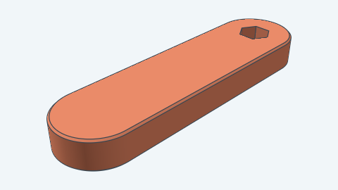 | Arm (printed) |
| 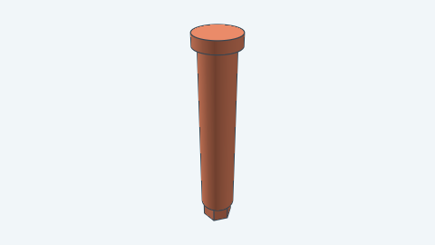 | Pin (printed) |
| 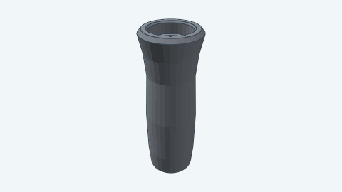 | Handle (printed) |
| 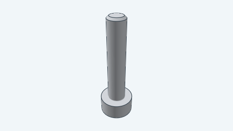 | M2 × 10 socket head cap screw ([`models/m2bolt`](../m2bolt)) |
| 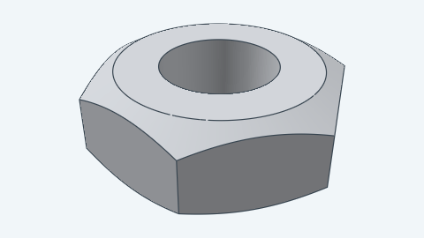 | M2 hex nut ([`models/m2nut`](../m2nut)) |

## Sizes

The 605ZZ crank (left) and the 608-2RS crank (right). They differ only in the bore.

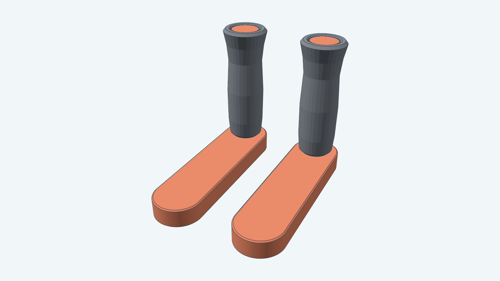

## Parameters

All dimensions are in millimeters. `Params.Validate` rejects a value outside its limit with an error that names it.

| Parameter | 605ZZ (default) | 608-2RS | Limit |
| --- | --- | --- | --- |
| `ShaftDiameter` | 5 | 8 | Above 0; leaves a 1.6 mm wall in the 20 mm arm (at most 16.7) |
| `FlatDepth` | 0.5 | 0.75 | Above 0 and at most a quarter of `ShaftDiameter` |
| `BoreClearance` | 0.05 | 0.05 | 0.05 to 0.5 |
| `Throw` | 55 | 55 | At least 20 |
| `Placement` | none | none | A valid frame |

`Throw` is the distance from the shaft's axis to the pin's axis. The arm, pin and handle keep the siren's sizes: the arm
is 20 mm wide and 8 mm thick, and the handle is 50 mm long and up to 18.6 mm across.

## Printing

Print the arm on its back face, the pin upright on its head, and the handle upright on its inner end, with no supports.
Pause the pin's print at 53.25 mm, drop the M2 nut into its cavity, and resume. To assemble, slide the handle onto the
pin from the stub end, push the stub into the arm's pocket, drive the bolt in from the arm's back face, and press the
arm onto the shaft.

For how to build this crank from Go, see the [developer notes](../../docs/models/crankhandle.md). The construction is
in [instructions.md](instructions.md) and [steps.md](steps.md).
