# Cube Puzzle
**Build status:** Not built yet.

This 60 mm, three-layer cube puzzle uses a central hub with six turning centers, twelve edges, and eight corners.
The blocks follow the same three constructions on each face. The colored faces show paint or stickers applied after
printing; the model contains no separate sticker bodies.

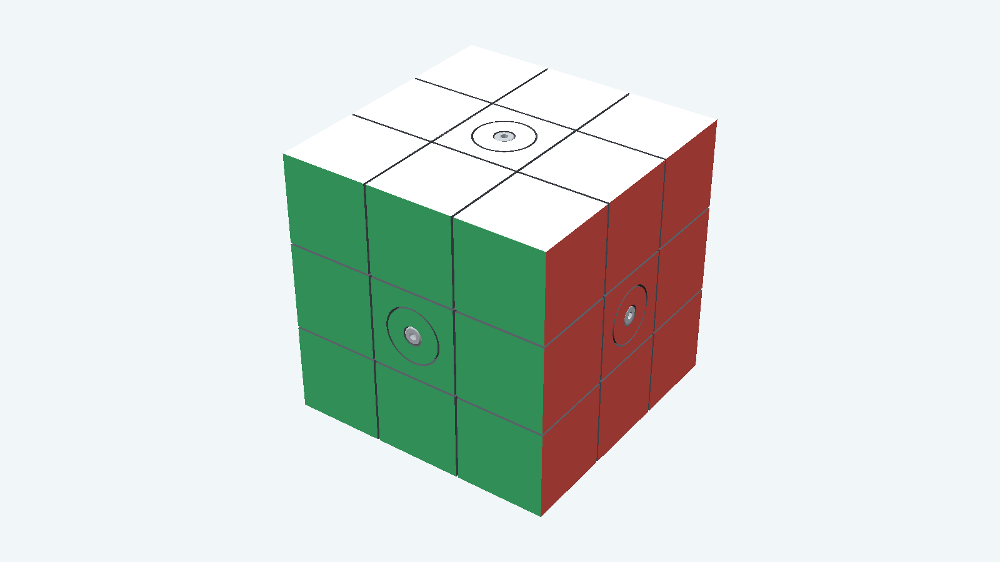

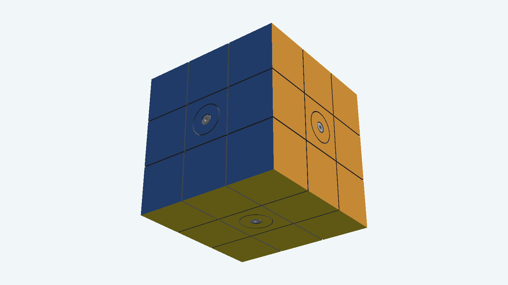

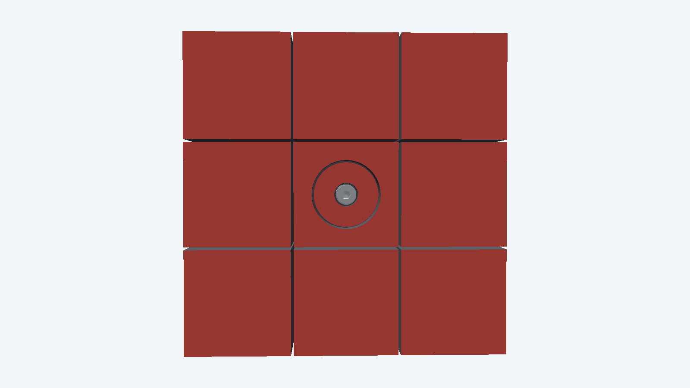

## Assembly

Place an M2 nut in each of the six open hex pockets on the hub. Place the eight corners around the hub and insert the
edges between them before adding the centers. Hold the loose blocks in place while assembling the first centers.
For each face, place its flanged sleeve against the hub, slide the center over it, then add the tube, disk, and M2 × 25
bolt. Tighten the bolt into the nut. The metal sleeves hold the disk clear of the turning center. Repeat on all six
faces. The bolt heads finish flush with the disks.

The two metal sleeves are custom turned parts, not printed pieces. Their dimensions are in
[instructions.md](instructions.md). Apply six distinct colors to the outside faces after assembly. This design has not
been physically printed or tested, so the sampled digital checks do not establish its feel or durability.

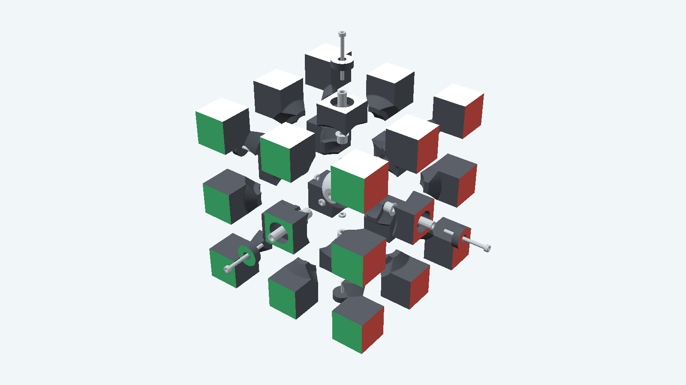

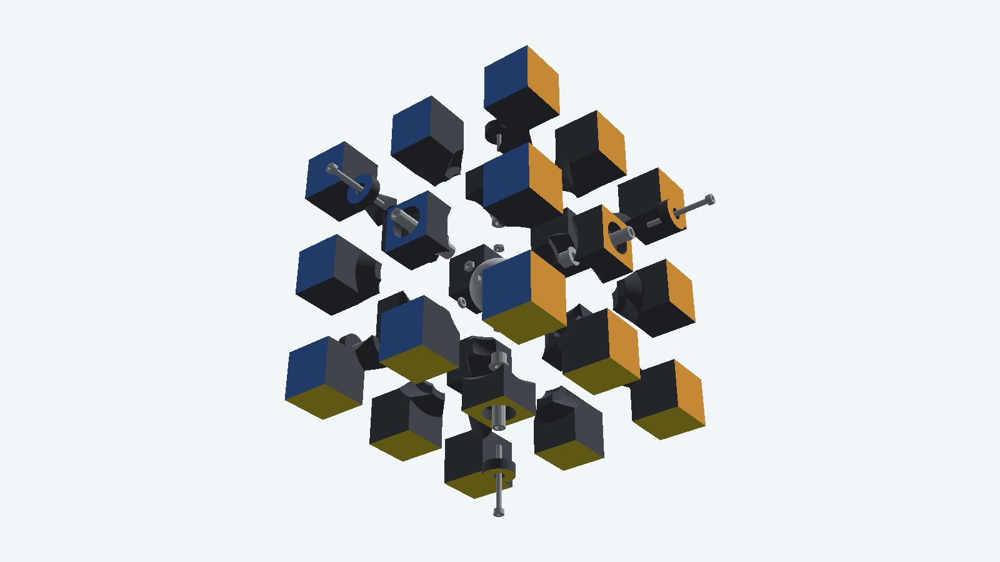

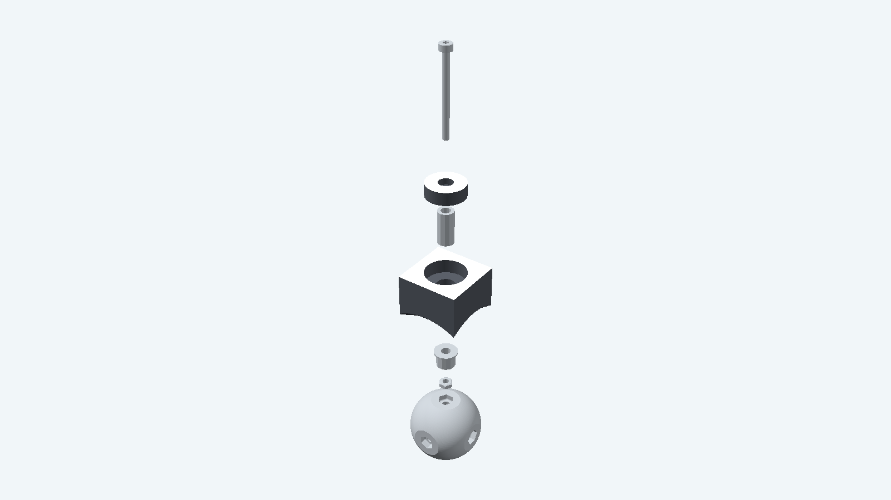

## Parts

| Part | Quantity |
|---|---:|
| 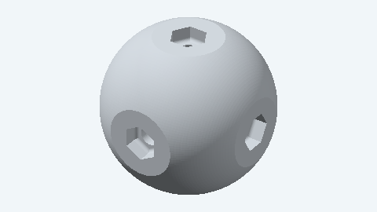 Hub | 1 |
| 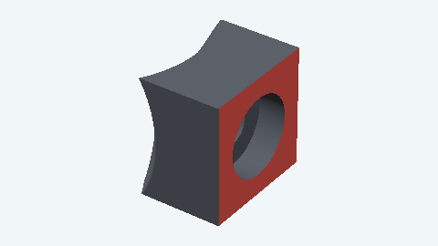 Center block | 6 |
| 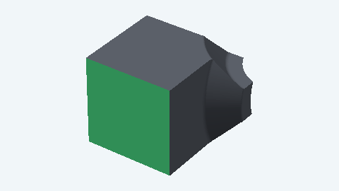 Edge block | 12 |
| 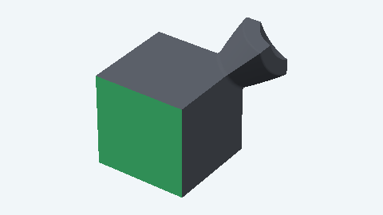 Corner block | 8 |
| 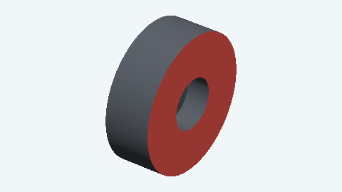 Center disk | 6 |
| 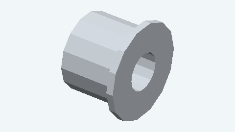 Flanged metal sleeve | 6 |
| 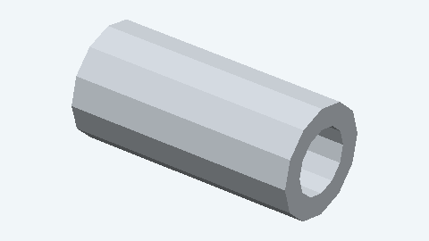 Metal tube | 6 |
| 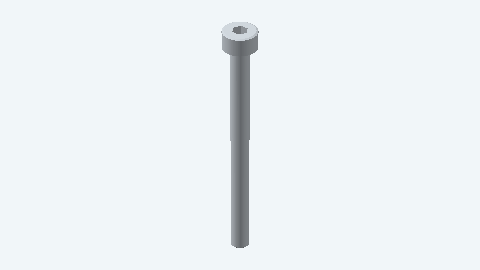 M2 × 25 socket-head bolt | 6 |
| 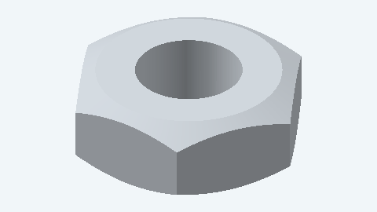 M2 nut | 6 |

The [construction contract](instructions.md) records dimensions, print orientations, and the retained nut-mating
corners. The [Decad steps](steps.md) describe the build. The [model notes](../../docs/models/cubepuzzle.md) describe
the Go API and digital checks.
