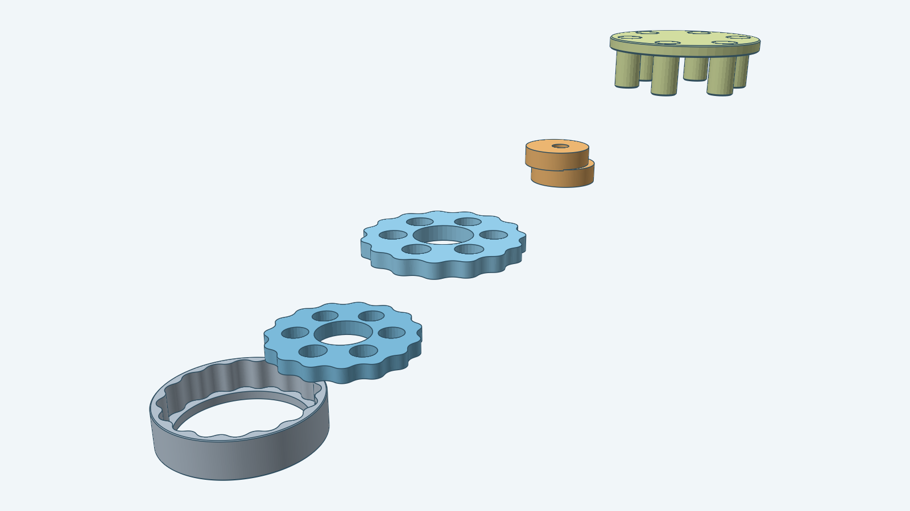

# Cycloidal drive



This item builds a cycloidal speed reducer with Decad: one or two lobed rotor discs on an eccentric cam,
a pinless housing whose inner wall is the discs' swept contour, and an output plate whose pins pass
through holes in the discs. The image shows the two-disc drive pulled apart along a staircase. Its
source is [instructions.md](instructions.md), which follows the Fusion add-in's
`fusion360-gear-generator/spec/cycloidal`. The [steps](steps.md) map the contract to Sketch and Decad
operations. Dimensions are in millimeters.

The Go package exposes `Build(ctx, doc, Params)`. It returns a `Drive` whose bodies carry the add-in's
names, and `Drive.Named` lists them in order. `DefaultParams()` is the add-in's default: 16 pins on a
90 mm pin circle, 1.5 mm eccentricity, one 8 mm disc and six 50 mm output pins. `Params` carries
every dialog input of the add-in, and `Placement` (an `r3.Frame`) replaces its plane and anchor point:
the frame origin is a point on the drive axis and the first disc's lower face lies on its plane. The
document needs a chain tolerance:

```go
doc := decad.New(decad.WithChainTolerance(units.Millimeters(0.1)))
```

`Problems` and `Validate` apply the add-in's validity table, with its wording, before anything is built.

## What differs from the Fusion add-in

- The rotor discs are not chamfered. Decad cannot offset a rim made only of fit splines exactly. The
  housing, the output plate and the pin ends take `ChamferSize`.
- With `DiscGap = 0` the two cam sections are separated by a 0.25 mm relief and joined by a bridge cylinder
  on the drive axis, because decad does not decide a union of bodies that share a face.
- Each lobe is drawn as three fit splines, one per curvature sign, because decad certifies a spline only
  when its curvature has one sign. A drive with many lobes is sampled coarser when decad's work ceiling
  refuses the finest sampling.
- The casing contour is an exact per-direction envelope instead of the add-in's binned radius, which is
  jagged. The housing is one prism cut by the contour cavity and a base hole, not a base ring joined to
  patterned casing sectors, because decad does not decide unions of bodies that share a face.
- The disc's bore and output holes are inner loops of its one sketch, not separate cuts.
- The add-in's four sub-components and its message for skipped chamfers are Fusion-only. Decad has no
  component tree, and the gallery reports an unsupported chamfer as an error.

## Checks

`go test ./models/cycloidal` builds the default drive, a two-disc drive and nine option variants
(solid cam, pin overrides, 12 and 24 pins, five output pins, 20 pins with two discs, a placement frame,
a thin housing, larger clearances). Every body passes 0.1 mm `VerifyAll`, every sketch is fully
constrained, and the rotor clears the casing, the cam and the output pins at the home pose.

The [model renderer](../../tools/render/README.md) produces the images from the two-disc drive.
