# Cycloidal drive

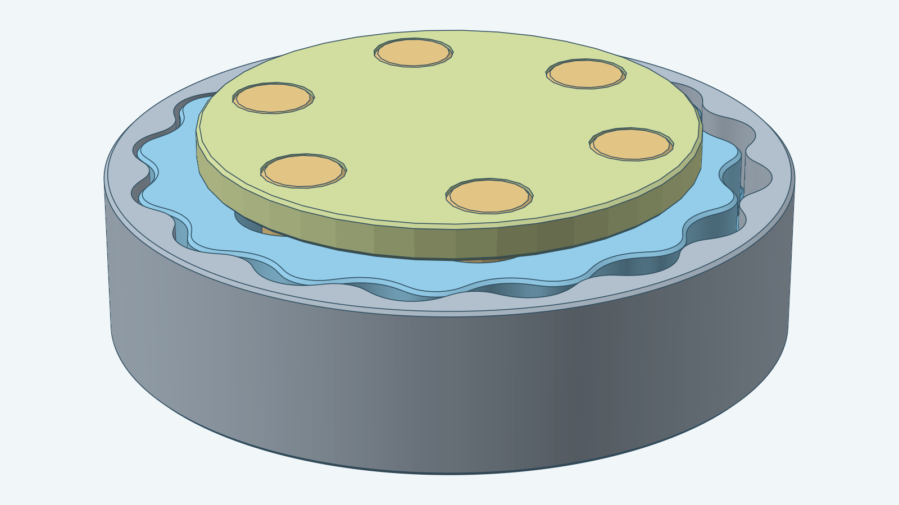

A cycloidal speed reducer. One or two lobed discs ride on an eccentric cam inside a pinless housing. An output
plate carries pins through holes in the discs. The default configuration has one disc; the images show the
two-disc option so both rotors are visible.

The drive has 16 pin positions on a 90 mm circle, 1.5 mm of eccentricity, an 8 mm disc and six output pins on a
50 mm circle.

## Assembled

The two-disc drive from the output end, input end and side.

| From the output end | From the input end | From the side |
| --- | --- | --- |
| 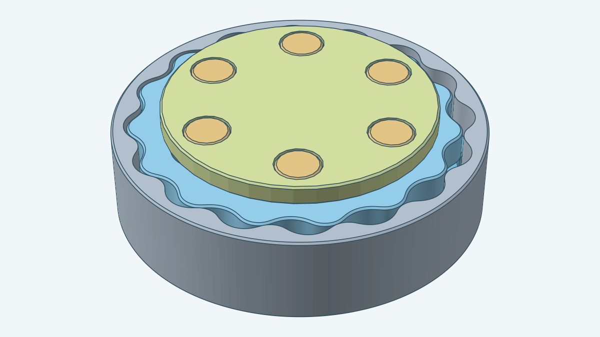 | 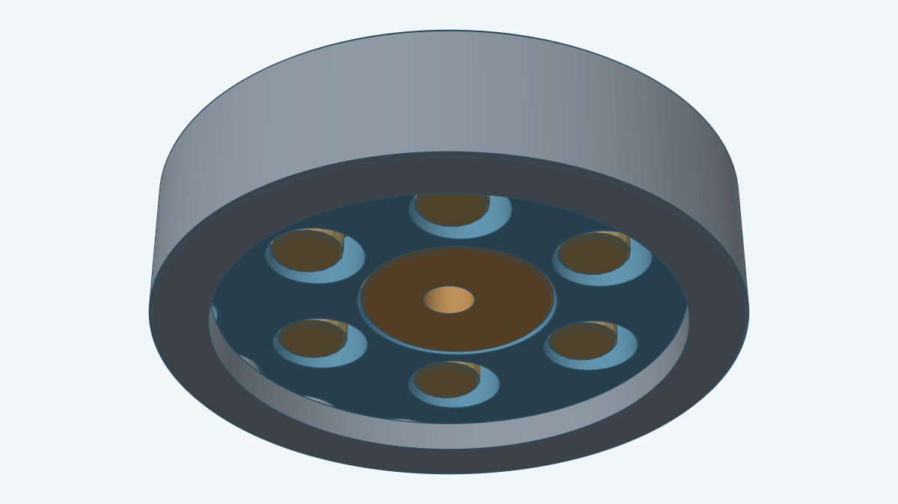 | 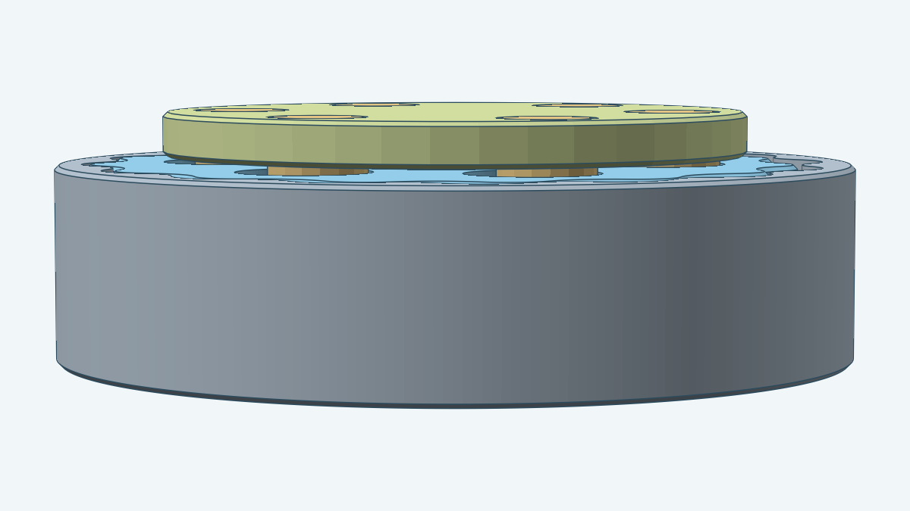 |

## Exploded

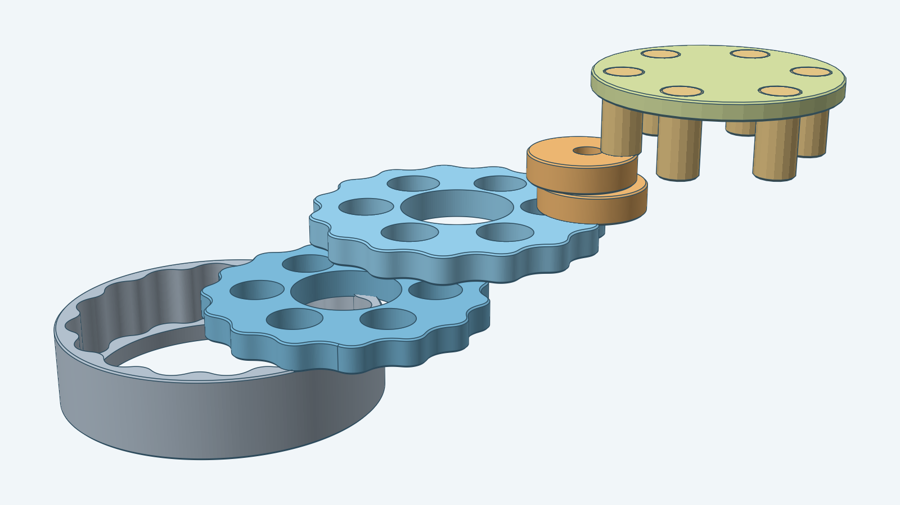

## Parts

Each image shows one named body of the two-disc build. The six output pins have the same shape and appear
separately because each pin is its own body.

| Image | Name |
| --- | --- |
| 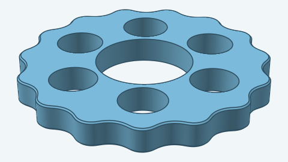 | Cycloidal Disk 1 |
| 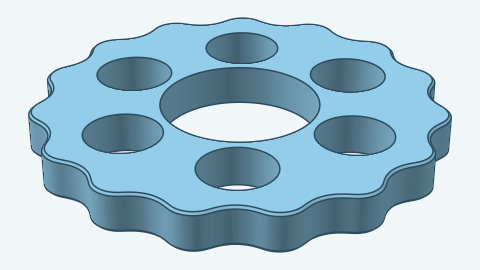 | Cycloidal Disk 2 |
| 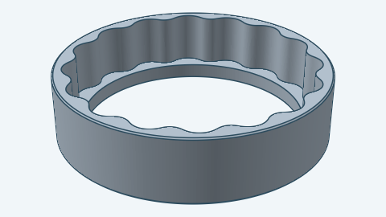 | Housing |
| 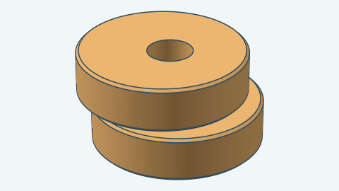 | Eccentric Cam |
| 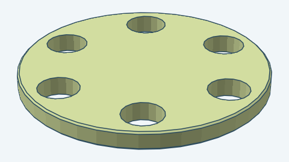 | Output Plate |
|  | Output Pin 1 |
| 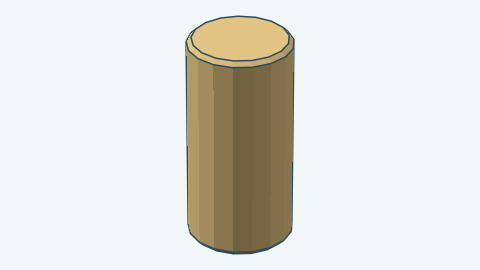 | Output Pin 2 |
| 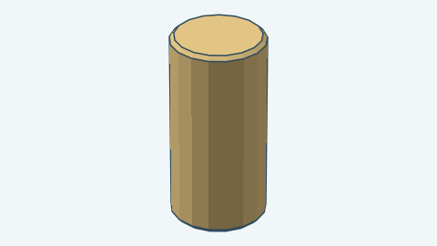 | Output Pin 3 |
| 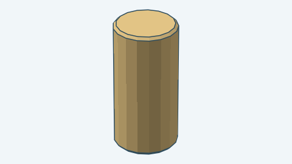 | Output Pin 4 |
| 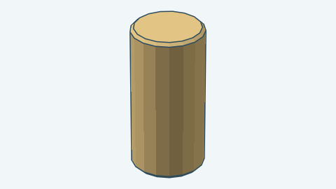 | Output Pin 5 |
| 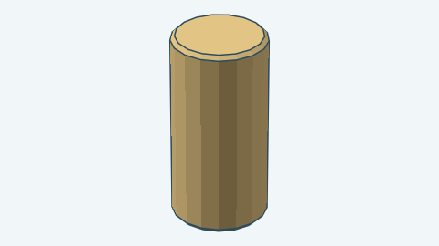 | Output Pin 6 |

You can vary:

- The number of pin positions and the pin circle diameter.
- The eccentricity, the pin diameters and the clearances. Moving custom parts have the Regular fit and pins in
  the plate have the press fit.
- One or two discs, their thickness and the gap between them.
- The cam diameter and the input shaft bore, or a solid cam.
- The number and circle of the output pins.
- The housing wall, base and output plate thickness.
- The chamfer size; it defaults to the required 0.5 mm at 45° on long convex outer rims of the
  rotor discs, housing, cam and output plate, and on both ends of every output pin.
- The position and orientation of the drive in space.

Dimensions are in millimeters.

For how to build this drive from Go, see the
[developer notes](../../docs/models/cycloidal.md).
