# Graham escapement

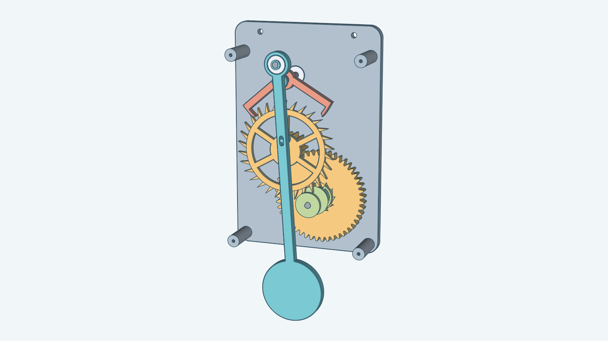

A desk-clock-size Graham escapement. A falling weight turns a great wheel, which turns a 30-tooth escape wheel through a
13-tooth pinion. An anchor with two pallets lets the escape wheel advance one half tooth at a time. A crutch on the
anchor's arbor pushes a pendulum, and the pendulum's swing times the anchor. The model includes the weight drive's drum,
ratchet and winding knob, but no cord or weight. It has 29 bodies, seven of them purchased 605ZZ bearings.

The whole movement is 122 mm wide, 184 mm tall and 51.75 mm deep, from the back of the back plate to the suspension
cap. Every part fits a 220 × 220 mm print bed. The default pendulum is 215 mm long, so it is the longest part.

## How the escapement works

The anchor has two pallets, one on each side of the escape wheel. Each pallet is a band 2.8 mm wide cut from an arc
about the anchor's arbor. The pallets span 7.5 tooth pitches, so when one pallet holds a tooth the other pallet's gap is
half a tooth off, and each beat advances the wheel by exactly half a tooth.

- **Lock.** A tooth tip rests on a pallet's locking face, an arc about the anchor's arbor. As the anchor swings, the
  tip slides along that arc and the wheel does not move, so the wheel exerts no torque on the anchor and does not push
  the pendulum back. This is the deadbeat action. With the default 1.5° lock angle, the tip sits about 1.0 to 1.1 mm
  inside the tooth tip circle.
- **Impulse.** When the anchor's swing frees the tooth, the tip slides down the pallet's straight impulse face. The
  wheel turns 4.0° while the anchor swings through the 2.5° lift angle, and the tooth pushes the anchor on.
- **Drop.** The tip leaves the impulse face. The wheel turns another 1.99°, which is 1.39 mm at the tooth tip, and the
  next tooth lands on the other pallet's locking face.

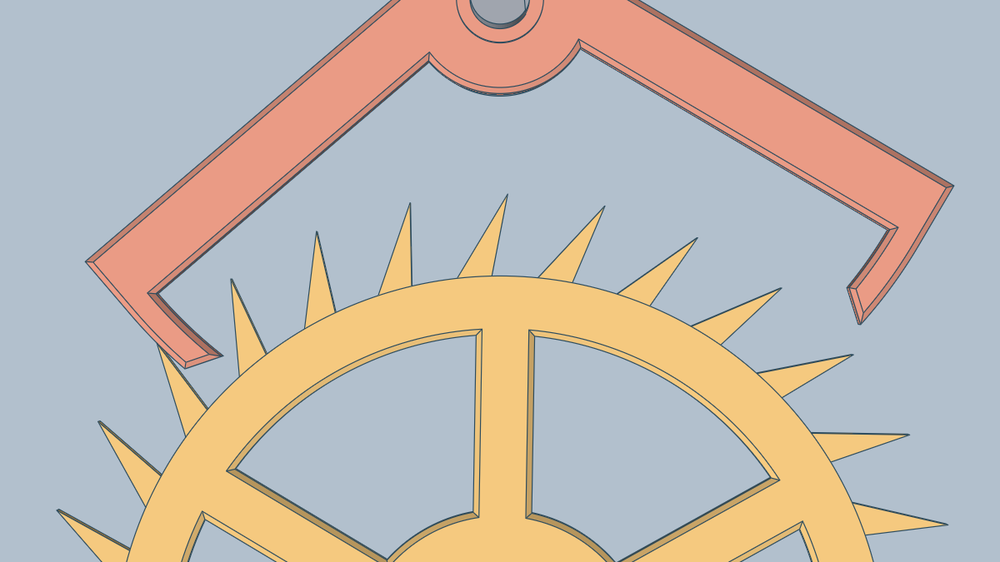

The anchor swings ±5° by default, which swings the pendulum ±3.8°. The wheel advances 12°, one tooth, in each
pendulum period. At the default 180 mm pendulum length the period is 0.85 s, two beats per period. A simulation of the
real wheel and anchor outlines in the model's tests measures one tooth per period, no recoil, and two drops of
1.39 mm per period, each landing on a locking face. With the Decad outlines the least gap from any other tooth to a
pallet is 0.62 mm.

## How it moves

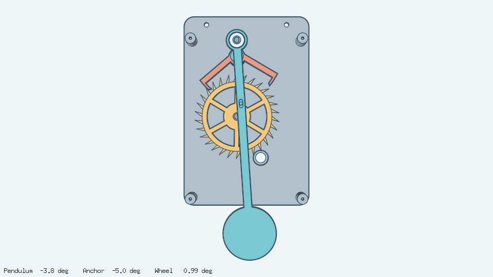

The animation shows one pendulum period in 36 frames. The crutch pin stands in a slot in the pendulum, so the pendulum's
swing turns the anchor, and the anchor lets the wheel advance one tooth per period. The loop has no jump: after one
period the wheel has turned one tooth, and the wheel looks the same. The drive train and the front parts are left out of
the animation. The drive does not repeat in one period.

## Assembled

| From the front | From above and the right | From the right |
| --- | --- | --- |
| 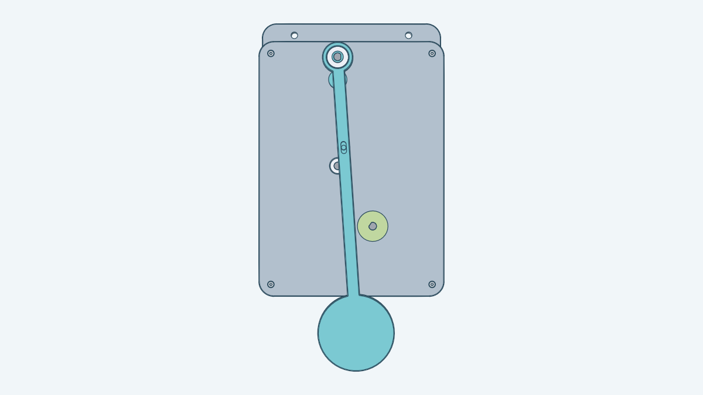 | 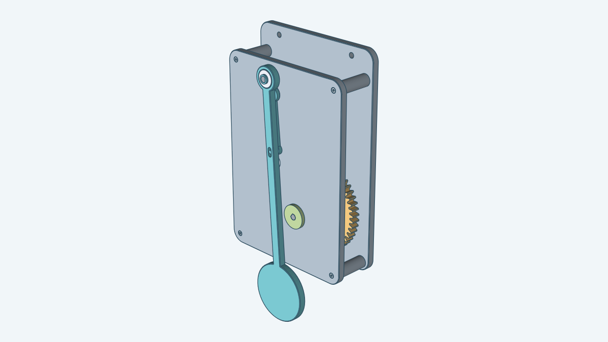 | 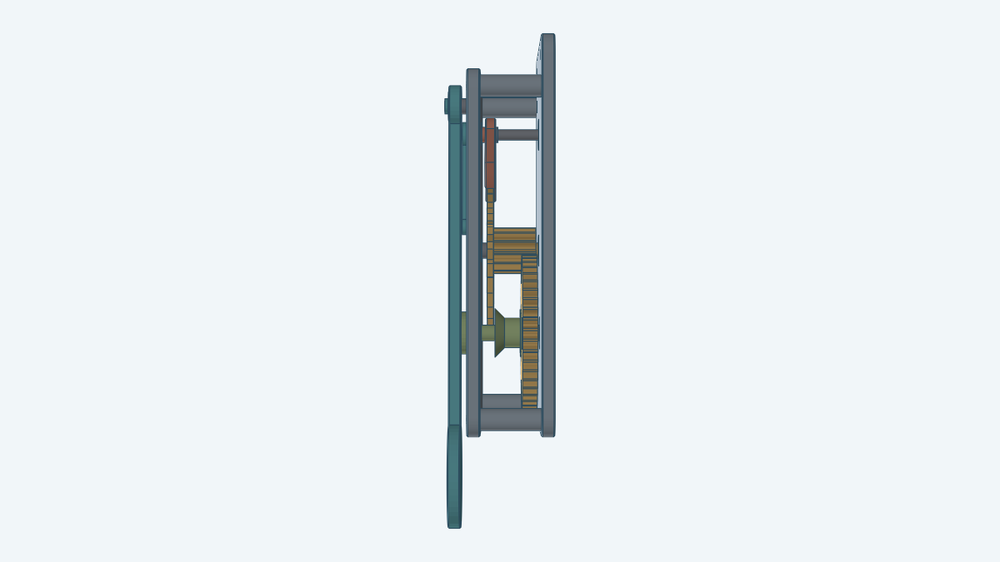 |

## Exploded

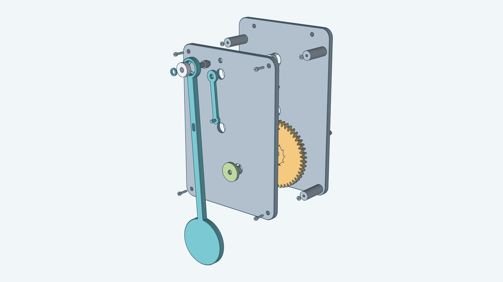

The picture pulls the parts apart along the movement's axis, from the arbors at the back to the suspension cap at the front. The arbors lie 70 mm behind the back plate, so the back plate hides most of them.

## Parts

The movement has 29 bodies and 16 distinct kinds. The table shows one of each kind and the counts are in the text:
seven bearings (the seventh sits in the pendulum), four bolts, four nuts, and every other part once.

| Image | Name |
| --- | --- |
| 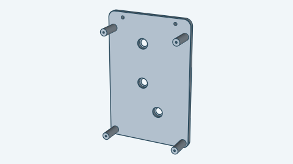 | Back plate, with four pillars, three bearing seats, two mounting holes and the nut cavities |
| 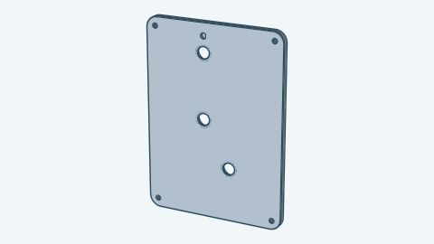 | Front plate, with three bearing seats, four head pockets and the suspension socket |
|  | Escape wheel, with the 13-tooth pinion and a rear boss |
| 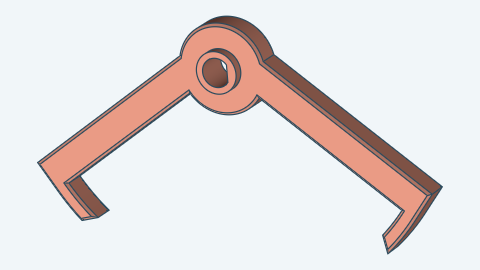 | Anchor |
| 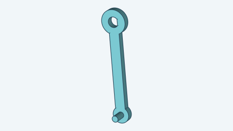 | Crutch, with its pin |
| 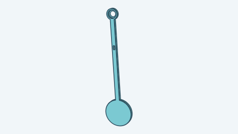 | Pendulum, with the crutch slot and the bearing pocket |
| 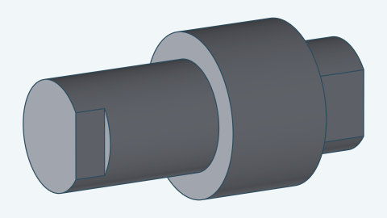 | Suspension pin |
|  | Suspension cap |
| 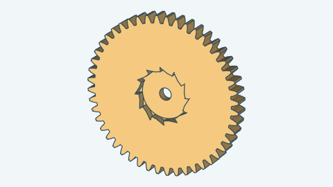 | Great wheel, with the internal ratchet |
| 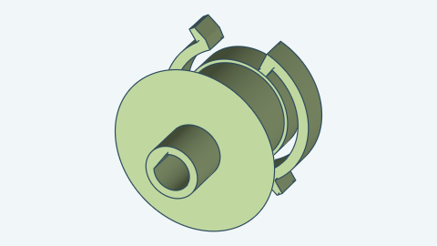 | Drum, with two flexure pawls |
| 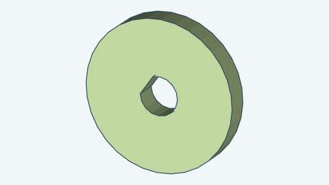 | Winding knob |
| 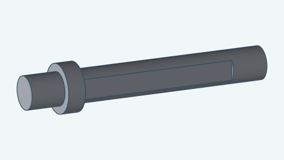 | Escape arbor |
| 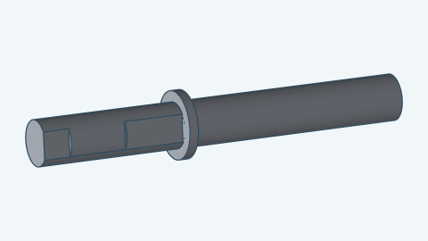 | Pallet arbor |
| 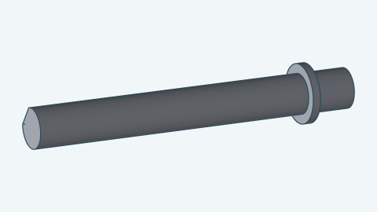 | Great wheel arbor |
| 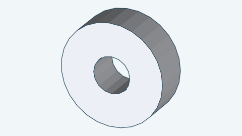 | Bearing (605ZZ), seven in all |
| 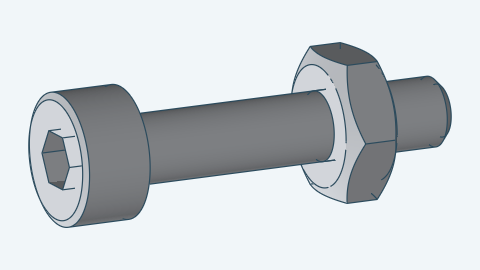 | M2 × 10 bolt, with its nut: four bolts and four nuts |

The three arbors look alike and carry no marks, because a 1.5 mm mark hole with 1 mm of material on each side needs a
face wider than a 5 mm arbor offers. They differ in length and in where the collar is. The escape arbor is 38 mm long and
the other two are 42.2 mm. The pallet arbor's collar is in the middle, near `z` 20, and the great wheel arbor's collar
is at its rear end.

## How it is driven

A weight on a cord hangs from the left side of the drum, 7 mm to the left of the great wheel's axis, and turns the drum
counter-clockwise. Two flexure pawls on the drum push the great wheel's internal ratchet. The great wheel turns the
13-tooth pinion on the escape wheel, which turns clockwise. The ratio is 48 ÷ 13.

To wind, turn the winding knob clockwise. The drum turns clockwise, and each pawl's arm flexes inward and clicks over
the 12 ratchet teeth, so the great wheel stays where it is. Under load the arms are in tension.

One escape wheel turn takes 30 pendulum periods, 25.5 s at the default pendulum length. One drum turn is 48 ÷ 13 wheel
turns, about 94 s. The model has no cord, so the run time for a length of cord is an estimate that depends on the
cord's thickness and the weight.

## Printing and assembly

Print each part without supports in this orientation:

- Escape wheel: the wheel face down.
- Anchor: the rear face down.
- Drum: the pawl layer down.
- Great wheel: the rear face down.
- Crutch and pendulum: the rear face down.
- Arbors and the suspension pin: standing on end, with the 1.2 mm collar ledge printing as a small overhang.
- Back plate: the rear face down. **Pause at 32 mm above the bed** (`z` 26 in the model), drop the four nuts into
  their open cavities, and resume. The next layers close the cavities and hold the nuts.
- Front plate: the front face up or down.

Assemble in this order:

1. Press the three back bearings into the back plate's seats, then set the arbors in them.
2. Slide the escape wheel on from the escape arbor's rear end, with the pinion toward the front, until its front face
   nearly meets the collar. It is a press fit: the D-shaped bore and the arbor's flat turn together.
3. Press the anchor on the pallet arbor from the front until its rear face nearly meets the pallet collar.
4. Slide the great wheel on its round arbor, then press the drum on the flat until the great wheel just turns freely.
5. Place the front bearings, then the front plate, and tighten the four M2 × 10 bolts from the front. Each head ends flush
   with the plate's face.
6. Press the crutch and the winding knob on the arbor ends, and the suspension pin's rear peg into the front plate's
   D-shaped socket. Set the pendulum's bearing on the pin and the crutch pin in the pendulum's slot, and press the cap on
   the pin's front peg.

Hang the movement level, so the pendulum hangs at the anchor's centre position, ψ = 0. Wind clockwise.

## Fits and edge finishing

- **Shafts in bearings.** Every arbor and the suspension pin is 5.0 mm across at a bearing, the same as the 605ZZ's
  bore, so the fit has no clearance.
- **Press fits.** The escape wheel, anchor, drum, crutch, knob and cap each have a D-shaped bore with 0.05 mm of radial
  clearance on the arbor's or pin's flat. The suspension pin's rear peg has the same fit in the front plate. Each
  bearing sits in a seat with 0.05 mm of radial clearance.
- **Tight fits, 0.25 mm.** Collars, bosses, the pin's shoulder and the cap stand 0.25 mm from a bearing face. The crutch
  and knob stand 0.25 mm off the front plate. The crutch pin has 0.25 mm on each side in the pendulum's slot. The great
  wheel stands 0.25 mm from its collar and the drum's pawl layer 0.25 mm from the ratchet pocket floor.
- **Regular fit, 0.40 mm.** The great wheel's 5.8 mm bore turns on the 5.0 mm arbor.
- **Loose fits.** The pendulum is 0.5 mm in front of the crutch and the knob. The anchor is 2.0 mm and the escape wheel
  3.0 mm behind the front plate. A pawl's arm clears the ratchet teeth by 1.0 mm.
- **Gears.** The pinion's tips clear the great wheel's roots by 0.54 mm and the great wheel's tips clear the pinion's roots
  by 0.54 mm, at module 1.5. The default backlash is 0.15 mm per gear.

The back and front plates have their outer edges, the bearing seat rims and the lip-bore rims chamfered by 0.5 mm at 45°.
The anchor's whole outline, the pendulum's outline with its pocket and lip-bore rims, and the six windows of the escape
wheel are chamfered too. The escape wheel's teeth, the great wheel's teeth and ratchet, the plates' small holes, the head
pockets, the crutch slot and the faces under 400 mm² are not chamfered.

You can vary:

- The pendulum length, from 120 mm to 250 mm.
- The anchor's swing, from the lift and lock angles plus 1° up to 6°.
- The lock angle, 1.25° to 1.5°, and the lift angle, 2° to 3°.
- The pose, as a fraction of one period.
- Backlash, 0 to 0.3 mm.
- The position and orientation of the movement in space.

Everything else is fixed. For how to build the movement from Go, see the [developer notes](../../docs/models/escapement.md).
