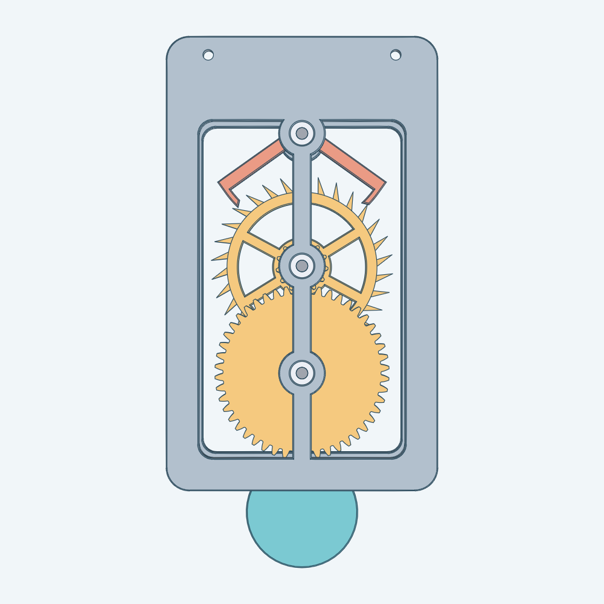
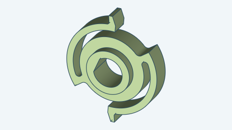
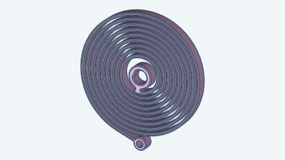
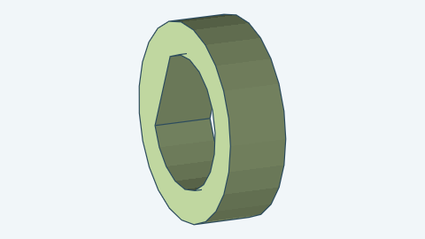
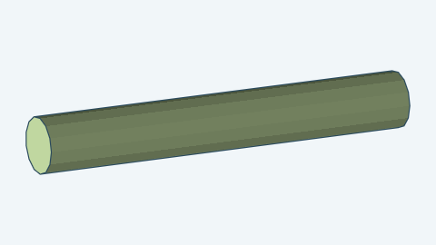
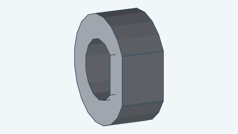

# Graham escapement

A desk-clock-size Graham escapement. An open spiral mainspring turns a great wheel, which turns a 30-tooth escape wheel through a
13-tooth pinion. An anchor with two pallets lets the escape wheel advance one half tooth at a time. A crutch on the
anchor's arbor pushes a pendulum, and the pendulum's swing times the anchor. The model includes the mainspring, the pawl carrier
with the great wheel's internal ratchet, and the winding knob. It has 34 bodies, seven of them purchased 605ZZ bearings.

The whole movement is 116 mm wide, 194 mm tall and 52.80 mm deep, from the back of the back plate to the suspension
cap. Every part fits a 220 × 220 mm print bed. The default pendulum is 215 mm long, so it is the longest part.

## How the escapement works

The anchor has two pallets, one on each side of the escape wheel. Each pallet is a band 2.8 mm wide cut from an arc
about the anchor's arbor. The pallets span 7.5 tooth pitches, so when one pallet holds a tooth the other pallet's gap is
half a tooth off, and each beat advances the wheel by exactly half a tooth.

- **Lock.** A tooth tip rests on a pallet's locking face, an arc about the anchor's arbor. As the anchor swings, the
  tip slides along that arc and the wheel does not move, so the wheel exerts no torque on the anchor and does not push
  the pendulum back. This is the deadbeat action. With the default 1.5° lock angle, the tip sits about 1.0 to 1.1 mm
  inside the tooth tip circle.
- **Impulse.** When the anchor's swing frees the tooth, the tip slides down the pallet's straight impulse face. The
  wheel turns 4.0° while the anchor swings through the 2.5° lift angle, and the tooth pushes the anchor on.
- **Drop.** The tip leaves the impulse face. The wheel turns another 1.99°, which is 1.39 mm at the tooth tip, and the
  next tooth lands on the other pallet's locking face.

The anchor swings ±5° by default, which swings the pendulum ±3.8°. The wheel advances 12°, one tooth, in each
pendulum period. At the default 180 mm pendulum length the period is 0.85 s, two beats per period. A simulation of the
real wheel and anchor outlines in the model's tests measures one tooth per period, no recoil, and two drops of
1.39 mm per period, each landing on a locking face. With the Decad outlines the least gap from any other tooth to a
pallet is 0.62 mm.

## How it moves

The animation shows one pendulum period in 36 frames. The crutch pin stands in a slot in the pendulum, so the pendulum's
swing turns the anchor, and the anchor lets the wheel advance one tooth per period. The loop has no jump: after one
period the wheel has turned one tooth, and the wheel looks the same. Both plates stay in the animation, because they are
fixed. The drive train, the front bearings and the bolts are left out of it. The drive does not repeat in one period.

## Assembled

| From the front | From above and the right | From the right |
| --- | --- | --- |
|  |  |  |

## Seen from the back

The back plate's windows show the great wheel's back face and teeth, the pinion's ring beyond the hub, and the escape
wheel and the anchor behind them. The strip down the middle hides the mesh of the pinion and the great wheel.

## Open frame

Both plates are open frames, mirror-symmetric about a plumb line. Each has a rim, a spine 8 mm wide and a hub ring of
radius 10 round each bearing, and two windows. The suspension, the pallet arbor, the escape arbor and the great wheel
arbor stand on that line, and the pendulum hangs down it at rest, so every still image reads vertical. From the front,
through the front plate's windows, you see the escape wheel's teeth, the anchor's pallets and arms, the great wheel's teeth
and the ratchet with its pawls. The spine, the hubs and the winding knob hide only the middle of each wheel. The model is
for a wall mount and has no stand.

## Exploded

The picture pulls the parts apart along the movement's axis, so each arbor, its wheels and its bearings stay in one line. A layer moves sideways only where a part it joins would hide it: the crutch lies inside the pendulum's outline, so the pendulum, its bearing and the suspension cap step 25 mm to the right. A dotted line joins a part to its place on the part it joins when the part moved off its own line, here the pendulum and its bearing. Each arbor sits beyond the wheels pressed onto it, in the same line.

## Parts

The movement has 34 bodies and 20 distinct kinds. The table shows one of each kind and the counts are in the text:
seven bearings (the seventh sits in the pendulum), two end collar rings, four bolts, four nuts, and every other part once.

| Image | Name |
| --- | --- |
|  | Back plate, an open frame with two windows, four pillars, three bearing seats, two mounting holes and the nut cavities |
|  | Front plate, an open frame with two windows, three bearing seats, four head pockets and the suspension socket |
|  | Escape wheel, with the 13-tooth pinion and a counterbore for the arbor's collar in its front face |
|  | Anchor, pressed on the pallet arbor and rocks with it, and its two pallets catch the escape wheel's teeth one at a time |
|  | Crutch, with its pin and a keyed counterbore for the crutch collar in its rear face |
|  | Pendulum, with the crutch slot and the bearing pocket |
|  | Suspension pin, the pendulum's pivot: its rear peg presses into the front plate's socket, and its round 5.0 mm shank carries the pendulum's bearing |
|  | Suspension cap, a 1.5 mm thick, 7.4 mm wide disc with a D-shaped socket that presses onto the pin's front peg and holds the pendulum's bearing on the pin so the pendulum cannot slide off. It is a retainer, not an arbor collar |
|  | Great wheel, with the internal ratchet and a counterbore for the arbor's collar in its rear face |
|  | Pawl carrier, with two flexure pawls. It is pressed on the great wheel's arbor, and its pawls push the great wheel's internal ratchet, so the spring drives the wheel but the wheel does not unwind when you wind the knob |
|  | Mainspring, an open spiral in PETG |
|  | Spring retainer, a 3 mm thick, 10 mm wide ring pressed on the great wheel's arbor in front of the mainspring's hub, so the hub stays on the arbor between the pawl carrier and the retainer |
|  | Spring anchor pin, a rod pressed into the front plate that holds the mainspring's outer eye still while the arbor winds the hub |
|  | Winding knob, with a keyed counterbore for the knob collar in its rear face. It is pressed on the front end of the great wheel's arbor, and turning it winds the mainspring |
|  | Escape arbor |
|  | Pallet arbor |
|  | Great wheel arbor |
|  | End collar ring, a 3 mm ring with a D-shaped outer surface and a D-shaped bore: two in all, one on the pallet arbor and one on the great wheel arbor, both in front of the front plate |
|  | Bearing (605ZZ), seven in all |
|  | M2 × 10 bolt, with its nut: four bolts and four nuts |

The three arbors look alike and carry no marks, because a 1.5 mm mark hole with 1 mm of material on each side needs a
face wider than a 5 mm arbor offers. They differ in length and in where the collar is. The escape arbor is 38 mm long and
the other two are 43.25 mm. The escape arbor's collar is near its front end, the pallet arbor has a long shoulder from its
rear end to `z` 21, and the great wheel arbor's 3 mm collar is at its rear end. The two end collar rings carry no marks, because a ring is at most 1.1 mm wide. They are the same part. An end ring is flat on one side of its outside, and its bore is 4.1 mm across.

## How it is driven

The great wheel sits directly below the escape wheel, on the same plumb line. An open spiral mainspring, 64 mm across and
6 mm tall, sits on the great wheel's arbor. Its inner hub fits the arbor's flat, and its outer eye hooks on a pin pressed into
the front plate's spine, directly below the arbor. The spring is not in a barrel, so it shows through the front plate's
windows. Two flexure pawls on the pawl carrier, which is pressed on the same arbor, push the great wheel's internal ratchet.
The great wheel turns the 13-tooth pinion on the escape wheel, which turns clockwise. The ratio is 48 ÷ 13.

To wind, stop the pendulum and turn the winding knob clockwise about 2¼ turns, until it stiffens. Never turn it past the stiff
point. The spring tightens, and each pawl's arm flexes inward and clicks over the 12 ratchet teeth, so the great wheel stays
where it is. Under load the arms are in tension.

The spring gives about 8 N·mm at the end of its run and 44 N·mm at full wind, an estimate for printed PETG. From full wind the
great wheel turns about 1.8 times, which is 6.8 escape wheel turns and 204 pendulum periods: **about 3 minutes** at the default
pendulum length. The torque and the losses are estimates, not measurements. The strain at full wind is 0.93 %, about a
quarter of PETG's yield strain. PETG creeps under a held load, so let the spring run down after a showing. At full wind the
pendulum may swing wider than the default; check the amplitude on a first print, and do not let it pass about 7.5° at the
anchor, where the pallets reach the wheel's roots.

## Printing and assembly

Print each part without supports in this orientation:

- Escape wheel: the wheel face down. The floor of its front counterbore prints as a ring 0.9 to 1.15 mm wide over air, which
  needs no support.
- Anchor: the rear face down.
- Pawl carrier: the pawl layer down.
- Mainspring: flat, in PETG. The other parts can use PLA.
- Spring retainer: flat on the bed, axis vertical.
- Great wheel: the rear face down. The floor of its counterbore prints as a ring 0.65 mm wide over air, which needs no support.
- Crutch and pendulum: the rear face down. The floor of the crutch's and the knob's rear counterbore prints as an overhang
  ring over air, 0.9 to 1.3 mm wide, which needs no support.
- Collar rings and the suspension cap: flat on the bed, axis vertical.
- Arbors and the suspension pin: standing on end, with the 1.2 mm collar ledge printing as a small overhang.
- Back plate: the rear face down. **Pause at 32 mm above the bed** (`z` 26 in the model), drop the four nuts into
  their open cavities, and resume. The next layers close the cavities and hold the nuts.
- Front plate: the front face up or down. The plates print flat, and the windows need no support.

Assemble in this order:

1. Off the frame, on the escape arbor: slide the escape wheel on from the rear end, front face first so the pinion
   faces the back, until its front counterbore stops on the collar. It is a press fit: the D-shaped bore and the arbor's
   flat turn together. The bore is wider than the arbor's 5.0 mm bearing seat, so the wheel passes over the seat.
2. Off the frame, on the pallet arbor: press the anchor on from the front end until its rear face stops on the shoulder.
3. Off the frame, on the great wheel arbor, from the front end: slide the great wheel on, counterbore toward the back, up to the collar, then press the pawl carrier on
   the flat until the great wheel turns freely with about 0.25 mm of play. Slide the mainspring on the flat, then press
   the spring retainer on until it stops where the arbor's flat steps out, which leaves the spring hub about 0.25 mm of play.
4. Press the three back bearings into the back plate's seats, then push the three arbors into them from the front.
5. Place the front bearings on the arbors' front ends and hook the spring's eye on the anchor pin, which is pressed into
   the front plate. Set the front plate on, and tighten the four M2 × 10 bolts from the front. Each head ends flush
   with the plate's face.
6. Press the crutch collar on the pallet arbor's front end, flat to flat, until it stops at the end of the flat, then press
   the crutch on, its keyed counterbore over the collar, until it stops. Do the same with the knob collar and the winding
   knob on the great wheel arbor.
7. Press the suspension pin's rear peg into the front plate's D-shaped socket. Set the pendulum's bearing on the pin and
   the crutch pin in the pendulum's slot, and press the cap on the pin's front peg.

Hang the movement on a wall, level, so the pendulum hangs at the anchor's centre position, ψ = 0. The default pose is that
position. Wind clockwise.

## Fits and edge finishing

- **Shafts in bearings.** Every arbor and the suspension pin is 5.0 mm across at a bearing, the same as the 605ZZ's
  bore, so the fit has no clearance.
- **Press fits.** The escape wheel, anchor, pawl carrier, spring retainer, collar rings, crutch, knob and cap each have a D-shaped bore with 0.05 mm of radial
  clearance on the arbor's or pin's flat. Between the bearings each arbor is thicker than its 5.0 mm seats (3.3 mm radius, and
  3.05 mm under the great wheel), with the flat 0.05 mm further out than the seat radius, so
  the bores pass the seats. The ends outside the front plate and the pin's front peg are 4.0 mm across, so the rings, crutch, knob and cap keep
  walls of 1.65 mm or more; every pressed part has a wall of at least 1.6 mm round its bore. The suspension pin's rear peg has the same fit in the front plate. Each
  end collar ring has 0.05 mm of radial clearance in its keyed counterbore and 0.05 mm between its front face and the counterbore's floor, and the escape wheel
  has the same in its front counterbore. Each
  bearing sits in a seat with 0.05 mm of radial clearance.
- **Tight fits, 0.25 mm.** Collars, the arbors' own steps (where an arbor narrows from 6.6 to 5.0 mm), the pin's shoulder and the cap stand 0.25 mm from a bearing face, and the end collar rings start 0.25 mm in front of the front plate. The crutch pin has 0.25 mm on each side in the pendulum's slot. The great
  wheel's counterbore floor stands 0.25 mm from its collar's end and the pawl carrier's pawl layer 0.25 mm from the ratchet pocket floor. The spring hub has 0.30 mm on the arbor's flat, which the turning arbor closes to no less than 0.20 mm, and stands
  0.25 mm from the carrier boss and from the retainer, and the eye has 0.40 mm on the anchor pin.
- **Regular fit, 0.40 mm.** The great wheel's 6.9 mm bore turns on the arbor's 6.1 mm journal, and its 8.2 mm counterbore turns
  on the 7.4 mm collar.
- **Loose fits.** The crutch and the knob stand 1.30 mm in front of the front plate. The pendulum is 0.5 mm in front of the crutch and the knob. The anchor is 2.0 mm and the escape wheel
  3.0 mm behind the front plate. A pawl's arm clears the ratchet teeth by 1.0 mm.
- **Gears.** The pinion's tips clear the great wheel's roots by 0.54 mm and the great wheel's tips clear the pinion's roots
  by 0.54 mm, at module 1.5. The default backlash is 0.15 mm per gear.

The back and front plates have their outer edges, both windows, the bearing seat rims and the lip-bore rims chamfered by
0.5 mm at 45°. The anchor's whole outline, the pendulum's outline with its pocket and lip-bore rims, and the six windows
of the escape wheel are chamfered too, as are the rim of the escape wheel's front counterbore and the great wheel's rear counterbore. The escape wheel's teeth, the great wheel's teeth and ratchet, the plates' small holes, the head
pockets, the crutch slot and the faces under 400 mm² (the winding knob, the carrier, the retainer, the collar rings, the pinion's rear face and the pin) are not chamfered.

You can vary:

- The pendulum length, from 120 mm to 250 mm.
- The anchor's swing, from the lift and lock angles plus 1° up to 6°.
- The lock angle, 1.25° to 1.5°, and the lift angle, 2° to 3°.
- The pose, as a fraction of one period.
- Backlash, 0 to 0.3 mm.
- The position and orientation of the movement in space.

Everything else is fixed. For how to build the movement from Go, see the [developer notes](../../docs/models/escapement.md).
