# Bolts and nuts

**Build status:** Built and tested.

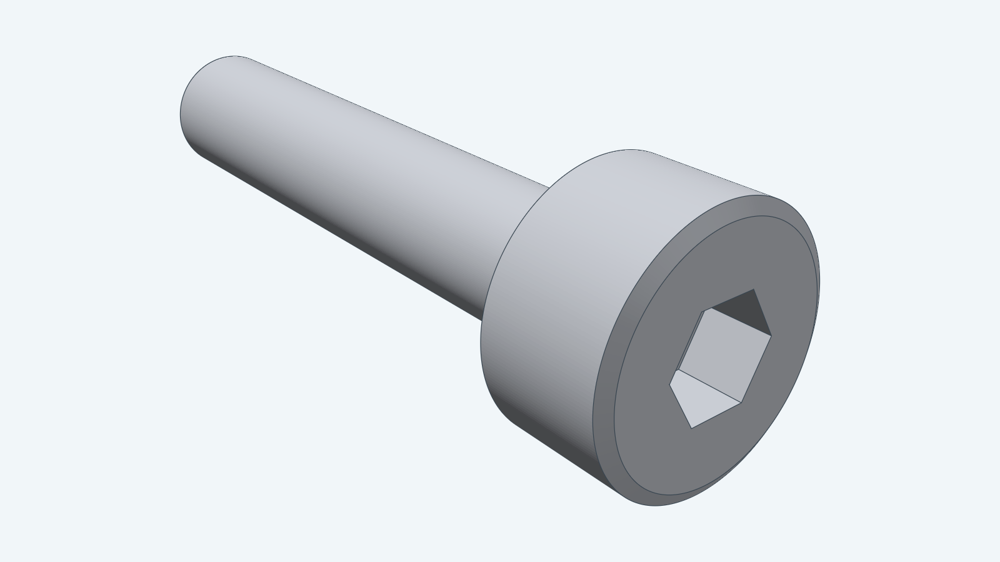

This model builds a bolt or a nut from a named size preset. The presets are M2 and M5. Each preset carries one bolt
and the hex nut that pairs with it, and the bolt comes in the preset's standard lengths.

| Preset | Bolt | Nut | Lengths (mm) | Build status |
| --- | --- | --- | --- | --- |
| M2 | Socket head cap screw, ISO 4762 / JIS B 1176 | Hex nut, ISO 4032 / JIS B 1181 | 6, 10, 16, 18, 20, 25 | Built and tested |
| M5 | Hex head bolt, ISO 4017 / JIS B 1180 | Hex nut, ISO 4032 style 1 / JIS B 1181 | 16, 20, 25, 30, 35, 40, 45, 50, 60, 70, 80 | Built and tested |

The thread is not modeled. A shank is a plain cylinder of the nominal diameter and a nut bore is the same nominal
diameter, so the model gives each part's envelope for fitting holes and parts. It does not set thread length,
tolerance or strength class.

**Clearance adjustment:** Nominal. Adjust custom mating geometry to provide fit clearance.

## M2 socket head cap screw

The M2 bolt follows the ISO 4762 dimension drawing: a 3.8 mm head with a chamfered top edge, a 1.5 mm hex socket
1 mm deep with a drill point, an underhead fillet, a 2 mm shank and a 45 degree chamfer at the tip. The default is an
M2x10 screw. You can change the length, measured from the head's underside to the tip, to one of the six standard
lengths.

The head end shows the hex socket and its drill point.

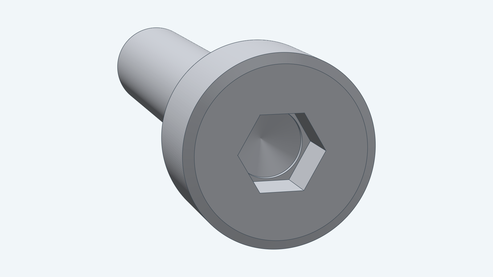

The side view shows the head chamfer, the underhead fillet and the tip chamfer.

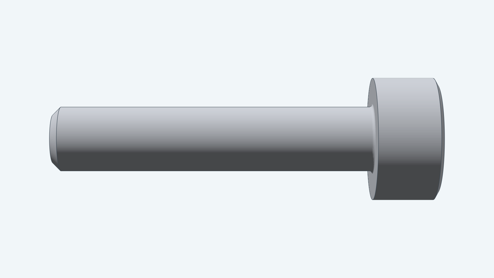

The tip end shows the flat tip, its chamfer and the underside of the head.

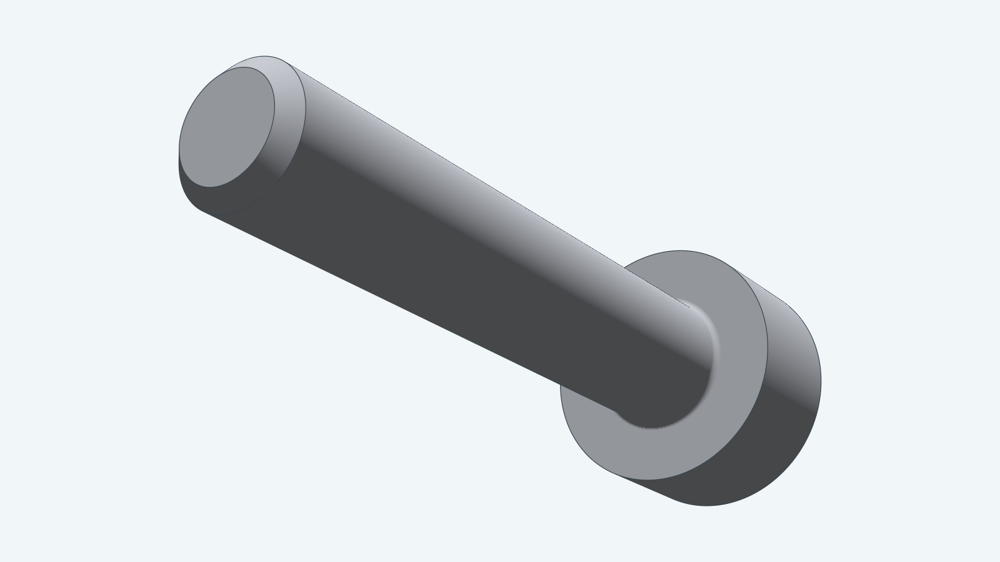

All six lengths, from M2x6 at the bottom to M2x25 at the top.

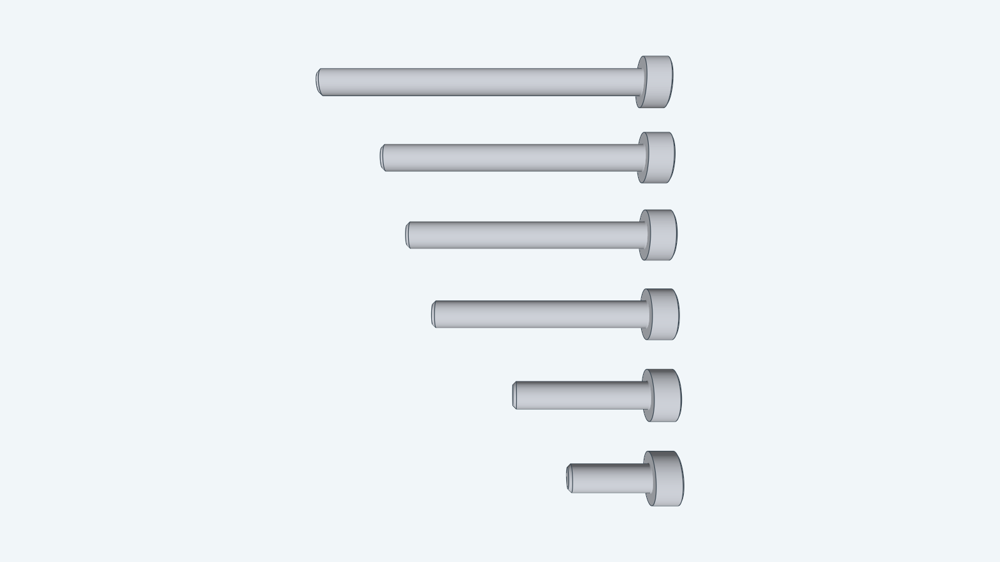

## M2 hex nut

The M2 nut pairs with the M2 bolt. It follows ISO 4032 and JIS B 1181: 4 mm across flats, 1.6 mm thick, a 2 mm bore,
and a 30 degree chamfer on every corner of both faces. The hexagon uses its exact corners, 4.619 mm across, where the
standards give a smaller minimum.

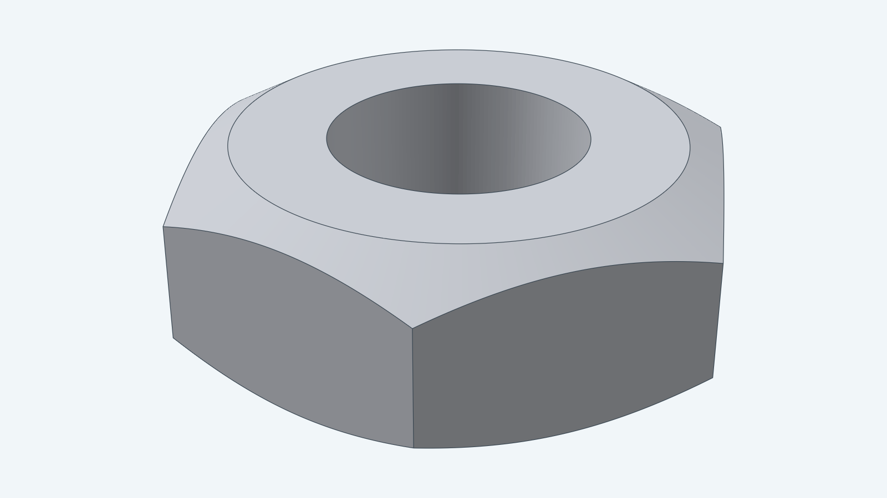

The top view shows the hexagon, the flat bearing circle and the bore.

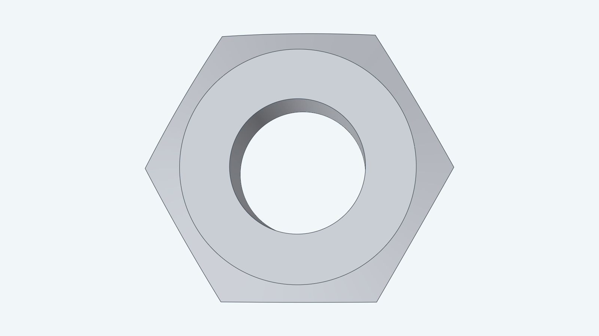

The side view shows how the chamfers curve across each flat.

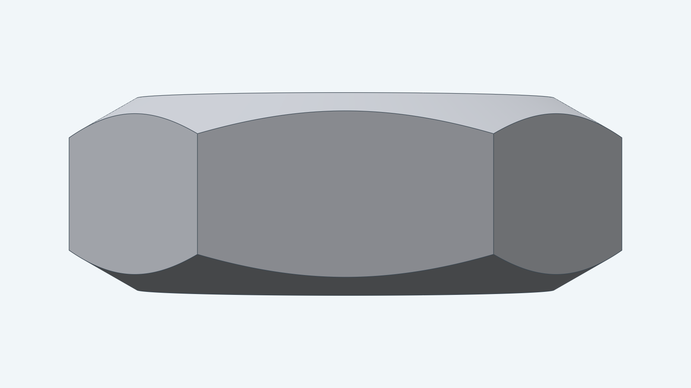

The underside has the same chamfer and bearing circle as the top.

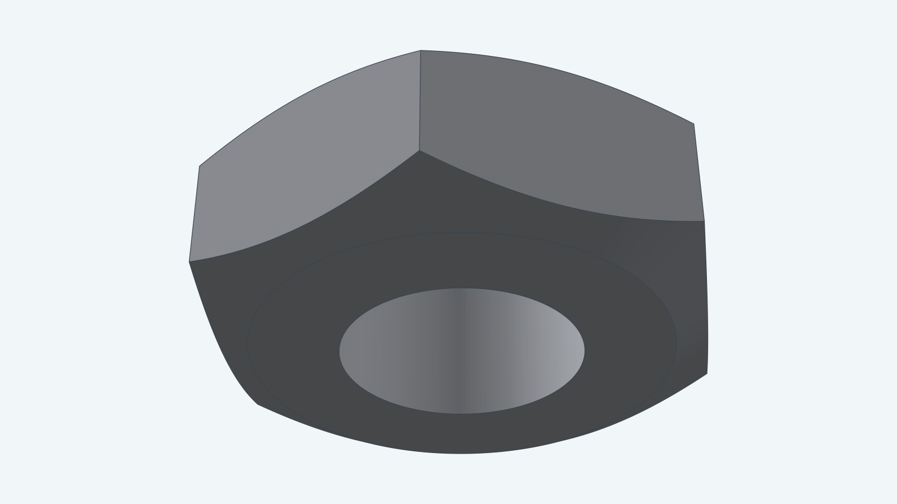

The nut fits the M2x10 bolt. This image seats it 1 mm from the tip.

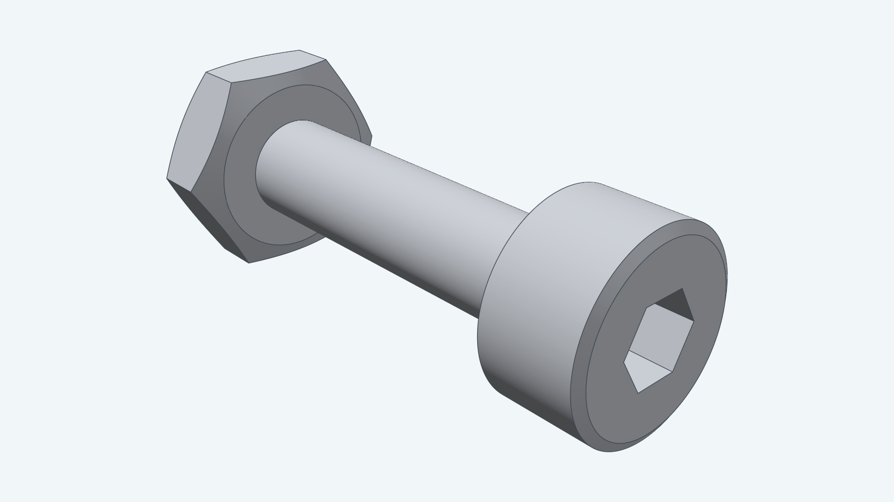

## M5 hex head bolt

The M5 bolt follows the ISO 4017 and JIS B 1180 dimension drawing: a head 3.5 mm tall and 8 mm across flats, with a
30 degree chamfer on both faces, a 5 mm shank and a 45 degree chamfer at the tip. The default is an M5x25 bolt. You
can change the length, measured from the head's underside to the tip, to one of the eleven standard lengths.

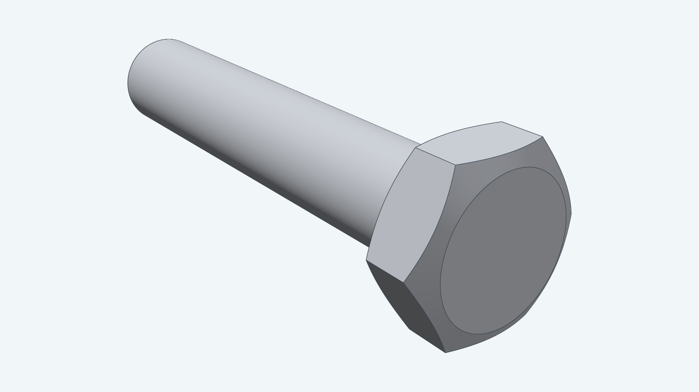

The head end shows the hexagon, the flat circle inside the chamfer and the chamfered corners.

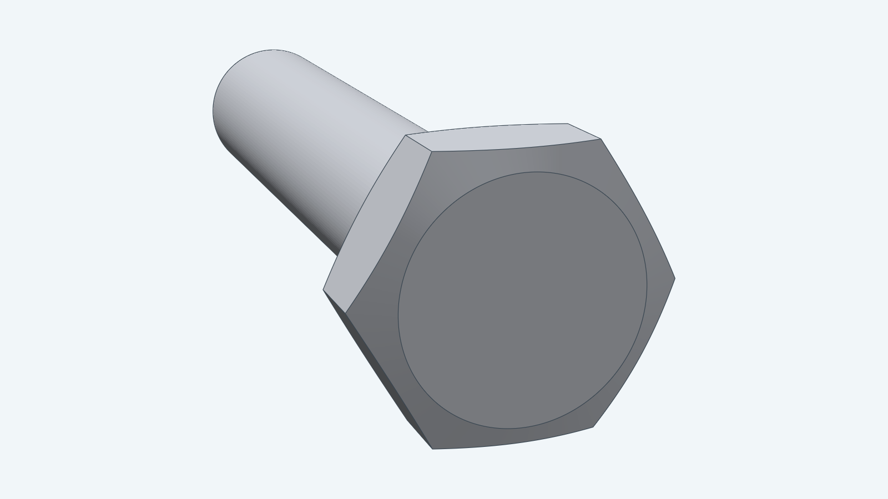

The side view shows the head chamfers and the tip chamfer.

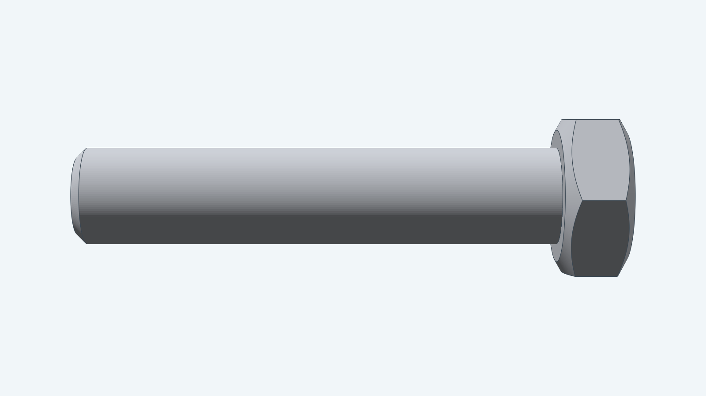

All eleven lengths, from M5x16 at the bottom to M5x80 at the top.

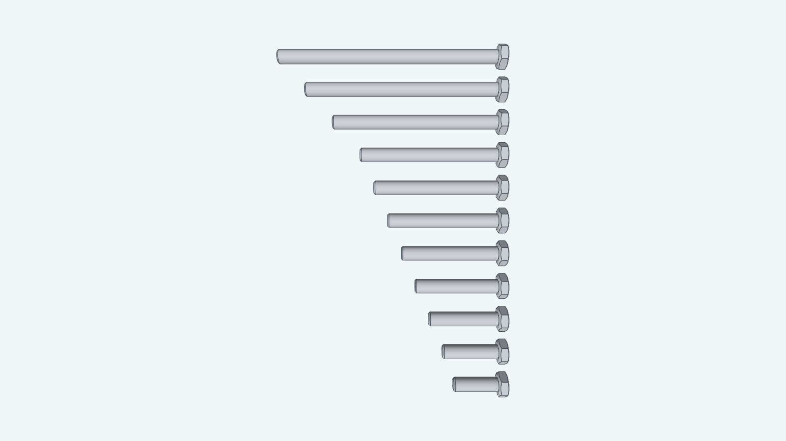

## M5 hex nut

The M5 nut pairs with the M5 bolt. It follows ISO 4032 and JIS B 1181: 8 mm across flats, 4.7 mm thick, a 5 mm bore,
and a 30 degree chamfer on every corner of both faces. The hexagon uses its exact corners, 9.238 mm across, where the
standards give a smaller minimum.

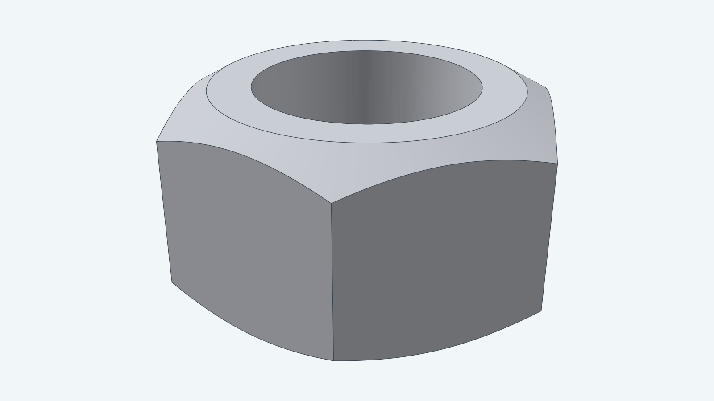

The top view shows the hexagon, the flat bearing circle and the bore.

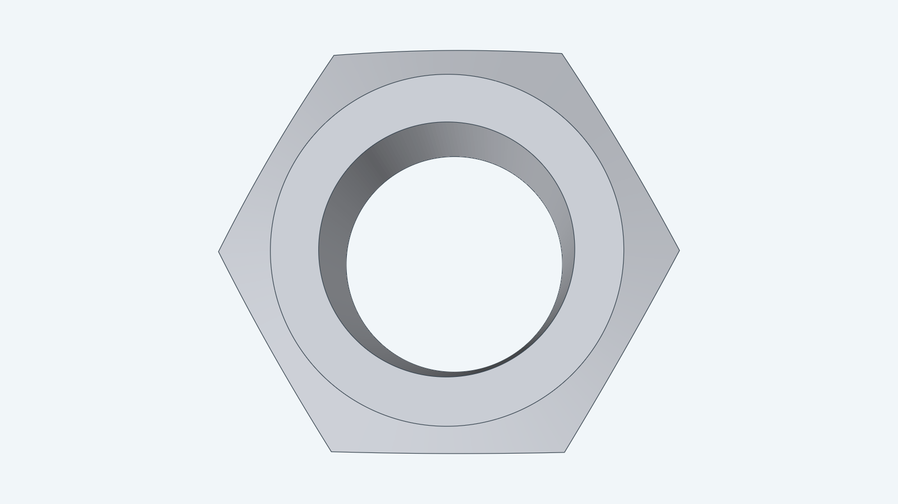

The side view shows how the chamfers curve across each flat.

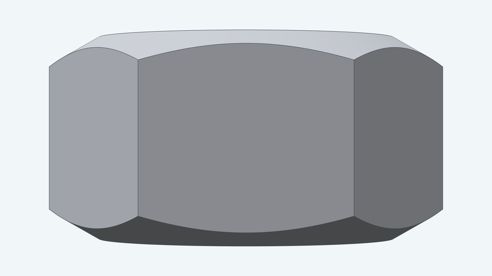

The nut fits the M5x25 bolt. This image seats it 1 mm from the tip.

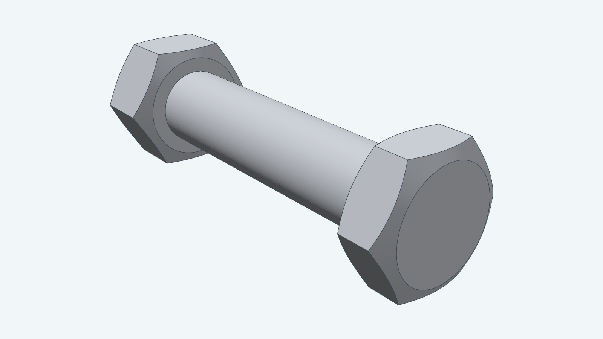

For how to build these from Go, see the [developer notes](../../docs/models/fastener.md).
