# Hand-crank fan

A handheld fan. You hold the grip in your left hand and turn the crank on the right with your right hand. The fan
faces you and blows air toward you.

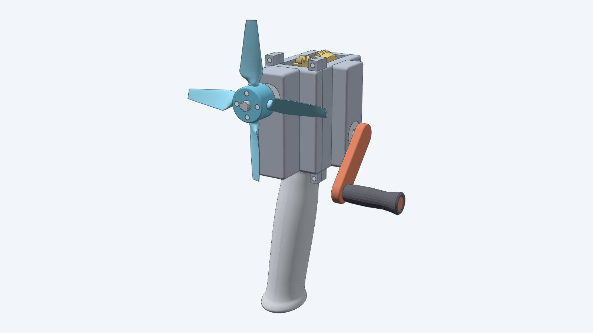

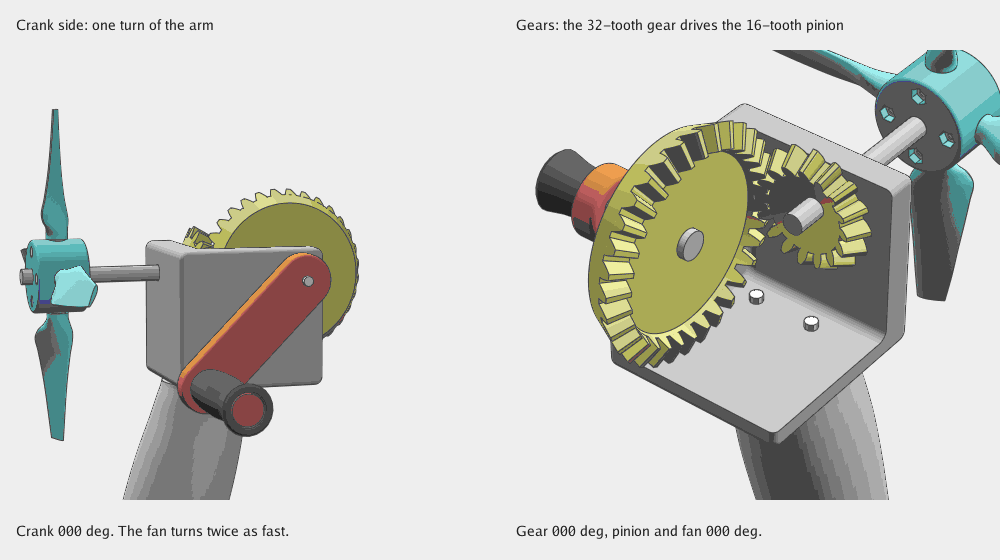

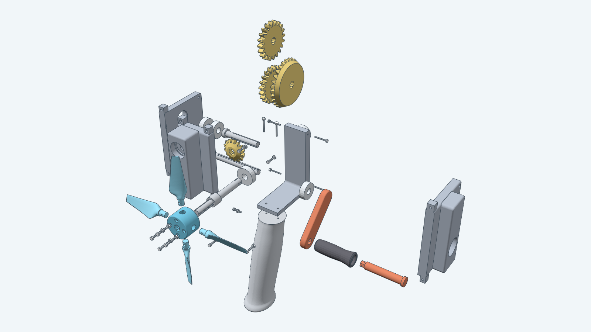

The crank shaft sits 40 mm below the fan's axis, so the crank handle swings clear of the blades. A pair of
equal spur gears inside the gearbox carries its turn up to the drive shaft, and a straight-tooth bevel gear pair turns that through 90°
and doubles its speed: one forward crank turn (clockwise, seen from the right) turns the four-blade rotor
twice, clockwise as the operator sees it. The spur pair reverses the turn, so the blades are mirrored to push air
toward the operator. Each blade is shaped like a small wind turbine blade: a thick round root, a widest section near
the hub, and a taper to a thin tip, with the angle falling from the root to the tip. Its concave face leads the
motion and faces the operator.

Each blade is a separate part with a round stud that slides into a socket in the hub. One M2 x 16 bolt and nut
hold it, so a damaged blade comes off and is replaced. Everything else is meant to be 3D-printed, except seven 608-2RS
ball bearings, one wherever a shaft crosses a wall.
The grip hangs under the gearbox. It is an oval of about 35 to 38 mm, raked like a pistol grip, with a flared base
and a palm swell, and two M2 screws hold it. The grip starts below the lowered floor, and the crank sits at the height of the gearbox's lower half, 40 mm below the fan. The crank handle is a small 50 mm barrel, 16 mm thick, for the thumb, index and middle fingers. It spins on a headed pin, so it
neither slides off nor wobbles, and the arm sits on the shaft's splines in a tight-fit bore, with one more M2 screw holding the pin. Outside
corners are rounded. The rotor has no guard.

The gears are the [bevel gear pair](../bevelgear/) and two [spur gears](../spurgear/). Each shaft is 8 mm
with three grooves, and each gear, the crank arm and the fan hub have a bore with three teeth that sit in them, so six
faces carry the torque and the round shaft still slides through every bore. The gearbox is one flat-walled tray with a post across its left end and a back wall, 51 mm
wide, 88 mm tall and 80 mm deep, not counting the bearing blocks. The spur gears sit in it left of the bevel gear, and
both shafts slide in through the post and carry a collar outside it. A bearing sits in a seat in the post, in the crank-side wall,
in the crank block and in the fan wall and block, so there is no boss or sleeve. The tray prints as four pieces cut at its walls: the base, which is the floor and the back wall, the post, the
crank-side wall with its block, and the fan-side wall with its block, which holds the fan shaft. Each piece prints with
its shaft axes vertical, so no bore lies on its side: the post on its inner face, and the two walls on the face that meets
the base with their blocks pointing up. The seats that open onto the bed have a 45° cone for a ceiling. Four M2 screws go
through the post and the crank-side wall into the base's back wall, and four M2 bolts and nuts, in ears on the outside,
join the fan-side wall to the post and the crank-side wall. The hub's blade sockets are plain 6 mm holes, small enough to
print on their side.

## Parts

Each part is shown once, from the real model, in place at the default pose. A fan has one of each part except
the gearbox screws, the grip screws, the bearings, and the blades with their bolts, which are repeated as the names say. The bought parts are
the screws, the nuts and the bearings. Everything else is printed.

| Image | Name |
| --- | --- |
| 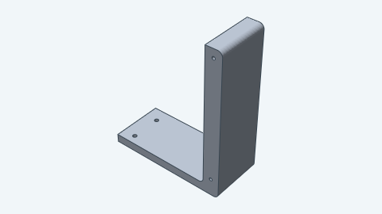 | Gearbox base |
| 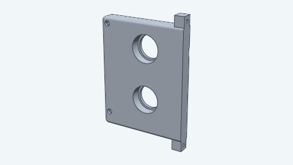 | Gearbox post |
| 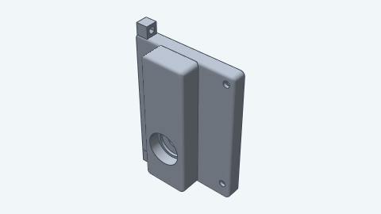 | Gearbox crank-side wall |
| 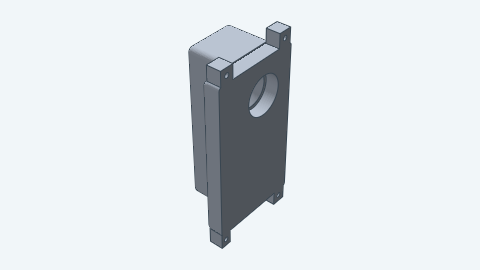 | Gearbox fan-side wall, which holds the fan shaft |
| 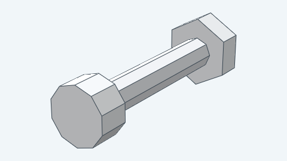 | Gearbox bolt and nut, M2 x 12 (four) |
| 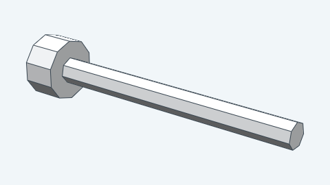 | Gearbox screw, M2 x 16 (four) |
| 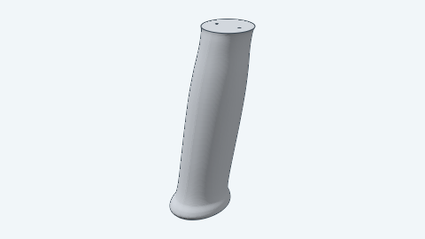 | Grip |
| 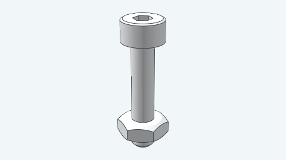 | Grip screw, M2 x 16 (two) |
| 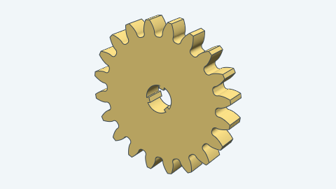 | Crank gear |
| 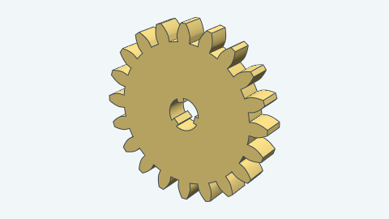 | Drive gear |
| 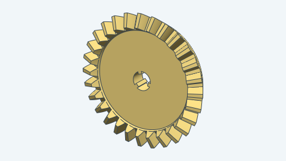 | Driving bevel gear |
| 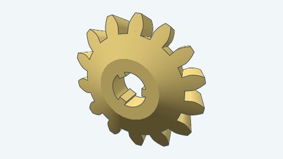 | Pinion bevel gear |
| 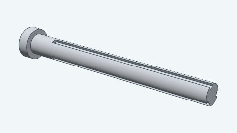 | Crank shaft |
| 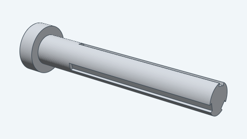 | Drive shaft |
| 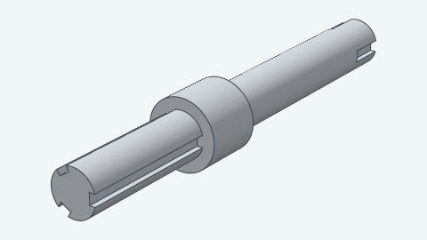 | Fan shaft |
| 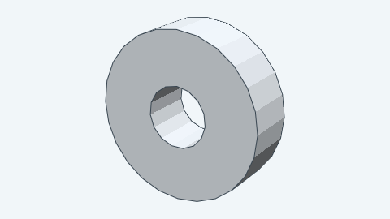 | Ball bearing, 608-2RS (seven) |
| 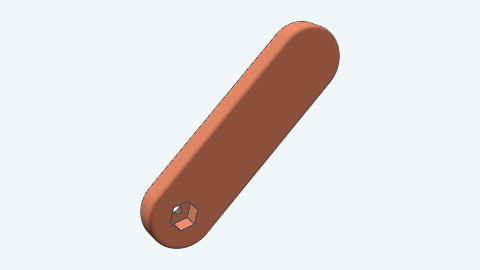 | Crank arm |
| 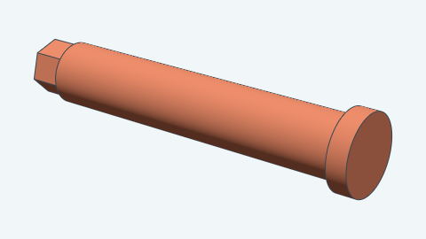 | Crank pin |
| 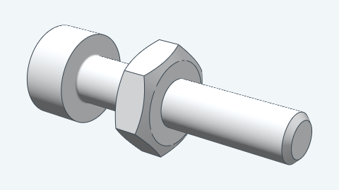 | Crank pin screw and nut, M2 x 10 |
| 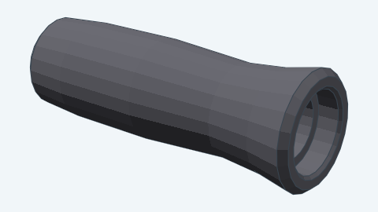 | Crank handle |
| 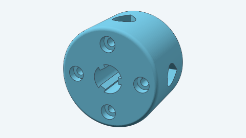 | Fan hub |
| 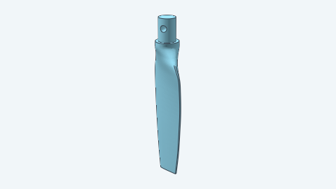 | Fan blade (one for each blade) |
| 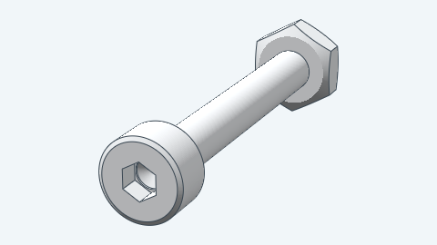 | Blade bolt and nut, M2 x 16 (one for each blade) |

You can vary:

- The crank angle, which also sets the fan angle at twice that value.
- The blade pitch, from 10° to 40°, which turns each whole blade; it is the blade angle at three quarters of the radius.
- The number of blades, 3 or 4.

For how to build it from Go, see the [developer notes](../../docs/models/handcrankfan.md).
