# Hand-crank siren

A hand-cranked siren. You turn the crank on the back of the gearbox, two spur stages spin a slotted rotor disc ten
times faster, and the rotor chops the air against a fixed slotted stator disc. The horn on the front sends the tone out.

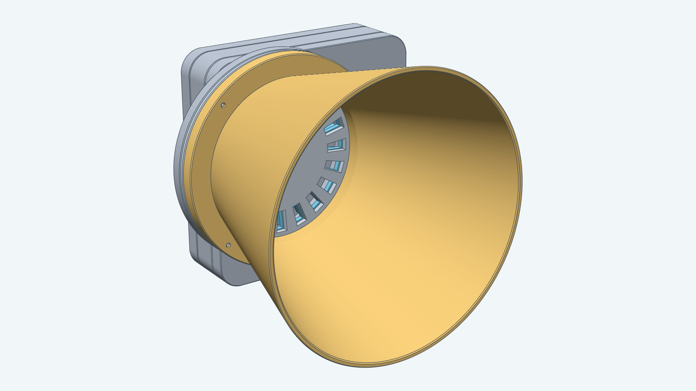

The finished siren from three more angles: from behind, where the crank is, from the right side, and from above.

| | | |
| --- | --- | --- |
| 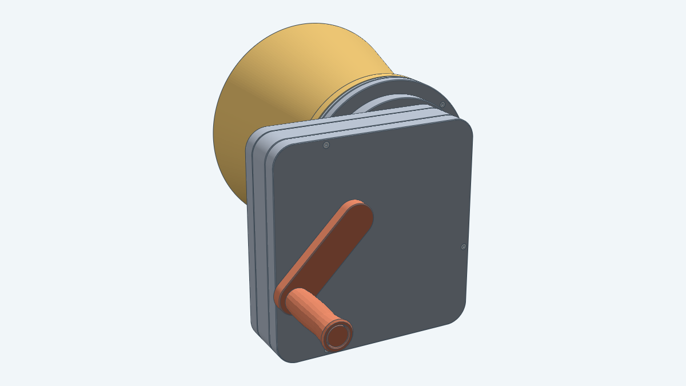 | 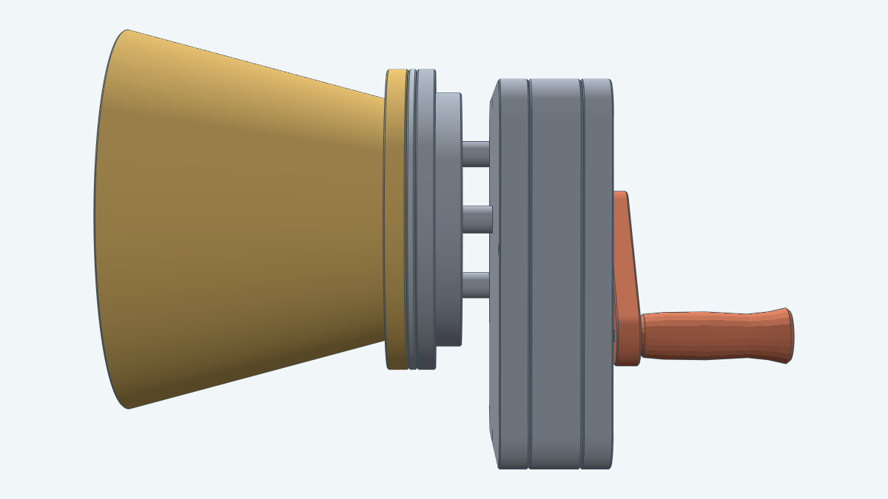 | 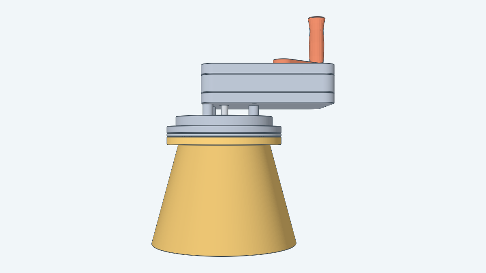 |

A cutaway with the drum, stator and horn cut by the plane through the axis shows the rotor, its vanes and the ports.

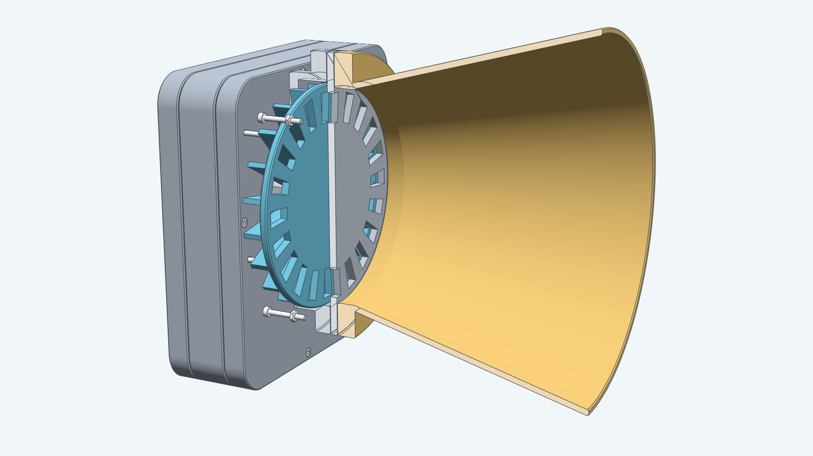

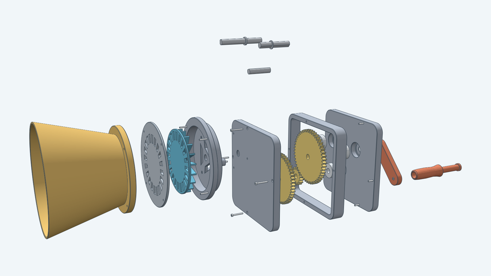

## How it works

The crank gear (50 teeth) drives a 16-tooth pinion, and a 48-tooth gear on the same shaft drives a 15-tooth pinion on the
rotor shaft. The ratio is (50/16)(48/15) = 10, so one crank turn spins the rotor ten times. The rotor and the stator
each have the same ring of ports, 20 by default. Each time a rotor port passes a stator port the air flow opens and
closes once, so the pitch is

    f = Slots x Ratio x (crank turns per second)

At two crank turns a second the rotor turns 20 times a second (1200 rpm) and the default siren sounds 400 Hz. With 12
to 24 slots the pitch at that crank speed runs from 240 Hz to 480 Hz. The rotor has a straight paddle vane on each land
between its ports, so it also works as a blower: air comes in through three windows in the drum's back plate, the vanes
throw it outward to the port ring, and it leaves through the horn whenever a rotor port lines up with a stator port. The
direction of turn does not matter.

The gears are [spur gears](../spurgear/) of module 1.5. Each shaft is 7.5 mm across with one flat, and each gear, the
rotor hub and the crank arm have a D-shaped bore that is pressed on, so the printed bore grips the shaft. The crank
gear has a shaft collar behind it, because it is the only gear that could slide into a gear it does not mesh with.
The gearbox is a sandwich of three printed pieces, a front plate, a frame and a rear plate, each printed flat so every
bearing seat is a vertical hole. Six 608-2RS bearings carry the three shafts. The drum stands on three posts in front
of the gearbox, with the stator and the horn bolted to its front.

Ports are straight-sided (chord-sided) rather than arc-sided, because Decad cannot pattern 20 arc-sided cuts yet. The
acoustic difference is small.

## Bolts, nuts and fits

Every bolt head sinks into a pocket in the part it joins and ends flush with that part's face, so nothing stands
proud. Every nut sits in a cavity that the part closes on all sides except the bolt hole. You drop each nut in during a
print pause: slice the piece in the orientation below, add a pause at the layer where the cavity's roof starts, drop
the nut into the open cavity, and resume.

| Piece | Prints with | Nuts to drop in |
| --- | --- | --- |
| Gearbox frame | front face down, with a second pause near the top | four near the bed and four near the top |
| Gearbox front plate | inner face down | three, for the drum bolts |
| Horn | flange down, mouth up | four, for the horn bolts |
| Crank pin | upright, head down | one, for the pin bolt |

The drum prints standing on its flange's front face, and its back plate needs slicer support. A siren takes 16 bolts (12
of M2 x 16, 3 of M2 x 18 and 1 of M2 x 10), 16 nuts and 6 608-2RS bearings.

Every pair of printed parts has a gap of at least 0.2 mm where the parts are not meant to come apart (Tight), 0.35 mm
where they move or come apart for service (Regular), and 0.5 mm where they only sit near each other (Loose). Each
bearing seat is 0.05 mm larger in radius than the bearing. The tests measure each gap on the built model. The two
gear pairs sit 49.5 mm and 47.25 mm apart, half the sum of their pitch diameters, with a deeper tooth root and a small
backlash, so each tooth tip clears the other gear's root by more than 0.5 mm.

The model is marked Mixed in [models/README.md](../README.md): the printed fits carry these clearances, and the bolts,
nuts and bearings keep their standard sizes.

## Parts

Each part is shown once, from the real model, in place at the default pose.

| Image | Name |
| --- | --- |
| 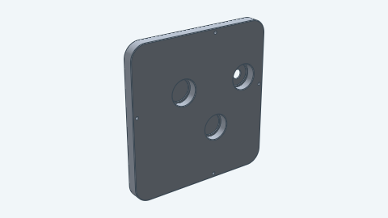 | Gearbox front plate |
| 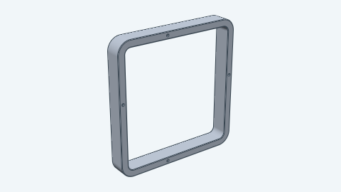 | Gearbox frame |
| 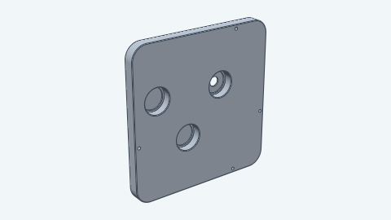 | Gearbox rear plate |
| 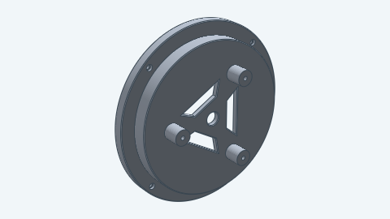 | Drum |
| 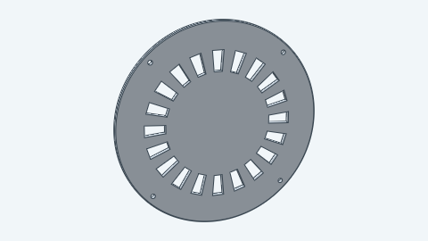 | Stator |
| 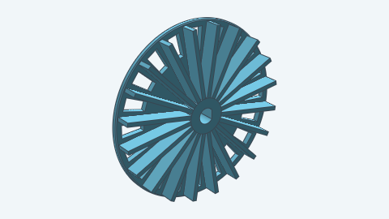 | Rotor |
| 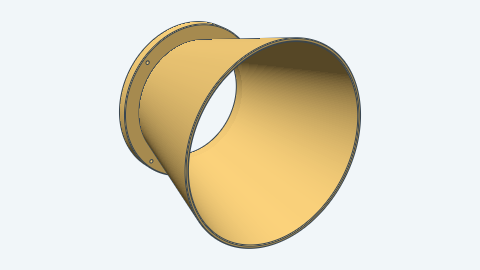 | Horn |
| 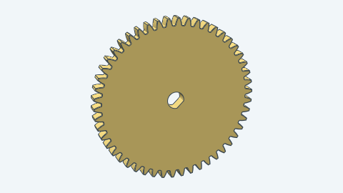 | Crank gear, 50 teeth |
| 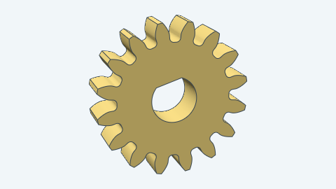 | Intermediate pinion, 16 teeth |
| 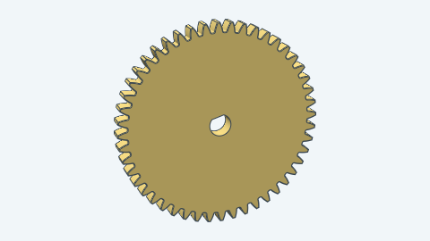 | Intermediate gear, 48 teeth |
| 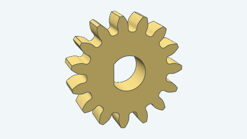 | Rotor pinion, 15 teeth |
| 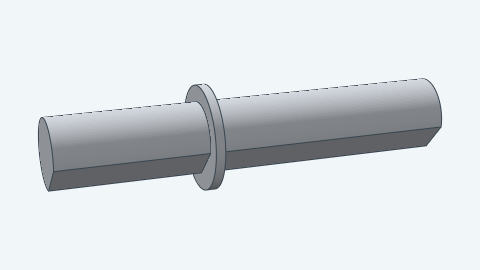 | Crank shaft |
| 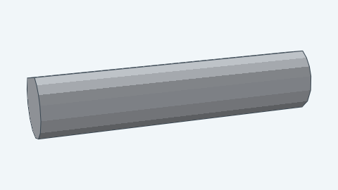 | Intermediate shaft |
| 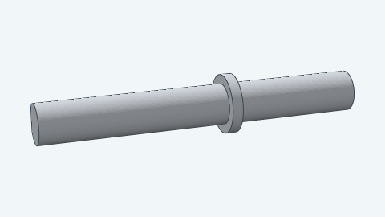 | Rotor shaft |
| 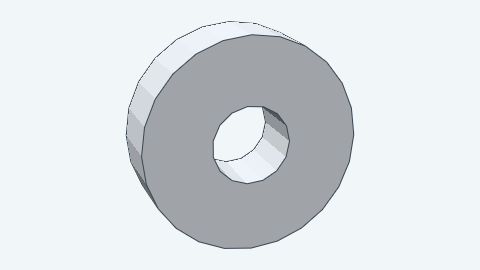 | Ball bearing, 608-2RS (six) |
| 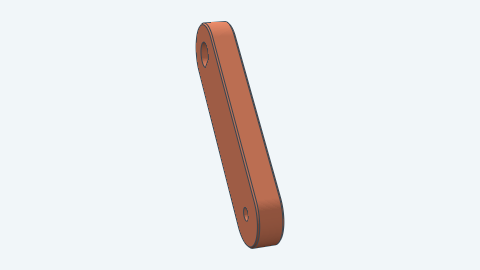 | Crank arm |
| 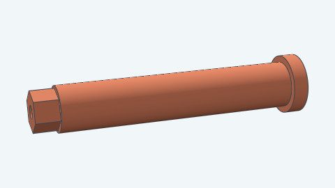 | Crank pin |
| 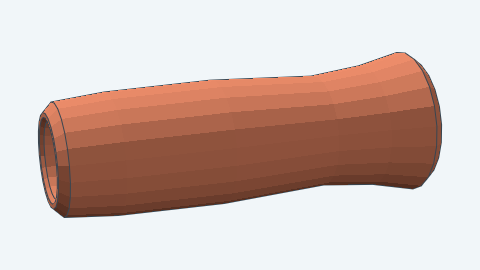 | Crank handle |
| 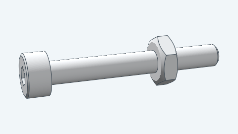 | Gearbox bolt and nut, M2 x 16 (eight) |
| 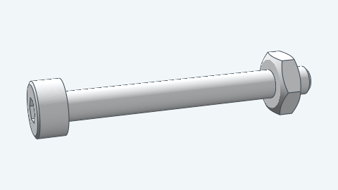 | Drum bolt and nut, M2 x 18 (three) |
| 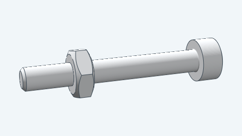 | Horn bolt and nut, M2 x 16 (four) |
| 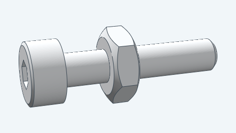 | Crank pin bolt and nut, M2 x 10 |

You can vary:

- The crank angle, which also sets the rotor angle at ten times that value.
- The number of slots, 12 to 24, which sets the ports in the rotor and the stator and the vanes on the rotor.

For how to build it from Go, see the [developer notes](../../docs/models/handcranksiren.md).
