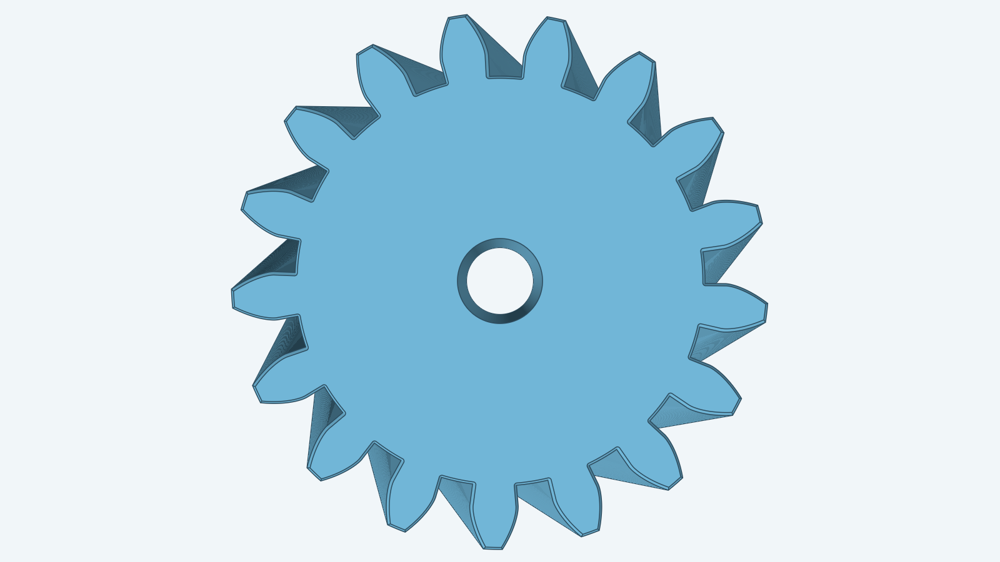
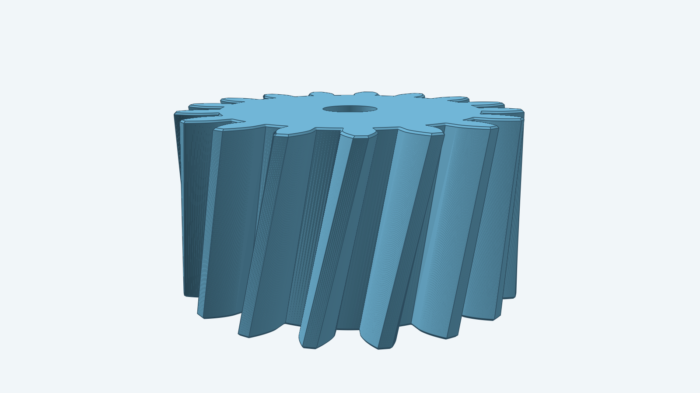

# Helical gear

## More views

| From above | Low side angle |
| --- | --- |
|  |  |

This model follows the Fusion add-in's helical instructions and the
gallery's spur involute tooth calculation. The hero image builds the 17-tooth gear with a
3 mm bore and 0.1 mm outer-cap chamfers. The bore matches the spur hero's
diameter on the same Module 1, 17-tooth outline.

Set `Params.Placement` (an `r3.Frame`) to anchor the gear: the frame origin is the
reference point on the gear axis, its U and V axes span the reference plane that
holds the lower cap, and the gear grows along U×V. A nil `Placement` keeps the world XY plane.
Use `spurgear.Build` for zero twist. This helical `Build` requires a positive
twist angle from 1° through 45°.

Run `go test ./models/helicalgear` to check the supported parameter cases.
