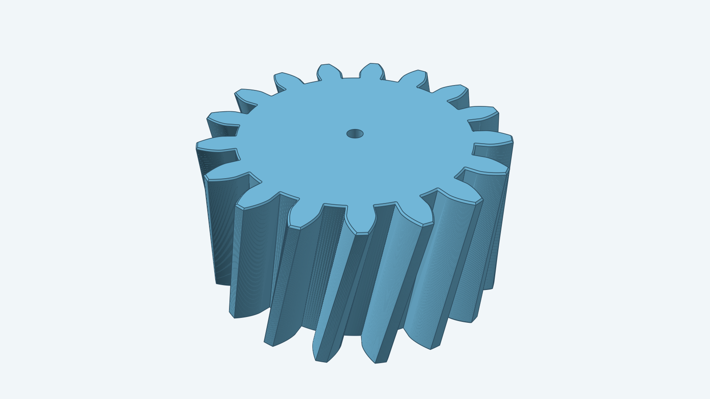

# Helical gear



This model uses the [source helical instructions](instructions.md) and the
gallery's spur involute tooth calculation. The first real 8-tooth, 2 mm
thick, +14.5° case produces two verified Decad bodies: a lofted tooth and
an extruded root disc. With merged Decad `dc2d041f1523`, all eight tooth
Unions, the optional 1 mm bore Cut, and both outer cap Chamfers pass
`VerifyAll` at 0.1 mm. On the bored gear, each cap selector returns 1,072
outer edges and no bore edges. The source-order root-fillet selector finds
no matching axial root edges on the small gear and skips that step. The
source-default 17-tooth gear passes all tooth Unions and `VerifyAll` at 0.1 mm
against merged Decad `228ae52cc75c` in 78.564 seconds. Its real 1 mm bore
passes the source-order Cut and `VerifyAll` against merged Decad
`c3059829064f` in 86.889 seconds; the verified mesh has one through-hole.
With merged Decad `5f6f09763897`, the same default gear also passes both
0.1 mm outer-cap chamfers and `VerifyAll` in 291.86 seconds while keeping
that through-hole.
A real nonempty root-fillet case is pending. The hero image builds the
17-tooth gear with a 1 mm bore and 0.1 mm outer-cap chamfers.
Use `spurgear.Build` for zero twist; this helical `Build` accepts nonzero
twist angles while Decad's joined-root Fillet support is being completed.

The focused geometry checks run from the repository worktree:

```sh
go test ./models/helicalgear -run '^TestSmallHelicalToothAndRootDiscVerifyIndividually$' -count=1 -timeout 2m
go test ./models/helicalgear -run '^TestSmallRealHelicalGear$' -count=1 -timeout 2m
go test ./models/helicalgear -run '^TestSmallRealHelicalGearThroughBore$' -count=1 -timeout 2m
go test ./models/helicalgear -run '^TestSmallRealHelicalGearWithCapChamfer$' -count=1 -timeout 5m
go test ./models/helicalgear -run '^TestSmallRealHelicalGearWithBoreAndCapChamfer$' -count=1 -timeout 5m
go test ./models/helicalgear -run '^TestDefaultRealHelicalGear$' -count=1 -timeout 5m
go test ./models/helicalgear -run '^TestDefaultRealHelicalGearThroughBore$' -count=1 -timeout 5m
go test ./models/helicalgear -run '^TestDefaultRealHelicalGearWithBoreAndCapChamfer$' -count=1 -timeout 10m
```

All five small-gear checks pass against merged Decad `dc2d041f1523`. The cap Chamfer
checks take about 218 seconds without a bore and 214 seconds with a bore.
The source-default 17-tooth build, 1 mm bore, and both outer-cap chamfers
pass against their merged Decad releases. A nonempty root fillet still
requires a real geometry check.
