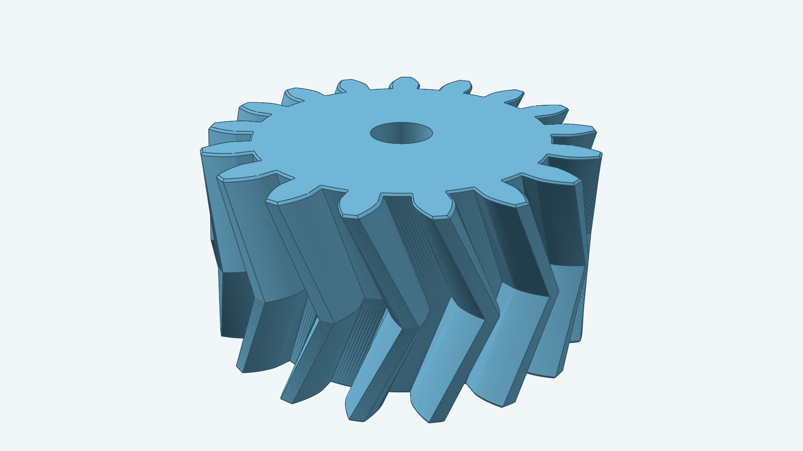
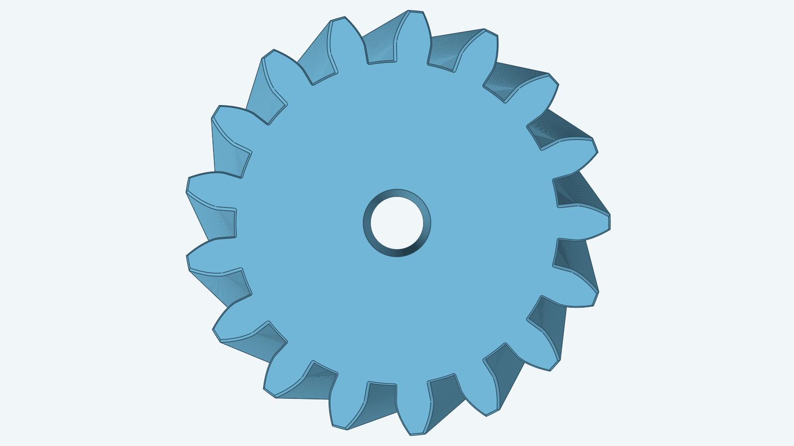
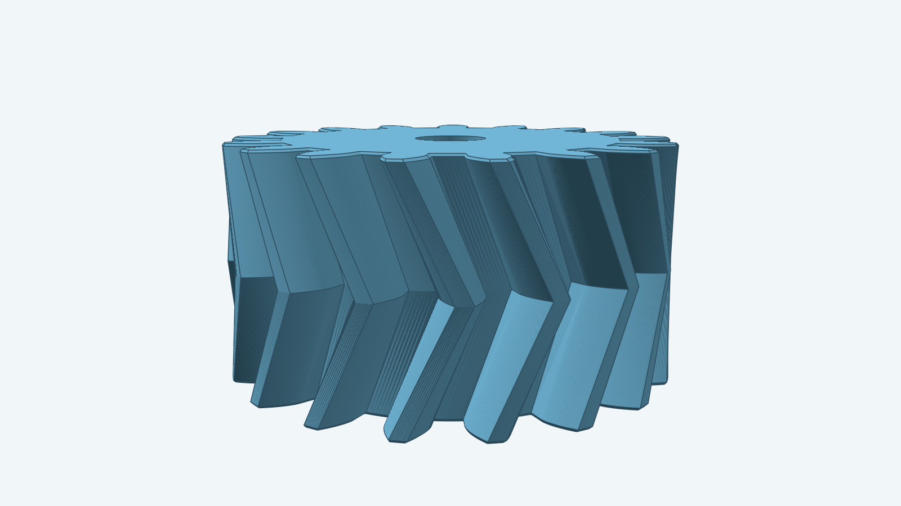

# Herringbone gear

## More views

| From above | Low side angle |
| --- | --- |
|  |  |

An involute gear with two helical halves twisted in opposite directions, so the teeth form a chevron that
meets at the gear's midpoint. The opposing slopes cancel each other's sideways push when the gear turns.
The helix angle runs from 1° to 45°. The images show a 17-tooth gear with a 3 mm bore and a 0.1 mm chamfer
on its outer edges.

You can vary:

- Module, tooth count, pressure angle, thickness and helix angle.
- A centered through-bore.
- A chamfer on the outer edge of both end faces.
- The position and orientation of the gear in space.

For how to build this gear from Go, see the [developer notes](../../docs/models/herringbonegear.md).
