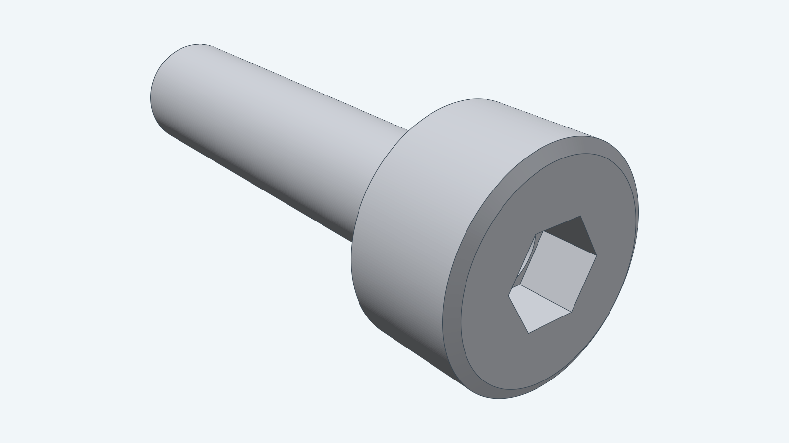
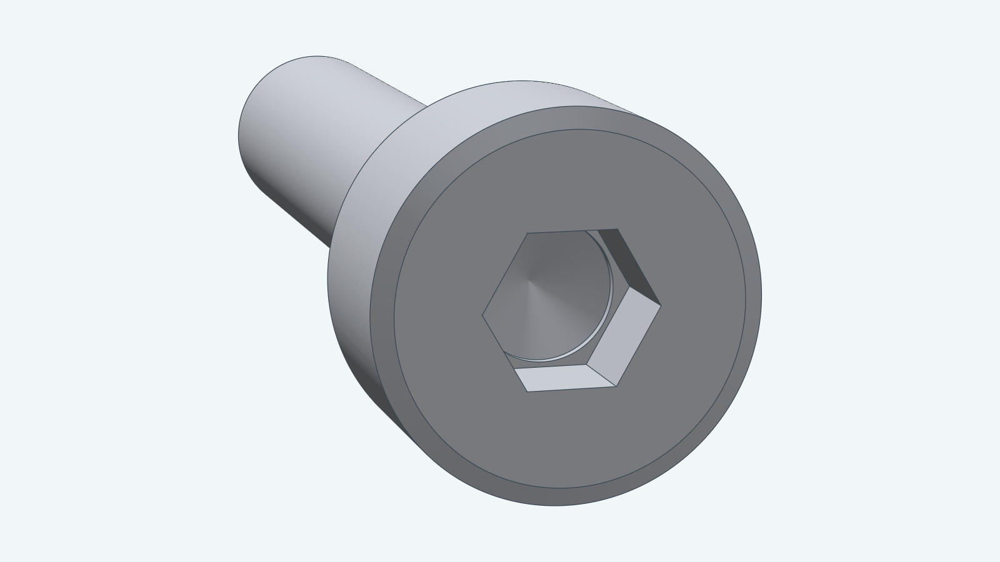
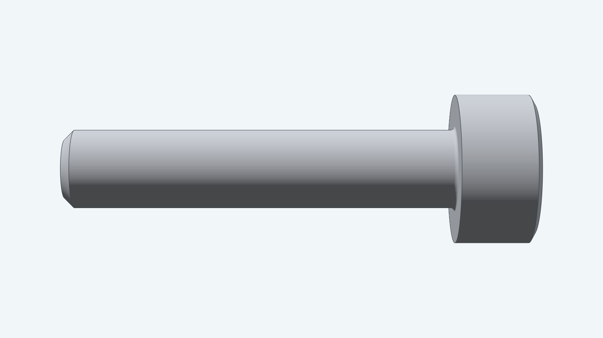
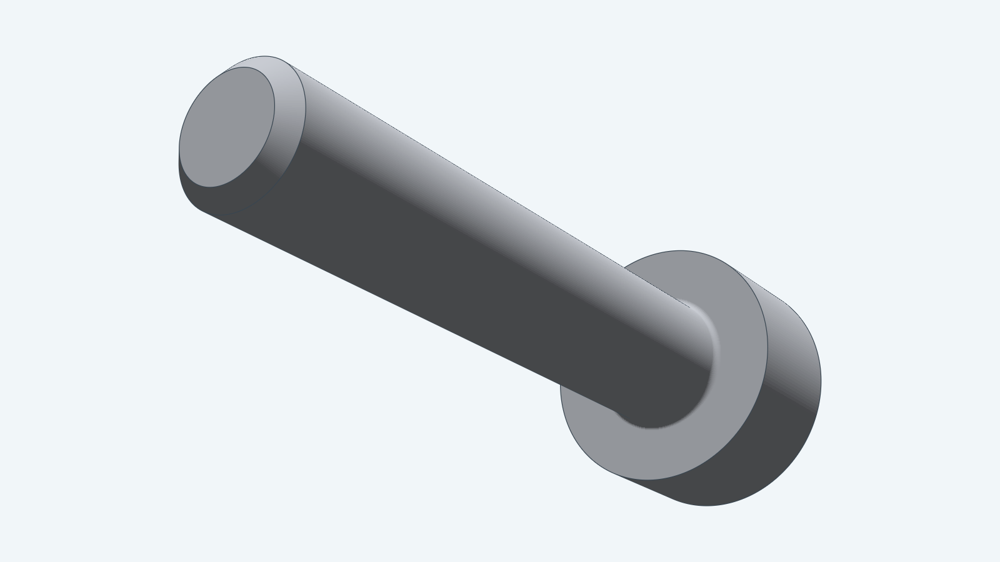
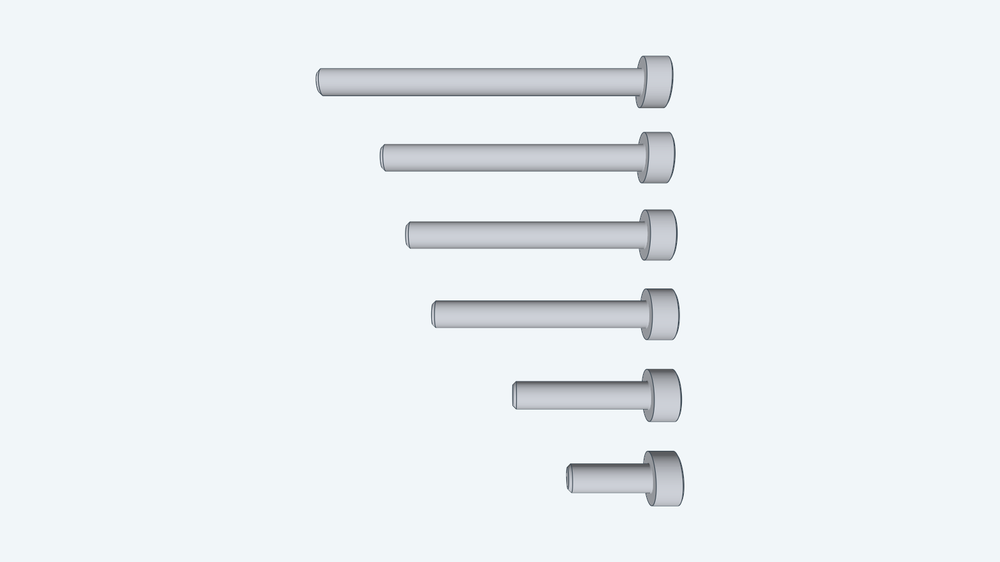

# M2 socket head cap screw

This model is an M2 socket head cap screw in the standard lengths 6, 10, 16, 18, 20 and 25 mm.
It follows the ISO 4762 dimension drawing: a 3.8 mm head with a chamfered top edge, a 1.5 mm hex socket
1 mm deep with a drill point, an underhead fillet, a 2 mm shank and a 45 degree chamfer at the tip.

The thread is not modeled. The shank is a plain 2 mm cylinder, so the model gives the screw's envelope for
fitting holes and parts. It does not set thread length, tolerance or strength class.

**Clearance adjustment:** Nominal. Adjust custom mating geometry to provide fit clearance.

`DefaultParams` selects an M2x10 screw. `Length` sets the length from the head's underside to the tip and
must be one of `StandardLengths()`. `Placement` positions the underside center and the screw axis in an
assembly; the head lies along the frame's normal.

## Views

The head end shows the hex socket and its drill point.

The side view shows the head chamfer, the underhead fillet and the tip chamfer.

The tip end shows the flat tip, its chamfer and the underside of the head.

## Lengths

All six lengths, from M2x6 at the bottom to M2x25 at the top.

The [developer guide](../../docs/models/m2bolt.md) documents construction and checks.
The [instructions](instructions.md) own the dimensions; the [steps](steps.md) map them to Decad.
