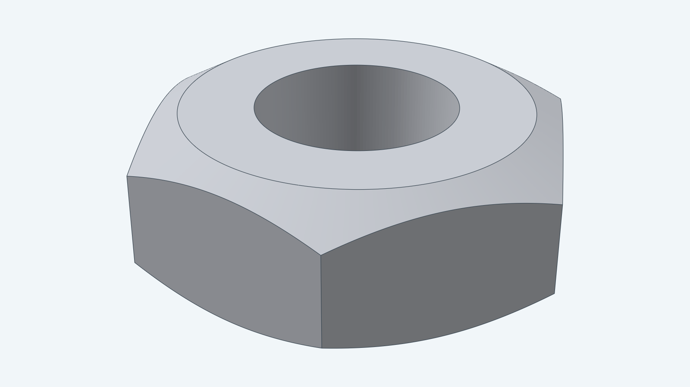
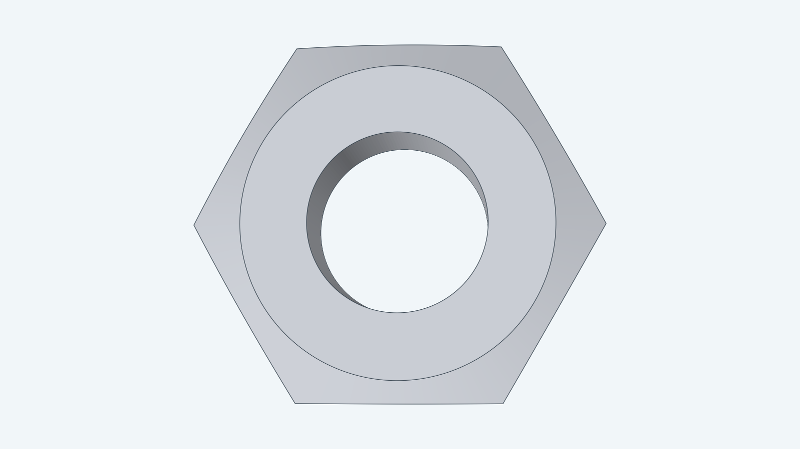
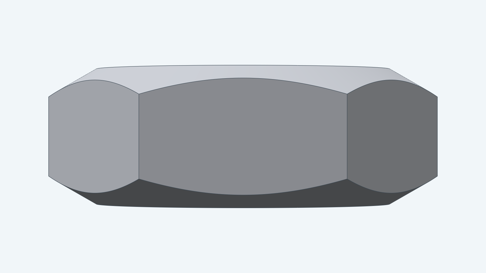
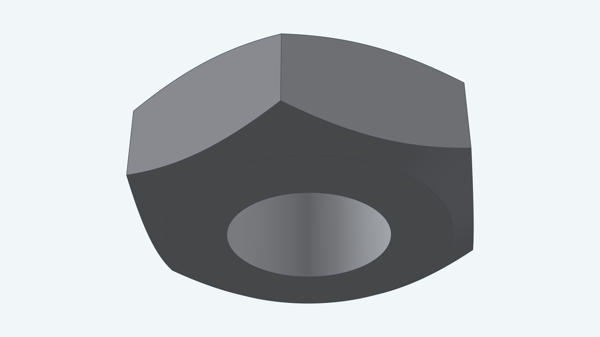
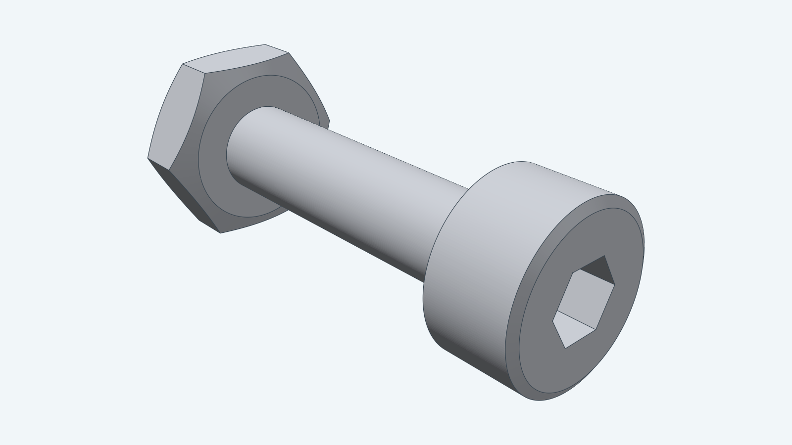

# M2 hex nut

This model is the M2 hex nut that pairs with the [M2 bolt](../m2bolt/). It follows ISO 4032 and JIS B 1181:
4 mm across flats, 1.6 mm thick, a 2 mm bore, and a 30 degree chamfer on every corner of both faces.

The thread is not modeled. The bore is the nominal 2 mm, the same as the bolt's shank.
The hexagon uses its exact corners, 4.619 mm across, where the standards give a smaller minimum.

**Clearance adjustment:** Nominal. Adjust custom mating geometry to provide fit clearance.

## Views

The top view shows the hexagon, the flat bearing circle and the bore.

The side view shows how the chamfers curve across each flat.

The underside has the same chamfer and bearing circle as the top.

The nut fits the M2x10 bolt. This image seats it 1 mm from the tip.

For how to build this nut from Go, see the [developer notes](../../docs/models/m2nut.md).
