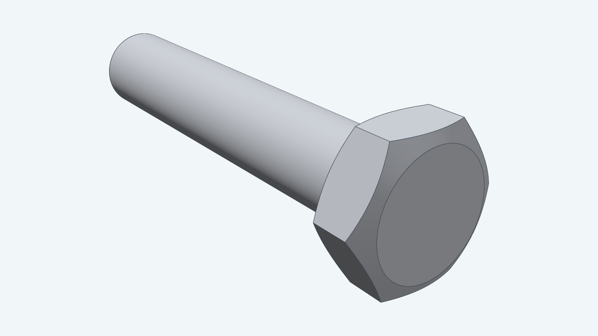
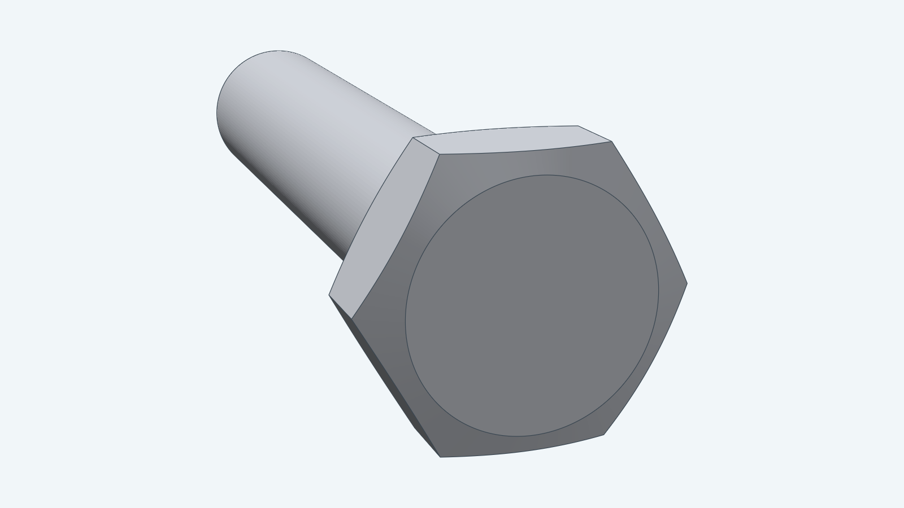
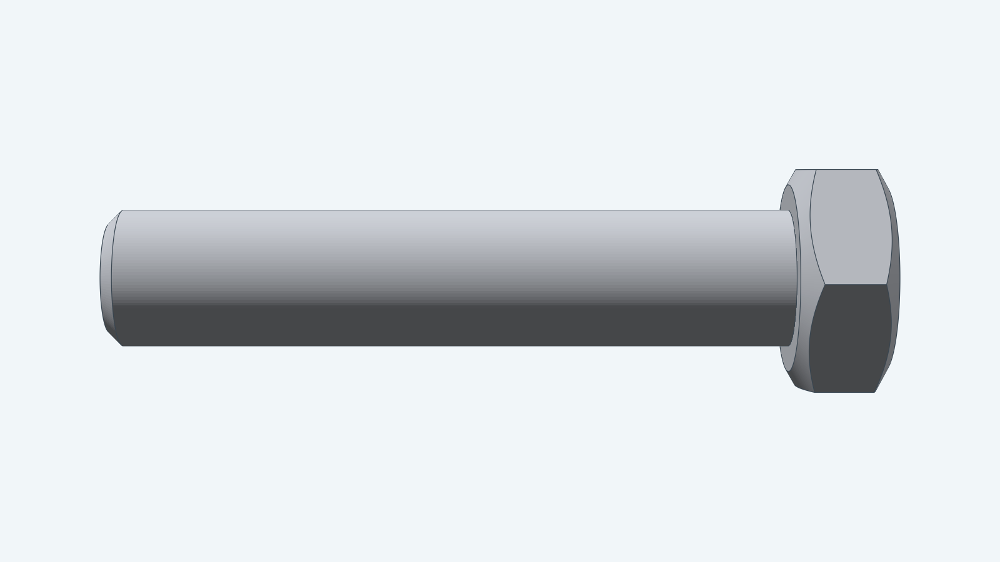
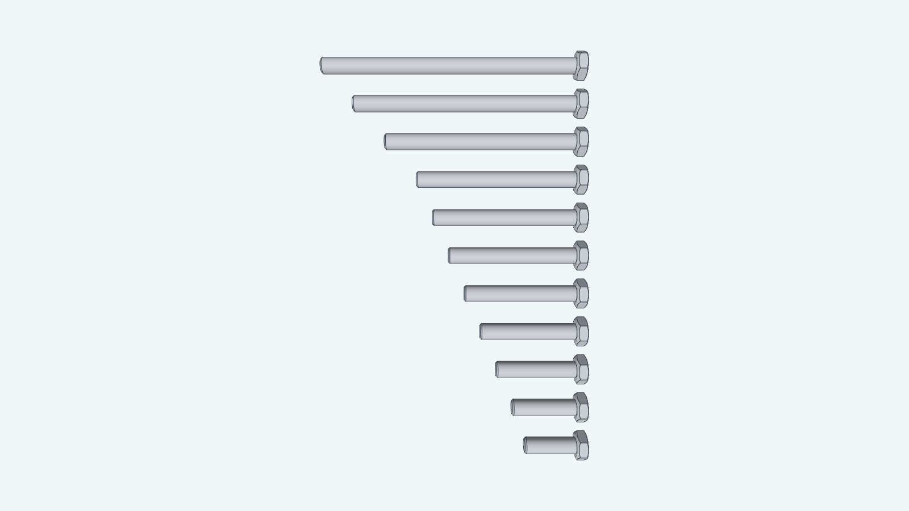

# M5 hex head bolt

**Build status:** Not built yet.

This model is an M5 hex head bolt in the standard lengths 16, 20, 25, 30, 35, 40, 45, 50, 60, 70 and 80 mm.
It follows the ISO 4017 and JIS B 1180 dimension drawing: a head 3.5 mm tall and 8 mm across flats, with a 30 degree
chamfer on both faces, a 5 mm shank and a 45 degree chamfer at the tip. The M5 nut pairs with it.

The thread is not modeled. The shank is a plain 5 mm cylinder, so the model gives the bolt's envelope for
fitting holes and parts. It does not set thread length, tolerance or strength class.

**Clearance adjustment:** Nominal. Adjust custom mating geometry to provide fit clearance.

The default is an M5x25 bolt. You can change the length, measured from the head's underside to the tip,
to one of the eleven standard lengths.

## Views

The head end shows the hexagon, the flat circle inside the chamfer and the chamfered corners.

The side view shows the head chamfers and the tip chamfer.

## Lengths

All eleven lengths, from M5x16 at the bottom to M5x80 at the top.

For how to build this bolt from Go, see the [developer notes](../../docs/models/m5bolt.md).
