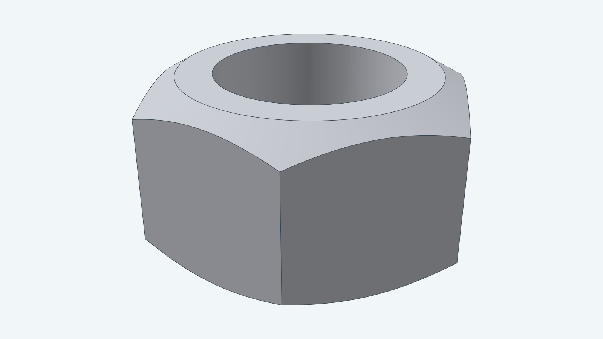
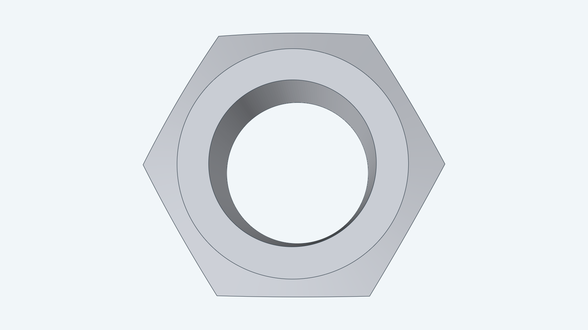
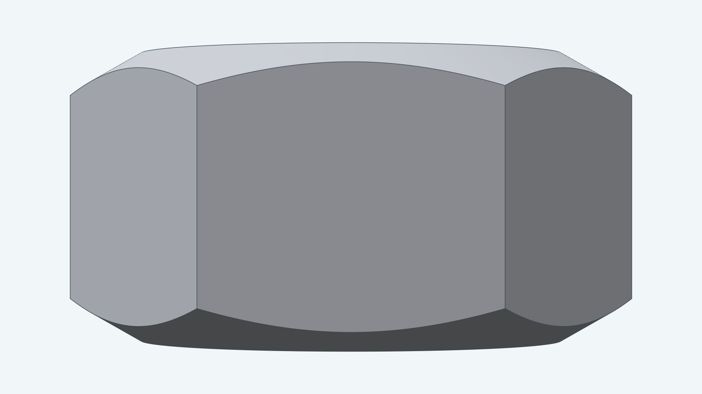
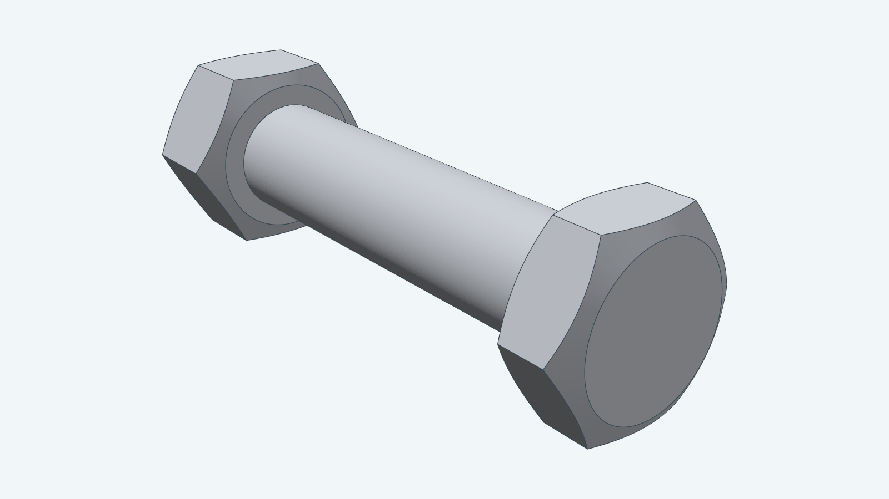

# M5 hex nut

**Build status:** Not built yet.

This model is the M5 hex nut that pairs with the [M5 bolt](../m5bolt/). It follows ISO 4032 and JIS B 1181:
8 mm across flats, 4.7 mm thick, a 5 mm bore, and a 30 degree chamfer on every corner of both faces.

The thread is not modeled. The bore is the nominal 5 mm, the same as the bolt's shank.
The hexagon uses its exact corners, 9.238 mm across, where the standards give a smaller minimum.

**Clearance adjustment:** Nominal. Adjust custom mating geometry to provide fit clearance.

## Views

The top view shows the hexagon, the flat bearing circle and the bore.

The side view shows how the chamfers curve across each flat.

The nut fits the M5x25 bolt. This image seats it 1 mm from the tip.

For how to build this nut from Go, see the [developer notes](../../docs/models/m5nut.md).
