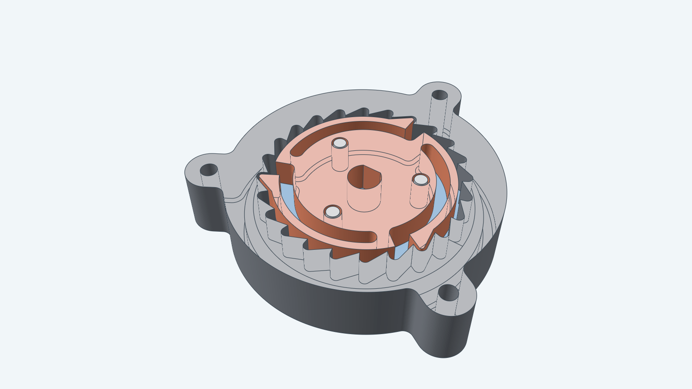
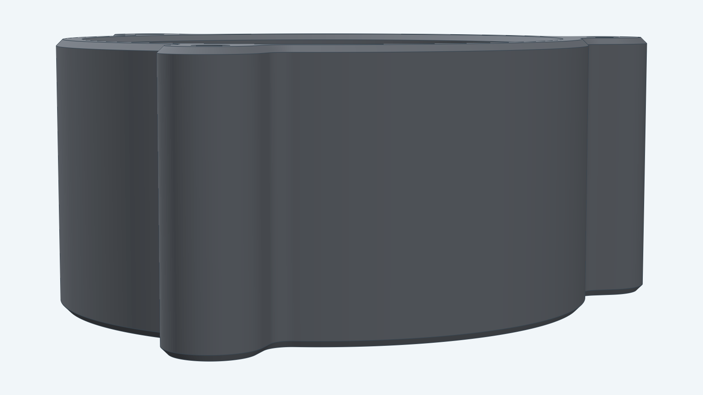
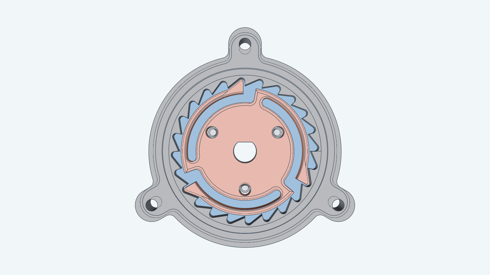
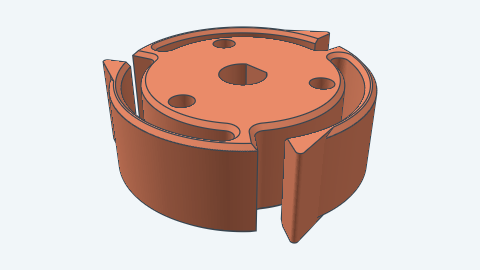
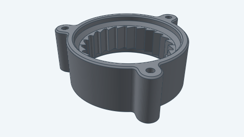
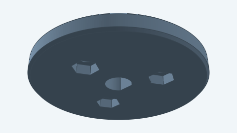
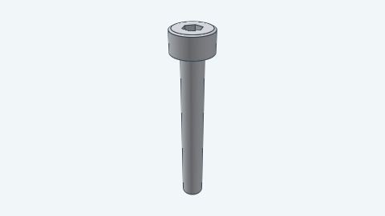
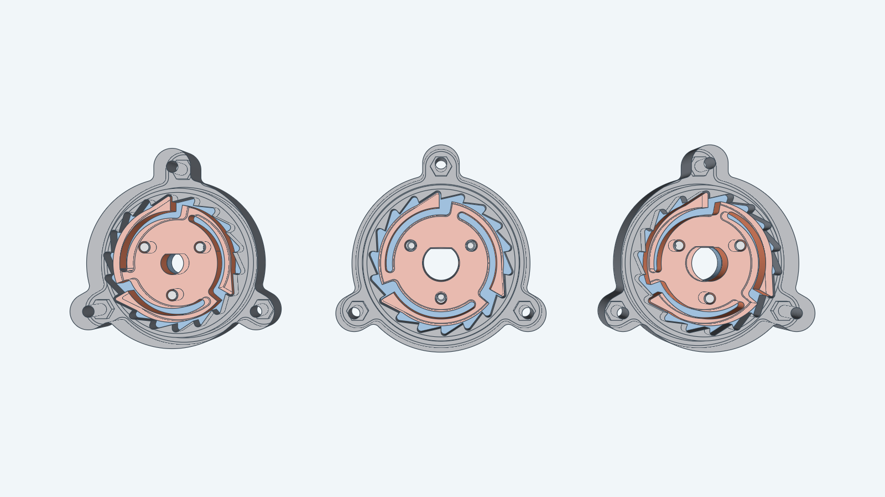

# One-way clutch

A printed one-way clutch for a D-flat shaft. A hub with three flexing pawls presses on the shaft and meets a 42 mm ring
with 24 internal teeth. Turn the shaft one way and the pawls catch the teeth, so the ring turns with it. Turn the shaft
the other way and the teeth push the pawls inward, the arms bend, and the ring stays still with a click for each tooth.
A back plate and a cover hold the ring on the hub. Three M2 × 16 bolts and nuts clamp the stack. Every printed part
prints with its axis vertical and no supports.

You choose the shaft from three presets (`605ZZ`, `608ZZ` and `608ZZ-gearbox`) and the direction in which the ring turns
freely. The shaft is not part of this model: a shaft that runs in a bearing has the bearing's bore as its diameter, and
the mechanism you build owns it.

**Clearance adjustment:** Mixed. The bore clearance is a parameter; the bolts and nuts keep their nominal size.

## Views

From the front, the cover shows the three bolt heads, flush in their pockets, round the shaft's D hole.

From the back, the back plate's outer face goes against the mechanism.

From the side, the ring's outside is 42 mm across and has chamfered ends.

## How it works

The picture cuts the clutch at the hub's mid-height and looks along the shaft.

- Each pawl is a thin curved arm printed in one piece with the hub. The arm ends in a head, and the head sits in the
  gap between two of the ring's 24 teeth.
- Each tooth has a radial lock face on one side and a ramp on the other. Turning the hub toward the lock face presses
  the head against it, and the ring turns with the hub.
- Turning the hub the other way, the ramp presses the head inward. The arm bends in the plane of the print, so the
  bending loads the printed lines along the arm, and the head clicks over the tooth.
- A slot behind each arm gives it room to bend. The arm is 1.2 mm thick.

The second cut runs through the shaft axis. Each plate has a rim that fits a counterbore in the ring's end, with a 45°
cone beside it, so the plates hold the ring between them and it cannot slide along the shaft. The ring keeps 0.4 mm of
radial gap to each rim.

## Freewheel direction

`Freewheel` is the direction the ring turns freely about a held shaft, seen from the front (the cover). The shaft
turning the same way drives the ring along with it; the shaft turning the other way slips under it. The two directions
are mirror images: the hub and the ring are mirrored, and the plates, bolts and nuts are the same.

The left clutch (`Clockwise`) lets the ring turn clockwise about a held shaft, seen from the front. The right clutch
(`CounterClockwise`) lets it turn counter-clockwise.

## Exploded

From the left: the three M2 nuts, the back plate, the hub, the ring, the cover, and the three M2 × 16 bolts.

## Parts

| Image | Name |
| --- | --- |
|  | Hub with its three pawls (printed) |
|  | Ring with 24 internal teeth (printed) |
|  | Back plate, with three nut cavities (printed) |
|  | Cover, with three head pockets (printed) |
|  | M2 × 16 socket head cap screw ([`models/m2bolt`](../m2bolt)), 3 |
|  | M2 hex nut ([`models/m2nut`](../m2nut)), 3 |

## Sizes

The three presets differ only in the D bore of the hub and the two plates. From the left: `605ZZ`, `608ZZ` and
`608ZZ-gearbox`.

## Parameters

All dimensions are in millimeters. `Params.Validate` rejects a value outside its limit with an error that names it.

| Parameter | Default | Meaning and limit |
| --- | --- | --- |
| `Shaft` | `605ZZ` | A preset name: `605ZZ` (5 mm shaft, 0.5 mm flat), `608ZZ` (8 mm, 0.75 mm flat) or `608ZZ-gearbox` (8 mm, 0.5 mm flat) |
| `Freewheel` | `Clockwise` | `Clockwise` or `CounterClockwise`; the zero value is rejected |
| `BoreClearance` | 0.05 | Radial clearance of every D bore, 0.05 to 0.5, and small enough to keep 1.6 mm of wall between the bore and the nut cavities |
| `Placement` | none | A valid frame |

The ring is 42 mm across and the stack is 19.5 mm high. Neither depends on the preset.

## Printing

Print the hub in PETG, since its arms flex at every click; PLA works too. Print the hub and the ring on either face, and
the cover with its outer face down, with no supports. Print the back plate with its outer face down and pause the print
just above the nut cavities, at 3.5 mm, to drop an M2 nut into each one.

To assemble:

1. Press the back plate onto the shaft, its outer face toward the mechanism.
2. Press the hub onto the shaft.
3. Push each pawl head in with a finger and slide the ring over the hub, turning it in the freewheel direction.
4. Press the cover onto the shaft.
5. Drive the three M2 × 16 bolts through the cover and the hub into the nuts, and tighten them.

For how to build this clutch from Go, see the [developer notes](../../docs/models/onewayclutch.md). The construction is
in [instructions.md](instructions.md) and [steps.md](steps.md).
