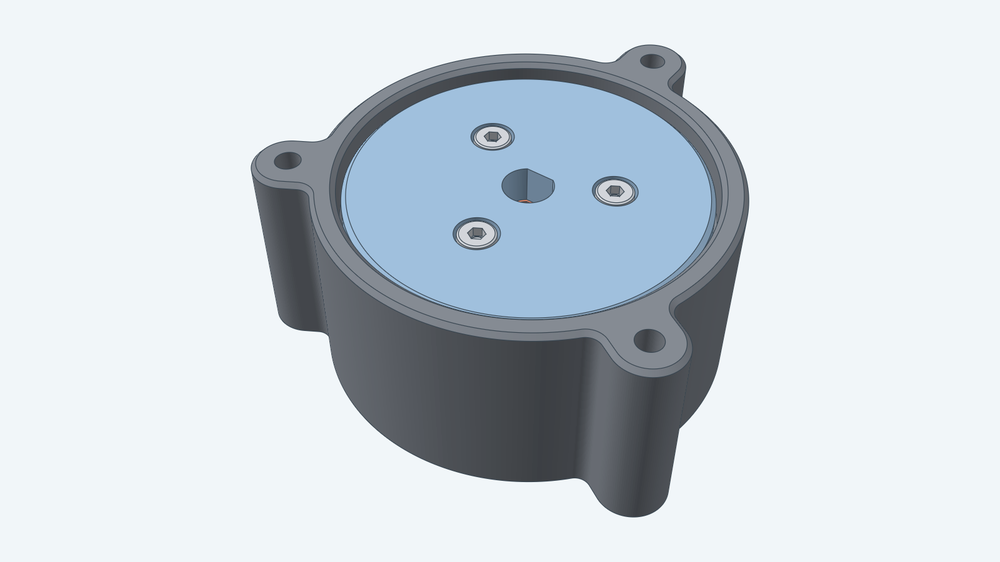
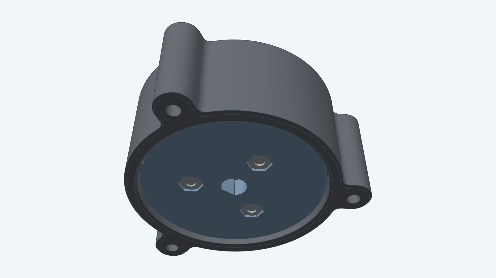
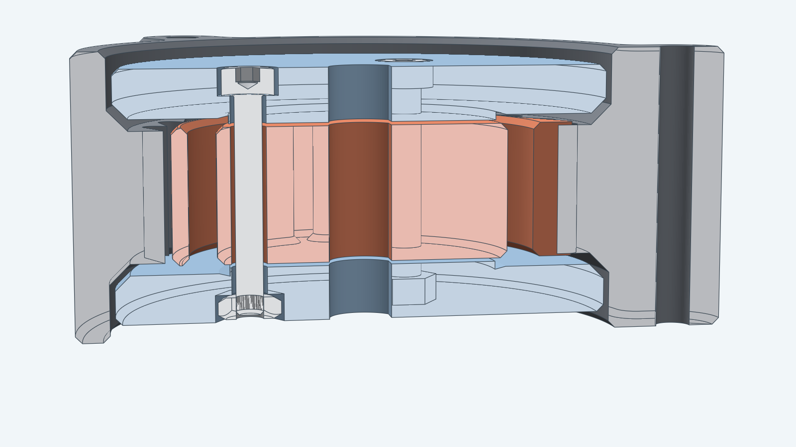
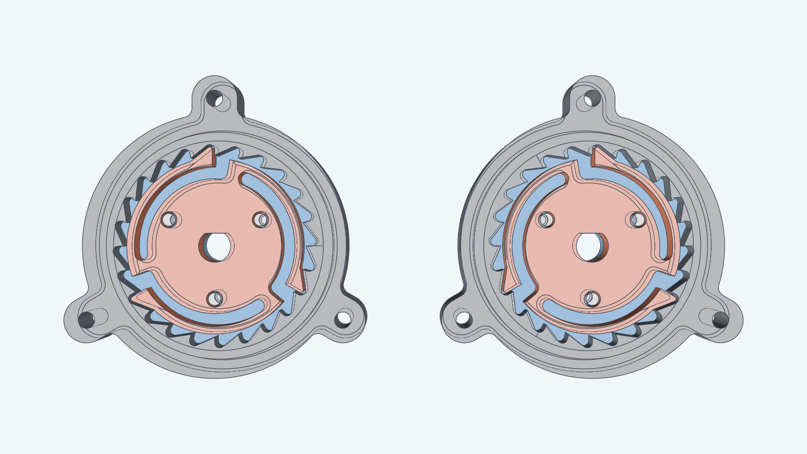
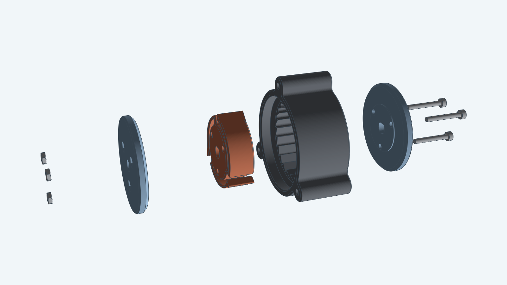
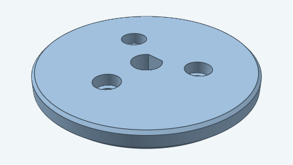
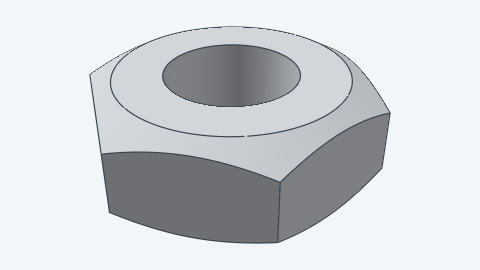

# One-way clutch

**Build status:** Built and tested.

A printed one-way clutch for a D-flat shaft. A hub with three flexing pawls presses on the shaft and meets a 42 mm ring
with 24 internal teeth and three bolt ears. Turn the shaft one way and the pawls catch the teeth, so the ring turns with it. Turn the shaft
the other way and the teeth push the pawls inward, the arms bend, and the ring stays still with a click for each tooth.
A back plate and a cover hold the ring on the hub. Three M2 × 16 bolts clamp the stack, each into a nut in a hex pocket
in the back plate's outer face. Every printed part prints with its axis vertical and no supports.

You choose the shaft from three presets (`605ZZ`, `608ZZ` and `608ZZ-gearbox`) and the direction in which the ring turns
freely. The shaft is not part of this model: a shaft that runs in a bearing has the bearing's bore as its diameter, and
the mechanism you build owns it.

**Clearance adjustment:** Mixed. The bore clearance is a parameter; the bolts and nuts keep their nominal size.

## Views

From the front, the cover shows the three bolt heads, flush in their pockets, round the shaft's D hole. The ring's
three ears stand out between the bolt heads.

From the back, the back plate's outer face goes against the mechanism. Its three hex pockets hold the nuts. Each bolt tip
sits just inside the back plate's outer face, and ends flush with it once the bolts are tight.

From the side, the ring's outside is 42 mm across between the ears, which stand out to a 54.2 mm circle. The ring's
outer edges are chamfered, and the ring stands 1.25 mm past both plates.

## How it works

The picture cuts the clutch at the hub's mid-height and looks along the shaft.

- Each pawl is a thin curved arm printed in one piece with the hub. The arm ends in a head, and the head sits in the
  gap between two of the ring's 24 teeth.
- Each tooth has a radial lock face on one side and a ramp on the other. Turning the hub toward the lock face presses
  the head against it, and the ring turns with the hub.
- Turning the hub the other way, the ramp presses the head inward. The arm bends in the plane of the print, so the
  bending loads the printed lines along the arm, and the head clicks over the tooth.
- A slot behind each arm gives it room to bend. The arm is 1.2 mm thick, and it strains 0.65 % at full travel.
- Turned the free way, each head clears the teeth: 0.12 mm after 1.5 degrees of turn and 0.07 mm after 2 degrees,
  measured on the built parts.
- The hub's two faces carry a 0.5 mm chamfer along the arms and, on the 8 mm presets, round the D bore. The head's run
  stays sharp so it keeps its lock contact.

The second cut runs through the shaft axis. Each plate has a rim that fits a counterbore in the ring's end, with a 45°
cone beside it, so the plates hold the ring between them and it cannot slide along the shaft. The ring keeps 0.4 mm of
radial gap to each rim, and each rim overlaps the counterbore over 2.0 mm.

## Mounting the clutch

The ring's two ends stand 1.25 mm past everything that turns with the shaft: both plates, the bolt heads and the bolt
tips. The ring floats 0.85 mm each way between the plates' cones, so 0.4 mm stays clear at the end of its travel.

- A part that turns with the ring, such as a housing or a gear, may sit flat against either end of the ring. It must
  clear the shaft and a 37 mm circle round it.
- A part that turns with the shaft, such as a collar, a spacer or a bearing's inner race, bears on a plate's face.
  Keep it inside 35 mm across, so it never reaches the ring.
- No bearing outside the clutch is needed. The plates' rims and cones carry the ring.

The driven part attaches to the ring alone. Three ears run the ring's full height, each with an M2 clearance bore. Bolt
the driven part to the ears, or key a housing onto them: a tight fit needs a 42 mm bore with three notches for the ears.
The model places no bolt in the ears. The plates stay round, so nothing bolted to the ears reaches the parts that turn
with the shaft.

| Ear dimension | Value |
| --- | ---: |
| Ears | 3, at 90°, 210° and 330° (the same in both directions) |
| Bore circle | 47.0 mm across |
| Bore | 2.6 mm (M2 clearance) |
| Ear width | 7.2 mm |
| Tip circle | 54.2 mm across |
| Length | 21.0 mm (the ring's full height) |

## Freewheel direction

`Freewheel` is the direction the ring turns freely about a held shaft, seen from the front (the cover). The shaft
turning the same way drives the ring along with it; the shaft turning the other way slips under it. The two directions
are mirror images: the hub and the ring are mirrored, and the plates, bolts and nuts are the same.

The left clutch (`Clockwise`) lets the ring turn clockwise about a held shaft, seen from the front. The right clutch
(`CounterClockwise`) lets it turn counter-clockwise.

## Exploded

From the left: the three M2 nuts, the back plate, the hub, the ring with its ears, the cover, and the three M2 × 16 bolts.

## Parts

| Image | Name |
| --- | --- |
|  | Hub with its three pawls (printed) |
|  | Ring with 24 internal teeth and three bolt ears (printed) |
|  | Back plate, with three hex nut pockets in its outer face (printed) |
|  | Cover, with three head pockets (printed) |
|  | M2 × 16 socket head cap screw ([`models/m2bolt`](../m2bolt)), 3 |
|  | M2 hex nut ([`models/m2nut`](../m2nut)), 3 |

## Fits

The model keeps these clearances between its parts. The measured value is the least over every preset and both
directions, less the measurement's own error bound, so it sits a little under the modeled value.

| Pair | Modeled (mm) | Measured (mm) |
| --- | ---: | ---: |
| Hub, back plate and cover D bores on the shaft | `BoreClearance` (0.05) | 0.049 |
| Hub on each plate's boss | 0.25 | 0.237 |
| Pawls to the plates | 0.65 | 0.601 |
| Ring counterbore to each plate's rim | 0.40 | 0.381 |
| Ring cone to each plate's cone | 0.60 | 0.583 |
| Ring tooth ends to the plates | 0.85 | 0.832 |
| Ring ends past every shaft-side part, with the ring at the end of its play | 1.25 | 0.40 at the end of the play |
| Each pawl head in its tooth gap, seated | 0.40 | 0.387 |
| Arm outer arc to the teeth's tips | 0.55 | 0.515 |

## Sizes

The three presets differ only in the D bore of the hub and the two plates. From the left: `605ZZ`, `608ZZ` and
`608ZZ-gearbox`.

## Parameters

All dimensions are in millimeters. `Params.Validate` rejects a value outside its limit with an error that names it.

| Parameter | Default | Meaning and limit |
| --- | --- | --- |
| `Shaft` | `605ZZ` | A preset name: `605ZZ` (5 mm shaft, 0.5 mm flat), `608ZZ` (8 mm, 0.75 mm flat) or `608ZZ-gearbox` (8 mm, 0.5 mm flat) |
| `Freewheel` | `Clockwise` | `Clockwise` or `CounterClockwise`; the zero value is rejected |
| `BoreClearance` | 0.05 | Radial clearance of every D bore, 0.05 to 0.5, and small enough to keep 1.6 mm of wall between the bore and the nut pockets |
| `Placement` | none | A valid frame |

The ring is 42 mm across between its ears and 54.2 mm across the ear tips, and the plates are 18.5 mm long, the ring 21.0 mm. None of
these depends on the preset.

## Printing

Print the hub in PETG, since its arms flex at every click; PLA works too. Print the hub and the ring on either face, and
the cover with its outer face down, with no supports. Print the back plate with its outer face down; its hex pockets open on the bed, and no pause is needed. The ears print
as vertical prisms with no overhang.

To assemble, work off the shaft with the bolts loose, because a nut is not held until its bolt reaches it:

1. Push the three M2 × 16 bolts through the cover's head pockets, and stand the cover on its outer face, bolts up.
2. Slide the hub over the bolts onto the cover.
3. Push each pawl head in with a finger and slide the ring over the hub, turning it in the freewheel direction.
4. Lay the back plate on, inner face down, with the bolts through its holes.
5. Drop an M2 nut into each hex pocket. Lift the stack, holding the plates together, and turn each bolt from the cover's
   side until it catches its nut. Leave them loose.
6. Press the clutch onto the shaft, back plate first, its outer face toward the mechanism's collar. The loose bolts let the three
   D bores line up on the shaft.
7. Tighten the three bolts from the front. The pockets stop the nuts turning.

For how to build this clutch from Go, see the [developer notes](../../docs/models/onewayclutch.md). The construction is
in [instructions.md](instructions.md) and [steps.md](steps.md).
