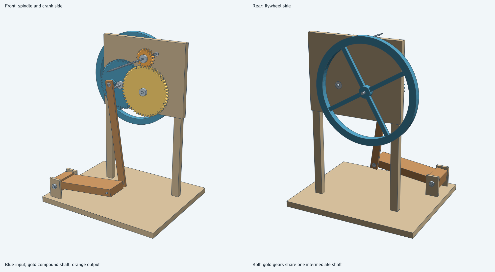
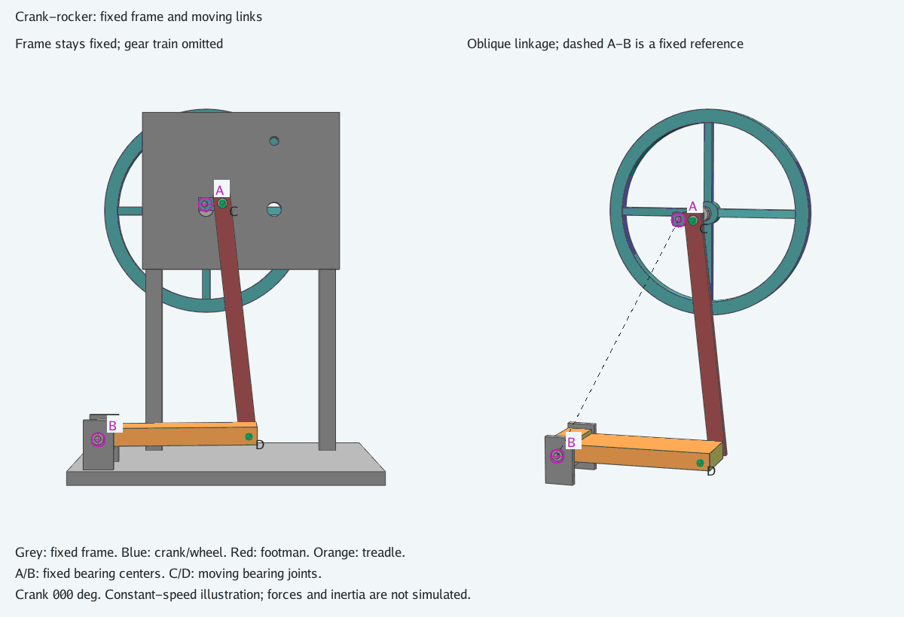
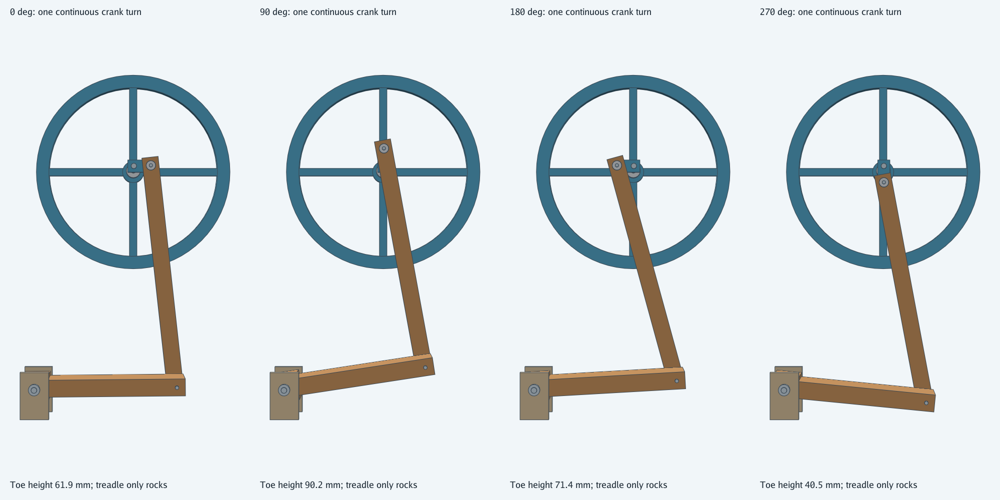
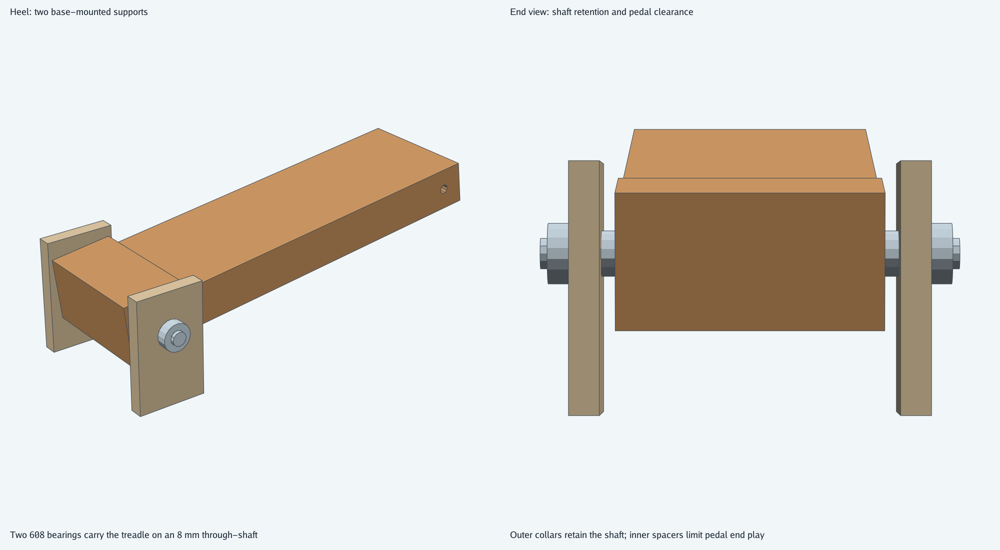
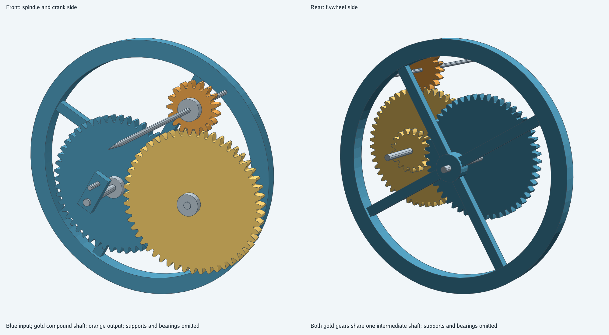
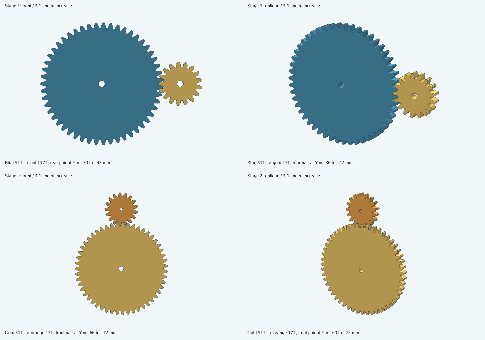
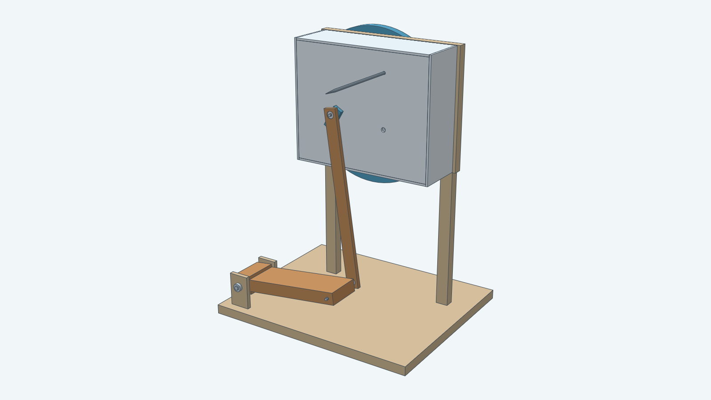

# Pedal yarn spindle

A foot treadle turns a 310 mm flywheel and two 51/17 spur gear pairs. The horizontal quill turns
nine times per complete pedal cycle. Both hands can draft the fibre. This model imports the
involute gears from [spurgear](../spurgear/) and constructs the frame, four-bar linkage, flywheel,
spindle, stock bearing envelopes and removable gear cover with Decad.

The hero views have the gear cover removed to expose the transmission. The input gear is blue;
both gears on the intermediate shaft are gold; the output pinion is orange.
The brown treadle and connecting rod move the blue crank. The steel spindle projects toward the operator.
Every image is rendered from the real assembly bodies.

## Why the gears rotate while the pedal rocks

The treadle and footman form a crank-rocker linkage. The crank pin travels in a complete circle,
while the treadle pivots back and forth at its heel. On the powered part of the stroke, the footman
turns the crank and accelerates the flywheel. The flywheel then turns the crank through dead center
and lifts the treadle for the next stroke. The treadle's return does not reverse the crank.

The grey frame stays still in the left view. The right view removes frame panels to expose the linkage.
Purple marks A and B stay fixed. Green marks C and D move with the crank and pedal.

| Mark | Center position | Relative motion | Bearings |
| --- | --- | --- | --- |
| A | The shaft axis stays fixed to the frame. | The input shaft, crank and flywheel turn. | Two 608-2RS bearings. |
| B | Two base brackets hold the 8 mm heel shaft. | The treadle rocks about the shaft. | Two 608-2RS bearings. |
| C | The center moves around A. | The footman pivots on the moving crank pin. | One 605ZZ bearing. |
| D | The center moves with the treadle toe. | The footman pivots relative to the treadle. | One 605ZZ bearing. |

The animation prescribes a counterclockwise crank rotation. It shows how the parts connect and move;
it does not simulate foot force, flywheel inertia or self-starting. Its camera stays fixed in every frame.

The four panels follow the same real crank, footman, treadle and flywheel through 0, 90, 180 and 270 degrees.
The crank makes a full turn; the treadle only rocks. The drawing hides the frame and gears to expose the linkage.

There is no one-way clutch or ratchet. The operator starts the flywheel in the intended direction
and keeps its momentum with the pedal. It can stall or reverse if that momentum is lost at dead center.
This design permits reverse rotation for plying; it does not mechanically enforce one-way rotation.
The flywheel rim is specified as steel, about 2.56 kg at scale 1. A return-energy screening is described below.
Starting effort and the assumed operating loads still need a physical trial.

## Heel support and pedal return

Two brackets support the 8 mm heel shaft on opposite sides of the pedal. Two 608-2RS bearings sit in the
enlarged heel. Outer clamping collars retain the shaft; inner-ring spacers leave 0.2 mm total pedal end play
at scale 1. Match spacer contact faces to the purchased bearing inner rings so they do not rub the seals.
The bearing seats and stepped heel keep material around the 22 mm bearings at both scale endpoints.
The brackets still require base fasteners, and the commercial collars require their actual clamp screws.

The hinge controls sideways motion while allowing the pedal to rock. No vertical slide guides are fitted:
the toe follows an arc, rising 50.6 mm and moving 2.4 mm horizontally at scale 1.
The crank and connecting rod provide the return stroke. Ease foot pressure as the flywheel lifts the pedal.

The nominal-scale return check uses the actual rim inertia at a steel density of 7800 kg/m³.
It budgets the moving parts' gravitational lift, 5 N residual foot pressure at 150 mm from the heel,
and 0.05 Nm combined load and friction torque referred to the crank. It compares rim energy between
60 and 30 rpm against a conservative full-cycle budget, with a required 25% margin.
Timber parts use 600 kg/m³; crank, pins and moving bearing envelopes use 7800 kg/m³.
The check excludes other rotating inertia from the available energy. A lightweight printed rim fails this load case.
The default check gives 0.800 J available against a 0.604 J budget, a 32.5% surplus under those assumptions.
These are screening assumptions, not measured loads. Scaled variants need their own energy assessment.
No return spring is fitted; the geometry animation still prescribes motion and does not simulate these forces.

## Which gears mesh

The drive-only views omit the support frame, treadle, footman and bearing envelopes together.
The complete assembly views include the bearings in their housings.

The footman runs in front of the input shaft end, with 5 mm of axial clearance at the default scale.
Longer crank and toe pins connect it to the crank and treadle across their axial gaps.
The oblique animation view shows this separation.

The two large gears do not mesh with one another. They occupy two planes, 30 mm apart along Y.
The blue 51-tooth input gear meshes with the small gold 17-tooth pinion behind the large gold gear.
That small pinion and the large gold 51-tooth gear clamp to the same intermediate shaft and turn together.
The large gold gear then meshes with the orange 17-tooth spindle pinion above it.

Each row isolates one meshing pair without moving its parts. The oblique views show the tooth thickness
and shared axial span. The first pair triples speed and reverses direction; the second triples it again
and reverses it back. The spindle therefore turns nine times per input revolution in the input direction.

## Spin, then wind

Tie a leader onto the spindle and draft with the yarn at about 45 degrees to the shaft.
Stop when the drafted length has enough twist. Back off the leader from the point, bring the yarn
to 90 degrees, and turn slowly to wind it onto the straight part of the spindle. Repeat.
This follows the operating method in [Ashford's quill instructions](https://www.ashford.co.nz/instructions/QS.pdf).

This quill has manual wind-on. It does not continuously draw yarn into a bobbin.
Reverse the crank direction to reverse twist for plying. Start the flywheel by hand away from a
linkage dead center; the mechanism has no ratchet or one-way clutch.

| Complete pedal cycles per minute | Calculated spindle rpm |
| --- | --- |
| 40 | 360 |
| 60 | 540 |
| 80 | 720 |

These speeds follow from the tooth counts. They are not measurements of a built machine.

## Dimensions and parameters

At the default scale, the base measures 420 × 350 mm. The spindle axis is 482.3 mm above the base
bottom, and the flywheel reaches 535 mm. The treadle rocks through approximately 14.5 degrees.
The lowest treadle corner stays at least 8.9 mm above the base across a complete crank turn.

`Scale` changes frame and gear dimensions and axial shaft lengths from 0.8 to 1.2.
Stock bearing dimensions, 8 mm and 5 mm shaft diameters and their mating bores stay fixed.
`CrankAngle` selects an assembled pose in radians.
The tooth counts and 9:1 ratio stay fixed. The two gear pairs each have 0.3 mm additional center
distance at scale 1; this clearance scales with the model.

## Bearings, guard and prototype hardware

The assembly imports its bearing envelopes from [ballbearing](../ballbearing/).
Six 608-2RS bearings support the 8 mm input, intermediate and heel shafts, two per shaft.
Four 605ZZ bearings support the 5 mm spindle and footman: two on the spindle and one at each footman end.
The same purchased sizes are used at every frame scale.

The frame holds the shaft bearings' outer rings while their inner rings turn with the shafts.
At the heel, the pin is fixed and the treadle rocks on its bearings. At the footman ends,
the bearings allow the red rod to turn relative to the moving pins.
The CAD annuli represent complete mounting envelopes, so they do not show separate ring rotation.

The removable cover encloses the gear stages. The cover is included in every build; renderer presets
choose whether to show it. The flywheel and treadle linkage remain exposed in this concept.
The spindle point needs a removable cap when stored.

Use purchased clamping hubs to connect the round-bore gears and flywheel to their shafts, and fit
axial collars or circlips. The model includes hub and bearing envelopes but omits clamp screws,
mounting fasteners, threads and drive-shaft retention. Heel collar and spacer envelopes are included.
The frame joints also need fastening
details before fabrication. This is a mechanical prototype design, not a tested manufacturing release.

Physical trials must validate the specified rim mass, assumed return loads, pedal effort, vibration, bearing friction, gear wear,
noise, yarn capacity and guarding. The geometry checks establish dimensions, linkage closure,
sketch constraints and solid geometry; they do not measure those operating properties.

The [developer guide](../../docs/models/pedalspindle.md) documents the API, build, image commands,
component list and verification. The [instructions](instructions.md) own the construction dimensions;
the [steps](steps.md) map them to Decad.
