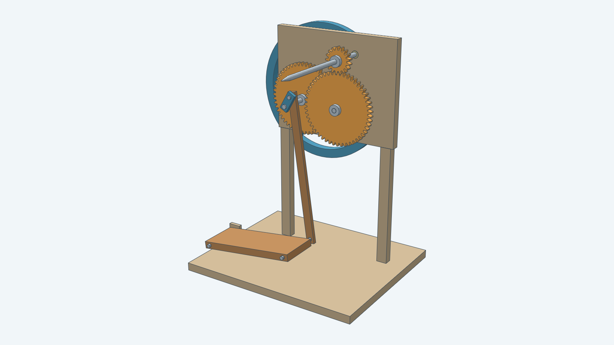
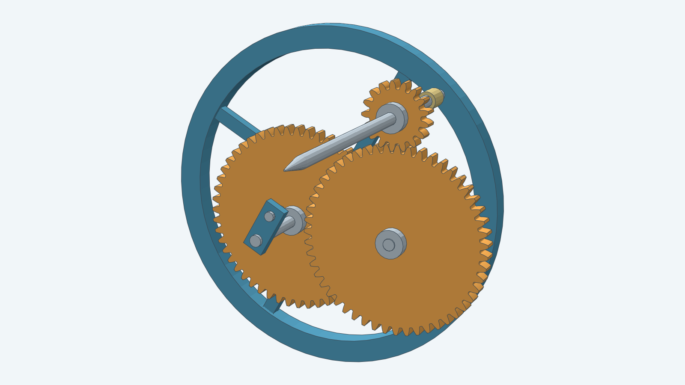

# Pedal yarn spindle

A foot treadle turns a 310 mm flywheel and two 51/17 spur gear pairs. The horizontal quill turns
nine times per complete pedal cycle. Both hands can draft the fibre. This model imports the
involute gears from [spurgear](../spurgear/) and constructs the frame, four-bar linkage, flywheel,
spindle, bushes and removable gear cover with Decad.

The hero view has the gear cover removed to expose the transmission. Blue parts transmit rotation;
orange gears increase speed; the brown treadle and connecting rod move the crank. The steel spindle
projects toward the operator. Every image is rendered from the real assembly bodies.

## Spin, then wind

Tie a leader onto the spindle and draft with the yarn at about 45 degrees to the shaft.
Stop when the drafted length has enough twist. Back off the leader from the point, bring the yarn
to 90 degrees, and turn slowly to wind it onto the straight part of the spindle. Repeat.
This follows the operating method in [Ashford's quill instructions](https://www.ashford.co.nz/instructions/QS.pdf).

This quill has manual wind-on. It does not continuously draw yarn into a bobbin.
Reverse the crank direction to reverse twist for plying. Start the flywheel by hand away from a
linkage dead center; the mechanism has no ratchet or one-way clutch.

| Complete pedal cycles per minute | Calculated spindle rpm |
| --- | --- |
| 40 | 360 |
| 60 | 540 |
| 80 | 720 |

These speeds follow from the tooth counts. They are not measurements of a built machine.

## Dimensions and parameters

At the default scale, the base measures 420 × 350 mm. The spindle axis is 482.3 mm above the base
bottom, and the flywheel reaches 535 mm. The treadle rocks through approximately 14.5 degrees.
The lowest treadle corner stays at least 12.9 mm above the base across a complete crank turn.

`Scale` changes every length together from 0.8 to 1.2. `CrankAngle` selects an assembled pose in radians.
The tooth counts and 9:1 ratio stay fixed. The two gear pairs each have 0.3 mm additional center
distance at scale 1; this clearance scales with the model.

## Guard and prototype hardware

The removable cover encloses the gear stages. The cover is included in every build; renderer presets
choose whether to show it. The flywheel and treadle linkage remain exposed in this concept.
The spindle point needs a removable cap when stored.

Use purchased clamping hubs to connect the round-bore gears and flywheel to their shafts, and fit
axial collars or circlips. The model includes hub and bush envelopes but omits clamp screws,
mounting fasteners, threads and detailed shaft retention. The frame joints also need fastening
details before fabrication. This is a mechanical prototype design, not a tested manufacturing release.

Physical trials must establish pedal effort, flywheel mass, vibration, bearing friction, gear wear,
noise, yarn capacity and guarding. The geometry checks establish dimensions, linkage closure,
sketch constraints and solid geometry; they do not measure those operating properties.

The [developer guide](../../docs/models/pedalspindle.md) documents the API, build, image commands,
component list and verification. The [instructions](instructions.md) own the construction dimensions;
the [steps](steps.md) map them to Decad.
