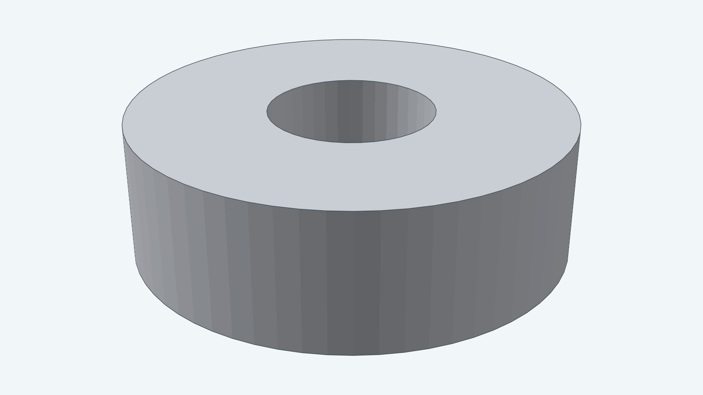
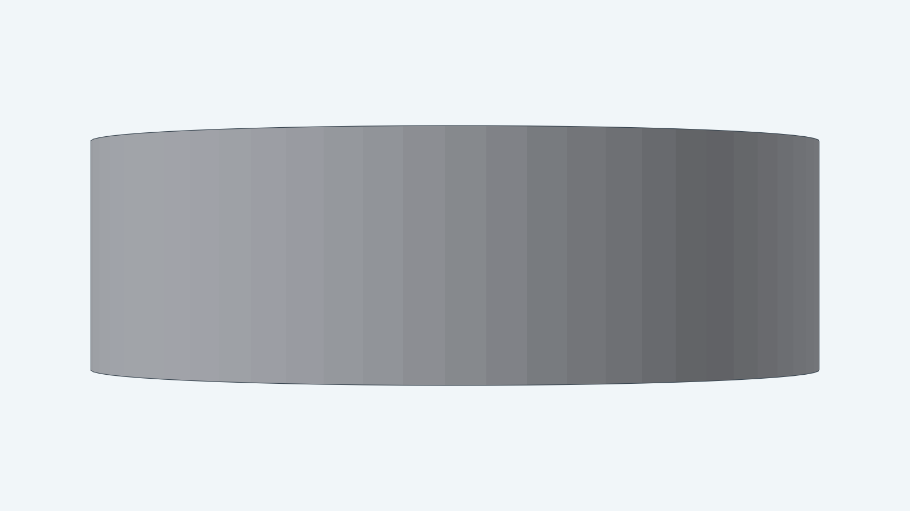
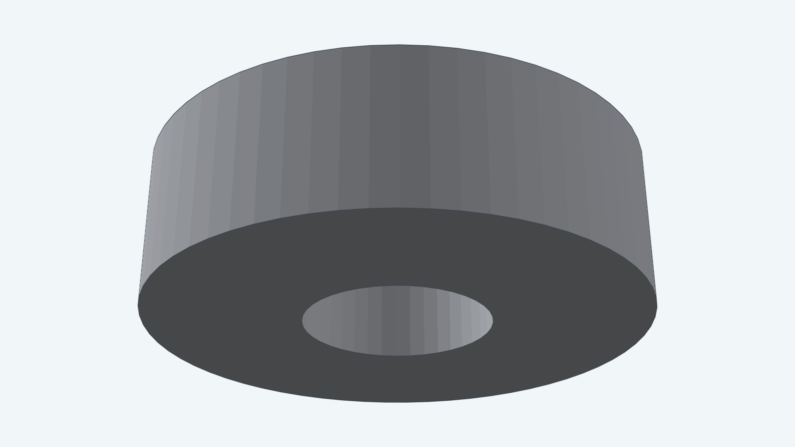

# Pin ring

This model is a plain flat ring that sits on a pin to hold the pin in place. By default it has a 3 mm inner radius,
which is the 5 mm thin rod's 2.5 mm radius plus 0.5 mm of radial clearance, and an 8 mm outer radius, so the ring is
5 mm wide. It is 5 mm thick.

**Clearance adjustment:** Adjustable. The bore clearance is a parameter.

`DefaultParams` selects the ring in its local frame: the axis is the Z axis and the ring spans z from 0 to 5.
You can change the rod radius, the clearance, the radial width and the thickness. `Placement` positions the
ring in an assembly.

## Views

The top view shows the ring and its bore.

The side view shows the 5 mm thickness.

The underside is flat, like the top.

The [developer guide](../../docs/models/pinring.md) documents construction and checks.
The [instructions](instructions.md) own the dimensions; the [steps](steps.md) map them to Decad.
