# Planetary gearbox

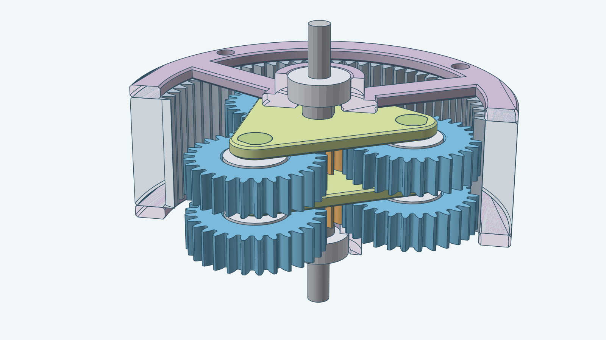

A compact planetary speed reducer. A fixed ring gear with teeth on its inside is the housing, closed at both ends by
an open-frame cover. A small sun gear turns three planet gears that roll around it inside the ring. Each planet turns
on a 605ZZ bearing with 0.05 mm radial clearance in its pocket and rides on a pin of the carrier, a solid triangular plate that
turns slowly. The sun is the input and the carrier is the output.

The default gearbox has a 13-tooth sun, three 29-tooth planets and a 71-tooth ring. One stage slows the output to
1 ÷ 6.46 of the input speed (1 + 71 ÷ 13). The image shows two stages in the same ring: a link shaft joins the first
carrier to the second sun, so two stages slow the output to 1 ÷ 41.8. The ring and both covers are cut open along a
plane through the axis; every other part is shown whole.

## Assembled

The complete two-stage gearbox with nothing cut away, from the output end, from the input end and from the side.

| From the output end | From the input end | From the side |
| --- | --- | --- |
| 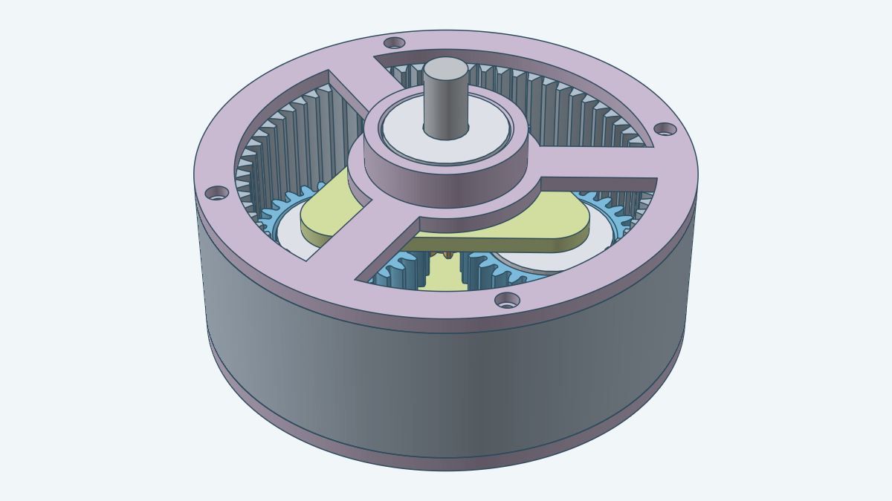 | 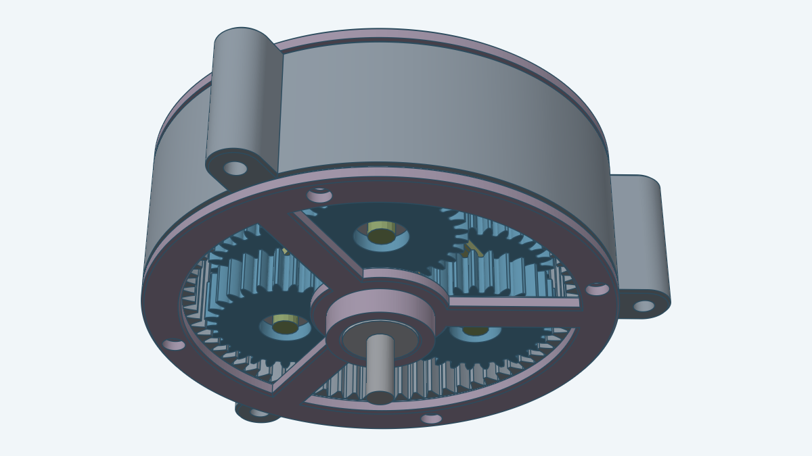 | 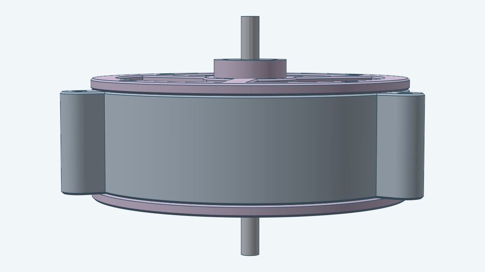 |

## Exploded

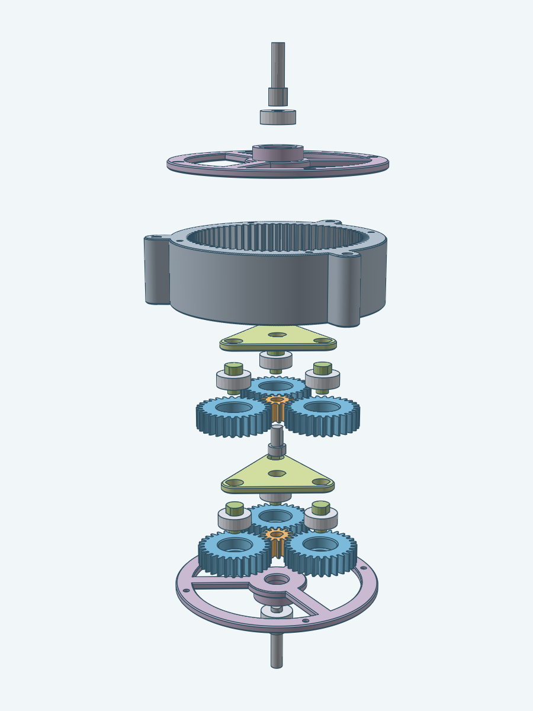

The picture pulls the gearbox apart along its axis. The bolts and nuts are left out; the "How the housing is
bolted" section shows them.

The parts, from the bottom of the picture:

1. The front bearing, off the input shaft's outer end.
2. The front cover.
3. The input shaft, out of the front cover's inner side.
4. The ring.
5. The first stage: the planets; the sun, beside the planets' bearings, which come up out of the planets; the
   carrier; and above it the carrier pins, which leave through the top of the carrier's sockets, beside the link shaft.
6. The second stage: the planets; the sun, beside the planets' bearings; the carrier pins, below the carrier; the
   carrier; and the output shaft, out of the top of the carrier.
7. The rear cover, then the rear bearing off the output shaft's outer end.

## How it moves

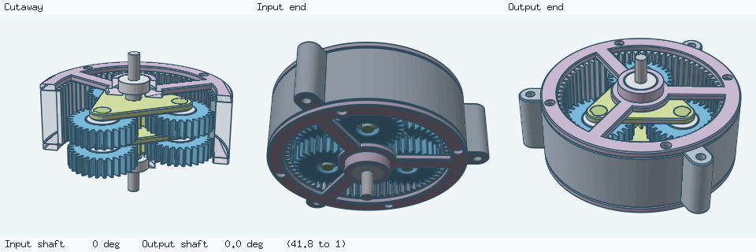

The input shaft and the first sun turn together. The planets roll inside the fixed ring, so each planet turns on its
own bearing while the carrier carries it around the sun. The first carrier turns at 13 ÷ 84 of the sun's speed and
drives the second sun, which drives the second carrier and the output shaft at the same ratio again. The flat
on each shaft shows its turning: the input shaft's flat sweeps round, and the output shaft's creeps. The readout
below the panels gives both angles. The animation plays forward and then back.

## How the input and the output connect

Every shaft is a separate part, 5 mm across where it passes through a bearing or a sun, the same as the 5 mm bore of a
605ZZ, so it has no clearance in the bearing. The sun's bore is D-shaped with 0.05 mm of radial clearance, a press fit (5.1 mm across), so a flat 0.5 mm deep on the
shaft, which makes it a D section, turns the sun without slipping. The input shaft is a 5 mm rod with that flat where the sun sits and
a round collar, 7.4 mm across, next to its bearing. The collar stands in for the washer a metal build would use, so the
sun does not rub on the bearing and the cover.

The link shaft and the output shaft are thin-thick. Each has a 7.4 mm D thick part with a 0.5 mm flat, pressed through
the carrier's D hole with 0.05 mm of clearance all round and level with the carrier's lower face. The thick part ends
0.25 mm short of the next sun or the rear bearing, so the step keeps them off the carrier. The thin 5 mm part fills the
sun's bore or the bearing. Only the input shaft keeps a collar.

- **Input.** The input shaft enters through the front cover's 605ZZ and fills the first sun's bore. It sticks out
  12 mm beyond the front cover's bearing boss, where a motor or a crank attaches.
- **Between stages.** A link shaft runs through the first carrier's hole and fills the second sun's bore, so the
  second sun turns with the first carrier.
- **Output.** The output shaft runs through the last carrier's hole and the rear cover's 605ZZ and sticks out 12 mm
  beyond its boss.

Each pin of the carrier is a separate part, shaped thin-thick: a 5 mm rod that carries the planet bearing and a 7.4 mm D-shaped thick part that starts 0.25 mm above the bearing's top face, so the planet bearing stays clear of the plate, and passes through a D socket in the plate. The thick part ends level with the plate's upper face. It and its socket have 0.05 mm of clearance all round, a press fit, so the pin stays in the plate once pushed in. To assemble, lay the carrier upper face down on a flat surface and press each pin in, thick end first, until it meets the surface. Press the link or output shaft into the carrier from the upper face, with the lower face on the surface.

The model does not show a set screw or the coupling to a motor. The input and output shafts' round ends, and the flat, are where a coupling or a set screw would grip.

## Edge finishing

Every large flat face of the ring, the covers and the carriers has its outer edge chamfered by 0.5 mm at 45°, so the
printed parts have no sharp rims to chip or cut. That covers both end faces of the ring, both faces of each cover
including the edges of its three windows, and both faces of each carrier plate. The ring's teeth, the pin sockets, the carrier's centre hole, the bolt holes and the
bearing seats are not chamfered. The chamfer on the ring follows the mounting ears too.

## Mounting the gearbox

The ring has three mounting ears, spaced 120° apart, to fix the gearbox in place. Each ear is a tab on the ring's outside,
as long as the ring, with a 4 mm bore parallel to the gearbox axis. The bore is a plain hole: the model adds no bolt,
head pocket or nut cavity, so you choose what passes through it. The bore's edge is 3 mm from the covers' outer edge, so a
fastener head up to 10 mm across lies beside the covers and not on them. You can change the bore diameter and the number
of ears. With no ears, the ring is a plain cylinder.

The ring is the fixed part of a planetary gearbox, so the ears carry the whole reaction torque of the output.

## How the housing is bolted

Eight M2 bolts and eight M2 nuts ([`models/m2bolt`](../m2bolt), [`models/m2nut`](../m2nut)) hold the covers to the
ring, four bolts and four nuts per cover. Each bolt head lies flush with its cover's outer face. Each nut sits in a
closed cavity inside the ring wall, so the ring holds the nut and it cannot fall out. The section is cut along the plane
through the axis and one bolt of each cover, in the one-stage gearbox.

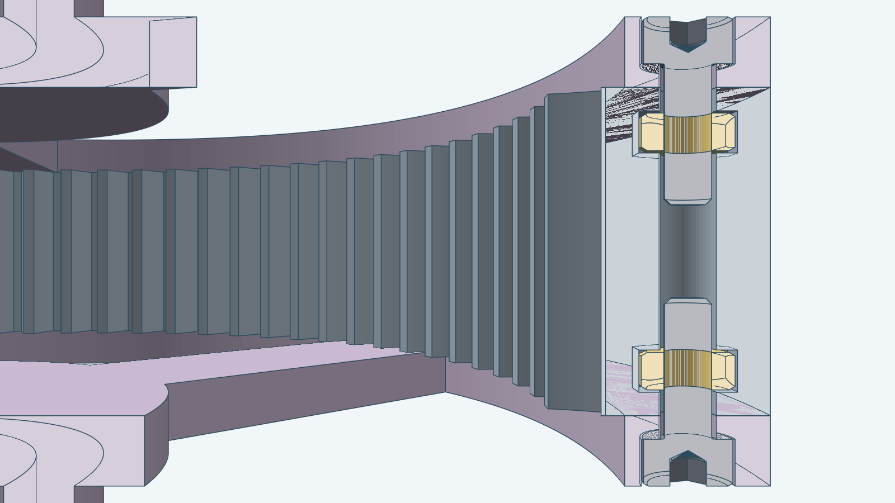

Each bolt is 6 mm long. It runs from a cover into the end of the ring and never along the whole housing, so the bolt
length stays the same for any number of stages. The front and rear bolts share each hole from opposite ends and their
tips do not meet. The exploded view lifts the nut out of its cavity to show where it sits.

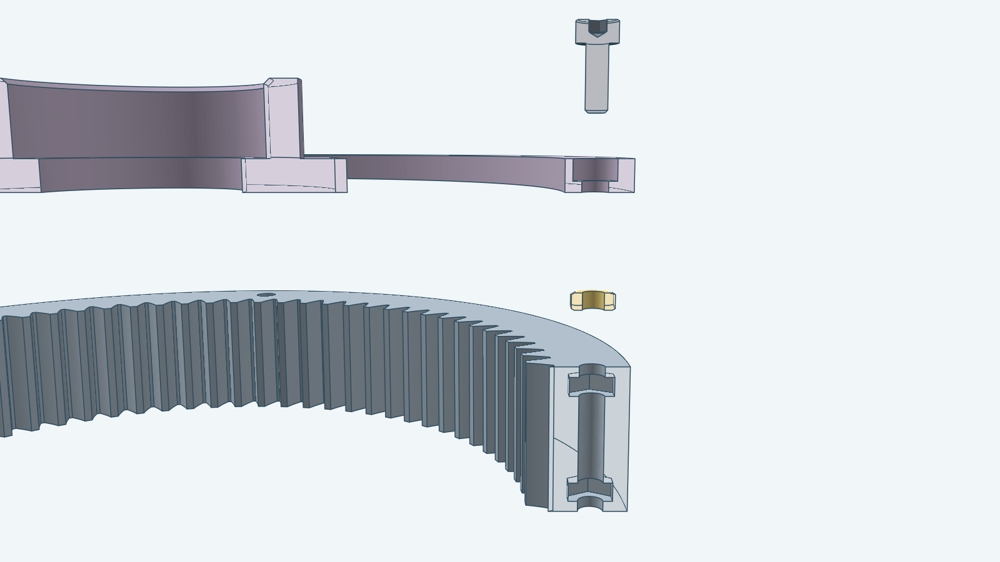

### Printing the ring: insert the nuts by hand

The nuts are not pressed in afterwards. Each nut sits in a cavity the ring walls close on every side except the bolt
hole, so the nuts have to go in while the ring prints. Print the ring standing on its front face, and stop the printer
twice:

1. At 3 mm above the bed, the front cavities are open at the top. Drop a nut into each of the four, then resume.
2. At `L - 1` mm above the bed, where `L` is the ring length (with the default dimensions 14 mm for one stage and `13 K + 1` mm for `K` stages),
   the rear cavities are open at the top. Drop a nut into each of the four, then resume.

The next layers print the 1 mm roofs over the nuts. After that the ring holds all eight nuts by itself.

To assemble, set each cover on its ring end and drive each bolt in from the cover's outer face, through the ring's 1 mm
roof into the nut.

| Part | Pocket | Size |
| --- | --- | --- |
| Bolt head | Round, in the cover's outer face | 4.4 mm wide, 2 mm deep, 1 mm of cover under it |
| Bolt shank | Hole through the cover and the ring | 2.6 mm wide |
| Nut | Closed round cavity in the ring wall, 1 mm behind the end face | 5.02 mm wide, 2 mm high |

## Parts

A gearbox has one ring, two covers, two cover bearings and an input
shaft and, in every stage, one sun, three planets, three planet bearings, three carrier pins, one carrier and one shaft. The bearing is a
purchased 605ZZ, drawn as its 5 × 14 × 5 mm envelope; the covers and the planets use the same part. Planet pins and shafts are 5 mm where they pass through a bearing, the same as the bearing bore, with no clearance. Planet and cover bearing pockets have 0.05 mm radial clearance. A planet bearing sits 0.25 mm above its pocket floor and extends 0.25 mm above the planet. Each pocket has a 0.5 mm chamfer on its entrance. The front cover is
the rear cover turned over. Each carrier is the same part. A stage's shaft is the link shaft when another stage
follows it, and the output shaft for the last stage. The default one-stage gearbox has only the output shaft. Every
part is shaped to print on its own, without supports: the carrier plate down, the pins, the link shaft and the output shaft standing on their thick ends,
the input shaft standing on end or lying down.

| Image | Name |
| --- | --- |
| 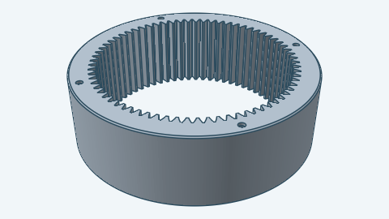 | Ring gear |
| 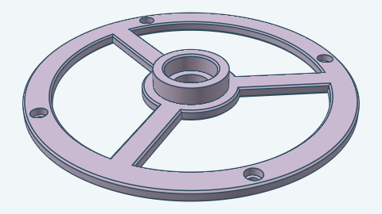 | Cover (front and rear) |
| 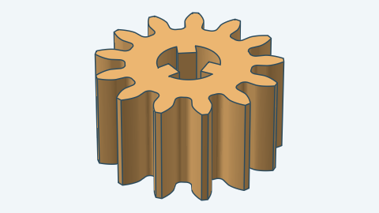 | Sun gear |
| 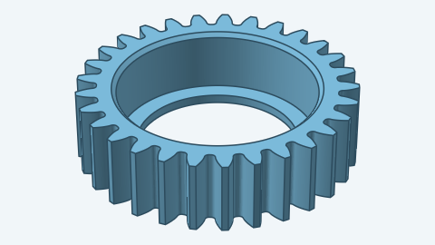 | Planet gear |
| 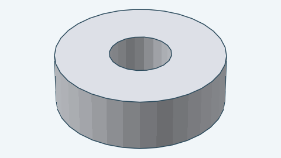 | Bearing (605ZZ) |
| 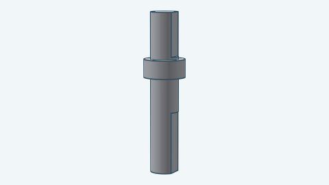 | Input shaft |
| 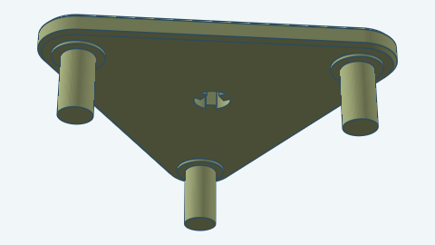 | Carrier |
|  | Carrier pin |
| 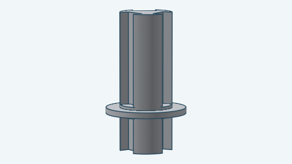 | Link shaft |
| 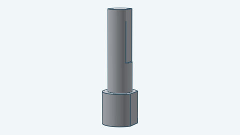 | Output shaft |

You can vary:

- The number of stacked stages in the one ring.
- The tooth counts of the sun, planets and ring, and the number of planets.
- Module and pressure angle.
- Gear, carrier and cover thickness, and the gaps between them.
- How far the input and output shafts reach out of the covers.
- The carrier wall, bearing pocket clearance and entrance chamfer, ring wall and bolt hole size (2.6 mm, the M2 clearance hole).
- The number of mounting ears on the ring (three by default, zero for none) and the diameter of their bore (4 mm).
- Backlash.
- The position and orientation of the gearbox in space.

The ring must have as many teeth as the sun plus twice the planets, and the sun and ring teeth together must divide
by the planet count so the planets sit at equal angles. Dimensions are in millimeters, and the pressure angle is in
radians. Each pair of meshing gears has 0.3 mm of backlash by default, set by how much each tooth is thinned. The tip-to-root clearance is at least `max(0.25 × module, 0.5 mm)`.

For how to build this gearbox from Go, see the [developer notes](../../docs/models/planetarygearbox.md).
