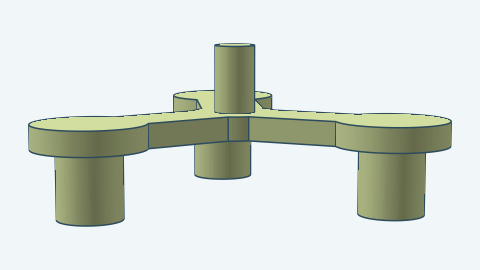
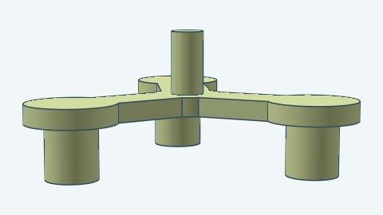

# Planetary gearbox

A compact planetary speed reducer. A fixed ring gear with teeth on its inside is the housing. A small sun gear
turns three planet gears that roll around it inside the ring. Each planet turns on a 608ZZ bearing pressed into a
pocket in the gear and rides on a pin of the carrier, a three-armed spider that turns slowly. The sun and the
carrier's shafts turn with the shaft that drives them, so they have no bearing. The sun is the input and the
carrier is the output.

The default gearbox has a 13-tooth sun, three 29-tooth planets and a 71-tooth ring. One stage slows the output to
1 ÷ 5.46 of the input speed (1 + 71 ÷ 13). The image shows two stages in the same ring, pulled apart: the first
carrier's stub shaft drives the second sun, so two stages slow the output to 1 ÷ 29.8.

## Parts

Each part is shown once, from the real model. A gearbox has one ring and, in every stage, one sun, three planets,
three bearings and one carrier. The bearing is a purchased 608ZZ, drawn as its 8 × 22 × 7 mm envelope. A stage's carrier is the linking carrier when another stage follows it, because its stub shaft drives
that stage's sun. The last stage's carrier is the output carrier, and its shaft is the output. The default one-stage
gearbox has only the output carrier.

| Image | Name |
| --- | --- |
|  | Ring gear |
|  | Sun gear |
|  | Planet gear |
|  | Planet bearing (608ZZ) |
|  | Linking carrier |
|  | Output carrier |

You can vary:

- The number of stacked stages in the one ring.
- The tooth counts of the sun, planets and ring, and the number of planets.
- Module and pressure angle.
- Gear and carrier thickness, and the gaps between them.
- The shaft and output shaft sizes, the carrier wall, the bearing pocket clearance and the ring wall.
- Backlash.
- The position and orientation of the gearbox in space.

The ring must have as many teeth as the sun plus twice the planets, and the sun and ring teeth together must divide
by the planet count so the planets sit at equal angles. Dimensions are in millimeters, and the pressure angle is in
radians. Each pair of meshing gears has 0.1 mm of backlash by default, set by how much each tooth is thinned.

For how to build this gearbox from Go, see the [developer notes](../../docs/models/planetarygearbox.md).
