# Planetary gearbox with 8 mm shafts (608ZZ cover bearings)

[Planetary gearbox](README.md)

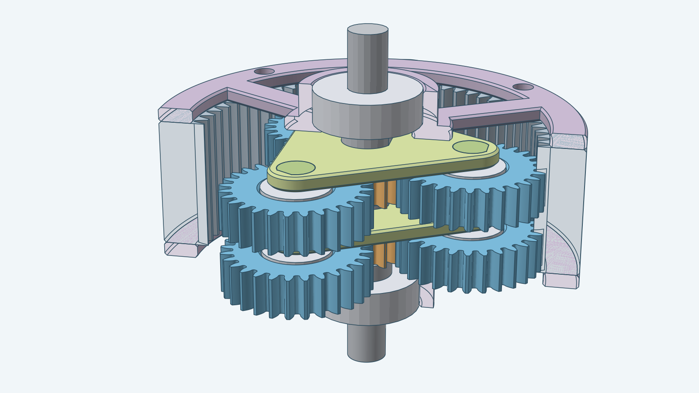

This kit keeps the 605ZZ planet bearings of the default gearbox and holds the input and output shafts in 608ZZ cover
bearings. Each shaft is 8 mm across where it passes a bearing or a sun, the bore of a 608ZZ, so it has no clearance in
the bearing. The carrier pins stay 5 mm across, the bore of a 605ZZ. A wider printed shaft carries more torque.

The kit has a 14-tooth sun, three 28-tooth planets and a 70-tooth ring. The default 13/29/71 teeth do not fit here: the
8.1 mm sun bore needs a sun of at least 14 teeth at module 1. One stage slows the output to 1 ÷ 6 of the input speed
(1 + 70 ÷ 14), and two stages slow it to 1 ÷ 36. The images show two stages in the same ring. The ring and both covers
are cut open along a plane through the axis in the hero image; every other part is shown whole.

## Assembled

The complete two-stage gearbox with nothing cut away, from the output end, from the input end and from the side.

| From the output end | From the input end | From the side |
| --- | --- | --- |
| 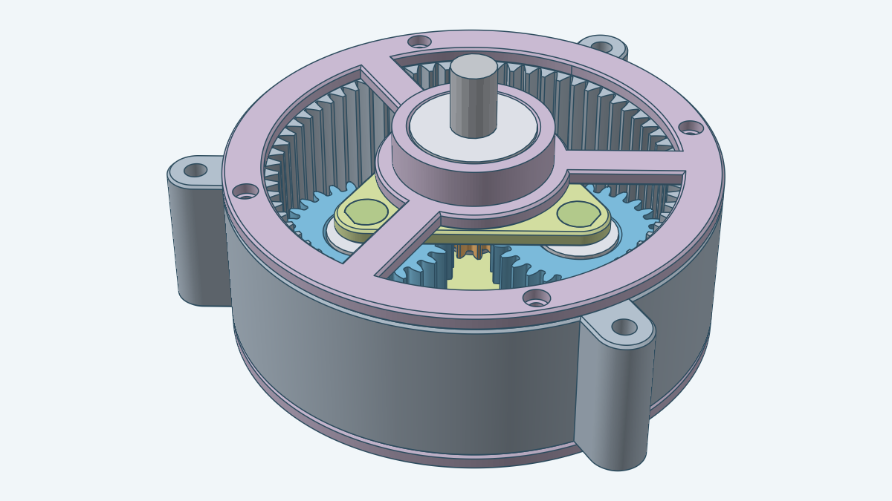 | 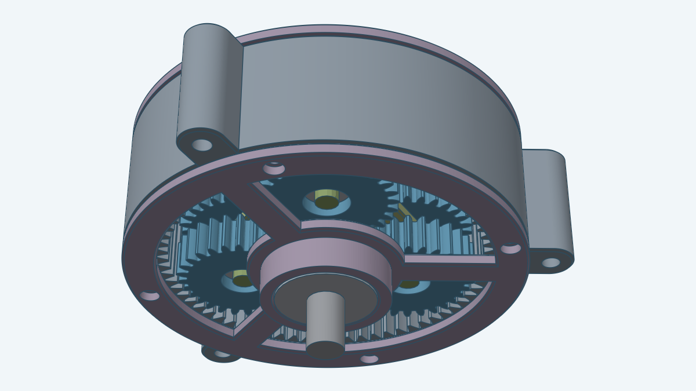 | 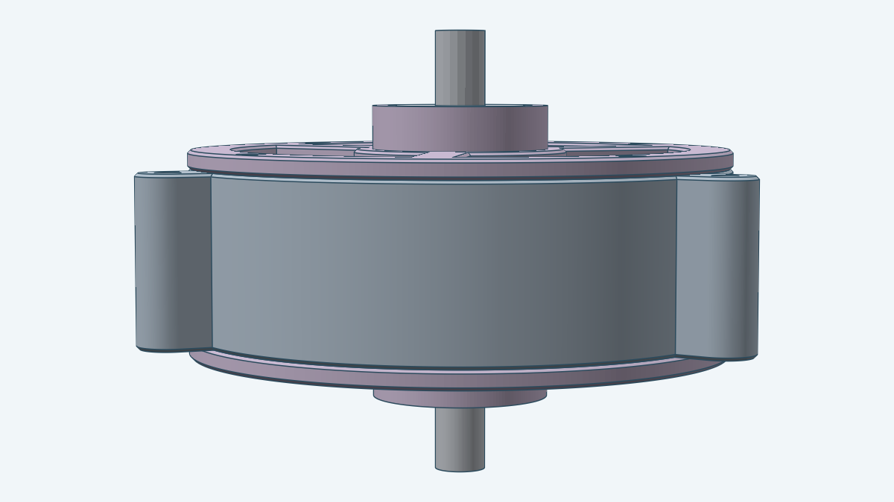 |

## Exploded

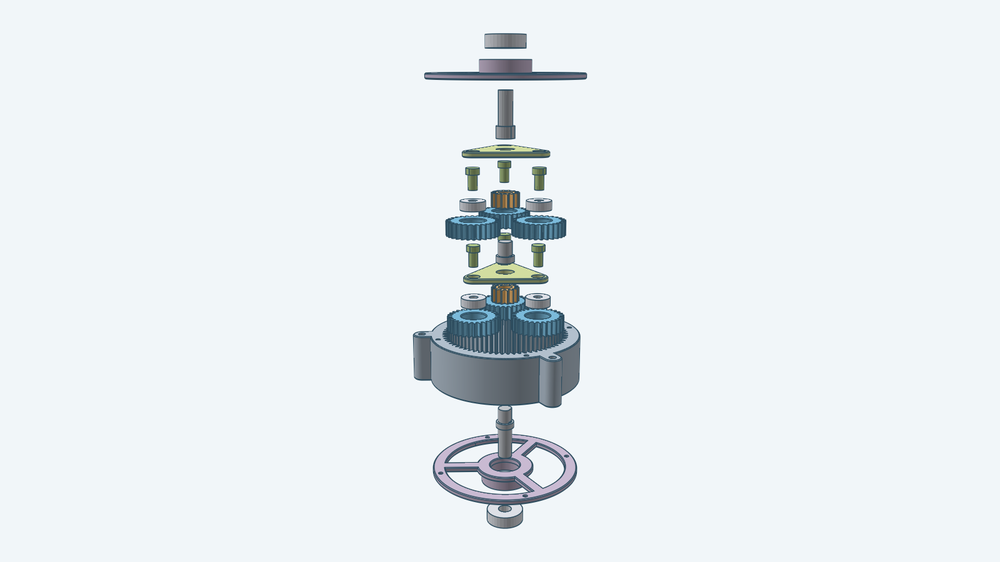

The picture pulls the gearbox apart along its axis. It leaves out the bolts and nuts, which are the same as in the
default gearbox.

The parts, from the bottom of the picture:

1. The front bearing, a 608ZZ, off the input shaft's outer end.
2. The front cover, with its wide bearing boss.
3. The input shaft, out of the front cover's inner side.
4. The ring.
5. The first stage: the planets; the sun, beside the 605ZZ planet bearings, which come up out of the planets; the
   carrier; and above it the carrier pins, beside the link shaft.
6. The second stage: the planets; the sun, beside the planet bearings; the carrier pins, below the carrier; the
   carrier; and the output shaft, out of the top of the carrier.
7. The rear cover, then the rear bearing, a 608ZZ, off the output shaft's outer end.

## What changes from the default

| Dimension | Default | This kit |
| --- | --- | --- |
| Sun, planet and ring teeth | 13, 29, 71 | 14, 28, 70 |
| One-stage ratio | 6.46 | 6 |
| Shaft diameter | 5 mm | 8 mm |
| Sun bore | 5.1 mm | 8.1 mm |
| Shaft collar and thick part | 7.4 mm | 10.4 mm |
| Cover bearing pocket | 14.1 mm | 22.1 mm |
| Cover lip bore | 10 mm | 18 mm |
| Cover bearing boss | 20.1 mm | 28.1 mm |
| Cover hub | 26.1 mm | 34.1 mm |
| Ring outer radius | 44.1 mm | 43.6 mm |

The carrier pins, the planet pockets and lips, the pin boss and the cover spoke width are the same as the default's.

## Parts

The gearbox has the same parts as the default. The two cover bearings are 608ZZ and the three planet bearings are
605ZZ, so this kit lists two bearings. Each is drawn as its nominal envelope.

| Image | Name |
| --- | --- |
| 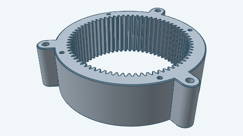 | Ring gear |
| 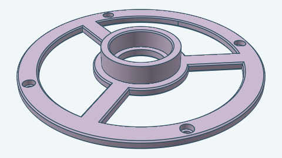 | Cover (front and rear) |
| 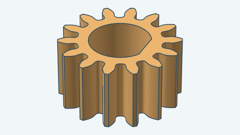 | Sun gear |
| 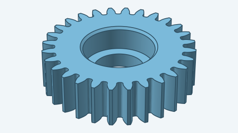 | Planet gear |
| 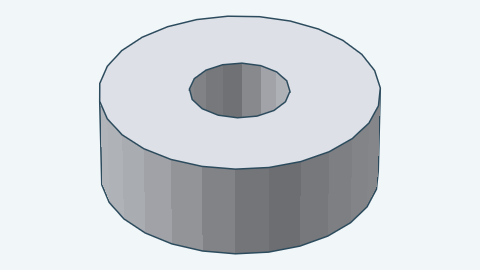 | Planet bearing (605ZZ) |
| 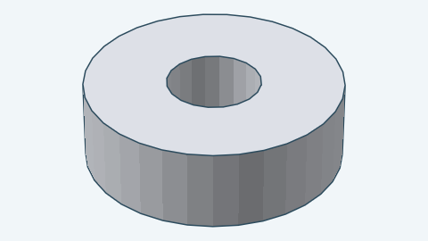 | Cover bearing (608ZZ) |
| 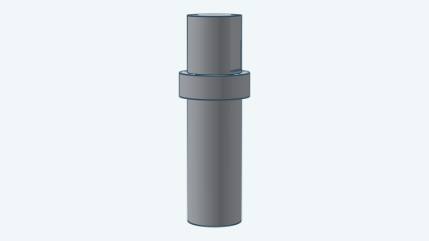 | Input shaft |
| 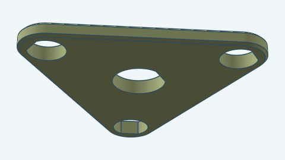 | Carrier |
| 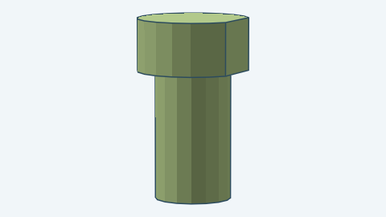 | Carrier pin |
| 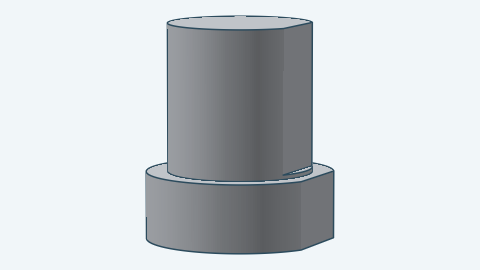 | Link shaft |
| 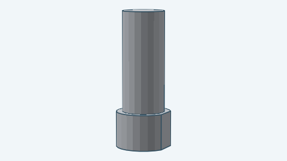 | Output shaft |

## Building it

```go
p, err := planetarygearbox.DefaultParamsFor("planet605-shaft608")
if err != nil {
	return err
}
p.Stages = 2
box, err := planetarygearbox.Build(ctx, planetarygearbox.NewDocument(), p)
```

`DefaultParamsFor` returns the default parameters with `PlanetBearing` 605ZZ, `ShaftBearing` 608ZZ and the 14/28/70
teeth. For the functions and checks, see the [developer notes](../../docs/models/planetarygearbox.md).
