# Planetary gearbox with 8 mm planet pins (608ZZ planet bearings)

[Planetary gearbox](README.md)

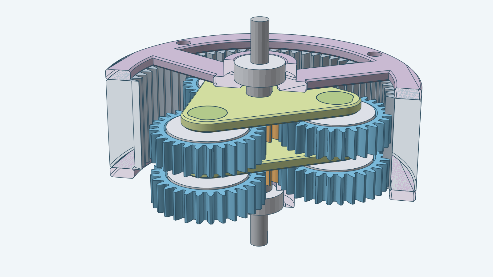

This kit keeps the 605ZZ shaft bearings of the default gearbox and turns each planet on a 608ZZ bearing. Each
carrier pin is 8 mm across, the bore of a 608ZZ, so it has no clearance in the bearing. The input, link and output
shafts stay 5 mm across, the bore of a 605ZZ. A wider printed pin carries more torque.

The kit keeps the default 13-tooth sun, 29-tooth planets and 71-tooth ring. The 22.1 mm planet bearing pocket leaves
0.93 mm of wall under the planet's root circle beyond the one module the design needs. One stage slows the output to
1 ÷ 6.46 of the input speed (1 + 71 ÷ 13), and two stages slow it to 1 ÷ 41.8. The images show two stages in the same
ring. The ring and both covers are cut open along a plane through the axis in the hero image; every other part is shown
whole.

## Assembled

The complete two-stage gearbox with nothing cut away, from the output end, from the input end and from the side.

| From the output end | From the input end | From the side |
| --- | --- | --- |
| 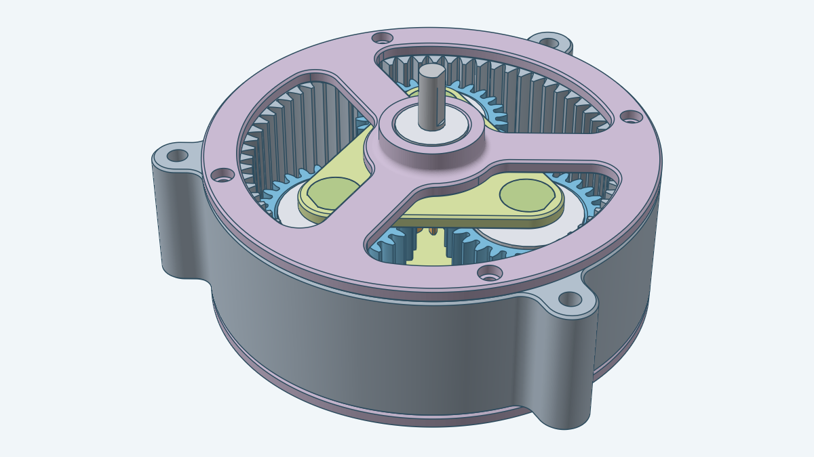 | 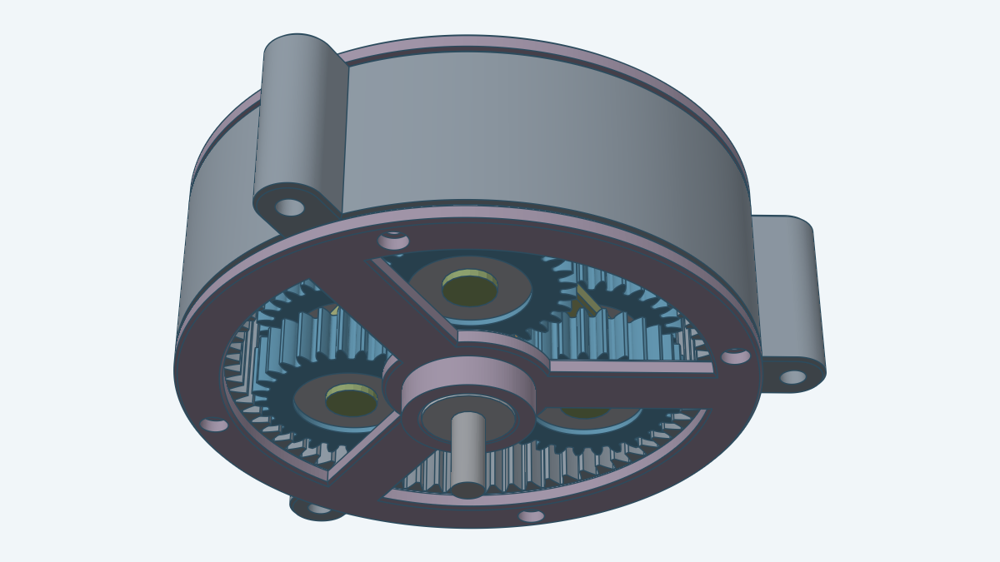 | 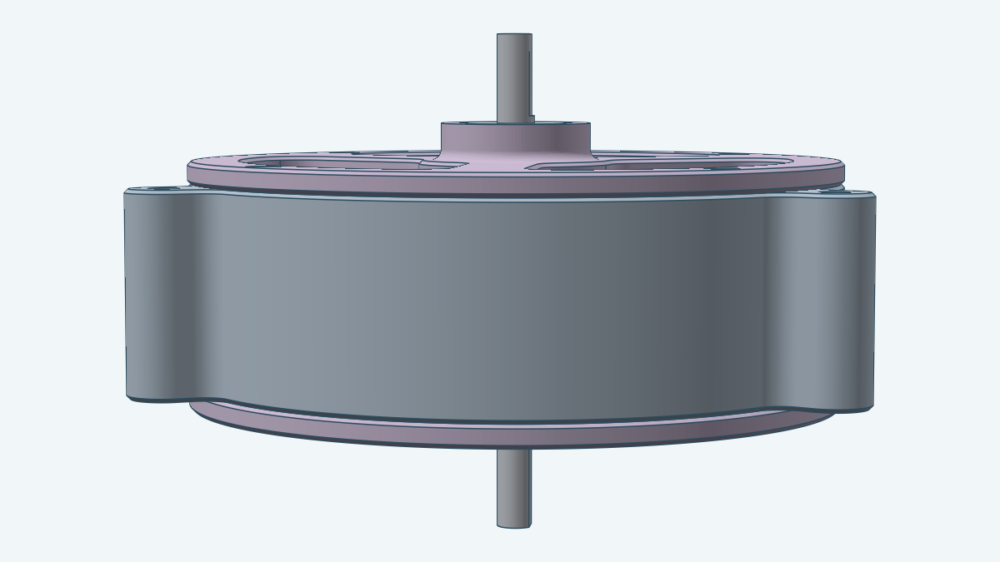 |

## Exploded

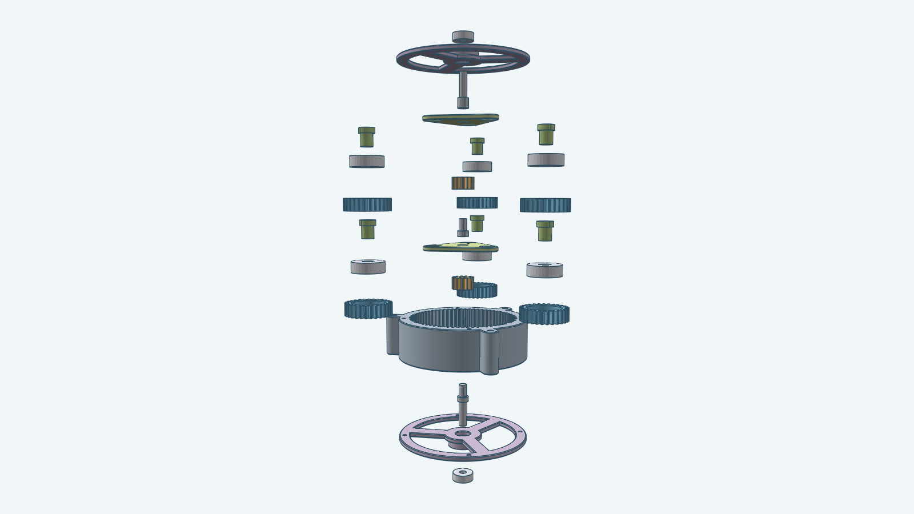

The picture pulls the gearbox apart along its axis. It leaves out the bolts and nuts, which are the same as in the
default gearbox; [How the housing is bolted](README.md#how-the-housing-is-bolted) shows them.

Each stage's planets, bearings and carrier pins also move 45 mm outward from the axis, so all three planets of a
stage show side by side and none hides behind the sun.

The parts, from the bottom of the picture:

1. The front bearing, a 605ZZ, off the input shaft's outer end.
2. The front cover.
3. The input shaft, out of the front cover's inner side.
4. The ring.
5. The first stage: the planets; the sun, beside the 608ZZ planet bearings, which come up out of the planets; the
   carrier; and above it the carrier pins, beside the link shaft.
6. The second stage: the planets; the sun, beside the planet bearings; the carrier pins, below the carrier; the
   carrier; and the output shaft, out of the top of the carrier.
7. The rear cover, then the rear bearing, a 605ZZ, off the output shaft's outer end.

## What changes from the default

| Dimension | Default | This kit |
| --- | --- | --- |
| Sun, planet and ring teeth | 13, 29, 71 | 13, 29, 71 |
| Pin diameter | 5 mm | 8 mm |
| Pin thick part and socket | 7.4 mm | 10.4 mm |
| Planet bearing pocket | 14.1 mm | 22.1 mm |
| Planet lip bore | 10 mm | 18 mm |
| Pin boss | 11 mm | 14 mm |
| Cover spoke width | 7 mm | 10 mm |

The shafts, the cover bearing boss and hub, the ring and the teeth are the same as the default's.

## Parts

The gearbox has the same parts as the default. The three planet bearings of every stage are 608ZZ and the two cover bearings are 605ZZ, so this kit lists two bearings. Each is drawn as its envelope: 8 × 22 × 7 mm for the 608ZZ and 5 × 14 × 5 mm for the 605ZZ.

| Image | Name |
| --- | --- |
| 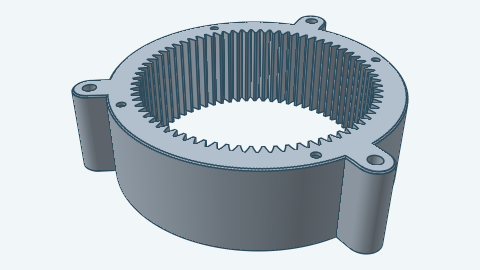 | Ring gear |
| 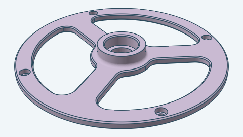 | Cover (front and rear) |
| 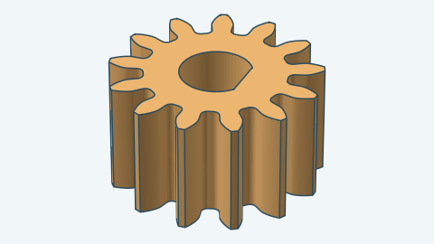 | Sun gear |
| 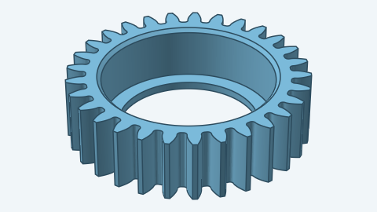 | Planet gear |
| 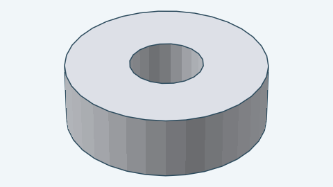 | Planet bearing (608ZZ) |
| 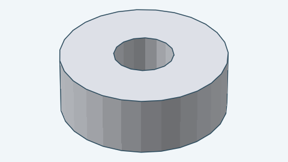 | Cover bearing (605ZZ) |
| 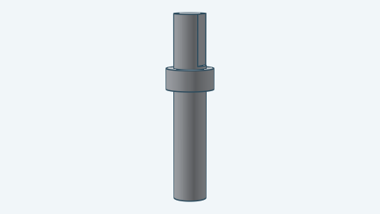 | Input shaft |
| 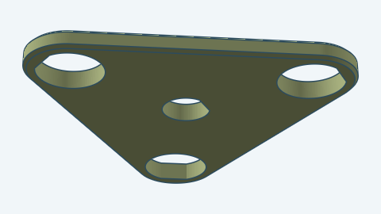 | Carrier |
| 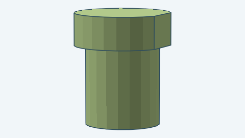 | Carrier pin |
| 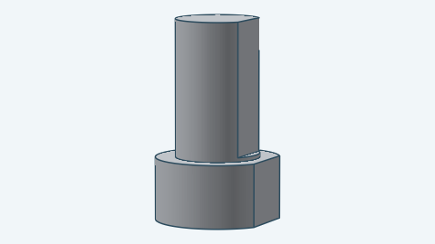 | Link shaft |
| 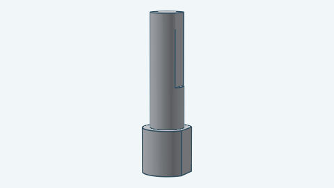 | Output shaft |

## Building it

```go
p, err := planetarygearbox.DefaultParamsFor("planet608-shaft605")
if err != nil {
	return err
}
p.Stages = 2
box, err := planetarygearbox.Build(ctx, planetarygearbox.NewDocument(), p)
```

`DefaultParamsFor` returns the default parameters with `PlanetBearing` 608ZZ, `ShaftBearing` 605ZZ and the 13/29/71
teeth. For the functions and checks, see the [developer notes](../../docs/models/planetarygearbox.md).
