# Plaque stand

**Build status:** Built and tested.

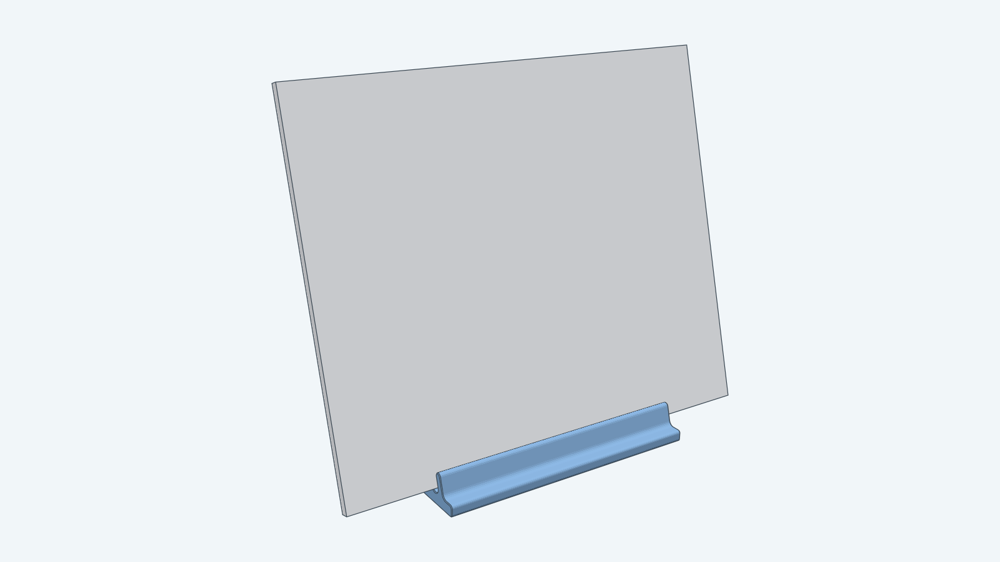

A desk or shelf stand for a flat, heavy rectangular plaque, built from separate printed parts to save plastic: two
identical brackets joined by a printed rail, with two M2 bolts and nuts. The plaque rests on a rounded slot floor in
both brackets, leans back against each slot's back wall, and a low lip on each bracket's front stops it sliding
forward. The brackets sit 10% in from each end of the plaque. The rail drops into a channel in the rear of each bracket's
base, and one M2 × 6 bolt per bracket, driven down through the rail into a nut under the bracket, fixes it, so the
brackets cannot spread apart, slide along the plaque's edge or twist. The assembly tips over only after you tilt it
15° or more, forward, backward or sideways.

The default plaque size, 250 × 305 × 12.8 mm, is the measured size of the user's plaque. Change it to your plaque's
width, height and thickness; the brackets' depth and back rest and the rail's length follow from them. At the defaults
the printed parts use 61.9 cm³ of plastic, against 210.5 cm³ for a single 150 mm wide prism with the same profile. The model also
builds the plaque as a reference body so you can check the fit. The plaque is not printed: export the `Brackets` and
`Rail` bodies, and print the bracket twice.

**Clearance adjustment:** Mixed. The slot's clearance around the plaque is a parameter, 0.55 mm on each side by default
(a Loose fit). The rail takes a Regular 0.40 mm gap in its channels. The plaque and the M2 bolts and nuts keep their
nominal size.

## Views

The brackets, rail and hardware without the plaque show the channel in each bracket's rear base, the rail lying in
both, and the bolt heads sunk in the rail.

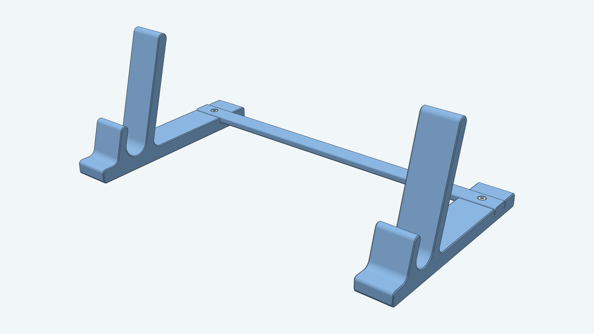

A cut through a bracket's middle and its bolt shows the joint. The M2 × 6 bolt passes through the rail and the channel
floor into a nut in a hex pocket open to the bracket's bottom face. The rail stands 0.4 mm proud of the base top here;
tightening the bolt pulls it down onto the channel floor, flush with the base top, with the bolt's tip flush with the
bottom face.

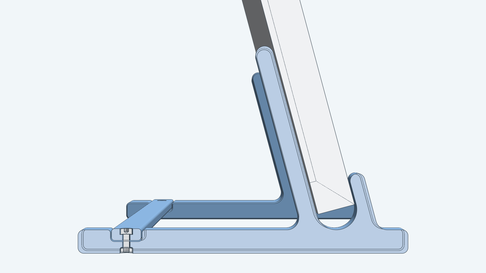

From the side, the plaque leans 15° back from vertical, resting on the slot's round floor against the back wall.

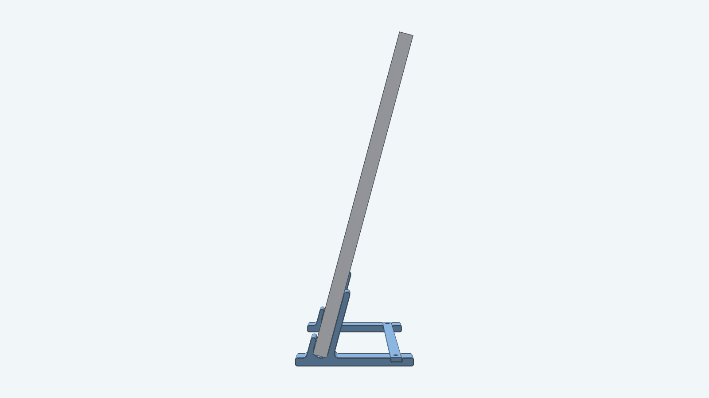

From behind, the rail ties the two brackets' rear bases together.

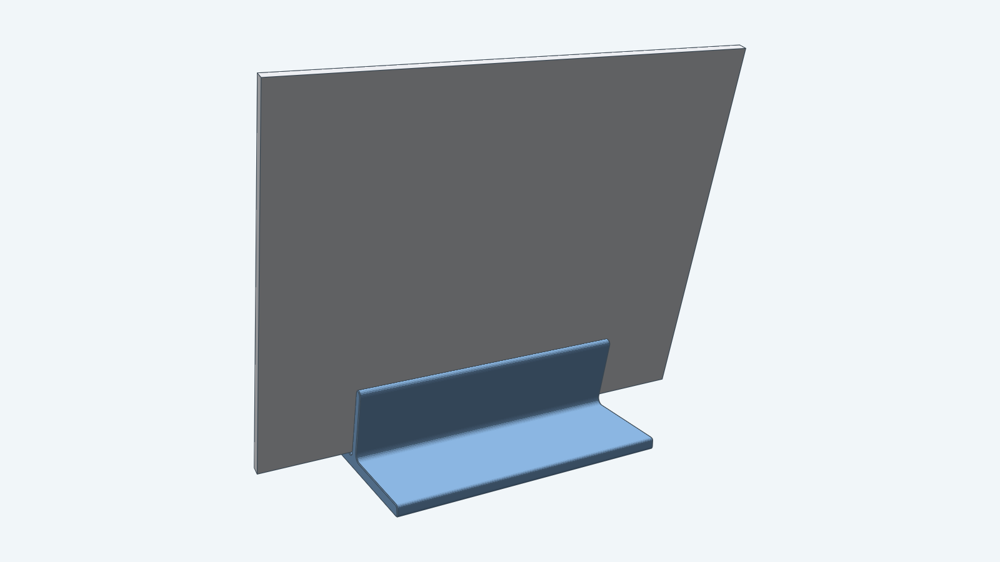

## Exploded

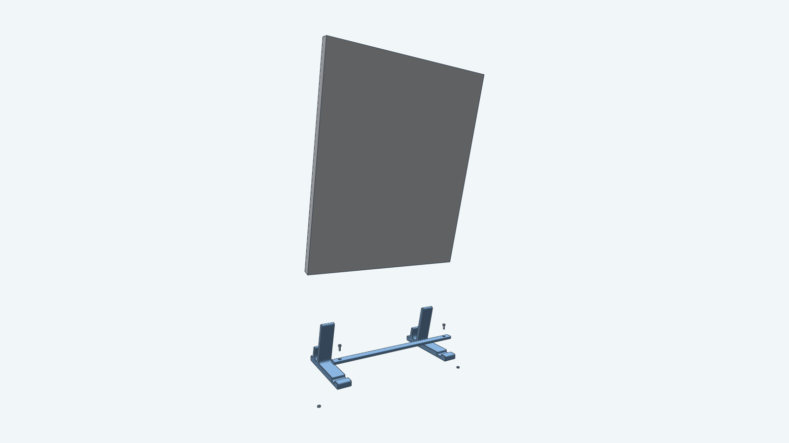

From the bottom: the two M2 nuts, below and outside the brackets they belong to; the two brackets; the rail above their
channels; the two M2 × 6 bolts above the rail; and the plaque lifted out of the slots.

## Parts

| Image | Name |
| --- | --- |
| 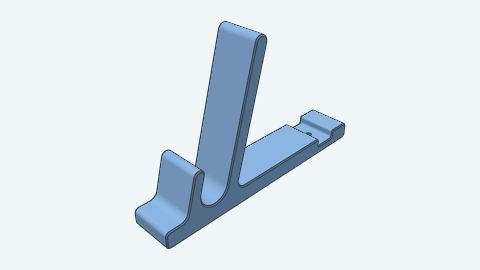 | Bracket (printed, 2) |
| 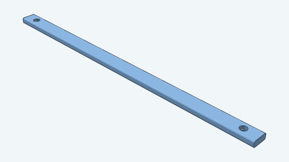 | Rail (printed, 1) |
| 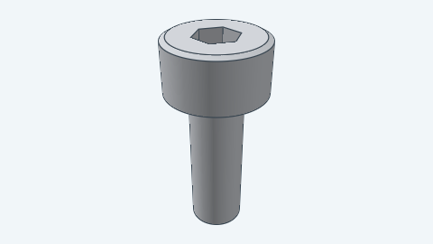 | M2 × 6 socket head cap screw ([`models/m2bolt`](../m2bolt/)), 2 |
| 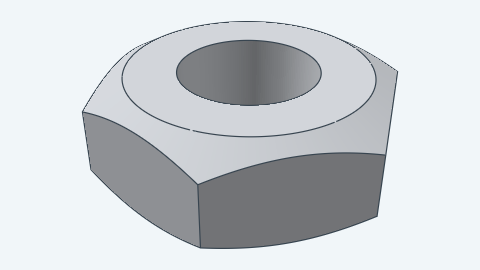 | M2 hex nut ([`models/m2nut`](../m2nut/)), 2 |
| 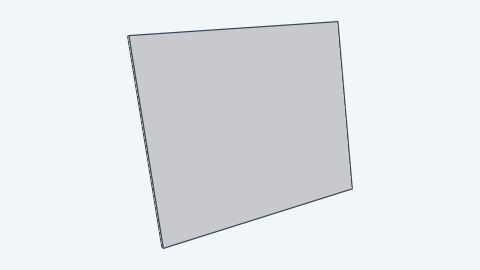 | Plaque (not printed), shown at the default size |

## Sizes

The stand takes the plaque's width, height and thickness. The picture shows the smallest allowed plaque (150 × 120 × 2 mm),
the default and the largest (400 × 350 × 15 mm), each in its own stand.

## Parameters

| Parameter | Default | Limit | Meaning |
| --- | ---: | --- | --- |
| `PlaqueWidth` | 250 mm | 150 to 400 mm | The plaque's width. |
| `PlaqueHeight` | 305 mm | 120 to 350 mm | The plaque's height, measured along the slot. |
| `PlaqueThickness` | 12.8 mm | 2 to 15 mm | The plaque's thickness. |
| `Recline` | 15° | 10° to 25° | How far the plaque leans back from vertical. |
| `LipHeight` | 10 mm | 6 to 20 mm | The lip's top above the slot floor, measured along the slot. |
| `SlotClearance` | 0.55 mm | 0.55 to 1.5 mm | The gap on each side of the plaque in the slot. |

The stand's size follows from these:

- Span (outer face to outer face of the brackets, and the rail's length) is 0.8 times the plaque width, held between 120
  and 246 mm.
- Each bracket is 20 mm wide.
- Back rest height is 0.2 times the plaque height, held between 30 and 60 mm.
- Depth is the smallest whole number of millimeters that keeps the backward tip angle at 15° or more and leaves the
  channel's lands: 2 mm of flat in front of the channel and 8 mm behind it. It is 112 mm by default and reaches 160 mm at
  the largest plaque.

Build fails with an error that names the parameter when a value is outside its limit.

**Plaque weight limit: 3 kg.** Each bracket is 20 mm wide, so each back rest carries about half the plaque's weight on
20 mm. At 3 kg that is about 9 MPa at the largest geometry and about 3 MPa at the defaults, a sustained load that PLA
carries. A 600 g plaque at the default size puts about 1 MPa on them. A heavy steel plaque at the largest
size, about 16 kg, would put about 50 MPa on the back rests, which is too much, so keep a plaque to 3 kg.

## Stability

The stand is sized so the plaque's centre of gravity stays 15° inside each tipping edge. The edges are the front and
back ends of the brackets' bottom faces and the brackets' outer faces. The plaque may lean slightly inside the slot's
clearance (1.1° at the defaults), so the check uses the leaned pose: forward for the front edge and backward for the
back edge. The tests read the three tip angles off the built bodies. At the defaults they are 19.9° forward, 15.0°
backward and 31.4° sideways. The rail never touches the desk.

## Printing

Print the bracket twice, each on a side face, and the rail once, flat on its bottom face with the head pockets up. Every
load then runs along the layers, and no part needs support or a pause. The brackets are 20 mm tall on the bed and cover
at most 160 × 75 mm; the rail is at most 246 mm long, so every part fits a 256 mm bed.

To assemble:

1. Lay the rail in both brackets' channels, its ends flush with the brackets' outer faces.
2. Hold an M2 nut in the hex pocket under each bracket.
3. Drive an M2 × 6 bolt down through each rail head pocket and tighten it, which pulls the rail down onto the channel
   floor.
4. Set the plaque in the slots.

See [instructions.md](instructions.md) for the construction, [steps.md](steps.md) for the Decad steps and
[docs/models/plaquestand.md](../../docs/models/plaquestand.md) for the Go API and the checks.
