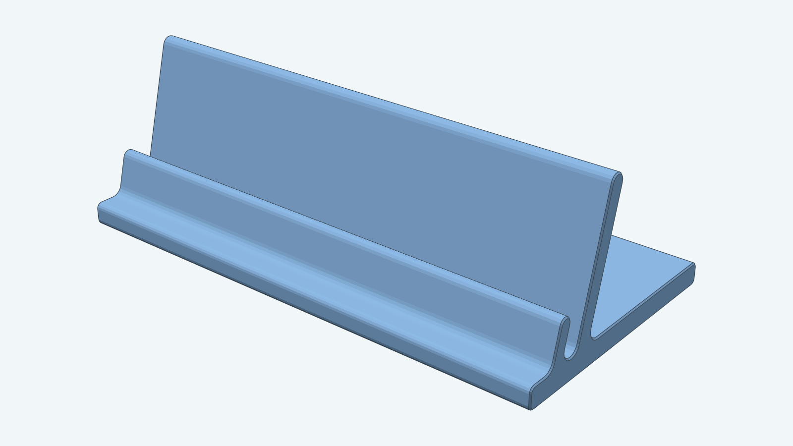
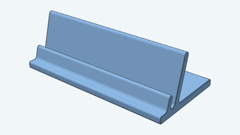
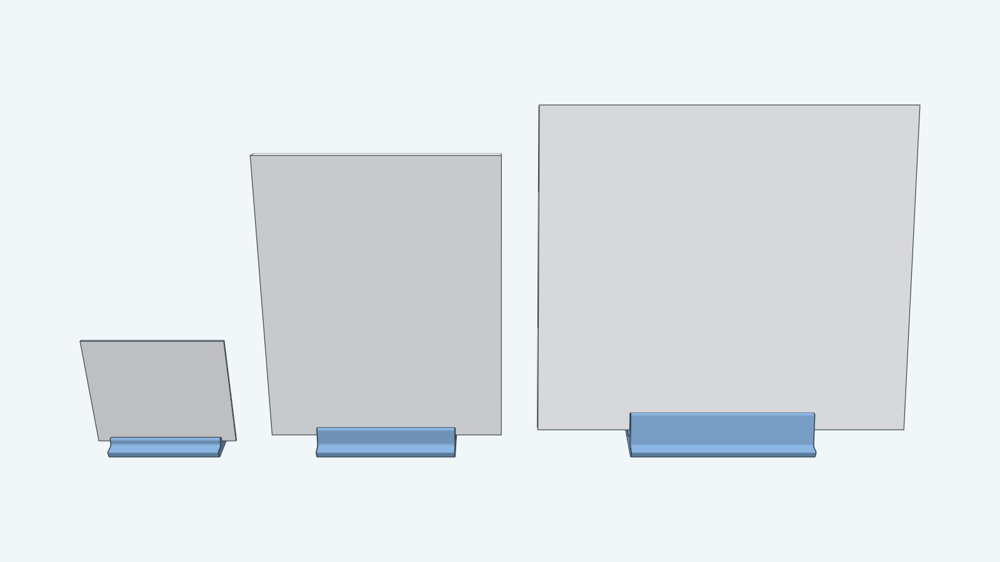
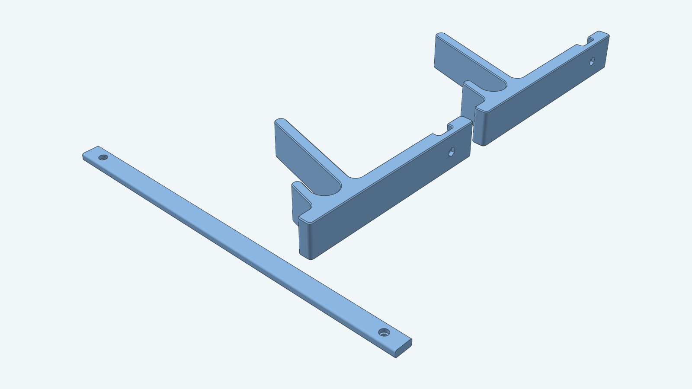

# Plaque stand

**Build status:** Not built yet.

A one-piece desk or shelf stand for a flat, heavy rectangular plaque. The plaque rests on a rounded slot floor,
leans back against the slot's back wall, and a low lip on the front stops it sliding forward. The stand is narrower than
the plaque and sits centred under it. Its base is deep enough that the plaque and stand tip over only after you tilt
them 15° or more, forward, backward or sideways.

The default plaque size, 300 × 250 × 6 mm, is a placeholder. Replace it with the real plaque's width, height and
thickness; the stand's width, depth and back rest follow from them. The model also builds the plaque as a reference
body so you can check the fit. The plaque is not printed: export only the `Stand` body.

**Clearance adjustment:** Mixed. The slot's clearance around the plaque is a parameter, 0.55 mm on each side by default
(a Loose fit); the plaque keeps its nominal size.

## Views

The stand alone shows the slot's full round floor, the lip in front, the back rest behind and the base's rounded corners.

From the side, the plaque leans 15° back from vertical, resting on the slot's round floor against the back wall.

From behind, the back rest and the deep base show how far the stand reaches back to keep the plaque from tipping.

## Exploded

## Parts

| Image | Name |
| --- | --- |
|  | Stand: the one printed part |
|  | Plaque: not printed, shown at the placeholder size |

## Sizes

The stand takes the plaque's width, height and thickness. The picture shows the smallest allowed plaque (150 × 120 × 2 mm),
the default and the largest (400 × 350 × 15 mm), each with its own stand.

## Parameters

| Parameter | Default | Limit | Meaning |
| --- | ---: | --- | --- |
| `PlaqueWidth` | 300 mm | 150 to 400 mm | The plaque's width. |
| `PlaqueHeight` | 250 mm | 120 to 350 mm | The plaque's height, measured along the slot. |
| `PlaqueThickness` | 6 mm | 2 to 15 mm | The plaque's thickness. |
| `Recline` | 15° | 10° to 25° | How far the plaque leans back from vertical. |
| `LipHeight` | 10 mm | 6 to 20 mm | The lip's top above the slot floor, measured along the slot. |
| `SlotClearance` | 0.55 mm | 0.55 to 1.5 mm | The gap on each side of the plaque in the slot. |

The stand's size follows from these:

- Stand width is 0.6 times the plaque width, held between 120 and 200 mm.
- Back rest height is 0.2 times the plaque height, held between 30 and 60 mm.
- Depth is the smallest whole number of millimeters that keeps the backward tip angle at 15° or more and leaves 5 mm of
  flat base behind the back rest. It is 93 mm by default and reaches 160 mm at the largest plaque.

Build fails with an error that names the parameter when a value is outside its limit.

A steel plaque at the largest size (400 × 350 × 15 mm, about 16 kg) at 25° puts roughly 10 MPa of bending on the back
rest's root. That is a sustained load on PLA, so print the stand in PETG, or use a lighter plaque, at that size.

## Stability

The stand is sized so the plaque's centre of gravity stays 15° inside each tipping edge. The edges are the front and
back ends of the base's bottom face and the two side faces. The plaque may lean slightly inside the slot's clearance
(1.34° at the defaults), so the check uses the leaned pose: forward for the front edge and backward for the back edge.
The tests read the three tip angles off the built bodies. At the defaults they are 19.6° forward, 15.3° backward and
33.9° sideways.

## Printing

Print the stand lying on one side face. Every load then runs along the layers, and no surface needs support. The print
is as tall as the stand is wide, so the widest stand needs 200 mm of print height. Its footprint on the bed is at most
160 × 75 mm.

See [instructions.md](instructions.md) for the construction, [steps.md](steps.md) for the Decad steps and
[docs/models/plaquestand.md](../../docs/models/plaquestand.md) for the Go API and the checks.
