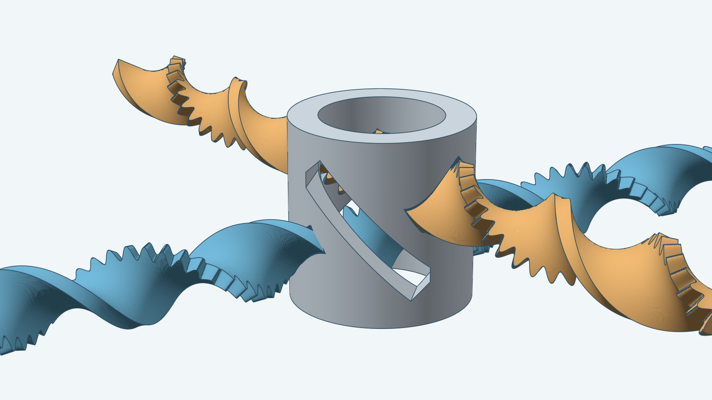
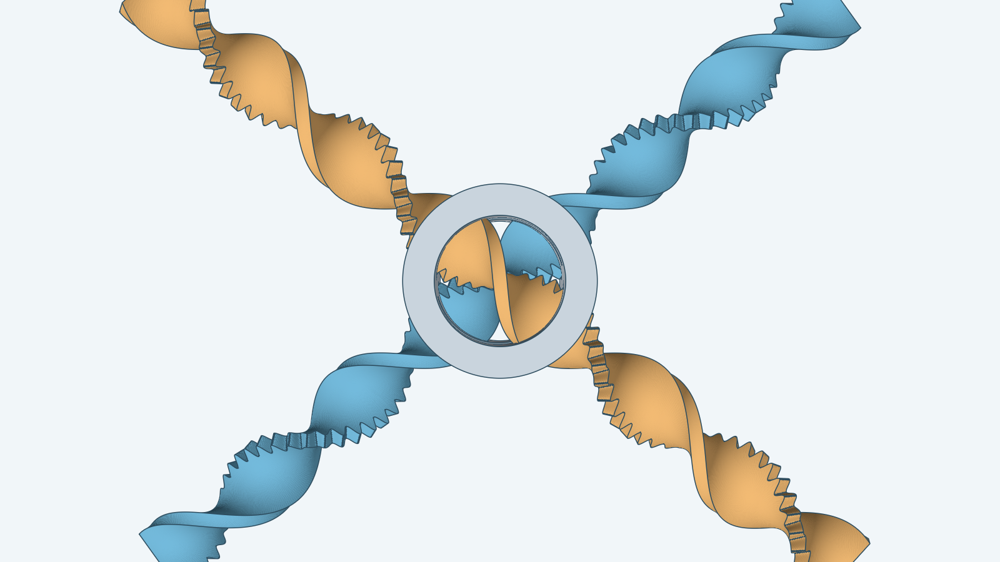
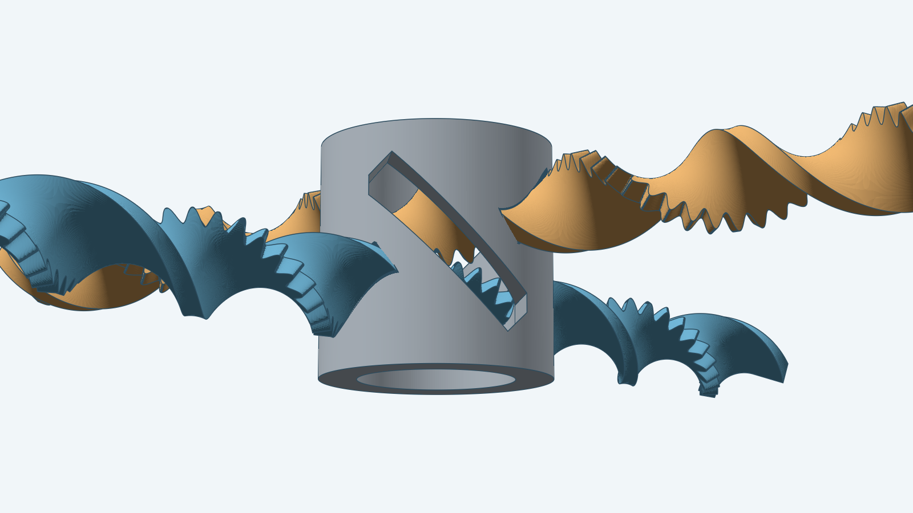
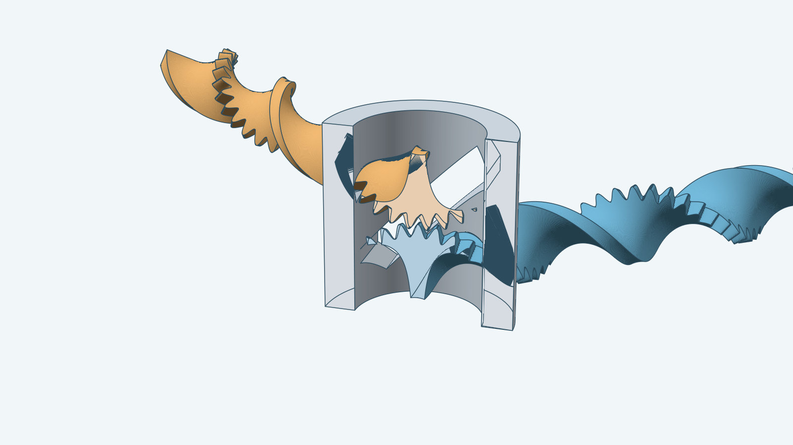

# Screw gear

## More views

| From above | Low side angle |
| --- | --- |
|  |  |

## Inside the sleeve

The mechanism is cut open along a plane through the sleeve's axis, and the half toward the camera is removed. The cut
faces of the sleeve and of both ribbons are drawn flat in a lighter shade. Inside the hollow, the two toothed edges
meet, and each ribbon runs out through a bore in the wall.

A pair of gears that move by a screw motion: each gear turns about its own axis while it slides along that
axis. Each gear is a flat ribbon with a wavy toothed edge, twisted along its length into a helix. The two axes
cross at 80° by default. A thick-walled sleeve holds the pair. Each ribbon passes through the sleeve's wall twice,
through twisted rectangular bores, and the two toothed edges meet in the sleeve's hollow. Two windows in the wall
show the teeth from the side.

Pushing one ribbon along its axis moves the other by the same distance, one tooth pitch for one tooth pitch. The
default ribbons have 68 teeth, are 15 mm wide and 3.75 mm thick, and are 178.5 mm long. The sleeve is 37.5 mm
tall and runs from 12.5 mm to 18.5 mm in radius. The model builds the gears and the sleeve as three separate
bodies.

You can vary:

- The ribbon: width, thickness, tooth count, tooth pitch and height, the lean and bow of the tooth ridges, and the
  twist lead.
- The sleeve: bore radius, height, clearance, the extra room on each bore's roof, wall thickness, and the wall
  kept round bores and windows.
- The mesh: the angle between the axes, how deep the teeth overlap, the mounting angle of each gear, and the tooth
  phase of the second gear.
- The position and orientation of the mechanism in space.

Dimensions are in millimeters. Angles are in radians. The tooth shape, lean, bow and mesh numbers are fitted to the
default 80° crossing angle and 49.5 mm lead. Other values build, but how well the teeth fit together has not been
measured.

The model leaves out the bore identification marks and the print diagnostics of the Fusion add-in.

For how to build this mechanism from Go, see the [developer notes](../../docs/models/screwgear.md).
