# Seven-segment display

**Build status:** Not built yet.

## Button mechanism prototype review

The [3D model (GLB)](prototype/button-review/button-display.glb), [open view](prototype/button-review/open.png), and
[transparent hood view](prototype/button-review/transparent-hood.png) show a partial home-position prototype.
The export includes the cap, rack, yoke, index, detent cam, and release crank. It omits the detent follower, primary
return spring, full ratchet and lock chain, newer output shaft and clamps, and complete release supports and mounting
hardware. The press cycle has not been verified. The images below show the existing manual display.

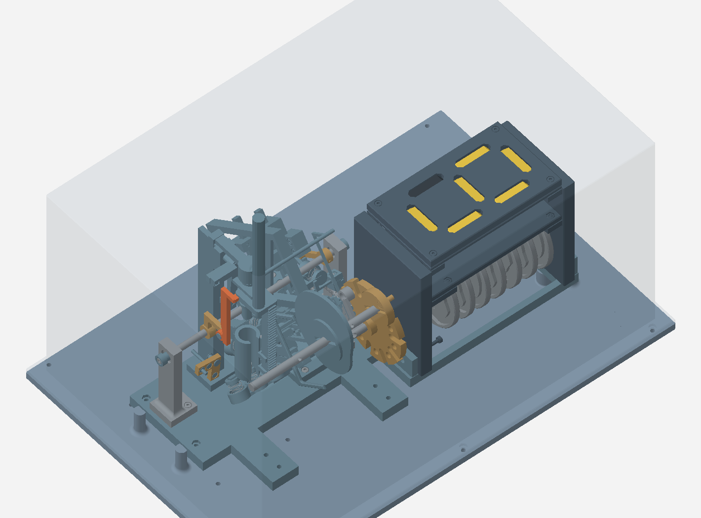

A printed, mechanical digit 0 to 9. Seven rotors turn in windows of a top plate. A rotor has a yellow face and a black
body: where a segment is lit its yellow face tips up toward you, and where it is off the black body shows. The tip shows
best from above. Seen from the knob side at 30 degrees elevation, the yellow fills only 35 to 41 % of the window of a
horizontal segment (a, g, d) across it. Every printed
part keeps one filament color (a rotor is two bodies, a yellow one and a black one) and never changes color, so the color you see is only the angle of a rotor. Turn the knob clockwise
and each click moves to the next digit. You choose the digit the model is built showing; nothing else varies.

**Not built yet.** That every rest position of the knob shows one digit is a calculated result, not a measured one:
nobody has printed and tried this model. The torque that pushes a released knob back to its digit, from two printed
PETG pawls, is compared with a friction budget at every shaft angle where a cam is still moving a segment. Each cam
and the ratchet wheel can turn 1.7 degrees on the shaft in its double-D bore, so while the pawls push the shaft
back a cam can lead the wheel by 3.4 degrees. With that lead the pawls beat the budget by 2.06 times at friction
0.35, 1.50 at 0.40 and 1.06 at 0.45. With the cams in step with the wheel they beat it by 3.55, 1.83 and 1.03 at
friction 0.35, 0.45 and 0.5 (the design asks for at least 3.0, 1.8 and 1.0). So the display is determinate by
calculation up to friction 0.45, with little margin at 0.45: at every rest each cam sits within 0.05 mm of its dwell
at friction 0.35 and within 0.07 mm at 0.45. At friction 0.5 it is shown only with the cams in step. The drive arm of
each rotor is at least 1.38 times its friction arms at 0.5. The budget counts the weight of the sliders, the
friction of their stems, guides and rotor journals, with each journal pushed across its hole by the drive, and the
drag of the two bearings, with the pawls at a modulus of 1.8 GPa, the low end for printed PETG. A built part has
other losses, such as warped pawls, rough grooves and dust. Stand the display level: tilted toward the knob, the
cams rest on the slider pins and each degree of tilt lowers the margins by about 1.5 %.

**Hand feel.** Expect the knob to take about 12.4 N at its rim to climb a tooth at friction 0.5 (about 248 N.mm of
peak torque with stiff PETG) and about 10.2 N at friction 0.35. These come from a finite-element model of the
earlier 1.75 mm pawl arms, scaled by the 1.2 times stiffer 1.90 mm arms; the model was not run again. The wheel
turns about 8 degrees past the top of a tooth before it clicks into the next notch.

**Pawl strain.** Each pawl arm bends to a nominal 1.45 % strain at the top of a tooth, and about 1.5 % at its
peak. That is above the 1.0 % the design aimed for and below the yield strain of printed PETG (5 to 6 %). No fatigue
data exist for an arm printed this way, so a print test decides it: turn 2 000 to 20 000 clicks and look for cracks at
the arm roots or a drop in the knob torque.

**Clearance adjustment:** Mixed. The custom fits are fixed constants; the bearings, bolts and nuts keep their nominal size.

## Views

The face seen from above, and at 45 and 30 degrees above the face, with the four top-plate bolts sunk flush in its corners. The lit rotors show yellow; the unlit ones show black.
Rotors b, c, e and f stand on the sides and a, g and d lie across.

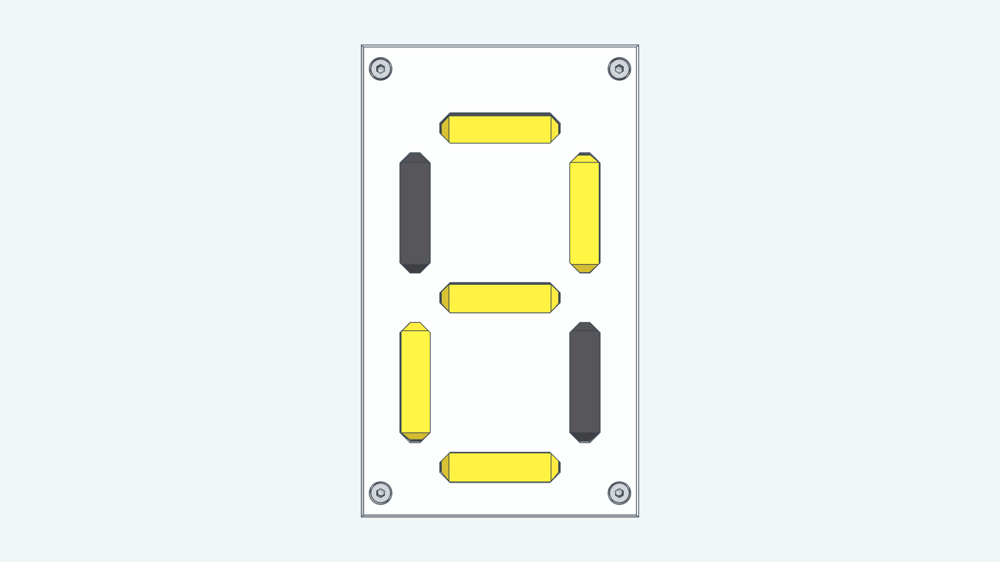

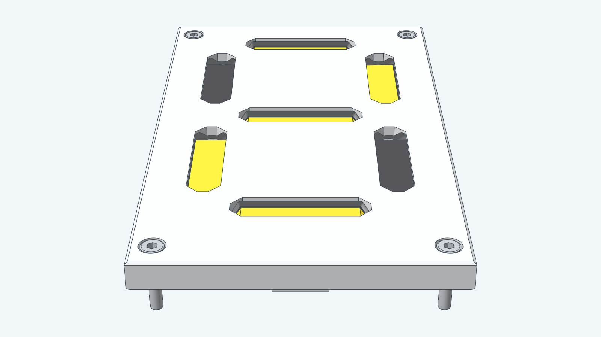

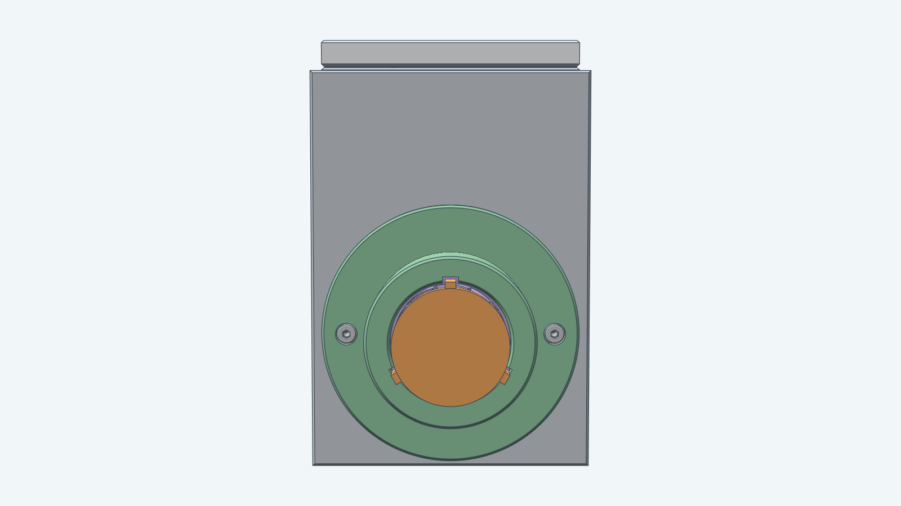

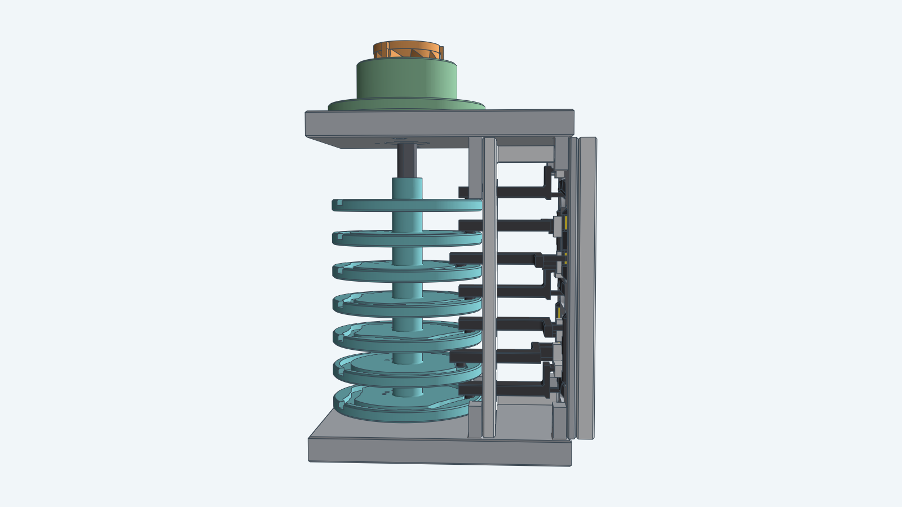

## How it works

A camshaft runs along the digit under the face. It carries seven cams, one for each segment, stacked 11 mm apart. Each
cam has a closed groove cut in its face. A pin on the segment's slider rides in that groove, so the cam pushes the slider
up and pulls it down: no springs are needed. The slider's tongue sits in a notch of the rotor above it and a pin on the
tongue rides in a radial slot of the rotor, so the slider's rise of 3 mm turns the rotor by about 90 degrees (89.2 for a, g and d and 90.0 for b, c, e and f; b to f are
given a small extra lift so their rest angles stay in range). A groove sits at 18 mm from the shaft where the segment is unlit
and 21 mm where it is lit, with a smooth ramp between.

A ratchet wheel with ten teeth sits on the front of the shaft. Two flexure pawls in the detent plate, one above the
wheel and one below, ride on it. Each pawl is a straight arm 22 mm long, printed in the plate, with a rounded head that
sits in a notch of the wheel. When the knob turns, a tooth's sloped face lifts the head outward and bends the arm, and
the head drops into the next notch at the top of the tooth. A tooth's steep face meets the head when the knob turns back.
So the pawls let the shaft turn forward one click at a time and stop it turning back.
Every cam ramp lies in the stretch of each click
where the pawls push the shaft on to the next click or back to the last one, so that a released knob should not stop
part way. This is a calculated result for friction up to 0.45 (see the status note above), not a measured one. The pawls bend in the plane of the plate, so the load follows the printed lines.

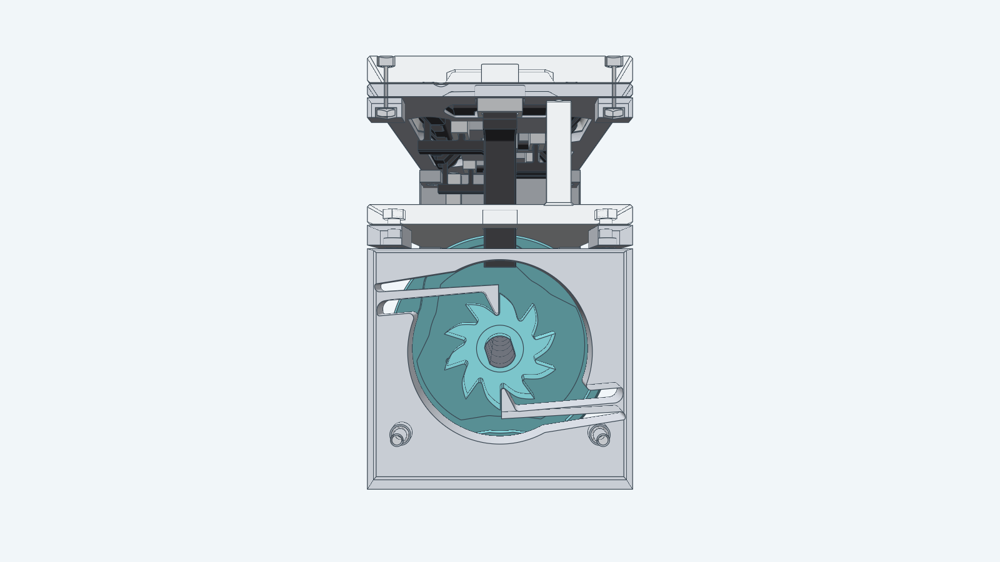

The ten digits, each posed from one build and seen from the front at an angle. Every part keeps its color; only the rotor
angles differ:

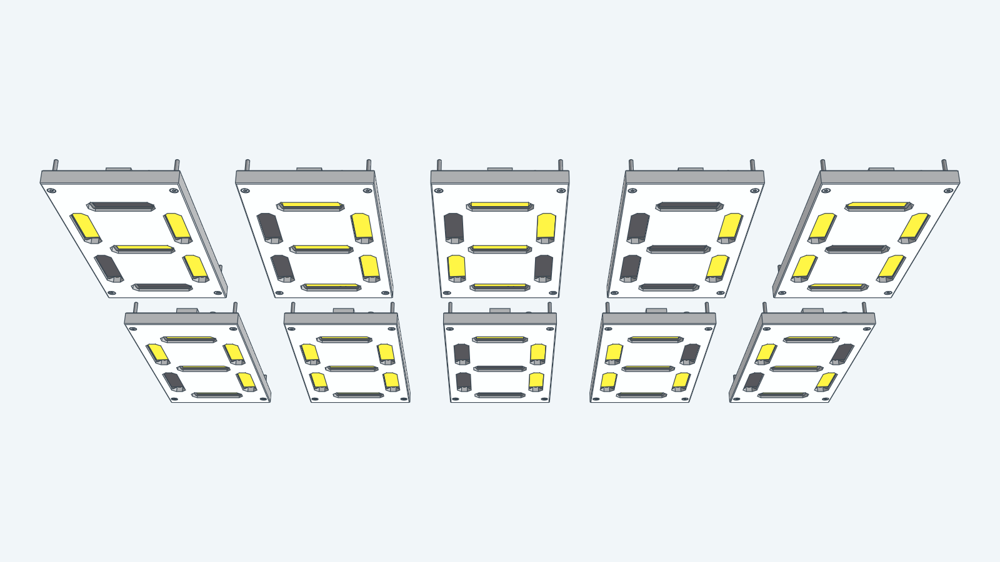

One turn of the camshaft, with the face seen at 45 degrees on the left and a cut through the axis on the right. Each rotor
turns only while its ramp passes the follower, and the shaft is meant to rest only where every segment is still. The
colors never change:

## Parts

Each cam also has a letter engraved 0.5 mm deep in its back face (the face opposite the groove), drawn in strokes of a
seven-segment display: A, b, C, d, E, F and G for the segments a to g. The cam prints with that face down, so the letters are on the cam's underside as printed (the bed side, not the top). The
opposite face carries the groove and has no room for a letter among its walls; as installed the letter face looks toward the
rear wall. Read the letter when you pick the cam up, before it goes on the shaft. Cams and walls carry a look-alike mark: round holes through the part. Parts of one set have different counts: the
front cams d, e, c have 1, 2, 3 holes; the rear cams g, b, f, a have 1, 2, 3, 4; the front wall has 1 and the rear wall 2.
Sliders and rotors carry no mark: each fits only its own place.

The seven cams from behind, a to d on the top row and e to g below, each with its letter in its back face:

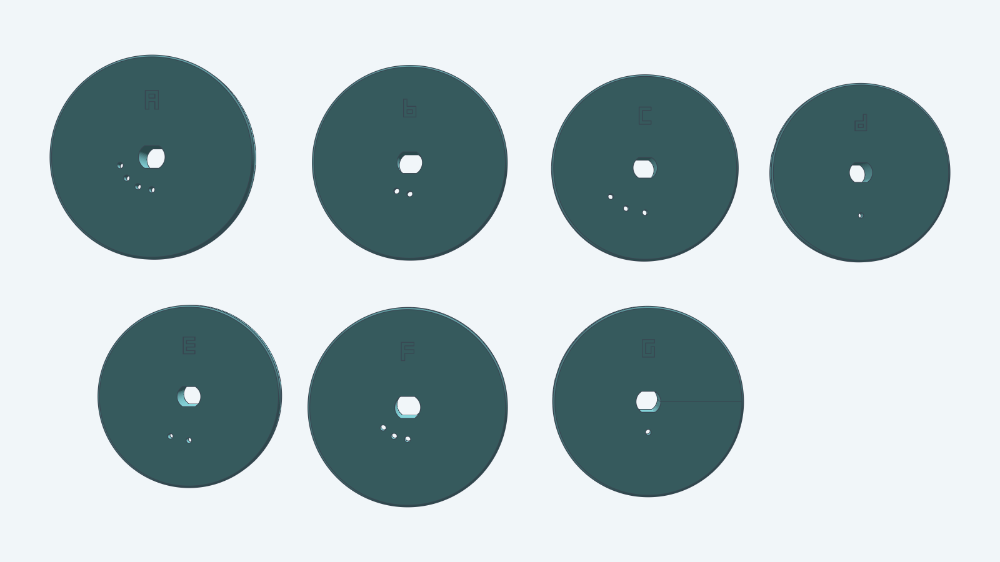

![The display taken apart. In the middle the camshaft with its seven cams between the open walls; the front wall, the detent plate, the collar ring and the knob slid out toward the front along the shaft, and the front bearing dropped below the shaft; the rear wall and its bearing to the back. Above the shaft the guide plate with its four columns, the cradle plate, the seven rotors spread out around the face with their yellow faces up, and the top plate with its four bolts highest. The seven black sliders stand clear on both sides: e and f, one above the other, on the left, and a, g and d on the right, with b and c near the rear wall. Nuts and the remaining bolts beside the parts they hold](images/exploded.png)

The camshaft alone, with the frame left out, its parts pulled off the front end along the shaft. From the rear: the shaft, cam a, f, b, g, c, e and d, the ratchet wheel, the collar ring and the knob:

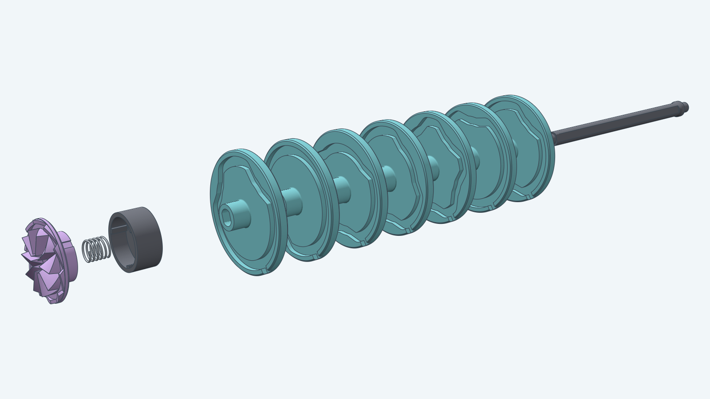

| Image | Part | Count | Look-alike holes | Notes |
| --- | --- | ---: | ---: | --- |
|  | Front wall | 1 | 1 | Holds the front 605ZZ, the detent plate's two nuts and the ledge and flange ribs. |
|  | Rear wall | 1 | 2 | Holds the rear 605ZZ and carries its own ribs. |
| 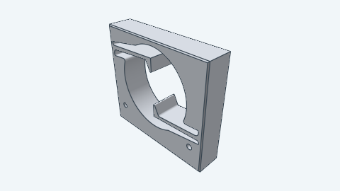 | Detent plate | 1 | - | Two flexure pawls that index the ratchet wheel. |
| 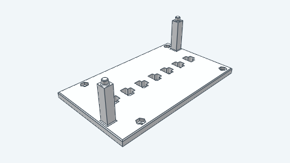 | Guide plate | 1 | - | Seven slots that guide the sliders' stems, and the columns and pegs that locate the cradle plate. |
|  | Cradle plate | 1 | - | Seven passages for the sliders and half-holes that carry the rotors' journals. |
| 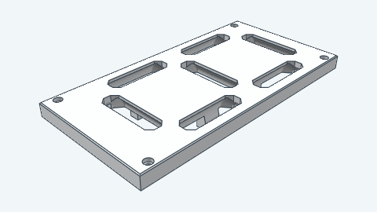 | Top plate | 1 | - | The display face with seven windows (5.9 mm wide, pointed at the ends), and a tube over each slider's blade. The plate under the window edge is 0.70 mm thick, 0.49 mm at the pointed ends: thinner than the usual 0.8 mm, and listed in the instructions. |
|  | Shaft | 1 | - | Double-D camshaft (two opposite flats where the cams and the ratchet wheel sit), printed as two halves. |
| 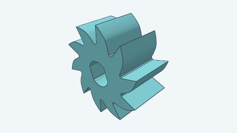 | Ratchet wheel | 1 | - | Ten teeth. |
| 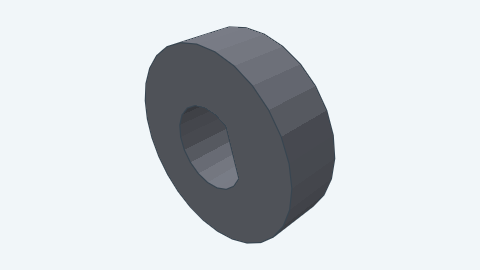 | Collar ring | 1 | - | Sits 0.4 mm from the front wall's outer face; the knob stands about 3.95 mm from it. |
| 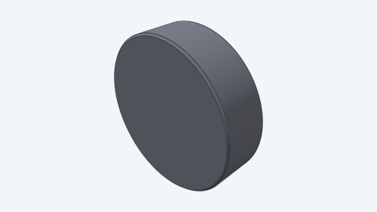 | Knob | 1 | - | Turn it clockwise only. |
|  | Cam d | 1 | 1 | Front cam, the letter d engraved on its back face. |
|  | Cam e | 1 | 2 | Front cam, the letter E engraved on its back face. |
|  | Cam c | 1 | 3 | Front cam, the letter C engraved on its back face. |
| 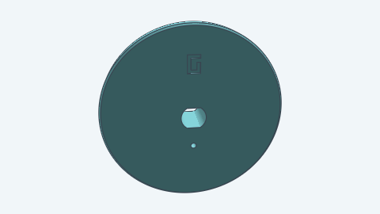 | Cam g | 1 | 1 | Rear cam, the letter G engraved on its back face. |
|  | Cam b | 1 | 2 | Rear cam, the letter b engraved on its back face. |
| 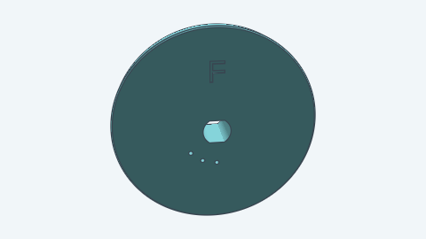 | Cam f | 1 | 3 | Rear cam, the letter F engraved on its back face. |
|  | Cam a | 1 | 4 | Rear cam, the letter A engraved on its back face. |
|  | Sliders a, g, d | 3 | - | The three horizontal segments are identical. They print with the -X face down. |
| 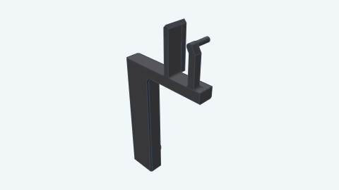 | Sliders b, c | 2 | - | Identical; they print with the -Y face down. |
|  | Sliders e, f | 2 | - | Identical; they print with the -Y face down. |
| 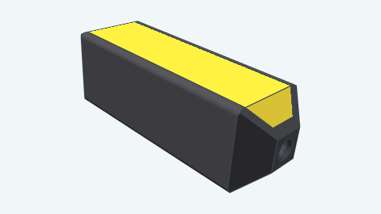 | Rotor A | 3 | - | For segments a, g, d: one notch. Two bodies, listed next. |
|  | Rotor A yellow face and tips | 3 | - | Yellow filament. The face slab continues onto the 45 degree tips. Prints face down. |
|  | Rotor A black body | 3 | - | Black filament. |
| 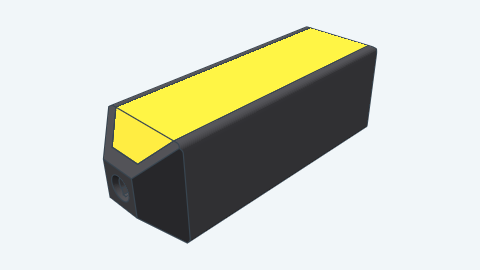 | Rotor B | 4 | - | For segments b, c, e, f: two notches. Two bodies, listed next. |
| 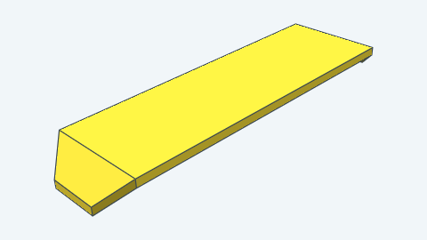 | Rotor B yellow face and tips | 4 | - | Yellow filament. The face slab continues onto the 45 degree tips. Prints face down. |
|  | Rotor B black body | 4 | - | Black filament. |
| 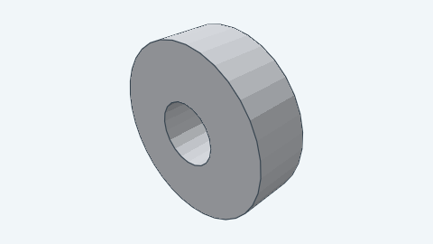 | 605ZZ bearing | 2 | - | Bought. |
|  | M2 x 10 bolt | 4 | - | Bought. The top plate's bolts, heads sunk flush. |
|  | M2 x 6 bolt | 4 | - | Bought. |
| 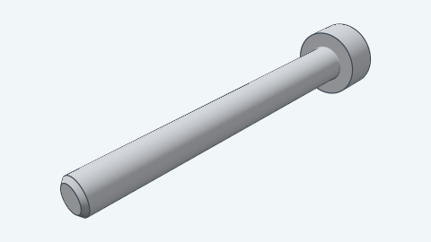 | M2 x 18 bolt | 2 | - | Bought. |
|  | M2 nut | 10 | - | Bought. |

## Printing

Print each part as the table says. Each cam prints with its back face down, so the letter is engraved in its first layers.
Print the shaft as two halves split along its axis, each on its cut face. Print the cams with the groove face up, the walls
with the outer face down, the top plate with the display face down, the cradle plate with its bottom face down, the
detent plate with its inner face down, the guide plate with its bottom face down, the a, g and d sliders with the -X face
down, the b, c, e and f sliders with the -Y face down, and the ratchet wheel, collar ring and knob flat.

Each rotor is two bodies, a yellow body (the face slab and the two tips) and a black body, printed face down in one job
on a printer that changes between two filaments of one polymer (both bodies share their faces, so they must be the same
polymer, for example PETG, to bond). A pause for a filament change does not work: the yellow takes the first 12 layers
and the black rim is printed in the same layers, so a pause would turn the rim and the tips yellow. A plate of seven rotors needs
about 24 tool changes (about 8 without the tips); a slicer preview shows the time. The rotor is 7.5 mm square and its journal
stubs are 1.2 mm across and overhang by 1.4 mm (accepted in the instructions; check the first print). The rotors, sliders, stubs and pegs print whole, not split, and the instructions say why. Use PETG for the detent plate. A bearing,
bolt or nut is bought.

## Bill of materials

- 2 x 605ZZ ball bearing
- 4 x M2 x 10 bolt
- 4 x M2 x 6 bolt
- 2 x M2 x 18 bolt
- 10 x M2 nut
- Yellow and black filament for the rotors

## Assembly

Positions below are in millimetres in the model's frame: the origin is on the table under the middle of the digit, x runs to
the right seen from the knob side, y runs away from the knob toward segment a, and z runs up. The exploded view above shows every
part in its place. A rotor's axis `u` runs along x for the horizontal segments (a, g, d) and along y for the vertical ones
(b, c, e, f); `+u` is to the right for a, g and d and toward the back (away from the knob) for the others. Nothing on the printed
parts is marked with these numbers: the plates carry their own holes, and the steps say which hole is which.

1. Lay the two printed halves of the shaft together along their cut faces. No glue and no cross bolt hold them: the
   cams, the ratchet wheel and the two bearings clamp them. Press the cams onto the shaft from the front end, groove
   faces toward the front, in order a, f, b, g, c, e, d, then the ratchet wheel, with its steep tooth faces
   counter-clockwise seen from the knob side. Push them all toward the rear until cam a stops on the end of the shaft's
   flats. Nothing else holds them along the shaft: the stack can slide forward until a groove floor touches its
   slider's pin tip, which costs nothing while the display stands level.
2. Bolt the detent plate to the front wall with two M2 x 18 bolts, the nuts in the wall's outer-face pockets.
3. Slide the front bearing onto the front journal and the front wall over it, each pawl head in a tooth gap. Slide the
   rear bearing on and press the rear wall onto it.
4. Press the collar ring onto the stub until it stops, then press the knob on. The knob must turn clockwise only. If it turns
   counter-clockwise, the ratchet wheel is on backwards.
5. Bolt the guide plate to the ledge ribs from below with four M2 x 6 bolts, the nuts dropped into its top pockets. The two
   front bolts go in between the detent plate and cam d. The two rear bolts, at y 38, go in past cam a, whose rim reaches only
   z 37.3 at that x while the bolt heads are at z 49.75, so there is 12.4 mm of room under each head: use a 1.5 mm hex key with
   a short arm of about 6 mm and let the long arm point out sideways (the sides of the frame are open). This follows from the
   dimensions and has not been tried on a print. Turn the knob until all seven entry channels face up (digit 8).
6. Press the cradle plate onto the guide plate's column pegs through its two registration holes at (12, -45), near the front
   edge on the right, and (-16, 39), near the back edge on the left (the other two holes are for the top plate's pegs).
7. On the bench, join each rotor to its slider: yellow face up, 2.0 mm along +u from its place (+u as defined above), notch over the tongue, then
   slide it -u so the pin enters the pocket. Rotor A (one notch) goes to a, g and d; rotor B (two notches) to b, c, e and f.
8. Lower each unit through its cradle passage and guide slot, the groove pin first, into its cam's entry channel. The
   journal stubs settle into the cradle's half-holes.
9. Lower the top plate over the cradle's pegs at (-12, -45), near the front edge on the left, and (16, 39), near the back edge on the
   right. The a, g and d blades stand upright. Each b to f
   arm sags by up to about 1 mm at its blade: reach in from the open side and lift the arm's outer end until its blade
   enters its tube, then let the plate down. The four top-plate nuts sit in hex pockets that open downward under the top
   flange ribs: drop a nut into each pocket from the open side and hold it there while the four M2 x 10 bolts go in from the top.
10. Click through 0 to 9 and check each digit.

## Turning the display over

Turned over, the rotors and sliders are held in place by the plates, but the geometry changes. The rotor's weight bias flips
by 13.5 degrees. The b to f pins shift by about 1 mm and the b to f rotors turn by 16 to 22 degrees. In that pose the
calculated tongue gaps to the notch shells are 0.16 mm (yellow shell) and 0.30 mm (black leg) in the worst-case stack of
tolerances. The b to f sliders' contact with the top plate and with their black bodies in the turned-over pose is checked in an
adjusted pose (a rigid turn about the groove pin and the slot, half the tilt limit, the rise 0.2 mm short of the full
rise and the flags lowered 0.11 mm), because in that pose the b to f sliders touch by design. `TestSevenSegmentCaptive`
allows no vertex deeper than 0.07 mm (the mesh tolerance) and reads 0.038 mm into the top plate and 0.058 mm into the
black body. Do not turn the display over with the knob in motion.

## Listed sharp corners

Seven kinds of sharp corner or thin rim stay, and the instructions list each: the window rims of the top plate (the plate
under the window edge is 0.70 mm thick along the long sides and 0.49 mm at the shoulders of the pointed ends); the inner
loops of the seam faces of the cradle and the top plate; the inner loops of the cradle plate's bottom face; the root of each
pin on a slider's tongue; the 45-degree step in the head of the a, g and d sliders; the pyramid edges of the rotors (convex,
120 degrees); and the corner at the end wall of each rotor bore. The tooling cannot round the cradle loops and the pin roots yet.
