# Seven-segment display

**Build status:** Not built yet.

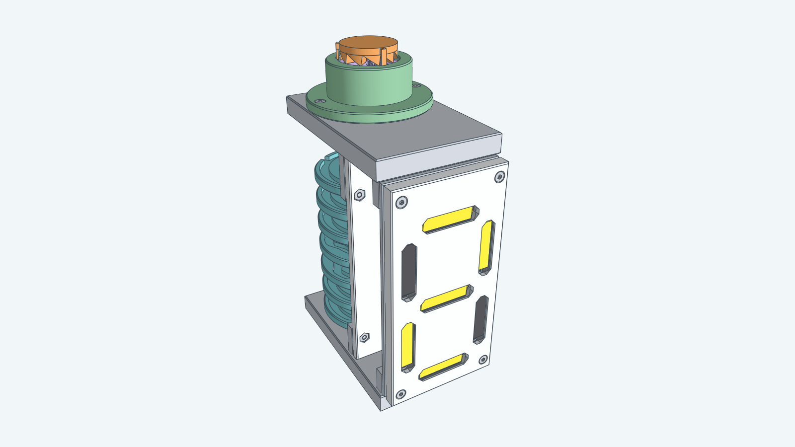

A printed, mechanical digit 0 to 9. Seven rotors turn in windows of a top plate. A rotor has a yellow face and a black
body: where a segment is lit its yellow face tips up toward you, and where it is off the black body shows. The tip shows
best from above. Seen from the button side at 30 degrees elevation, the yellow fills only 35 to 41 % of the window of a
horizontal segment (a, g, d) across it. Every printed
part keeps one filament color (a rotor is two bodies, a yellow one and a black one) and never changes color, so the color you see is only the angle of a rotor. The display stands on its back wall, so the
face looks toward you and the button end is the top; press the button and the display moves to the next digit. You choose the digit the model is built showing; nothing else varies.

**Not built yet.** That each press shows the next digit and locks it is a calculated result, not a measured one:
nobody has printed and tried this model. A press pushes the button 6.0 mm. The first 2.0 mm lets the rotor drop clear of
the fixed crown, and the next 4.0 mm turn the rotor, the hub and the shaft 31.7 degrees on the matching helical ramps. Every cam
has finished moving its segment by 29.55 degrees, so the new digit shows on the downstroke with a margin of 2.14 degrees.
The release adds the last 4.3 degrees, into the next notch. The margin is the ramp's 32.5 degrees less 0.81 degrees that the
smallest tooth lands Decad can build take; a print has its own tolerance on top of that. If the button is let go before the
rotor passes the crown's tip, the rotor slides back to the old digit and nothing jams. Nothing turns the shaft backward.
The teeth of the three toothed parts have ten teeth each, and their mating faces keep a gap of 0.02 mm
between tip and root: the print must hold that, or the teeth will bind. Stand the display on its back wall: lying down, the cams rest on the
slider pins.

**Hand feel.** Expect a press of about 11 to 14 N: the spring (a KSSC 1087, 5.64 N at rest and 7.53 N pressed) plus the
ramps' friction. While the cams move the segments they add up to about 5.6 N. The head stands 23.9 mm above the
front wall at rest and ends flush with the housing's bezel, 17.9 mm
above it, at the bottom of its stroke. These numbers are calculated, not measured.

**Clearance adjustment:** Mixed. The custom fits are fixed constants; the bearings, bolts and nuts keep their nominal size.

**Decad document.** Build the display in `sevensegment.NewDocument()`, a Decad document with `WithChainTolerance(0.02 mm)`. The helical teeth of the
rotor, button and housing need it: Decad cannot join a helical ramp to a ring, so each tooth is cut once and copied (steps.md, "Face teeth").

## Views

The face seen from above, and at 45 and 30 degrees above the face, with the four top-plate bolts sunk flush in its corners. The lit rotors show yellow; the unlit ones show black.
Rotors b, c, e and f stand on the sides and a, g and d lie across.

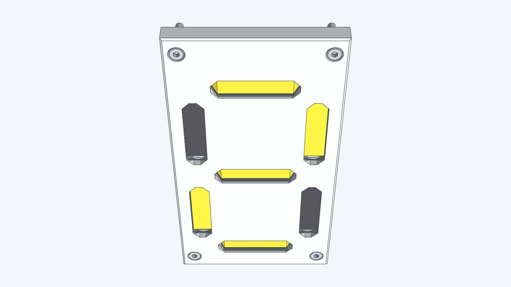

## How it works

A camshaft runs along the digit under the face. It carries seven cams, one for each segment, stacked 11 mm apart. Each
cam has a closed groove cut in its face. A pin on the segment's slider rides in that groove, so the cam pushes the slider
up and pulls it down: no springs are needed. The slider's tongue sits in a notch of the rotor above it and a pin on the
tongue rides in a radial slot of the rotor, so the slider's rise of 3 mm turns the rotor by about 90 degrees (89.2 for a, g and d and 90.0 for b, c, e and f; b to f are
given a small extra lift so their rest angles stay in range). A groove sits at 16.5 mm from the shaft where the segment is unlit
and 19.5 mm where it is lit, with a smooth ramp between.

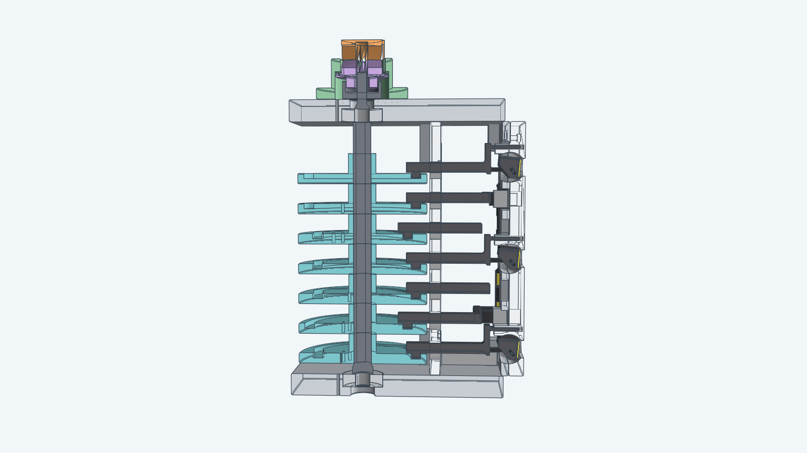

The click indexer, on the front end of the shaft, works like the one in a pen. A keyed hub is pressed on the stub of the
shaft; a rotor slides on the hub and is held up by a spring in a fixed crown with ten notches. The button's ten teeth
press on the rotor's ten inner teeth. A press pushes the rotor clear of the crown, then the matching helical ramps turn the
rotor, and the hub and shaft with it, 31.7 degrees. When you let go, the spring lifts the rotor onto the crown's short
ramp, which turns it the last 4.3 degrees into the next notch, where it locks. Nothing turns the shaft backward. Every cam ramp is finished by
29.55 degrees, so the new digit shows on the downstroke.

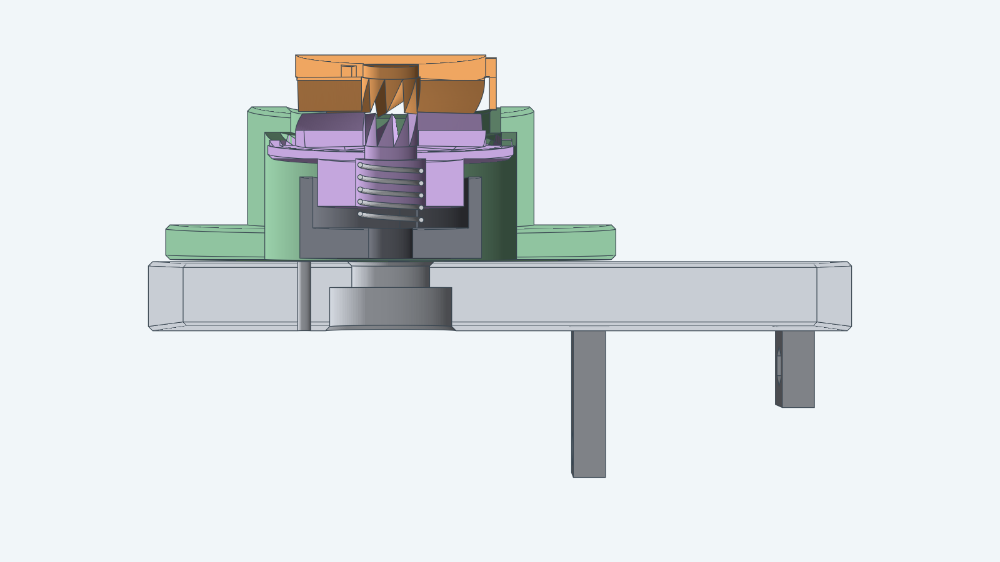

The ten digits, each posed from one build and seen from the front at an angle. Every part keeps its color; only the rotor
angles differ:

Ten presses, digit 0 up to 9 and back to 0, with the face on the left and the whole display cut through the axis on the
right. The button drops 6 mm and the display changes during the downstroke; the release finishes the step. In the cut the
cams turn with the shaft and each slider rises or drops as its cam's groove moves its pin. The
colors never change:

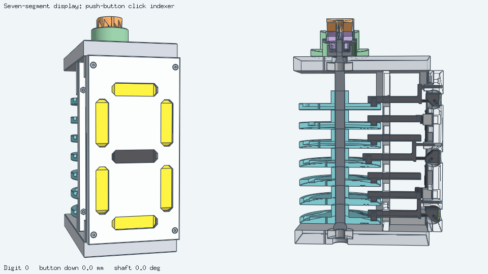

## Parts

Each cam also has a letter engraved 0.5 mm deep in its back face (the face opposite the groove), drawn in strokes of a
seven-segment display: A, b, C, d, E, F and G for the segments a to g. The cam prints with that face down, so the letters are on the cam's underside as printed (the bed side, not the top). The
opposite face carries the groove and has no room for a letter among its walls; as installed the letter face looks toward the
rear wall. Read the letter when you pick the cam up, before it goes on the shaft. Cams and walls carry a look-alike mark: round holes through the part. Parts of one set have different counts: the
front cams d, e, c have 1, 2, 3 holes; the rear cams g, b, f, a have 1, 2, 3, 4; the front wall has 1 and the rear wall 2.
Sliders and rotors carry no mark: each fits only its own place.

The seven cams from behind, a to d on the top row and e to g below, each with its letter in its back face:

![The display taken apart. In the middle the camshaft with its seven cams between the open walls; the front wall, the housing, the button, the rotor, the spring and the hub slid out toward the front along the shaft, and the front bearing dropped below the shaft; the rear wall and its bearing to the back. Above the shaft the guide plate with its two columns, the cradle plate, the seven rotors spread out around the face with their yellow faces up, and the top plate with its four bolts highest. The seven black sliders stand clear on both sides: e and f, one above the other, on the left, and a, g and d on the right, with b and c near the rear wall. Nuts and the remaining bolts beside the parts they hold](images/exploded.png)

The camshaft alone, with the frame left out, its parts pulled off the front end along the shaft. From the rear: the shaft, cam a, f, b, g, c, e and d, the hub, the spring and the rotor:

| Image | Part | Count | Look-alike holes | Notes |
| --- | --- | ---: | ---: | --- |
| 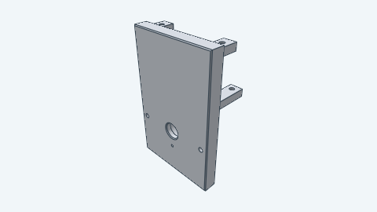 | Front wall | 1 | 1 | Holds the front 605ZZ, the housing's two nuts and the ledge and flange ribs. |
| 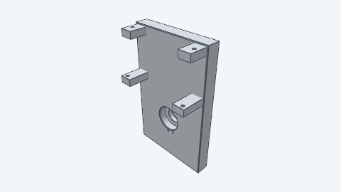 | Rear wall | 1 | 2 | Holds the rear 605ZZ and carries its own ribs. |
|  | Guide plate | 1 | - | Seven slots that guide the sliders' stems, and the columns and pegs that locate the cradle plate. |
| 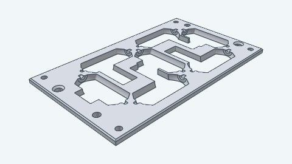 | Cradle plate | 1 | - | Seven passages for the sliders and half-holes that carry the rotors' journals. |
|  | Top plate | 1 | - | The display face with seven windows (5.9 mm wide, pointed at the ends), and a tube over each slider's blade. The plate under the window edge is 0.70 mm thick, 0.49 mm at the pointed ends: thinner than the usual 0.8 mm, and listed in the instructions. |
| 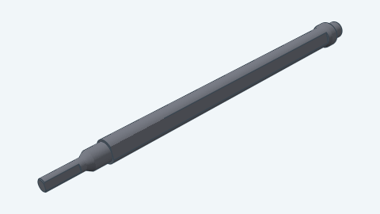 | Shaft | 1 | - | Double-D camshaft (two opposite flats where the cams sit), printed as two halves. |
| 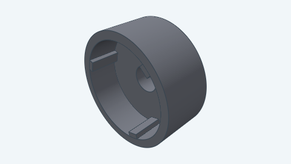 | Keyed hub | 1 | - | Pressed on the stub's flat, 0.4 mm from the front wall's outer face. A cup with three keys for the rotor's skirt. |
| 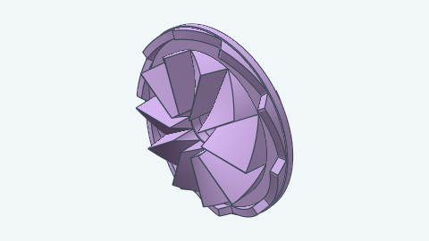 | Rotor | 1 | - | Slides 2.0 mm on the hub's keys. Ten inner teeth meet the button, ten outer teeth lock in the housing's crown. |
| 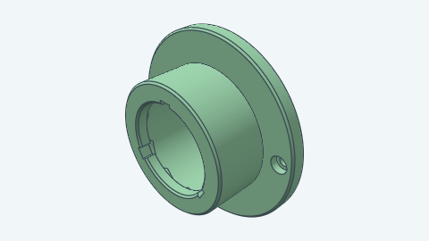 | Housing | 1 | - | Base bolted to the front wall, tube and bezel, a fixed crown with ten notches, and three slots for the button's lugs. |
| 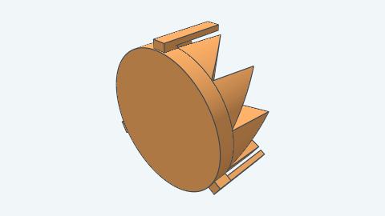 | Button | 1 | - | Head 22 mm across with ten teeth under it and three lugs that slide in the housing's slots. |
| 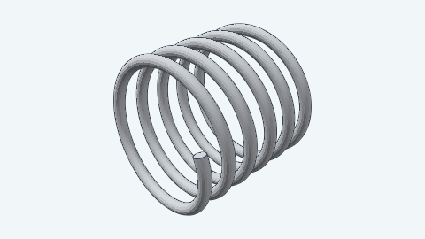 | Spring | 1 | - | Bought: KSSC K series 1087 from MonotaRO (order code 01353223), stainless, 7.0 mm outside diameter, 14.0 mm free length. The supplier's allowable load is 7.15 N at 6.4 mm length, so the pressed length of 6.0 mm is 0.4 mm past it, and fatigue life is not published. It stands on the hub and pushes the rotor up. |
|  | Cam d | 1 | 1 | Front cam, the letter d engraved on its back face. |
|  | Cam e | 1 | 2 | Front cam, the letter E engraved on its back face. |
|  | Cam c | 1 | 3 | Front cam, the letter C engraved on its back face. |
|  | Cam g | 1 | 1 | Rear cam, the letter G engraved on its back face. |
| 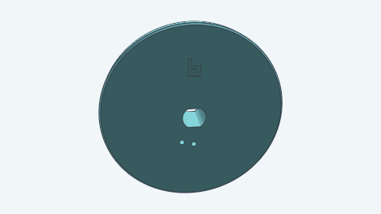 | Cam b | 1 | 2 | Rear cam, the letter b engraved on its back face. |
|  | Cam f | 1 | 3 | Rear cam, the letter F engraved on its back face. |
|  | Cam a | 1 | 4 | Rear cam, the letter A engraved on its back face. |
| 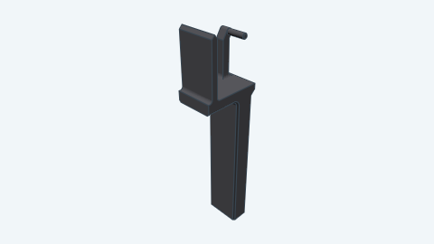 | Sliders a, g, d | 3 | - | The three horizontal segments are identical. They print with the -X face down. |
|  | Sliders b, c | 2 | - | Identical; they print with the -Y face down. |
| 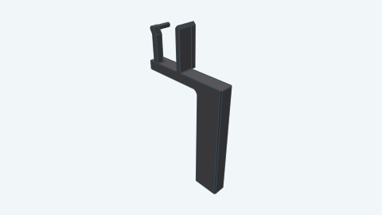 | Sliders e, f | 2 | - | Identical; they print with the -Y face down. |
|  | Rotor A | 3 | - | For segments a, g, d: one notch. Two bodies, listed next. |
| 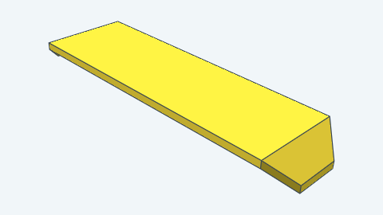 | Rotor A yellow face and tips | 3 | - | Yellow filament. The face slab continues onto the 45 degree tips. Prints face down. |
| 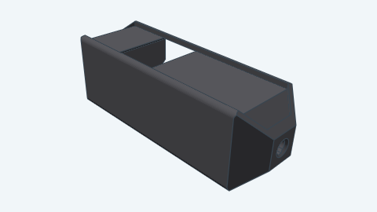 | Rotor A black body | 3 | - | Black filament. |
|  | Rotor B | 4 | - | For segments b, c, e, f: two notches. Two bodies, listed next. |
|  | Rotor B yellow face and tips | 4 | - | Yellow filament. The face slab continues onto the 45 degree tips. Prints face down. |
| 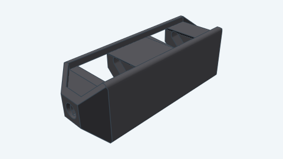 | Rotor B black body | 4 | - | Black filament. |
|  | 605ZZ bearing | 2 | - | Bought. |
| 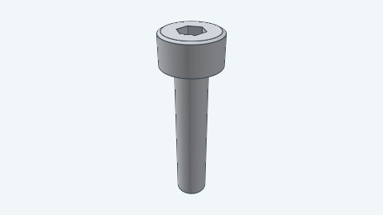 | M2 x 10 bolt | 6 | - | Bought. The top plate's four bolts, heads sunk flush, and the housing's two. |
| 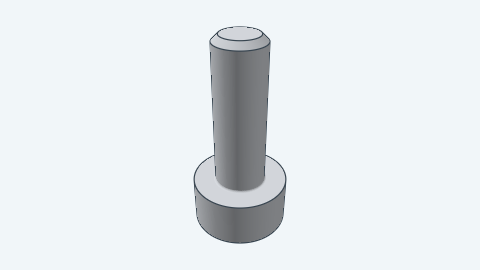 | M2 x 6 bolt | 4 | - | Bought. |
| 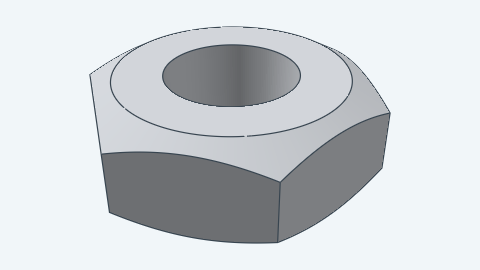 | M2 nut | 10 | - | Bought. |

## Printing

Print each part as the table says. Each cam prints with its back face down, so the letter is engraved in its first layers.
Print the shaft as two halves split along its axis, each on its cut face. Print the cams with the groove face up, the walls
with the outer face down, the top plate with the display face down, the cradle plate with its bottom face down, the
guide plate with its bottom face down, the a, g and d sliders with the -X face
down, the b, c, e and f sliders with the -Y face down, and the hub and rotor flat with the teeth up, the button with its head down and teeth up, and the housing with its bezel face down and the crown's teeth up.
The teeth need no supports: the ramps lie at 45 to 60 degrees and the notch walls are vertical. Print the rotor, button and housing at 0.1 mm layers or finer.

Each rotor is two bodies, a yellow body (the face slab and the two tips) and a black body, printed face down in one job
on a printer that changes between two filaments of one polymer (both bodies share their faces, so they must be the same
polymer, for example PETG, to bond). A pause for a filament change does not work: the yellow takes the first 12 layers
and the black rim is printed in the same layers, so a pause would turn the rim and the tips yellow. A plate of seven rotors needs
about 24 tool changes (about 8 without the tips); a slicer preview shows the time. The rotor is 7.5 mm square and its journal
stubs are 1.2 mm across and overhang by 1.4 mm (accepted in the instructions; check the first print). The rotors, sliders, stubs and pegs print whole, not split, and the instructions say why. A bearing,
bolt or nut is bought.

## Bill of materials

- 2 x 605ZZ ball bearing
- 6 x M2 x 10 bolt
- 4 x M2 x 6 bolt
- 10 x M2 nut
- 1 x KSSC K series 1087 compression spring, MonotaRO order code 01353223 (allowable load 7.15 N at 6.4 mm length; pressed length 6.0 mm is 0.4 mm past it; fatigue life not published)
- Yellow and black filament for the rotors

## Assembly

Positions below are in millimetres in the model's frame: the origin is under the middle of the digit, 3 mm below the walls' lower edges, x runs to
the right seen from the button side, y runs away from the button toward segment a, and z runs up. The exploded view above shows every
part in its place. A rotor's axis `u` runs along x for the horizontal segments (a, g, d) and along y for the vertical ones
(b, c, e, f); `+u` is to the right for a, g and d and toward the back (away from the button) for the others. Nothing on the printed
parts is marked with these numbers: the plates carry their own holes, and the steps say which hole is which.

1. Lay the two printed halves of the shaft together along their cut faces. No glue and no cross bolt hold them: the
   cams and the two bearings clamp them. Press the cams onto the shaft from the front end, groove
   faces toward the front, in order a, f, b, g, c, e, d. Push them all toward the rear until cam a stops on the end of the shaft's
   flats. Nothing else holds them along the shaft: the stack can slide forward until a groove floor touches its
   slider's pin tip, which costs nothing while the display stands level.
2. Slide the front bearing onto the front journal and the front wall over it. Slide the rear bearing on and press the
   rear wall onto it.
3. Press the hub onto the stub until it stops on the end of the stub's flat. Drop the spring over the stub, into the hub's
   cup, then the rotor, its skirt's slots over the hub's keys and its teeth up.
4. Bolt the housing to the front wall's outer face with two M2 x 10 bolts, the heads in the base's pockets and a nut
   dropped into each hex pocket on the wall's inner face before its bolt. The rotor's outer teeth must sit in the crown's
   notches. Slide the button in, its three lugs in the housing's slots and its teeth down.
5. Bolt the guide plate to the ledge ribs from below with four M2 x 6 bolts, the nuts dropped into its top pockets. The two
   front bolts go in just in front of cam d. The two rear bolts, at y 32, go in between cams f and a, with no cam
   under their heads: use a 1.5 mm hex key and let its long arm point out sideways (the sides of the frame are open).
   This follows from the dimensions and has not been tried on a
   print. Press the button until all seven entry channels face up (digit 8).
6. Press the cradle plate onto the guide plate's column pegs through its two registration holes at (12, -45), near the front
   edge on the right, and (-13.55, 39), near the back edge on the left (the other two holes are for the top plate's pegs).
7. On the bench, join each rotor to its slider: yellow face up, 2.0 mm along +u from its place (+u as defined above), notch over the tongue, then
   slide it -u so the pin enters the pocket. Rotor A (one notch) goes to a, g and d; rotor B (two notches) to b, c, e and f.
8. Lower each unit through its cradle passage and guide slot, the groove pin first, into its cam's entry channel. The
   journal stubs settle into the cradle's half-holes.
9. Lower the top plate over the cradle's pegs at (-12, -45), near the front edge on the left, and (14.5, 39), near the back edge on the
   right. The a, g and d blades stand upright. Each b to f
   arm sags by up to about 1 mm at its blade: reach in from the open side and lift the arm's outer end until its blade
   enters its tube, then let the plate down. The four top-plate nuts sit in hex pockets that open downward under the top
   flange ribs: drop a nut into each pocket from the open side and hold it there while the four M2 x 10 bolts go in from the top.
10. Press through 0 to 9 and check each digit. Each press must turn the display one digit forward.

## Turning the display over

Turned over, the rotors and sliders are held in place by the plates, but the geometry changes. The rotor's weight bias flips
by 13.5 degrees. The b to f pins shift by about 1 mm and the b to f rotors turn by 16 to 22 degrees. In that pose the
calculated tongue gaps to the notch shells are 0.16 mm (yellow shell) and 0.30 mm (black leg) in the worst-case stack of
tolerances. The b to f sliders' contact with the top plate and with their black bodies in the turned-over pose is checked in an
adjusted pose (a rigid turn about the groove pin and the slot, half the tilt limit, the rise 0.2 mm short of the full
rise and the flags lowered 0.11 mm), because in that pose the b to f sliders touch by design. `TestSevenSegmentCaptive`
allows no vertex deeper than 0.07 mm (the mesh tolerance) and reads 0.038 mm into the top plate and 0.058 mm into the
black body. Do not turn the display over with the button in motion.

## Listed sharp corners

The face teeth of the rotor, button and housing are listed: their tips are engagement edges, and their roots are retained sharp corners
(a land of 0.03 mm above the valley), because the 0.5 mm root round of the corner rule does not fit a 26 degree valley at 3.2 mm radius.

Eight kinds of sharp corner or thin rim stay, and the instructions list each: the window rims of the top plate (the plate
under the window edge is 0.70 mm thick along the long sides and 0.49 mm at the shoulders of the pointed ends); the inner
loops of the seam faces of the cradle and the top plate; the inner loops of the cradle plate's bottom face; the root of each
pin on a slider's tongue; the 45-degree step in the head of the a, g and d sliders; the pyramid edges of the rotors (convex,
120 degrees); and the corner at the end wall of each rotor bore. The tooling cannot round the cradle loops and the pin roots yet.
