# Treadle spinning wheel

The images show all 206 parts of the default build.

This wheel follows the flyer-and-bobbin arrangement in
[George Weil's labelled spinning wheel](https://www.georgeweil.com/blog/how-does-a-spinning-wheel-work/).
A foot treadle turns the large wheel through a crank and footman. A single drive band turns
the hollow flyer shaft. The bobbin rotates independently, and a Scotch brake slows it enough
for the flyer to wind yarn onto it.

The wheel has a 560 mm outside diameter and a 690 mm orifice height at default scale.
Four whorl grooves provide 7:1, 9:1, 12:1 and 17:1 flyer-to-wheel speed ratios.
The six-spoke wheel has a nominal 580 mm hub height. The hinged head puts the orifice at 690 mm at default tension.
The dimensions of this gallery frame and head define a new design rather than a copy of
the manufacturer's production drawings.

## Front and back

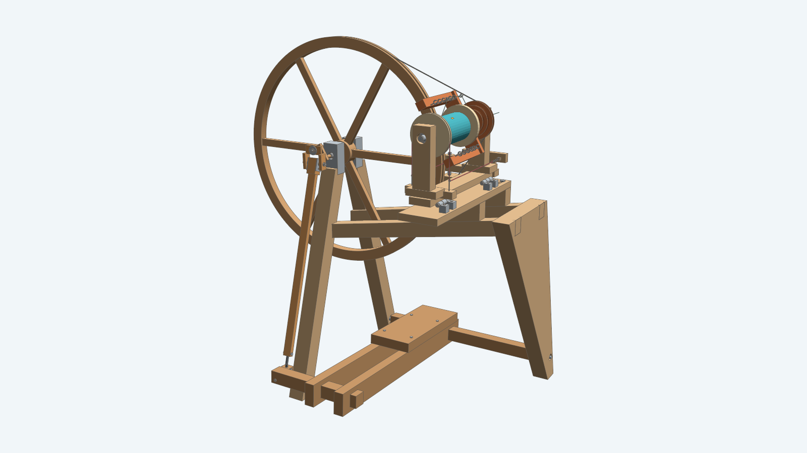

The rear view shows the drive band running from the wheel rim to the flyer whorl, the bobbin and the mother-of-all.

Two splayed uprights carry the wheel axle. The front wheel leg and single head leg carry the treadle shaft.
The head's maiden posts carry the flyer. The open frame carries these parts independently
of any removable cover. The vertical jack tilts the mother-of-all to adjust drive-band tension.
Moving its base along the flyer axis selects a whorl groove while keeping both pulley axes parallel.

The footboard extends fore and aft toward the operator. Its hinge shaft crosses the frame,
perpendicular to the wheel axle. Two bars carry the footboard, and a crossarm behind the wheel reaches the footman.
An upper gimbal has two rolling axes; a lower compliant connector joins the rocking rail to the footman.

## Yarn path and take-up

The leader enters the 10 mm axial orifice, exits a 6 mm radial port, passes through open guide hooks,
and reaches the bobbin. The flyer guides rotate around the bobbin. The bobbin's two 608 bearings
let it turn at a different speed from the flyer shaft. An orange marker on the teal yarn pack
makes that difference visible.

The brake cord wraps the bobbin's rear flange.
Both tails run forward below the flyer to two extension springs
and an accessible adjusting screw. Turning the screw extends both springs while preserving cord length.

The drive whorl, wheel hub, crank and treadle rail use removable keys in otherwise round shafts.
The whorl is one piece, between the front maiden and flyer crossbar, with all four grooves and a keyed 16.2 mm bore.
Bearing journals stay circular. The 10 mm yarn orifice requires a 16 mm front journal and
a plain nylon sleeve; the smaller rear journal uses a 608 bearing.

## Motion

The animation shows one wheel turn. The left panel views the wheel from the side opposite
the still images (turned 180 degrees about the vertical axis) to show the treadle, footman, crank and connector.
It prescribes 195 mm of yarn feed per wheel turn,
so the flyer makes 7 turns while the bobbin makes 6.
The still images show one pose. The model default is 100 mm of yarn feed per wheel turn.

The wheel can turn in either direction after a hand start. Flywheel inertia carries it
through the crank's dead centres and raises the pedal. Side slides and a pedal return spring
are unnecessary for this rocking treadle. The animation shows set motion; it does not
calculate foot force, bearing load, inertia, belt traction or brake friction.

## Parts and adjustment

The assembly reuses the [bearing envelopes](../ballbearing/) for seven 608-2RS bearings
and three 605ZZ bearings. A custom 16.2 x 26 x 20 mm sleeve carries the front flyer journal.
Other hardware includes 8 mm shafts, 5 mm linkage pins, M6 post/clamp fasteners,
an M8 drive-tension screw and an M4 brake-adjusting screw. Each shaft collar has a radial M2 grub screw.
Bolted end plates retain the gimbal and footman bearings. Screw threads are represented by mounting envelopes.

The rear maiden and its glued foot remove together for bobbin changes. Slacken the drive band and release the brake cord.
Remove the outer rear-flyer collar, unbolt the maiden foot, and slide the post-and-foot unit rearward off the shaft.
Remove the remaining rear-support collar and bobbin retaining collar, then slide the bobbin off the rear shaft.
Leave the modeled 0.2 mm shoulder gaps for bobbin rotation.
Physical brake setting, belt preload, balance, wood joints and shaft retention need checking
on a prototype before using the wheel to spin yarn.

## Exploded

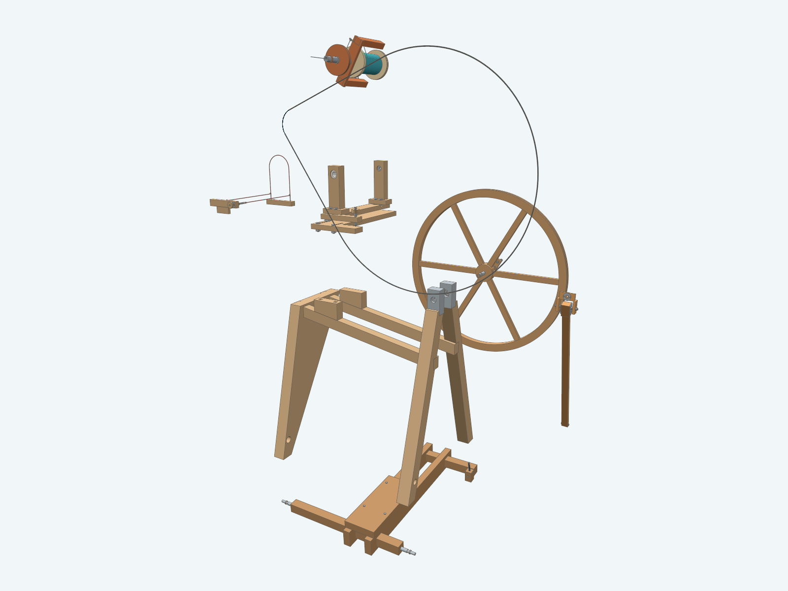

Each sub-assembly moves as one block from the assembled position. The frame stays put. The wheel with its axle and
crank moves to one side, the treadle drops, and the footman and gimbal move to the other. The head with its mother-of-all lifts
above the frame, the flyer and bobbin lift above the head, and the brake and drive band move out to the sides. Parts inside a
block keep their assembled places. The view is built from the 206 bodies of the default build and moved by the
renderer; it is not a derived Decad explode, because the wheel has no joint graph for one.

## Parts table

The 206 bodies have 109 distinct shapes. Identical bodies share a row, and the count says how many the wheel uses.
Each row gives the name of its first body. The bodies sit in the model's containers:
`Frame`, `Wheel`, `Treadle`, `Footman`, `Gimbal`, `Flyer`, `Bobbin`, `Fasteners`, `Collars`, `Bearings` and the
other kind containers. The table below groups the rows by sub-assembly instead, to match the exploded view.

### Frame

| Image | Part | Count |
| --- | --- | ---: |
| 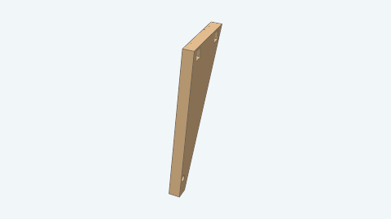 | Head leg (`head-leg`) | 1 |
| 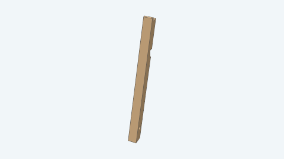 | Front wheel leg (`front-wheel-leg`) | 1 |
| 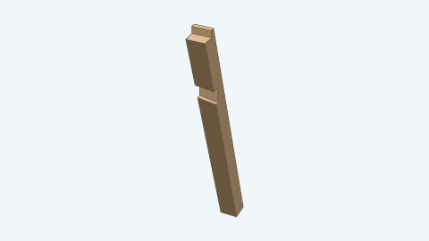 | Rear wheel leg (`rear-wheel-leg`) | 1 |
| 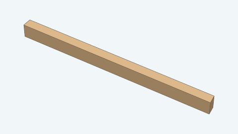 | Front bench rail (`front-bench-rail`) | 2 |
| 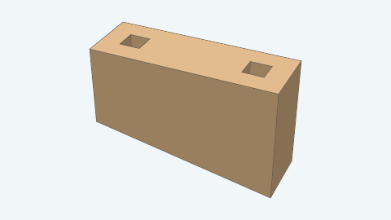 | Front head wedge (`front-head-wedge`) | 1 |
| 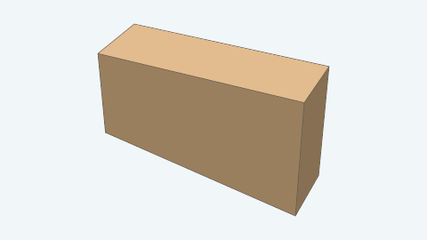 | Rear head wedge (`rear-head-wedge`) | 1 |
| 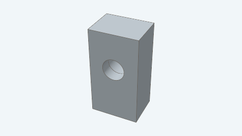 | Front wheel bearing cap (`front-wheel-bearing-cap`) | 2 |
| 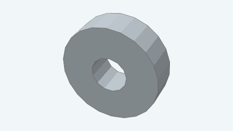 | 608-2RS bearing (`wheel-bearing-1`) | 7 |
| 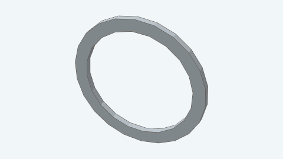 | Bearing retaining ring (`wheel-bearing-1-ring`) | 5 |

### Wheel, axle and crank

| Image | Part | Count |
| --- | --- | ---: |
| 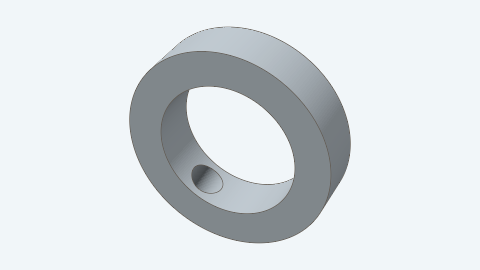 | Shaft collar (8 mm) (`wheel-axle-front-collar`) | 4 |
| 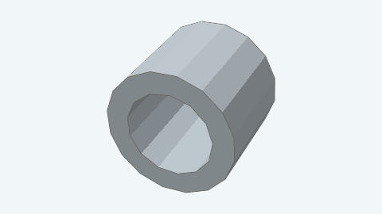 | Wheel axle front thrust spacer (`wheel-axle-front-thrust-spacer`) | 2 |
| 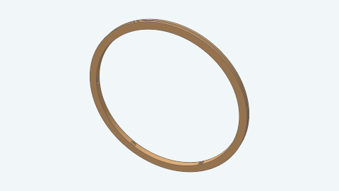 | Wheel rim (`wheel-rim`) | 1 |
| 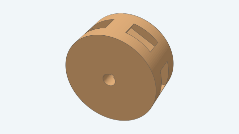 | Wheel hub (`wheel-hub`) | 1 |
| 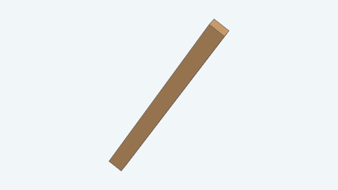 | Wheel spoke (`wheel-spoke-1`) | 6 |
| 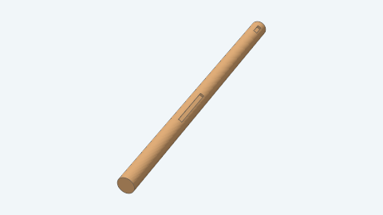 | Wheel axle (`wheel-axle`) | 1 |
| 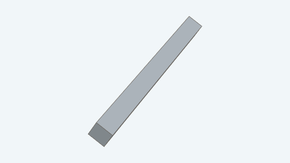 | Wheel hub key (`wheel-hub-key`) | 1 |
| 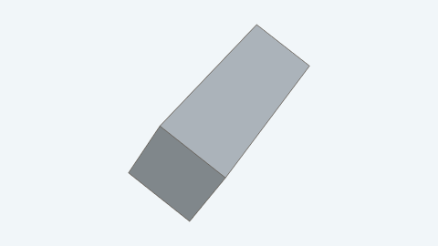 | Wheel crank key (`wheel-crank-key`) | 1 |
| 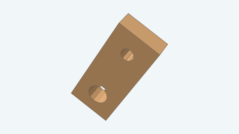 | Wheel crank (`wheel-crank`) | 1 |
| 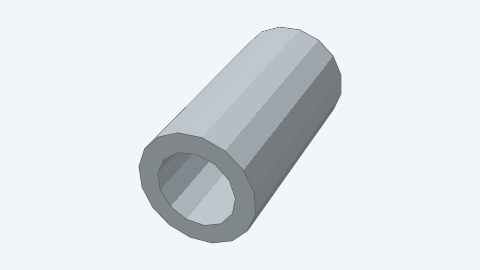 | Wheel hub front spacer (`wheel-hub-front-spacer`) | 2 |
| 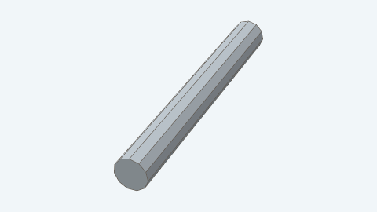 | Wheel crank pin (`wheel-crank-pin`) | 1 |
| 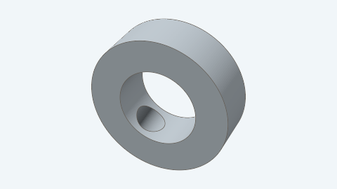 | Wheel crank pin collar (`wheel-crank-pin-collar-1`) | 2 |
| 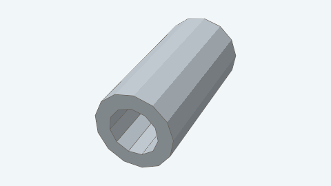 | Wheel crank pin spacer (`wheel-crank-pin-spacer`) | 1 |
|  | Collar grub screw (axle, crank, rear flyer, bobbin) (`wheel-axle-front-collar-setscrew`) | 7 |
|  | Collar grub screw (crank pin, gimbal pin) (`wheel-crank-pin-collar-1-setscrew`) | 4 |

### Treadle

| Image | Part | Count |
| --- | --- | ---: |
| 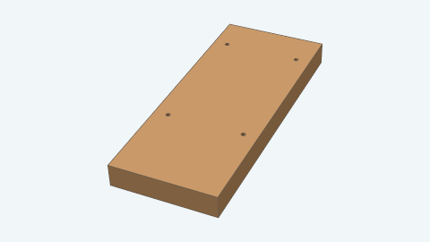 | Treadle (`treadle`) | 1 |
| 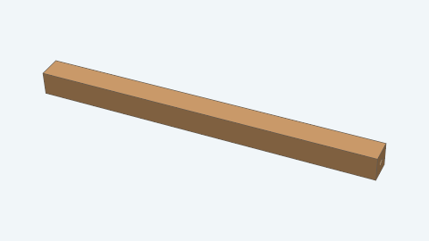 | Treadle heel rail (`treadle-heel-rail`) | 1 |
| 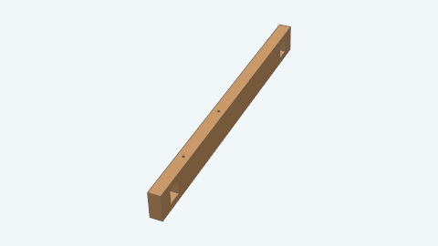 | Treadle bar left (`treadle-bar-left`) | 2 |
| 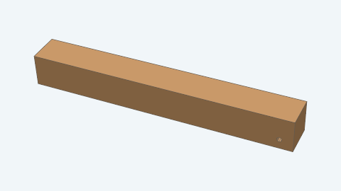 | Treadle rear crossarm (`treadle-rear-crossarm`) | 1 |
| 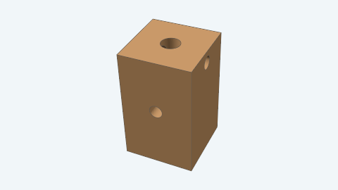 | Treadle connector block (`treadle-connector-block`) | 1 |
| 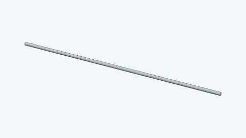 | Heel pin (`heel-pin`) | 1 |
| 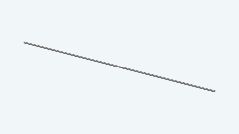 | Heel key (`heel-key`) | 1 |
| 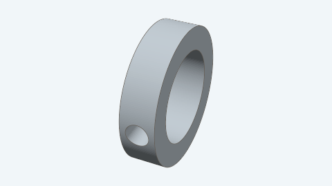 | Heel collar (`heel-collar-1`) | 2 |
| 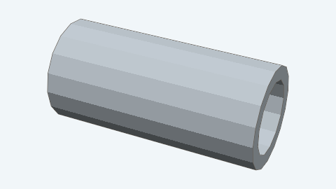 | Heel spacer (`heel-spacer-1`) | 2 |
| 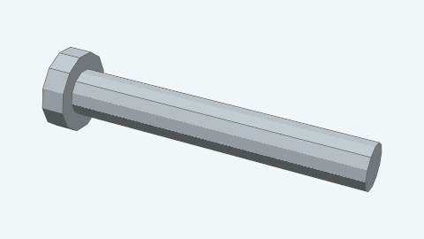 | Treadle lower clamp pin (`treadle-lower-clamp-pin`) | 1 |
| 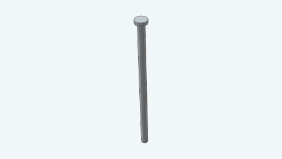 | Footboard bolt (`treadle-board-bolt-1-pin`) | 4 |
| 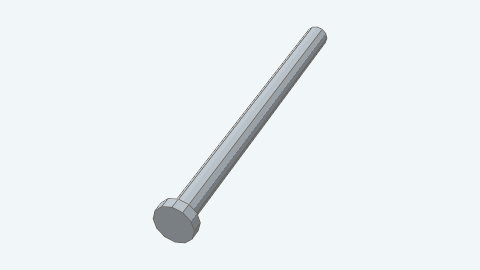 | Treadle block bolt pin (`treadle-block-bolt-pin`) | 1 |
| 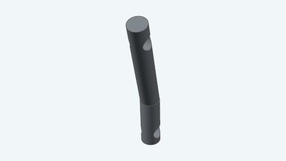 | Treadle flex connector (`treadle-flex-connector`) | 1 |
| 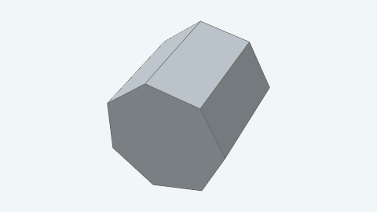 | Collar grub screw (heel pin) (`heel-collar-1-setscrew`) | 2 |

### Footman and gimbal

| Image | Part | Count |
| --- | --- | ---: |
| 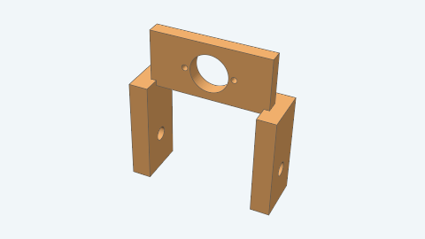 | Gimbal bridge (`gimbal-bridge`) | 1 |
| 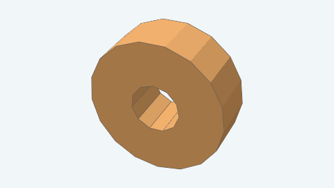 | 605ZZ bearing (`gimbal-crank-605`) | 3 |
| 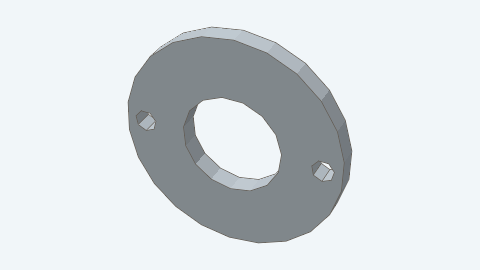 | Gimbal crank retainer (`gimbal-crank-retainer-1`) | 2 |
| 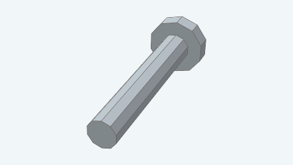 | Gimbal retainer bolt (`gimbal-retainer-bolt-1`) | 2 |
| 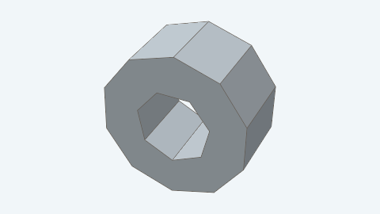 | M2 nut (`gimbal-retainer-nut-1`) | 3 |
| 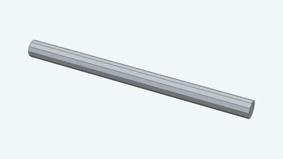 | Gimbal cross pin (`gimbal-cross-pin`) | 1 |
| 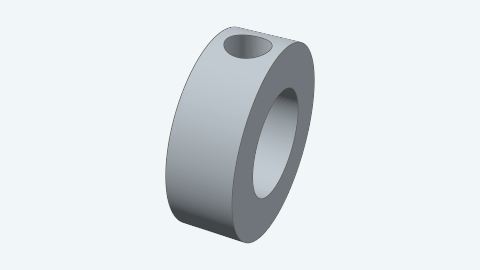 | Gimbal cross pin collar (`gimbal-cross-pin-collar-1`) | 2 |
| 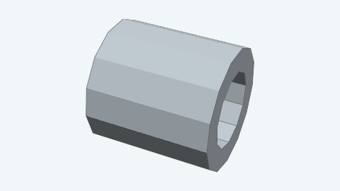 | Gimbal cross spacer (`gimbal-cross-spacer-1`) | 2 |
| 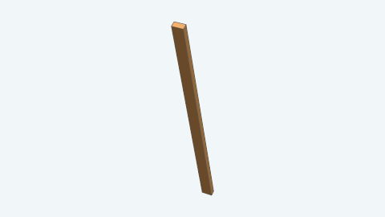 | Footman (`footman`) | 1 |
| 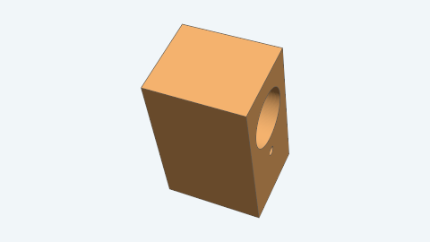 | Footman head boss (`footman-head-boss`) | 1 |
| 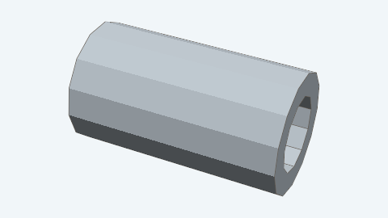 | Footman cross spacer (`footman-cross-spacer`) | 1 |
| 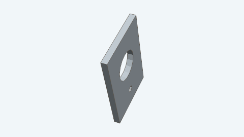 | Footman cross retainer (`footman-cross-retainer-1`) | 2 |
|  | Footman retainer bolt (`footman-retainer-bolt`) | 1 |
|  | Footman upper clamp pin (`footman-upper-clamp-pin`) | 1 |
|  | Clamp and bolt nut (`footman-upper-clamp-nut`) | 7 |

### Head

| Image | Part | Count |
| --- | --- | ---: |
|  | Mother base (`mother-base`) | 1 |
|  | Mother alignment clamp (`mother-alignment-clamp-1`) | 2 |
|  | Alignment and foot insert (`mother-alignment-insert-1`) | 6 |
|  | Mother hinge fixed bracket (`mother-hinge-1-fixed-bracket-1`) | 4 |
|  | Mother hinge fixed mount (`mother-hinge-1-fixed-mount-1`) | 4 |
|  | Mother hinge pin (`mother-hinge-1-pin`) | 2 |
|  | Mother hinge nut (`mother-hinge-1-nut`) | 2 |
|  | Mother hinge moving leaf (`mother-hinge-1-moving-leaf`) | 2 |
|  | Mother hinge moving mount (`mother-hinge-1-moving-mount`) | 2 |
|  | Mother upper bar (`mother-upper-bar`) | 1 |
|  | Mother jack arm (`mother-jack-arm`) | 1 |
|  | Mother jack square insert (`mother-jack-square-insert`) | 1 |
|  | Mother jack screw (`mother-jack-screw`) | 1 |
|  | Mother jack knob (`mother-jack-knob`) | 1 |
|  | Front maiden foot (`maiden-foot-1`) | 1 |
|  | Maiden foot bolt (`maiden-foot-1-bolt-1`) | 4 |
|  | Rear maiden foot (`maiden-foot-2`) | 1 |
|  | Front maiden (`front-maiden`) | 1 |
|  | Rear maiden (`rear-maiden`) | 1 |
|  | Front maiden bush (`front-maiden-bush`) | 1 |

### Flyer and bobbin

| Image | Part | Count |
| --- | --- | ---: |
|  | Flyer shaft (`flyer-shaft`) | 1 |
|  | Flyer whorl key (`flyer-whorl-key`) | 1 |
|  | Flyer crossbar key (`flyer-crossbar-key`) | 1 |
|  | Flyer drive whorl (`flyer-drive-whorl`) | 1 |
|  | Flyer crossbar (`flyer-crossbar`) | 1 |
|  | Flyer arm (`flyer-arm-1`) | 2 |
|  | Flyer shaft collar (long) (`rear-flyer-front-collar`) | 3 |
|  | Rear flyer front thrust spacer (`rear-flyer-front-thrust-spacer`) | 1 |
|  | Rear flyer rear thrust spacer (`rear-flyer-rear-thrust-spacer`) | 1 |
|  | Shaft collar (flyer shaft) (`front-sleeve-retainer`) | 4 |
|  | Bobbin (`bobbin`) | 1 |
|  | Bobbin inner race sleeve (`bobbin-inner-race-sleeve`) | 1 |
|  | Bobbin front thrust sleeve (`bobbin-front-thrust-sleeve`) | 1 |
|  | Bobbin yarn pack (`bobbin-yarn-pack`) | 1 |
|  | Bobbin witness bar (`bobbin-witness-bar`) | 1 |
|  | Yarn hook (`yarn-hook-1`) | 11 |
|  | Yarn hook (wide) (`yarn-hook-9`) | 1 |
|  | Yarn front guide (`yarn-front-guide`) | 1 |
|  | Yarn leader (`yarn-leader`) | 1 |
|  | Collar grub screw (whorl, crossbar, sleeve) (`front-sleeve-retainer-setscrew`) | 4 |

### Scotch brake

| Image | Part | Count |
| --- | --- | ---: |
|  | Brake rear crossbar (`brake-rear-crossbar`) | 1 |
|  | Brake front upright (`brake-front-upright`) | 1 |
|  | Brake control rail (`brake-control-rail`) | 1 |
|  | Brake band (`brake-band`) | 1 |
|  | Brake spring left (`brake-spring-left`) | 2 |
|  | Brake routing eye left (`brake-routing-eye-left`) | 2 |
|  | Brake front pin left (`brake-front-pin-left`) | 2 |
|  | Brake left anchor (`brake-left-anchor`) | 1 |
|  | Brake takeup screw (`brake-takeup-screw`) | 1 |
|  | Brake takeup knob (`brake-takeup-knob`) | 1 |
|  | Brake insert (`brake-insert`) | 1 |
|  | Brake insert retaining plate (`brake-insert-retaining-plate`) | 1 |
|  | Brake insert mount (`brake-insert-mount-1`) | 2 |

### Drive band

| Image | Part | Count |
| --- | --- | ---: |
|  | Drive band wheel wrap (`drive-band-wheel-wrap`) | 1 |
|  | Drive band flyer wrap (`drive-band-flyer-wrap`) | 1 |
|  | Drive band span (`drive-band-span-1`) | 2 |

See [construction and verification](../../docs/models/spinningwheel.md) for parameters,
build commands and the limits of the geometry checks.
