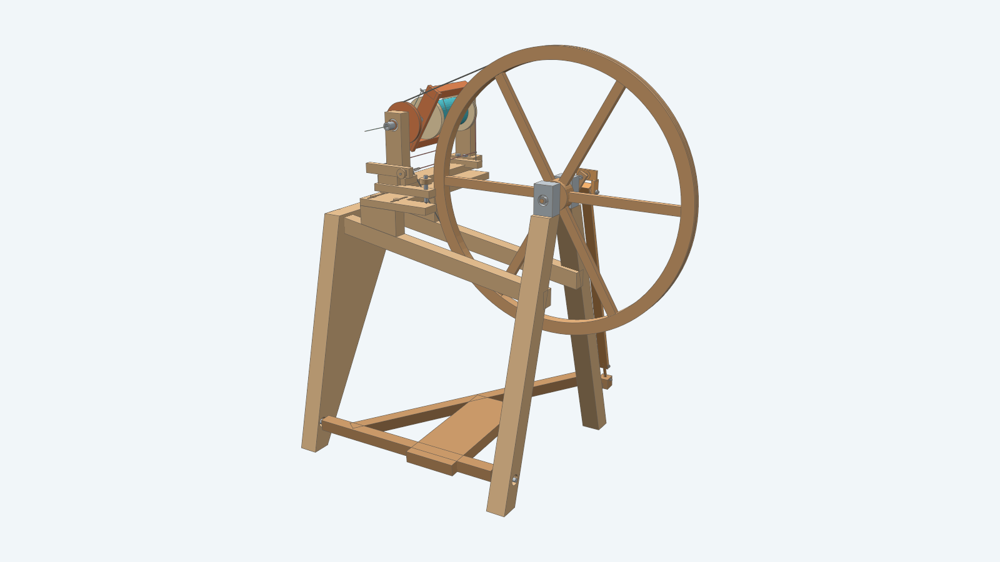
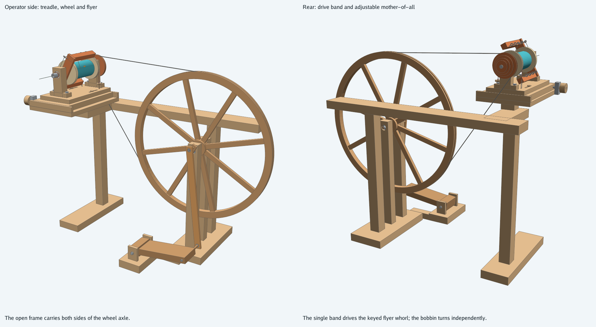
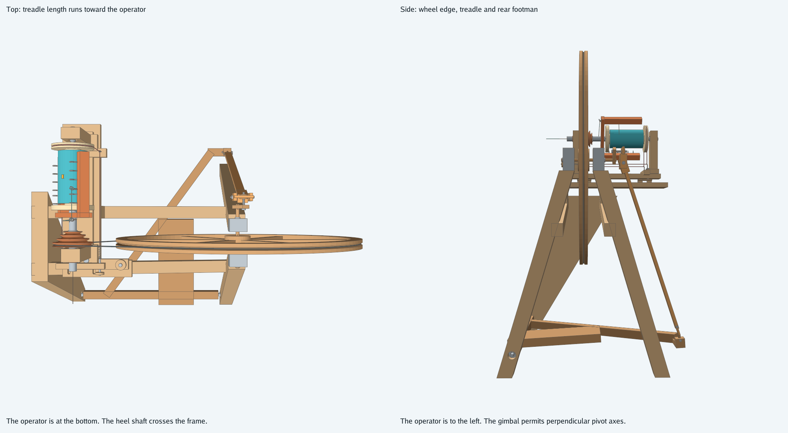
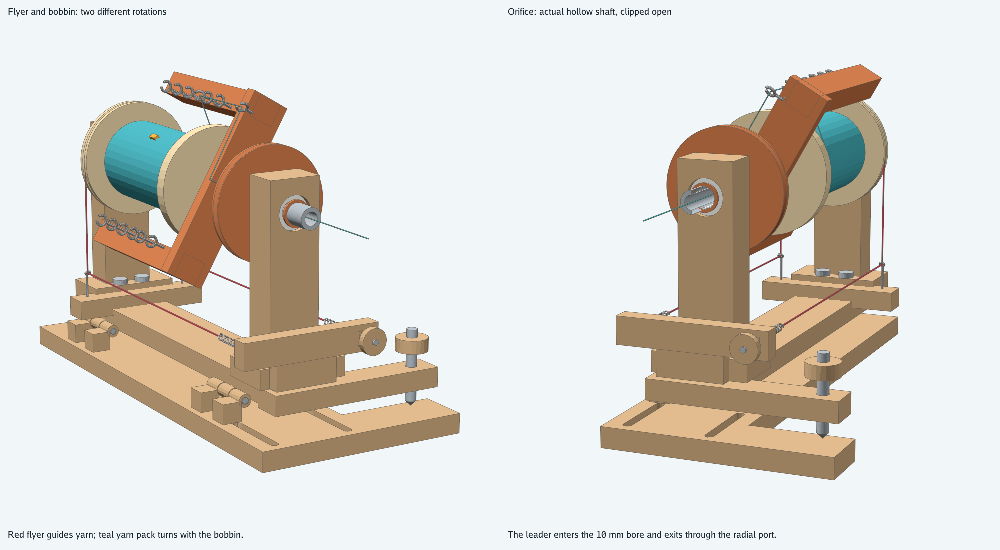
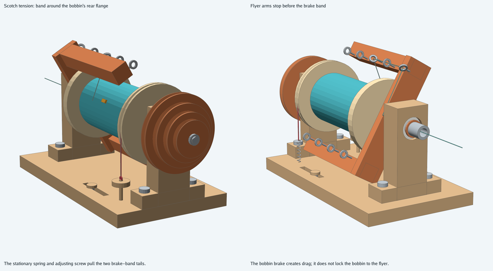
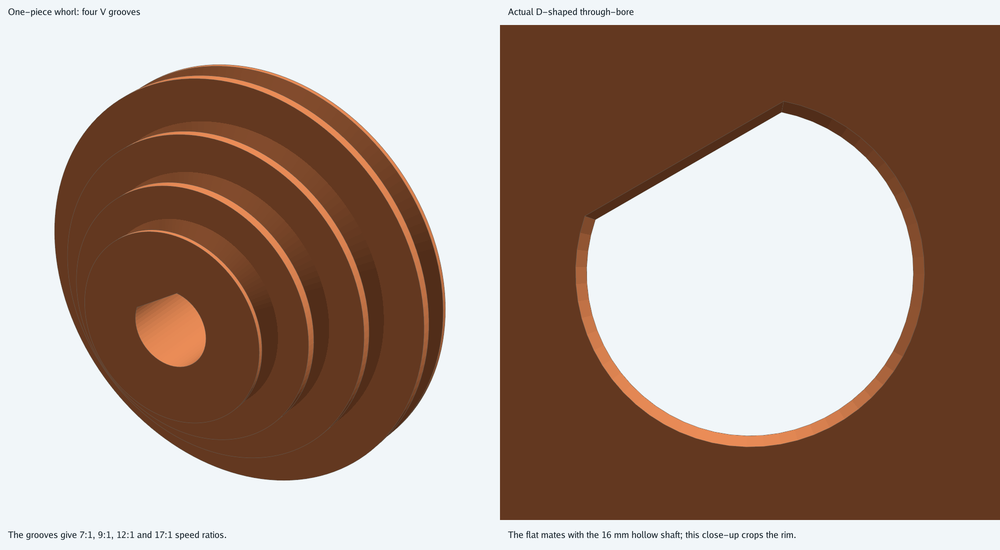
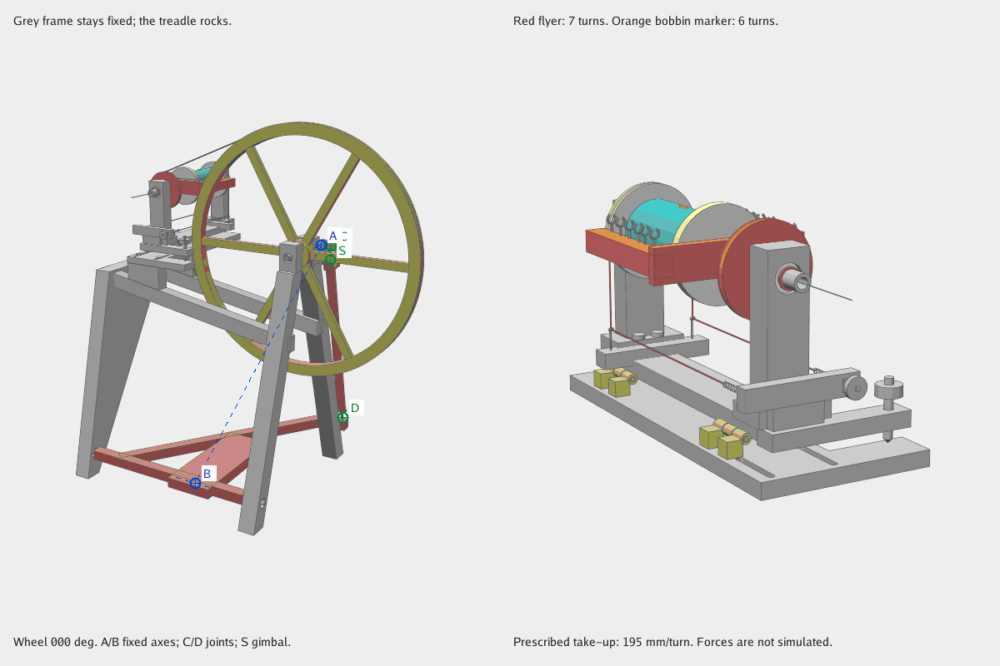

# Treadle spinning wheel

This wheel follows the flyer-and-bobbin arrangement in
[George Weil's labelled spinning wheel](https://www.georgeweil.com/blog/how-does-a-spinning-wheel-work/).
A foot treadle turns the large wheel through a crank and footman. A single drive band turns
the hollow flyer shaft. The bobbin rotates independently, and a Scotch brake slows it enough
for the flyer to wind yarn onto it.

The wheel has a 560 mm outside diameter and a 690 mm orifice height at default scale.
Four whorl grooves provide 7:1, 9:1, 12:1 and 17:1 flyer-to-wheel speed ratios.
The six-spoke wheel has a nominal 580 mm hub height. The hinged head puts the orifice at 690 mm at default tension.
The dimensions of this gallery frame and head define a new design rather than a copy of
the manufacturer's production drawings.

## Front and back

Two splayed uprights carry the wheel axle. The front wheel leg and single head leg carry the treadle shaft.
The head's maiden posts carry the flyer. The open frame carries these parts independently
of any removable cover. The vertical jack tilts the mother-of-all to adjust drive-band tension.
Moving its base along the flyer axis selects a whorl groove while keeping both pulley axes parallel.

The footboard extends fore and aft toward the operator. Its hinge shaft crosses the frame,
perpendicular to the wheel axle. A diagonal actuating rail reaches the footman behind the wheel.
An upper gimbal has two rolling axes; a lower compliant connector joins the rocking rail to the footman.
The [reference inventory](../../docs/spinning-wheel-reference-audit.md) records all corrected arrangements.

## Yarn path and take-up

The leader enters the 10 mm axial orifice, exits a 6 mm radial port, passes through open guide hooks,
and reaches the bobbin. The flyer guides rotate around the bobbin. The bobbin's two 608 bearings
let it turn at a different speed from the flyer shaft. An orange marker on the teal yarn pack
makes that difference visible.

The brake cord wraps the bobbin's rear flange. Both tails run forward below the flyer to two extension springs
and an accessible adjusting screw. Turning the screw extends both springs while preserving cord length.

The drive whorl, wheel hub and crank use matching D-shaped shaft connections.
The whorl is one piece, between the front maiden and flyer crossbar, with all four grooves and a D16.2 bore.
Bearing journals stay circular. The 10 mm yarn orifice requires a 16 mm front journal and
a plain nylon sleeve; the smaller rear journal uses a 608 bearing.

## Motion

The animation uses the same native bodies as the still images. The frame stays fixed,
the treadle rocks, and the footman's bearing centres follow the solved spatial linkage.
Blue A/B marks identify the perpendicular fixed axes. Green C/D/S marks follow the moving joints, and the frame is grey.
One wheel turn gives seven flyer turns and six bobbin turns in this illustrative animation.
Their difference winds about 195 mm of yarn at the displayed 31 mm winding radius.
The ordinary model default prescribes 100 mm of feed per wheel turn instead.

The wheel can turn in either direction after a hand start. Flywheel inertia carries it
through the crank's dead centres and raises the pedal. Side slides and a pedal return spring
are unnecessary for this rocking treadle. The animation prescribes motion; it does not
calculate foot force, bearing load, inertia, belt traction or brake friction.

## Parts and adjustment

The assembly reuses the [bearing envelopes](../ballbearing/) for seven 608-2RS bearings
and three 605ZZ bearings. A custom 16.2 x 26 x 20 mm sleeve carries the front flyer journal.
Other hardware includes 8 mm shafts, 5 mm linkage pins, M6 post/clamp fasteners,
an M8 drive-tension screw and an M4 brake-adjusting screw. Threads and custom split-clamp shaft
collars are mounting envelopes; their internal fasteners are not manufacturing models.

The rear maiden unbolts from its foot for bobbin changes. Remove the whorl and rear support,
release the rear bobbin collar, and slide the bobbin off the rear shaft.
The drive band must be slackened first. Leave the modeled 0.2 mm shoulder gaps for bobbin rotation.
Physical brake setting, belt preload, balance, wood joints and shaft retention need checking
on a prototype before using the wheel to spin yarn.

See [construction and verification](../../docs/models/spinningwheel.md) for parameters,
build commands and the limits of the geometry checks.
