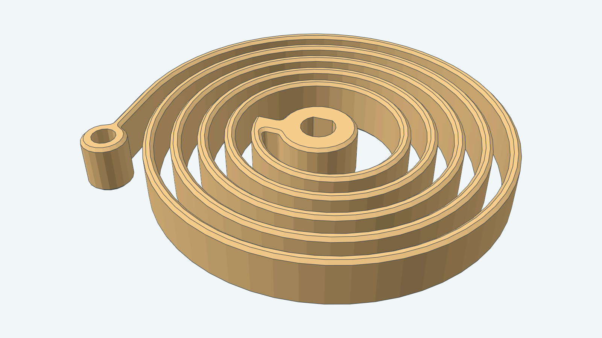
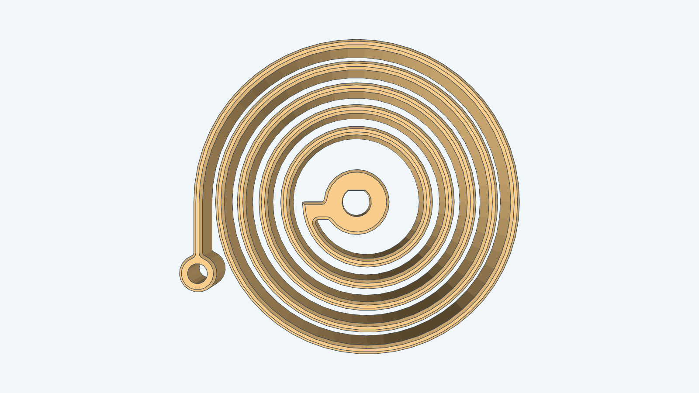
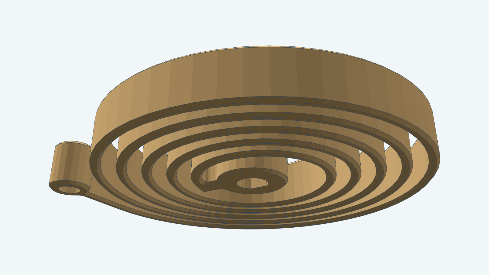
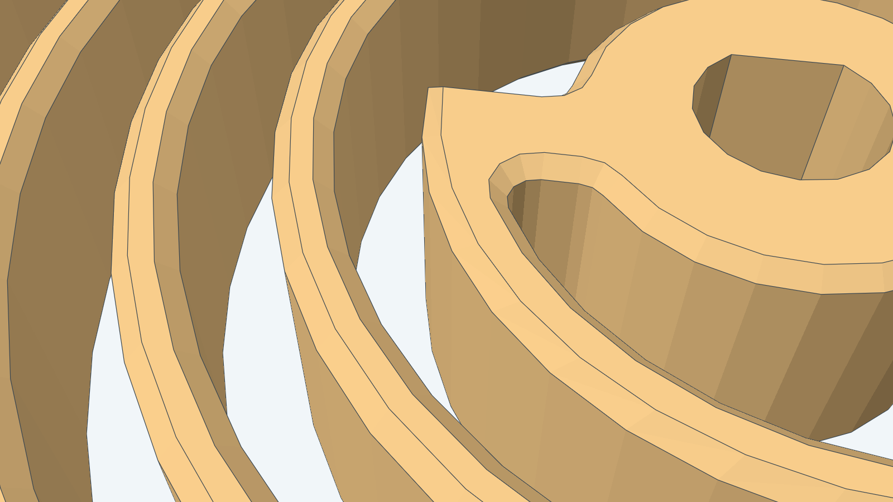
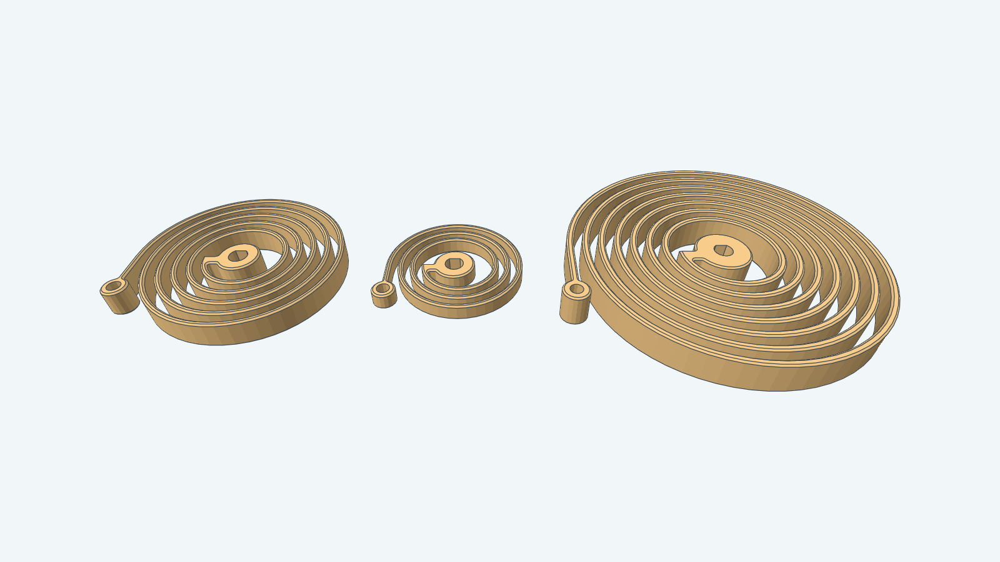

# Spiral spring

This model is a flat spiral (clock or motor) spring for wind-up mechanisms, printed as one piece. You set
the relaxed outer diameter, the strip thickness and the strip height. The inner end is a hub with a D bore
that fits an arbor. The outer end is a straight tail that ends in a round eye, which hooks over a pin in the
housing.

The model is the spring only. It does not include the arbor, the housing or the pin. It does not simulate
torque, fatigue or creep.

**Clearance adjustment:** Adjustable. The bore and the eye hole each take a clearance parameter, 0.2 mm at least.

## Parameters

All dimensions are in millimeters. `Params.Validate` rejects values outside the limits with an error that names
the field.

| Parameter | Default | Limit |
| --- | --- | --- |
| `OuterDiameter` | 60 | Above `HubDiameter`; room for one turn |
| `HubDiameter` | 12 | Radius at least 2.5 times `Thickness`; the wall between bore and hub edge is at least 1.5 |
| `Thickness` | 1.6 | At least 1.5 |
| `Height` | 8 | At least twice `Thickness` |
| `MinGap` | 2.0 | At least 1.0 |
| `Turns` | 0 | 0 fits as many turns as the gap allows; at most 40 |
| `ArborDiameter` | 5 | Above 0 |
| `ArborFlatDepth` | 0.5 | 0 for a round bore, at most a quarter of `ArborDiameter` |
| `BoreClearance` | 0.2 | At least 0.2 |
| `AnchorPinDiameter` | 3 | Above 0 |
| `AnchorClearance` | 0.35 | At least 0.2 |
| `Placement` | none | A valid frame |

The spring has as many turns as fit with an air gap of at least `MinGap` between turns. The actual gap is
the radial space left over, spread evenly, so it is usually a little wider than `MinGap`. Set `Turns` to ask
for fewer turns and a wider gap. The defaults give 5 turns with a 2.4 mm gap.

## Local frame and winding

The origin is on the spring axis in the bottom face, and +Z runs along the axis to the top face. The strip winds
counter-clockwise outward seen from +Z. To wind the spring, hold the eye and turn the arbor clockwise seen from
+Z. A `Placement` frame that reverses local +Z gives the opposite hand.

The flat of the D bore faces +Y. The eye lies in the -X/-Y quadrant.

## Views

The top view shows the two-center arc spiral, the root with its spoke and the tail running to the eye.

The low view shows the underside and the cap chamfers.

The root close-up shows the hub, the spoke that joins it to the first turn and the filleted corners.

## Sizes

From left to right: the default spring (60 mm), a 40 mm spring with 1.5 mm strip, and a 90 mm spring with 2 mm strip.

## Printing and material

Print the spring flat with the axis vertical and no supports. Every layer holds the whole spiral, and the strip
bends in the layer plane along its perimeters, so layer adhesion carries no bending load. At the default
1.6 mm thickness the strip is four 0.4 mm extrusion lines wide.

Use PETG or nylon. PLA creeps under a constant load and cracks at a lower strain.

`Dimensions.WindStrain` estimates the surface strain when the first turn wraps the hub: 3.1% for the defaults.
Compare it with your material's yield strain. `Dimensions.ActiveLength` is the centerline length of the strip,
634.6 mm for the defaults. A strip of material with Young's modulus `E` gives a torque of about
`M = E * Height * Thickness^3 * theta / (12 * ActiveLength)` for a winding angle `theta` in radians. With
`E` = 2000 N/mm^2 the defaults give about 8.6 N·mm per radian. Treat it as an estimate and measure a print.

For how to build this spring from Go, see the [developer notes](../../docs/models/spiralspring.md). The
construction is in [instructions.md](instructions.md) and [steps.md](steps.md).
