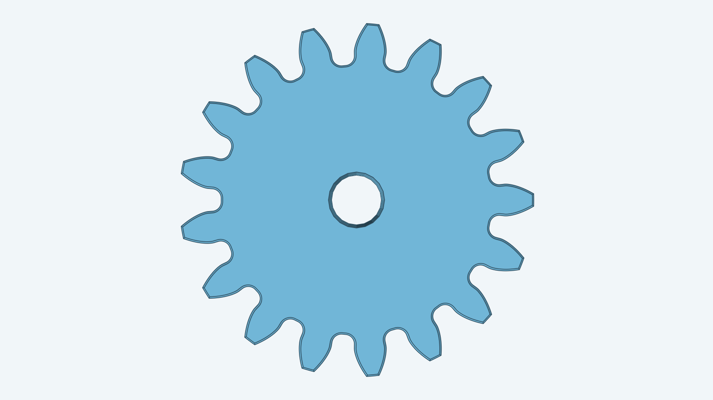
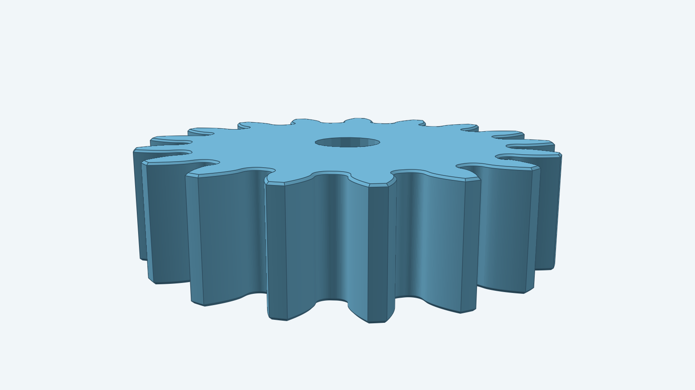

# Spur gear

## More views

| From above | Low side angle |
| --- | --- |
|  |  |

This item builds one straight-toothed involute gear; `spurgear.go` constructs
the model with decad. Dimensions are in millimeters, and the pressure angle is in radians.

The Go package exposes `Build(ctx, doc, Params)`. Its caller supplies a decad
document and receives one gear body. Set `Params.Placement` (an `r3.Frame`) to anchor the gear: the frame origin is
the reference point on the gear axis, its U and V axes span the reference
plane that holds the lower cap, and the gear grows along U×V. Leaving it nil
places the gear on the world XY plane at the origin. Helical gears take the
same placement, and so do herringbone and bevel gears. Run `go test ./models/spurgear` to check
the supported parameter cases.

`BoreDiameter` cuts a centered through-bore. `CapChamfer` chamfers the outer loops of both end
caps, with or without a bore; the bore rims stay sharp.

The [model renderer](../../tools/render/README.md) produces these images
from a 17-tooth, 5 mm thick gear with a 3 mm bore and a 0.1 mm cap chamfer.
