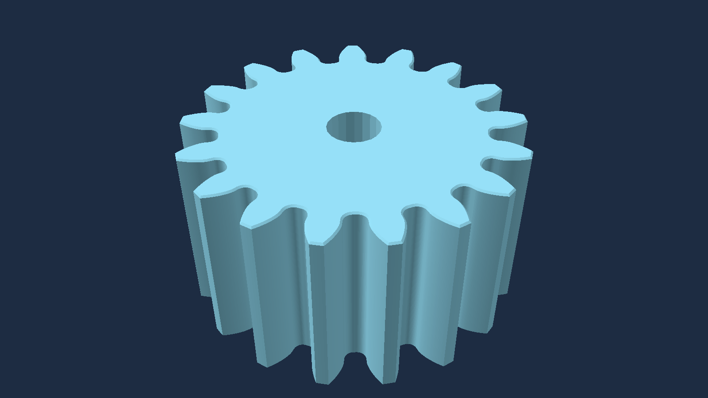

# Spur gear

This item builds one straight-toothed involute gear. Its source is
[instructions.md](instructions.md). The [steps](steps.md) map the contract to
Sketch and Decad operations; `spurgear.go` constructs the model with
decad. Dimensions are in millimeters, and the pressure angle is in radians.

The Go package exposes `Build(ctx, doc, Params)`. Its caller supplies a decad
document and receives one gear body. Run `go test ./models/spurgear` to check
the supported parameter cases.

`Build` draws one closed profile with fit-spline flanks, lofts matching
profiles at the two end planes, then asks decad to fillet the axial root
corners. The default model uses 15 fit points per flank and has 17 teeth
and 34 root fillets.

`BoreDiameter` cuts a centered through-bore after the root fillets.
`CapChamfer` chamfers the outer loops of both end caps, with or without a
bore. When present, the bore rims stay sharp. When a flank begins inside the
root circle, Sketch trims its original fit spline and joins the gear regions
into one profile. A nonpositive derived fillet radius skips root fillets.

The [model renderer](../../tools/render/README.md) produces this hero image
from a 17-tooth gear with a 3 mm bore and a 0.1 mm cap chamfer.
