# Swiss lever escapement

**Build status:** Not built yet. No physical copy of this model has been made and tested, so its dimensions and fits are unproven.

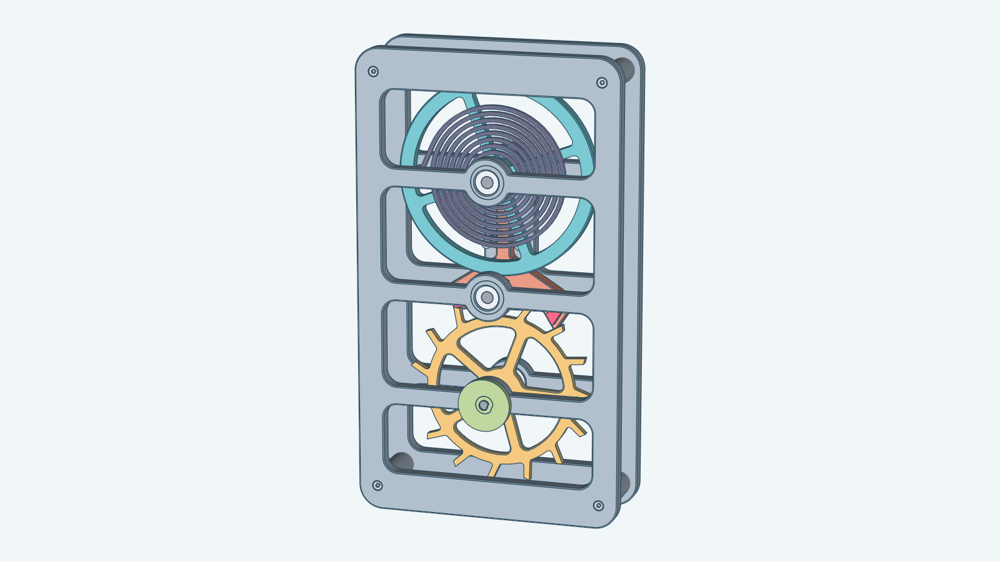

A desk-scale Swiss lever escapement, the escapement of most mechanical watches. You turn a knob with a fingertip, and
the escape wheel lets itself be advanced one tooth at a time by a lever, while a balance wheel on a printed hairspring
swings back and forth and times the lever. The model has a 15-tooth club-tooth escape wheel, a lever with a fork, a dart
and two pallet stones, a balance with a roller table, an impulse pin and a safety roller, two banking posts and a
two-plate frame on six 605ZZ bearings. It has 30 bodies, six of them purchased bearings.

The movement is 112 mm wide, 196 mm tall and 43.30 mm deep, from the back of the back plate to the front of the knob.
Every part fits a 220 × 220 mm print bed; the plates are the largest. Nothing stands out of the back plate's rear face,
so the movement lies on a desk with the knob on top and needs no stand.

## How the escapement works

The lever swings about its own arbor between two banking posts, 14° apart. A pallet stone is pressed into each arm of the
lever, and the escape wheel's teeth are between them. Because the stones span 2.5 tooth pitches, when one stone holds a
tooth the other stone's gap is half a tooth off, so each swing of the lever passes exactly one tooth.

- **Lock.** A tooth's locking corner (its toe) rests on a stone's locking face. The face is tilted 12° (the draw), so
  the wheel's push pulls the lever against its banking post and the balance cannot be disturbed by a jolt. The lock is
  about 1.0 mm along the face.
- **Unlock.** The balance's impulse pin enters the lever's fork and pushes one horn. The lever turns 2.5° and the tooth's
  toe leaves the locking face.
- **Impulse.** The wheel's push now goes into the lever in two steps, which is what a club tooth is for. First the
  stone's corner rides the tooth's own short impulse face for 4.0° of lever swing, then the tooth's heel rides the stone's
  impulse face for 4.5° more. The lever's other horn hands this push on to the pin and so to the balance.
- **Drop.** The tooth lets go of the stone. The wheel turns about 2.7° (1.9 mm at the heel circle) and the next tooth
  lands on the other stone's locking face. The lever then runs 1.5° on to its banking post.

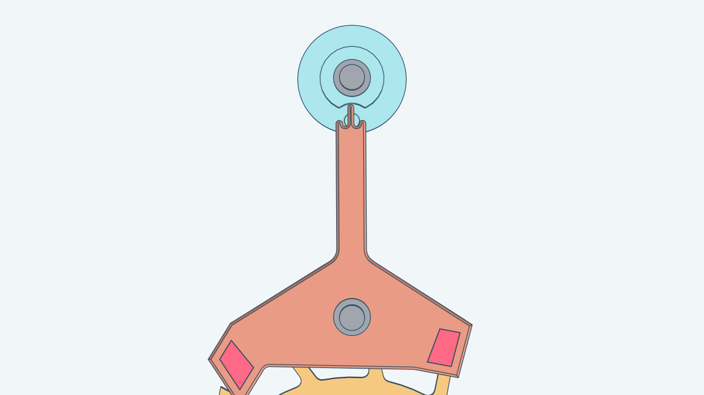

The safety action keeps a jolt from tripping the lever while the pin is away from the fork. The lever carries a thin dart
and the safety roller carries a crescent, a round notch in its edge. Away from the fork the dart's tip stands against the
roller's rim, so the lever cannot leave its banking post by more than 2.0°. When the pin returns, the crescent turns
into line with the dart and lets it through.

The balance turns 180° each way by default. The wheel advances one tooth, 24°, in each balance period. With the 156 g·cm²
balance and the 1.83 N·mm/rad printed hairspring the period is about 0.58 s, so the wheel turns once in about 8.7 s.
Checks in the model's tests measure one tooth per period and two drops of at least 1.70 mm per period on the real
wheel and stone outlines, and the pin in the fork touches a horn only while the balance is within 27.3° of rest on either side.

## Assembled

| From the front | From above and the right | From behind |
| --- | --- | --- |
| 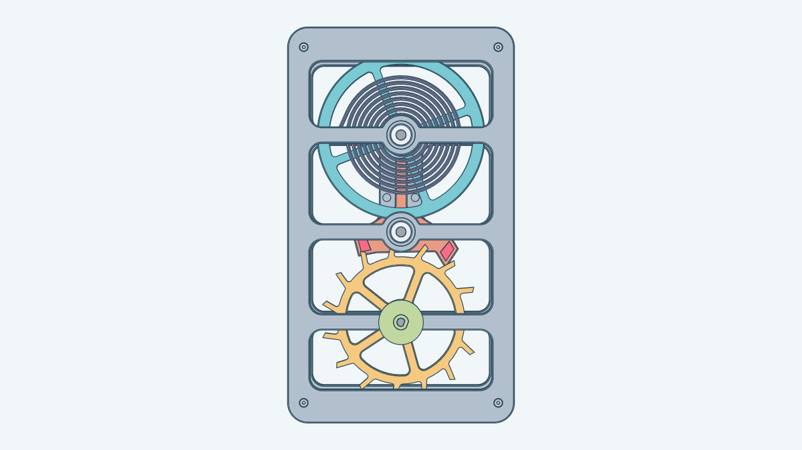 | 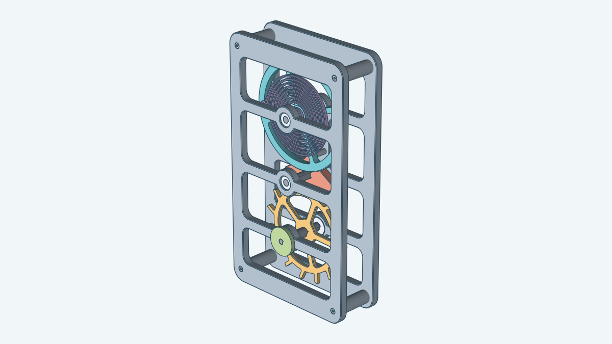 | 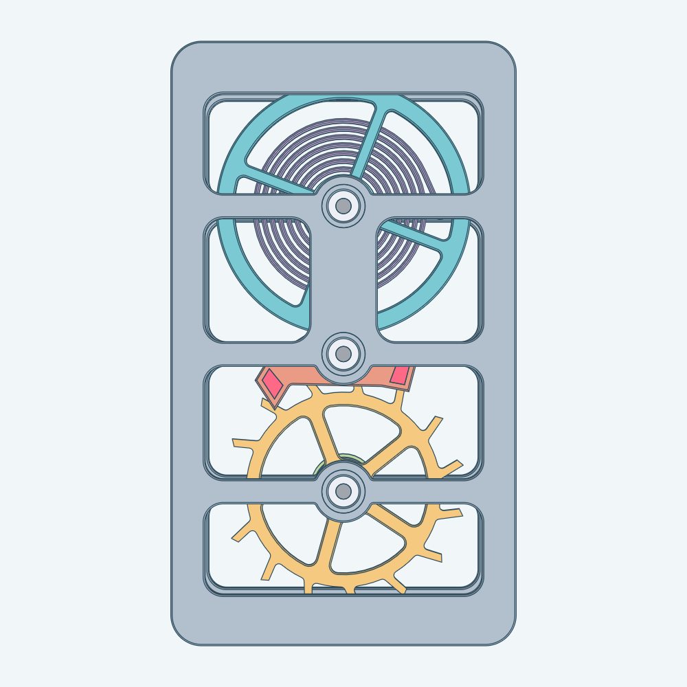 |

Both plates are open frames with horizontal bars at the three arbors and windows between them, so the escape wheel, the
lever and the balance show from the front and from behind. Four pillars on the back plate hold the front plate, and two
banking posts of the back plate stop the lever.

## Exploded

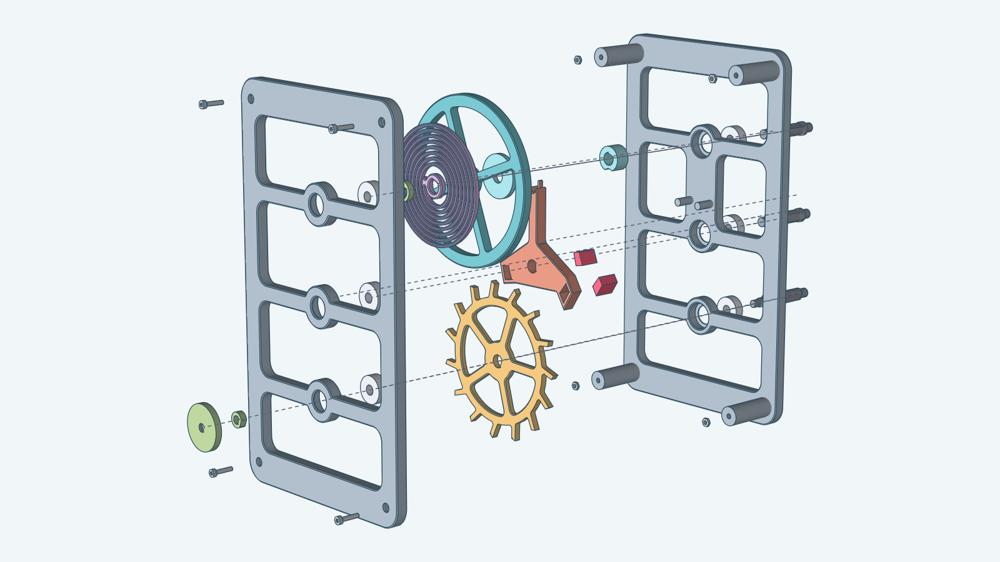

The picture pulls the parts apart along the movement's axis, so each arbor, the parts pressed on it and its bearings
stay in one line. The two stones lift out of the lever's front face, and the hairspring's eye leaves its stud on the
front plate.

## Parts

The movement has 30 bodies and 18 distinct kinds. The table shows one of each kind; the counts are in the text.

| Image | Name |
| --- | --- |
| 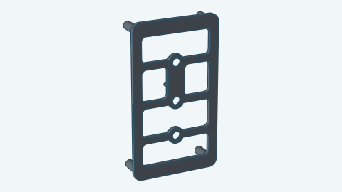 | Back plate, an open frame with four pillars, two banking posts, three bearing seats and the four nut cavities |
| 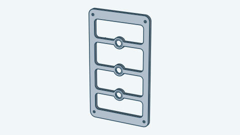 | Front plate, an open frame with three bearing seats, four head pockets and the hairspring stud |
| 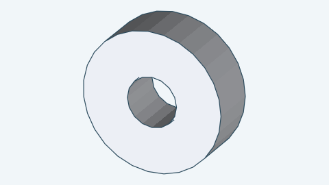 | Bearing (605ZZ), six in all: three in each plate |
| 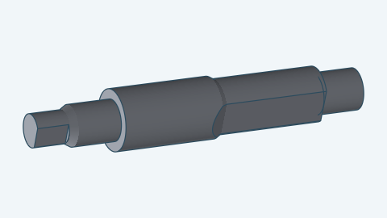 | Escape arbor, 42.25 mm long with its shoulder at the front, where the escape wheel stops; its front end is flat for the knob |
| 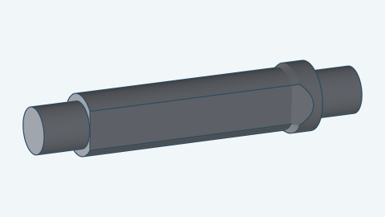 | Pallet arbor, 37 mm long with its shoulder at the rear. The balance staff is the same part, built twice: the pallet arbor carries the lever and the staff carries the balance stack |
| 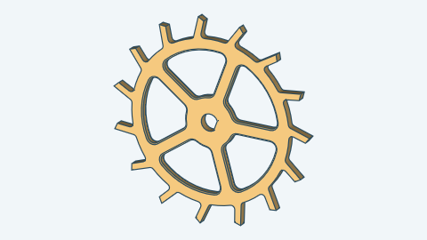 | Escape wheel, 15 club teeth, 80.3 mm across at the heels, pressed on the escape arbor |
| 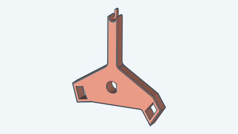 | Lever, with the fork and its two horns, the dart, two keyed slots for the stones and a D bore for the pallet arbor |
| 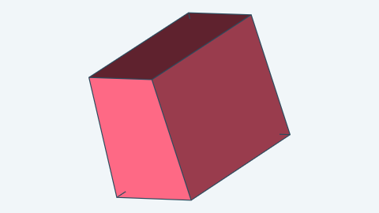 | Entry stone, the left pallet. Its trapezoid section has a 94° corner at the locking face and an area of 31.2 mm²; it enters only the lever's left slot. Print it in red if you can |
| 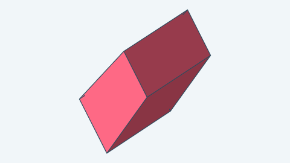 | Exit stone, the right pallet. Its section has a 109° corner at the locking face and an area of 31.8 mm²; it enters only the right slot. A stone turned over or end for end does not enter its slot |
| 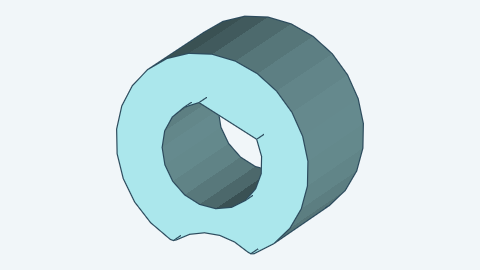 | Safety roller, a 12.9 mm cylinder with the crescent cut through its length, pressed on the balance staff |
| 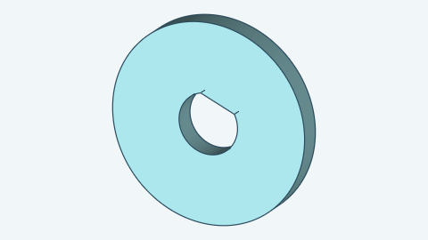 | Roller table, a 22 mm disc with the impulse pin, pressed on the balance staff in front of the safety roller |
| 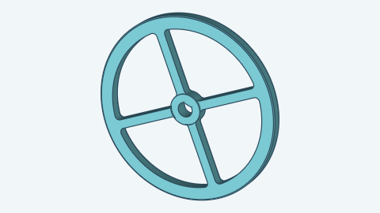 | Balance wheel, an 84 mm rim on four arms, with a hub boss that the hairspring's hub stands against |
| 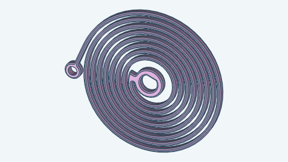 | Hairspring, a flat spiral of eight turns in PETG, with its hub on the balance staff's flat and its eye on the front plate's stud |
| 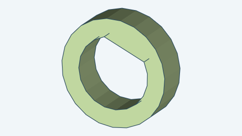 | Hairspring retainer, a 3 mm thick, 10 mm wide disc pressed on the staff in front of the hairspring's hub |
| 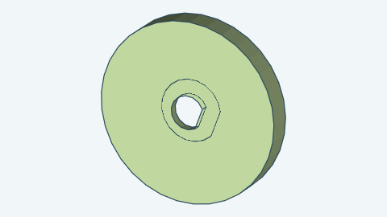 | Winding knob, a 22 mm disc with a keyed counterbore for the knob collar in its rear face |
| 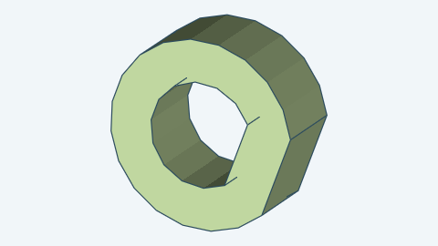 | Knob collar, a keyed ring pressed on the escape arbor's front end, inside the knob's counterbore |
| 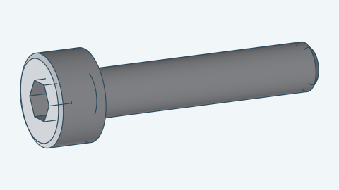 | M2 × 10 bolt, four in all, each sunk in a pocket of the front plate |
| 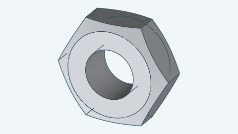 | M2 nut, four in all, each in a cavity of a pillar of the back plate |

The three arbors look alike and carry no marks, because a 1.5 mm mark hole with 1 mm of material on each side needs a
face wider than a 5 mm arbor offers. They differ in length and in where the shoulder is. The escape arbor is 42.25 mm long
with its shoulder at the front; the pallet arbor and the balance staff are 37 mm long with the shoulder at the rear, and
they are the same part. The two stones differ in section and each enters only its own slot, so a wrong one does not go in.

## How it is driven

The knob is pressed on the escape arbor's front end, so you turn the escape wheel directly. Turn the knob clockwise with a
fingertip. The action is designed for clockwise turning only. Each tooth that passes gives the lever an impulse, and the
lever gives the balance a push, so the balance swings while you turn. Estimated torque at the knob is 4 to 19 N·mm, far
less than a fingertip gives; the torque and the losses are estimates, not measurements.

The model has no mainspring, so it does not run by itself. A spring drive would add a click, a pawl carrier, a mainspring,
a retainer, an anchor pin and a gear pair, and is left for a later change.

The hairspring is what returns the balance to the fork. A lever escapement has no restoring force of its own: the lever
only unlocks and gives impulse, so a balance without a hairspring turns once and does not come back. The hub's flat sets
the beat, so at rest the impulse pin lies on the line from the balance staff to the pallet arbor.

## Printing and assembly

Print each part without supports in this orientation:

| Part | Material | Orientation |
| --- | --- | --- |
| Hairspring | PETG | flat, axis vertical |
| Entry stone, exit stone | PLA or PETG, red suggested | lying on the back face, length along the bed |
| Lever | PLA | rear face down |
| Escape wheel, balance wheel | PLA | rear face down |
| Roller table | PLA | front face down, pin up |
| Safety roller, retainer, knob collar | PLA | axis vertical |
| Winding knob | PLA | front face down |
| Arbors | PLA | each can print as two halves cut lengthwise through the middle of its flat, each half lying on its cut face |
| Back plate | PLA | rear face down, with a print pause for the nuts |
| Front plate | PLA | front face down |

Use PETG for the hairspring: its strain at 270° of balance swing is 0.37 %, about a tenth of PETG's yield strain. The model keeps each arbor whole; the clamped bearings and the pressed parts
hold the halves together, and glue is never needed.

**Pause the back plate at 31 mm above the bed.** The nuts sit in enclosed cavities in the four pillars. At the pause,
drop one M2 nut into each cavity and resume. The next layers close the cavities and hold the nuts.

Assemble in this order:

1. Press each stone into its slot in the lever, flush with the lever's rear face. The entry stone goes in the left slot
   and the exit stone in the right slot; each fits one way only.
2. Press the lever on the pallet arbor from the front end until it stops at the shoulder.
3. Slide the escape wheel on the escape arbor from the rear end until it stops at the shoulder.
4. Build the balance stack on the balance staff from the front end, in this order: the safety roller, the roller table with its
   impulse pin, the balance wheel and the hairspring, then press the retainer on until the hairspring's hub turns freely.
5. Press the three back bearings into the back plate, drop the nuts in during the print pause, and push the three arbors
   into the bearings from the front.
6. Place the front bearings on the arbors' front ends, hook the hairspring's eye on the stud and set the front plate on.
   Tighten the four M2 × 10 bolts from the front; each head ends flush with the plate's face.
7. Press the knob collar on the escape arbor's front end, flat to flat, then press the knob on, its keyed counterbore
   over the collar.

Lay the movement on its back plate's rear face with the knob on top, and turn the knob clockwise.

## Fits and edge finishing

- **Shafts in bearings.** Every arbor is 5.0 mm across at a bearing, the same as the 605ZZ's bore, so the fit has no
  clearance.
- **Press fits.** The escape wheel, lever, safety roller, roller table, balance wheel, retainer, knob collar and knob have
  a D-shaped bore with 0.05 mm of radial clearance on the arbor's flat. Every separate part pressed on a shaft keeps a
  wall of 1.6 mm or more round its bore. The stones have 0.05 mm all round in their slots. Each bearing sits in a pocket
  with 0.05 mm of radial clearance.
- **Tight fits, 0.25 mm.** Collars and the arbors' own steps stand 0.25 mm from a bearing face. The impulse pin has 0.25
  mm of shake against each corner round of the fork when the balance is at rest, and the dart has 0.27 mm in the crescent
  at the closest. The hairspring's hub has 0.25 mm on the staff.
- **Loose fits.** The escape wheel stands 0.55 mm in front of the lever plate, the pin tip stands 0.55 mm above the dart,
  and the lever's horns stay 1.9 mm from the safety roller. The wheel's heel circle clears the pallet arbor by 1.1 mm and
  the least gap from any tooth that is not working to a stone is 1.0 mm.
- **Edges.** The plates, the escape wheel's window loops, the lever's outline and the balance wheel's rim and windows
  have their large faces chamfered 0.5 mm. The teeth, the stones, the slots and every face under 400 mm² keep sharp edges.

You can vary:

- The balance amplitude, from 45° to 270°.
- The pose, as a fraction of one balance period.
- The position and orientation of the movement in space.

Everything else is fixed. For how to build the movement from Go, see the [developer notes](../../docs/models/swisslever.md).
